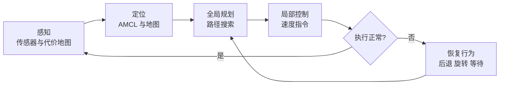
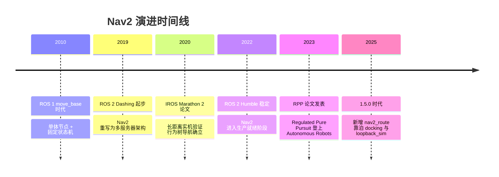
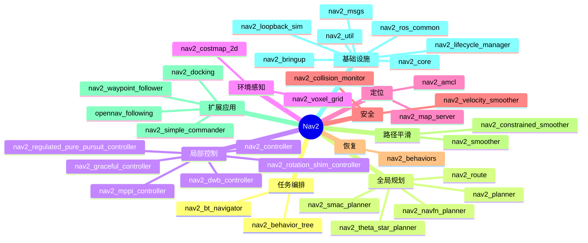
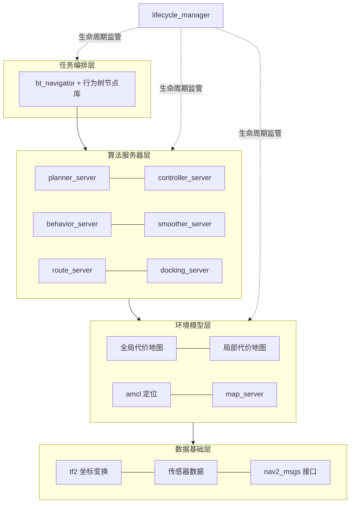

# 第 00 章 项目概览：从 move_base 到 Nav2 的导航栈全景

> **一句话总结**：Nav2 是 ROS 2 生态中生产就绪的移动机器人导航框架，它以行为树（BT）编排任务、以一组生命周期节点（Lifecycle Node）承载算法服务器（Server）、以插件（Plugin）机制开放全部算法边界，把"从 A 点安全走到 B 点"这一问题工程化为可组合、可替换、可监管的分布式系统。

> **前置知识**：无（全书起点） ｜ **知识依赖图**：[KnowledgeGraph/Knowledge](KnowledgeGraph/Knowledge.md)

## 0.1 项目定位：Nav2 解决什么问题

移动机器人自主导航的本质，是在部分未知、持续变化的环境中回答四个问题：**我在哪（定位）、周围有什么（感知）、怎么走（规划）、怎么执行（控制）**——并在任何一环失效时给出**恢复（Recovery）**手段。这五个环节构成一个必须实时闭合的环：

单独实现其中任何一环都不难，难的是把它们组装成一个**长期无人值守仍然可靠**的系统：传感器会抖动、定位会漂移、路径会被行人挡住、控制器会陷入局部极小值。Nav2 的价值不在于发明了某个算法，而在于提供了一套经过大规模验证的**系统级架构**——它规定了各环节的接口契约（nav2_core）、生命状态（lifecycle）、任务编排方式（行为树）与失败处理策略（behaviors），让开发者可以只替换自己关心的算法，而复用整个工程骨架。

## 0.2 历史背景：从 move_base 到 Nav2

Nav2 的前身是 ROS 1 时代的 navigation 栈，其核心 move_base 自 2010 年前后支撑了整整一代研究与产品。ROS 2 的到来给了社区一次重写的机会：

两代导航栈的差异不是修修补补，而是架构范式的更替：

| 维度 | ROS 1 move_base | ROS 2 Nav2 |
|---|---|---|
| 进程结构 | 单体节点，规划与控制耦合在一个进程 | 微服务化：planner / controller / behavior / smoother 等独立服务器 |
| 任务编排 | 硬编码状态机，恢复逻辑写死 | 行为树（BT），XML 即可重排导航逻辑 |
| 插件边界 | 仅 BaseGlobalPlanner / BaseLocalPlanner / RecoveryBehavior | nav2_core 定义十余种插件接口，覆盖规划、控制、检查器、平滑器、导航器等 |
| 状态管理 | 无生命周期概念，启动顺序靠运气 | Lifecycle Node + lifecycle_manager 统一 configure/activate 编排 |
| 通信模式 | Topic + 单一 Action | 每个服务器暴露独立 Action，支持抢占与并发任务 |
| 恢复机制 | 固定的 clear-rotate 序列 | 可插拔 Behavior 插件，由行为树按上下文调度 |
| 安全机制 | 无 | collision_monitor 独立安全层 + velocity_smoother 限幅 |

## 0.3 适用场景与非适用场景

Nav2 的问题域是**平面（含多楼层平面）移动机器人的自主导航**。SE(2) 状态空间是它全部算法假设的基础。

| 场景 | 适配度 | 说明 |
|---|---|---|
| AMR / 仓储物流车 | ✅ 极佳 | Route 图路由 + Docking 靠泊即为此类场景而生 |
| 服务 / 配送机器人 | ✅ 极佳 | 动态行人环境是 MPPI、collision_monitor 的主战场 |
| 清洁机器人 | ✅ 良好 | 结合全覆盖规划器（社区扩展）使用 |
| 巡检 / 安防机器人 | ✅ 良好 | waypoint_follower + 任务执行器插件直接支持 |
| 室外低速车辆 | ⚠️ 可行 | 需自备定位方案（GPS/融合），代价地图仍为 2D/2.5D |
| 无人机三维导航 | ❌ 不适用 | 状态空间与规划器均不支持三维自由飞行 |
| 机械臂运动规划 | ❌ 不适用 | 应使用 MoveIt 2 |
| 高动态竞速 | ❌ 不适用 | 控制频率与模型假设面向低中速平台 |

## 0.4 竞品对比与 Nav2 的优势

| 方案 | 开放性 | 算法水平 | 工程成熟度 | 主要短板 |
|---|---|---|---|---|
| ROS 1 move_base | 开源 | 停留在 2015 年前后 | 高但已停止演进 | ROS 1 生命周期终结，无 BT、无安全层 |
| 商业闭源导航栈 | 闭源 | 视厂商而定 | 高 | 黑盒不可定制，绑定硬件与授权费用 |
| 完全自研 | 自主可控 | 取决于团队 | 需数年打磨 | 重复造轮子，恢复/安全/编排细节极易踩坑 |
| **Nav2** | Apache-2.0 为主 | Hybrid-A*、MPPI、RPP 等前沿算法内置 | 生产就绪，实机马拉松验证 | 学习曲线较陡，需理解插件与 BT 体系 |

Nav2 的护城河可以概括为四点：**插件化**（一切算法皆可替换）、**生产就绪**（Marathon 2 长距离实机验证、持续 CI）、**学术前沿**（Smac Hybrid-A*、MPPI、RPP 论文级实现直接可用）、**社区与企业背书**（Open Navigation LLC 主导维护，NVIDIA 等企业赞助——opennav_docking 即由 NVIDIA 赞助开发，且同时支持 Humble/Jazzy/Kilted 多个 ROS 发行版）。

## 0.5 Nav2 全景鸟瞰

先用一张思维导图建立"包地图"，后续章节将逐分支展开：

从运行时视角看，这 40 多个包收敛为清晰的四层架构：

## 0.6 仓库事实卡片

| 条目 | 内容 |
|---|---|
| 当前版本 | 1.5.0（见 navigation2/package.xml） |
| 支持发行版 | Humble / Jazzy / Kilted（main 分支为滚动开发版） |
| 功能包数量 | 40+ 个 ament 包（含 nav2_dwb_controller、nav2_docking 下的子包） |
| 代码规模 | C++ 约 600 个 .cpp、440 个 .hpp；Python 约 120 个 .py |
| 许可证 | Apache-2.0 为主；nav2_amcl 含 LGPL、nav2_costmap_2d 含 BSD 成分 |
| 官方文档 | docs.nav2.org |
| 核心依赖 | rclcpp、pluginlib、BehaviorTree.CPP、tf2 |
| 维护主体 | Open Navigation LLC 与社区，企业赞助含 NVIDIA 等 |
| 插件接口 | nav2_core/include/nav2_core/ 下定义 GlobalPlanner、Controller、Behavior、Smoother、GoalChecker、ProgressChecker、PathHandler、BehaviorTreeNavigator、WaypointTaskExecutor 等 |

## 0.7 全书章节大纲

| 章节 | 主题 | 重要度 |
|---|---|---|
| 01_整体架构 | 服务器拓扑、数据流与控制流 | ★★★★★ |
| 02_目录设计 | 仓库组织与包命名约定 | ★★★ |
| 03_模块总览 | 40+ 包职责速查 | ★★★★ |
| 04_nav2_core插件接口 | 十余种插件契约逐一剖析 | ★★★★★ |
| 05_生命周期管理 | Lifecycle Node 与 lifecycle_manager | ★★★★★ |
| 06_Costmap2D | 分层代价地图与 Layer 插件 | ★★★★★ |
| 07_PlannerServer与全局规划 | 规划服务器与 NavFn/Theta* | ★★★★ |
| 08_SmacPlanner | Hybrid-A* 与 State Lattice | ★★★★★ |
| 09_ControllerServer与局部控制 | 控制服务器与检查器体系 | ★★★★★ |
| 10_MPPI与RPP控制器 | 采样优化与调节纯追踪 | ★★★★★ |
| 11_行为树与BTNavigator | BT 节点库与导航器插件 | ★★★★★ |
| 12_Behaviors恢复行为 | Spin/BackUp/Wait 等行为插件 | ★★★★ |
| 13_AMCL定位 | 粒子滤波实现 | ★★★★ |
| 14_MapServer | 地图加载保存与格式 | ★★★ |
| 15_Smoother路径平滑 | 简单平滑与约束优化平滑 | ★★★ |
| 16_CollisionMonitor与VelocitySmoother | 独立安全层设计 | ★★★★ |
| 17_Route路线规划 | 图路由与语义导航 | ★★★★ |
| 18_Docking靠泊 | opennav_docking 体系 | ★★★★ |
| 19_Action与通信机制 | Action/Service/Topic 使用范式 | ★★★★ |
| 20_线程模型 | 执行器、回调组与实时性 | ★★★★ |
| 21_配置系统 | 参数体系与动态更新 | ★★★ |
| 22_设计模式专题 | 插件工厂、模板方法等模式实战 | ★★★★ |
| 23_现代C++专题 | 智能指针、模板与并发实践 | ★★★ |
| 24_扩展开发指南 | 自定义规划器/控制器/BT 节点 | ★★★★★ |
| 25_学习路线图 | 源码阅读顺序与实践建议 | ★★★ |

## 0.8 知识总结

1. Nav2 把导航问题拆解为**感知→定位→规划→控制→恢复**的闭环，并以系统架构而非单一算法作为核心竞争力。
2. 相比 move_base 的单体节点 + 状态机，Nav2 采用**多服务器 + 行为树 + 生命周期管理**的微服务化范式。
3. **nav2_core 是全系统的接口宪法**：十余种纯虚基类定义了所有算法插件的契约，理解它是读懂其余模块的前提。
4. 1.5.0 时代的三个增量方向值得关注：**nav2_route** 图路由、**nav2_docking** 靠泊、**loopback_sim / opennav_following** 等新基建。
5. 全书阅读主线：先架构与接口（01~05），再核心算法（06~18），后机制专题与扩展（19~25）。

## 0.9 常见面试题

1. **Nav2 与 move_base 的架构差异？**
   要点：单体节点 vs 独立算法服务器；硬编码状态机 vs 行为树编排；3 种插件 vs 十余种插件接口；无生命周期 vs lifecycle 统一管理；新增独立安全层。
2. **为什么 Nav2 采用多服务器而非单体？**
   要点：故障隔离（规划崩溃不拖垮控制）；独立频率与线程模型；各服务器可单独替换/禁用；每个服务器暴露独立 Action 便于外部编排与复用。
3. **行为树相比状态机的优势？**
   要点：逻辑与代码解耦（XML 热更换）；组合性好，恢复策略可局部嵌套而非全局跳转；节点可复用；天然表达"回退 fallback"与"重试 retry"语义。
4. **Nav2 中插件机制靠什么实现？**
   要点：pluginlib 动态加载 + nav2_core 纯虚接口；各服务器持有插件容器，按参数中的插件名实例化；插件生命周期跟随宿主服务器的 lifecycle 状态。
5. **全局规划与局部控制的职责边界？**
   要点：planner_server 基于全局代价地图输出几何路径；controller_server 基于局部代价地图以高频输出速度指令并跟踪路径；两者通过 BT 衔接，路径失效时由 BT 触发重规划。
6. **collision_monitor 为什么要独立于控制器存在？**
   要点：安全功能必须与算法解耦，即使控制器/代价地图整体失效，仍有最后一道基于原始传感器数据的减速/停车防线。

## 0.10 最佳实践与容易踩坑

- **不要用 ROS 1 资料学 Nav2**：move_base 的教程、参数、恢复逻辑与 Nav2 几乎完全不通用，混用概念是初学者最大误区。
- **注意发行版差异**：Humble 与 Jazzy/Kilted 的 API 与参数存在差异，查阅 docs.nav2.org 时务必切换到对应版本页面。
- **main 分支比任何发行版都新**：本书基于 main（1.5.0），nav2_route、opennav_following 等包可能尚未随旧发行版二进制分发。
- **先跑通 nav2_bringup 再改代码**：以 loopback_sim 或仿真环境验证默认配置，再逐个替换插件，避免多变量同时调试。
- **参数不是配置全部**：行为树 XML 同样是"配置"，很多需求改 BT 即可实现，无需动 C++。

## 0.11 延伸阅读

- 官方文档：docs.nav2.org（概念、配置指南、迁移说明）
- Macenski 等，*The Marathon 2: A Navigation System*，IROS 2020——Nav2 架构的奠基论文
- Macenski 等，*Regulated Pure Pursuit for Robot Path Tracking*，Autonomous Robots 2023——默认控制器的算法出处
- BehaviorTree.CPP 官方文档——理解 BT 节点语义的必读材料
- 仓库内 doc/ 目录：architecture、design、requirements 子目录保存了早期设计文档与需求分析

## 0.C 阅读检查点

1. Nav2 与 move_base 在进程结构、任务编排、插件边界、状态管理上的核心差异分别是什么？（见 0.2 节）
2. Nav2 的问题域是什么状态空间？哪些场景适用、哪些不适用，判断依据是什么？（见 0.3 节）
3. Nav2 的四点"护城河"分别是什么？（见 0.4 节）
4. 从运行时视角看，40 多个包收敛为哪四层架构？lifecycle_manager 在其中处于什么位置？（见 0.5 节）
5. 全书的阅读主线分为哪三个阶段，各自覆盖哪些章节？（见 0.7 节与 0.8 节）

> 下一章：01_整体架构
