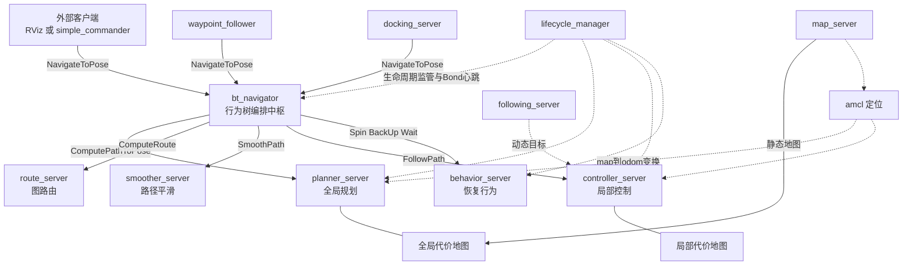
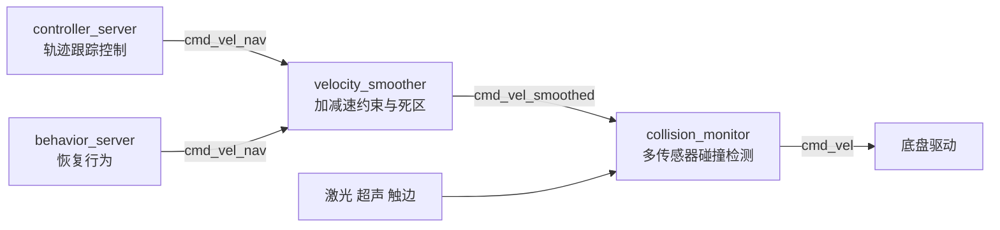
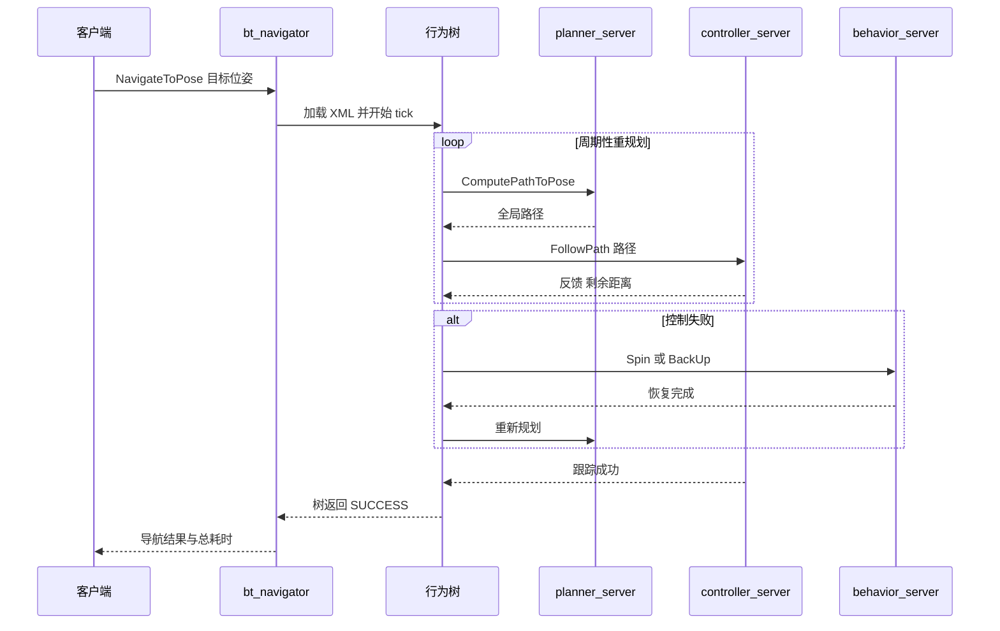
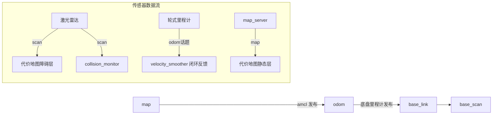

# 第 01 章 整体架构：多服务器协作的导航微服务系统

> **一句话总结**：Nav2 在运行时是一组由生命周期节点（Lifecycle Node）承载的独立算法服务器（Server），bt_navigator 以行为树（BT）为剧本、以 Action 为指挥棒编排它们协同工作，速度指令经过平滑与安全两道闸门后才抵达底盘，lifecycle_manager 则站在所有节点之上负责有序启停与存活监管。

## 1.1 为什么是多服务器架构

如果把导航系统写成一个大进程——规划、控制、恢复、平滑全部塞进同一个节点——它在演示场景里可以工作得很好，但在生产环境中会暴露三个致命问题，这也正是 ROS 1 move_base 留给社区的教训：

1. **故障不隔离**。规划器里一次内存越界会把控制循环一起带走，机器人在行进中直接"失联"。而在 Nav2 中，planner_server 崩溃时 controller_server 仍在独立进程或独立组件中运行，行为树可以感知失败并触发恢复策略，lifecycle_manager 也能通过 Bond 心跳发现掉线节点。
2. **频率不独立**。全局规划以秒级或按需触发即可，局部控制却要求 20Hz 以上的稳定节拍，恢复行为又是低频事件驱动。单体架构下这些异质节奏挤在同一个执行器里互相干扰；拆成服务器后，每个进程可以拥有自己的频率、线程与实时性配置（线程模型详见第 20 章）。
3. **算法不可替换**。设计者的意图是让"服务器"只负责工程骨架——Action 接口、代价地图（Costmap）访问、异常上报——而算法以插件（Plugin）形式注入。规划服务器与规划算法分离后，替换 NavFn 为 Hybrid-A* 只是改一行参数，不需要触碰任何服务器代码（插件契约详见第 04 章）。

换句话说，Nav2 把"导航"这个单一职责拆解成了一组**边界清晰、接口标准、可独立替换**的微服务，代价是引入了编排问题——谁来决定何时规划、何时控制、失败后怎么办？答案就是行为树导航器。

## 1.2 运行时全景

下图是默认配置下一台机器人上的完整运行时拓扑。bt_navigator 是唯一的"指挥"，它不实现任何导航算法，只通过 Action 客户端调用各服务器；amcl 与 map_server 提供定位和地图这两个全局前提；lifecycle_manager 不参与数据流，只负责监管所有生命周期节点：

几个值得注意的结构性事实：

- **代价地图不是独立节点**，全局/局部代价地图分别内嵌在 planner_server 与 controller_server 进程内，作为其成员对象存在（详见第 06 章）。
- **waypoint_follower 与 docking_server 既是服务器也是客户端**：它们对外提供 FollowWaypoints、DockRobot 等 Action，对内又把单段导航委托给 bt_navigator 的 NavigateToPose——这是 Nav2 中"服务器分层复用"的典型样例。
- **编排中枢可被绕过**：任何外部程序都可以直接调用 planner_server 的 ComputePathToPose 拿一条路径而不发起导航，这正是每个服务器暴露独立 Action 的价值。

## 1.3 默认启动节点清单

按 nav2_bringup/launch/navigation_launch.py 中 lifecycle_nodes 列表的真实顺序（该顺序即 lifecycle_manager 的 configure/activate 顺序），默认导航栈包含 11 个生命周期节点；定位侧另有 2 个节点由 localization_launch.py 拉起：

| 节点名 | 所属包 | 对外接口 | 职责一句话 |
|---|---|---|---|
| controller_server | nav2_controller | Action: follow_path；发布 cmd_vel_nav | 高频轨迹跟踪，输出速度指令 |
| smoother_server | nav2_smoother | Action: smooth_path | 对全局路径做平滑后处理 |
| planner_server | nav2_planner | Action: compute_path_to_pose / through_poses | 基于全局代价地图搜索路径 |
| route_server | nav2_route | Action: compute_route / compute_and_track_route | 基于预定义图（GeoJSON）做稀疏路由 |
| behavior_server | nav2_behaviors | Action: spin / backup / drive_on_heading / wait | 恢复行为执行器 |
| velocity_smoother | nav2_velocity_smoother | 订阅 cmd_vel_nav，发布 cmd_vel_smoothed | 加减速与死区约束 |
| collision_monitor | nav2_collision_monitor | 订阅 cmd_vel_smoothed，发布 cmd_vel | 基于原始传感器的最后安全闸门 |
| bt_navigator | nav2_bt_navigator | Action: navigate_to_pose / navigate_through_poses | 行为树编排中枢 |
| waypoint_follower | nav2_waypoint_follower | Action: follow_waypoints | 多航点顺序巡航 |
| docking_server | opennav_docking | Action: dock_robot / undock_robot | 自主靠泊与脱离 |
| following_server | opennav_following | Action: follow_object | 动态目标跟随 |
| amcl | nav2_amcl | 发布 map→odom TF 与 amcl_pose | 粒子滤波定位 |
| map_server | nav2_map_server | Topic: map；Srv: load_map | 静态地图加载与发布 |

清单顺序本身就是一种依赖表达：控制、规划等"被调用方"排在前面先激活，bt_navigator 这类"调用方"排在后面，保证编排者上线时被编排者已就绪。

## 1.4 速度指令链路：三级流水线

Nav2 刻意不让控制器直接驱动底盘，而是让 cmd_vel 穿过一条三级流水线。话题接线由 launch 中的 remapping 与 collision_monitor 的参数共同完成——controller_server 与 behavior_server 的输出话题都被重映射为 cmd_vel_nav：

这条链的设计动机层层递进：控制器输出的是"算法认为最优"的速度；velocity_smoother 把它约束到"电机与乘坐体验可接受"的速度；collision_monitor 则完全不信任上游——它直接消费原始传感器数据，在速度即将导致碰撞时降速或清零。即使控制器与代价地图整体失效，最后一道闸门依然有效（该独立安全层的完整剖析见第 16 章）。

## 1.5 一次 NavigateToPose 的端到端旅程

以默认行为树 navigate_to_pose_w_replanning_and_recovery.xml 为剧本，一次导航请求的典型时序如下：

理解这张图的关键在于：**行为树不是流程图而是调度器**。ComputePathToPose 与 FollowPath 在树中并行存活——规划分支按节流频率周期性刷新路径，控制分支持续消费最新路径；一旦控制分支报错，回退（Fallback）语义自动切入恢复子树，恢复成功后整棵树回到主干重试。这套机制的节点库与导航器插件在第 11 章展开。

完整业务链路见 [NavigateToPose 端到端时序图](Assets/sequence/NavigateToPose.md)。

## 1.6 TF 树与传感器数据流

所有服务器共享同一套坐标系契约：map 是全局规划参考系，odom 是连续但漂移的局部参考系，base_link 代表机器人本体。amcl 只发布 map→odom 这一段"修正量"，而非直接定位 base_link——这保证了即使定位跳变，odom→base_link 的连续性也不受影响，控制器不会突然抽搐：

数据流小结：激光同时供给代价地图（供规划与控制做碰撞代价评估）和 collision_monitor（供安全层做几何判断）；里程计既构成 TF 链条又作为速度反馈；静态地图既供 amcl 匹配也供全局代价地图打底。

## 1.7 启动体系：分层 include 与两种部署形态

nav2_bringup 的 launch 采用分层 include 架构：顶层 bringup_launch.py 只做条件编排——按参数决定引入 localization_launch.py（AMCL 模式）还是 slam_launch.py（建图模式），可选叠加禁行区/限速区 launch，最后必然引入 navigation_launch.py 拉起 1.3 节的全部服务器。参数由单一的 nav2_params.yaml 提供，经 RewrittenYaml 完成命名空间注入与占位符替换。

同一份 launch 支持两种部署形态，由 use_composition 参数切换：

| 维度 | Composition 容器模式 | 独立进程模式 |
|---|---|---|
| 进程结构 | 所有服务器作为组件加载进单一容器进程 | 每个服务器一个操作系统进程 |
| 通信开销 | 进程内通信，可零拷贝，延迟最低 | 经 DDS 序列化，跨进程 |
| 内存占用 | 共享库只加载一份，占用小 | 每进程独立加载，占用大 |
| 故障隔离 | 一个组件段错误会拖垮整个容器 | 单进程崩溃不影响其余节点 |
| 崩溃恢复 | 依赖 Bond 心跳检测后人工/上层处置 | 可配 use_respawn 自动重启进程 |
| 调试体验 | 需在容器内定位组件，较繁琐 | 可单独 gdb/重启某个服务器，友好 |
| 适用场景 | 资源受限的量产机型，默认推荐 | 开发调试、需要进程级隔离的场合 |

值得玩味的是这里的权衡：composition 模式用"故障隔离"换来了"性能与资源"，看似违背 1.1 节的初衷，实则不然——**逻辑架构上的服务器边界（接口、生命周期、可替换性）与物理部署形态（同进程或跨进程）是两个正交维度**，Nav2 把选择权交给了部署者。

启停顺序上，lifecycle_manager 沿节点清单顺序执行 Configure 再 Activate，关停时逆序执行 Deactivate、Cleanup、Shutdown，并以 Bond 心跳持续监控存活。此处只需建立"有序启停、集中监管"的直觉，状态机细节与 Bond 机制的完整剖析见第 05 章。

## 1.8 源码实现要点与设计模式

从实现角度回看这套架构，有四个反复出现的模式值得读者在后续源码章节中留意：

- **模板方法**：所有服务器继承 nav2::LifecycleNode，在 on_configure/on_activate 等钩子中完成各自的资源装配，骨架流程由基类与 lifecycle_manager 固定。
- **策略 + 工厂**：服务器持有 pluginlib::ClassLoader，按参数中的插件名动态实例化算法插件，实现"服务器即容器、算法即策略"。
- **中介者**：lifecycle_manager 集中协调各节点状态转移，节点之间互不感知彼此的生命周期。
- **门面**：bt_navigator 把十余个 Action 服务器的复杂协作收敛为一个 NavigateToPose 接口，外部世界只需要与门面对话。

扩展这套架构的正确姿势也由此清晰：新增算法写插件（第 04、24 章），改变编排逻辑改行为树 XML（第 11 章），新增能力则仿照 docking_server 的样例——实现一个新的生命周期服务器并注册进 lifecycle_manager 清单，通信范式遵循第 19 章的 Action 约定。

## 1.9 知识总结

1. Nav2 运行时 = **11 个导航生命周期节点 + 2 个定位节点 + lifecycle_manager**，节点清单顺序即启动激活顺序。
2. bt_navigator 是唯一编排中枢，**只发 Action 不算算法**；每个服务器的 Action 也可被外部独立调用。
3. 速度指令必经 **controller → velocity_smoother → collision_monitor** 三级流水线，安全层直接消费原始传感器数据，与算法层解耦。
4. TF 契约为 **map→odom→base_link**，amcl 只发布修正段 map→odom，保障控制连续性。
5. 逻辑架构与物理部署正交：composition 容器模式换性能，独立进程模式换隔离与调试便利，一套 launch 双形态。

## 1.10 常见面试题

1. **Nav2 默认启动哪些节点？bt_navigator 与它们是什么关系？**
   要点：11 个导航生命周期节点（controller/smoother/planner/route/behavior/velocity_smoother/collision_monitor/bt_navigator/waypoint_follower/docking/following）加 amcl、map_server；bt_navigator 通过 Action 客户端编排各服务器，自身不含导航算法。
2. **cmd_vel 从控制器到底盘经过哪些环节？为什么这样设计？**
   要点：cmd_vel_nav → velocity_smoother → cmd_vel_smoothed → collision_monitor → cmd_vel；平滑层保护执行机构，安全层基于原始传感器兜底，安全功能与算法失效域分离。
3. **为什么 amcl 发布 map→odom 而不是 map→base_link？**
   要点：TF 树单亲约束下 odom→base_link 由里程计维护，连续无跳变；定位修正只作用于 map→odom 段，定位跳变不会直接体现在控制回路中。
4. **composition 模式与独立进程模式怎么选？**
   要点：容器模式进程内通信、省内存，适合量产部署；独立进程可 respawn、易调试、故障隔离好，适合开发期；两者共用同一套节点与参数，仅部署形态不同。
5. **全局代价地图和局部代价地图分别属于谁？**
   要点：分别内嵌于 planner_server 与 controller_server 进程内，不是独立节点；随宿主服务器的生命周期状态一起 configure/activate。

## 1.11 最佳实践与容易踩坑

- **调试期用独立进程，部署期再切 composition**：容器模式下单组件崩溃会带走全部导航能力，开发阶段的收益远小于调试成本。
- **不要让底盘直接订阅 cmd_vel_nav 或 cmd_vel_smoothed**：绕过安全层等于拆掉最后一道防线；底盘只应消费 collision_monitor 输出的 cmd_vel。
- **新增自定义服务器务必注册进 lifecycle_manager 的 node_names**，否则它不会被 configure/activate，Action 永远不上线，且注意注册位置要先于其调用方。
- **观察 TF 树是排障第一步**：多数"机器人不动/原地打转"问题源自 map→odom 或 odom→base_link 缺失、时间戳超差，而非算法本身。
- **use_sim_time 必须全栈一致**：仿真下漏设任一节点都会导致 TF 查询失败，症状极具迷惑性。

## 1.12 延伸阅读

- nav2_bringup/launch/bringup_launch.py 与 navigation_launch.py：分层 include 与双形态部署的第一手样本
- nav2_bt_navigator/behavior_trees/navigate_to_pose_w_replanning_and_recovery.xml：默认导航剧本原文
- Macenski 等，*The Marathon 2: A Navigation System*，IROS 2020：多服务器 + 行为树架构的论证原文
- docs.nav2.org 的 Concepts 与 First-Time Robot Setup Guide：官方视角的架构导览
- 本书第 05 章（生命周期）、第 11 章（行为树）、第 16 章（安全层）、第 19 章（通信机制）、第 20 章（线程模型）

## 1.C 阅读检查点

1. 单体导航节点在生产环境中的三个致命问题是什么？Nav2 分别用什么机制回应？（见 1.1 节）
2. 默认启动的 11 个导航生命周期节点清单顺序为什么本身就是一种依赖表达？（见 1.3 节）
3. cmd_vel 三级流水线的完整话题链路是什么？每一级的设计动机分别是什么？（见 1.4 节）
4. 为什么说"行为树不是流程图而是调度器"？规划分支与控制分支如何并行存活？（见 1.5 节）
5. composition 容器模式看似违背故障隔离初衷，为什么说逻辑架构与物理部署是两个正交维度？（见 1.7 节）

> 下一章：02_目录设计
