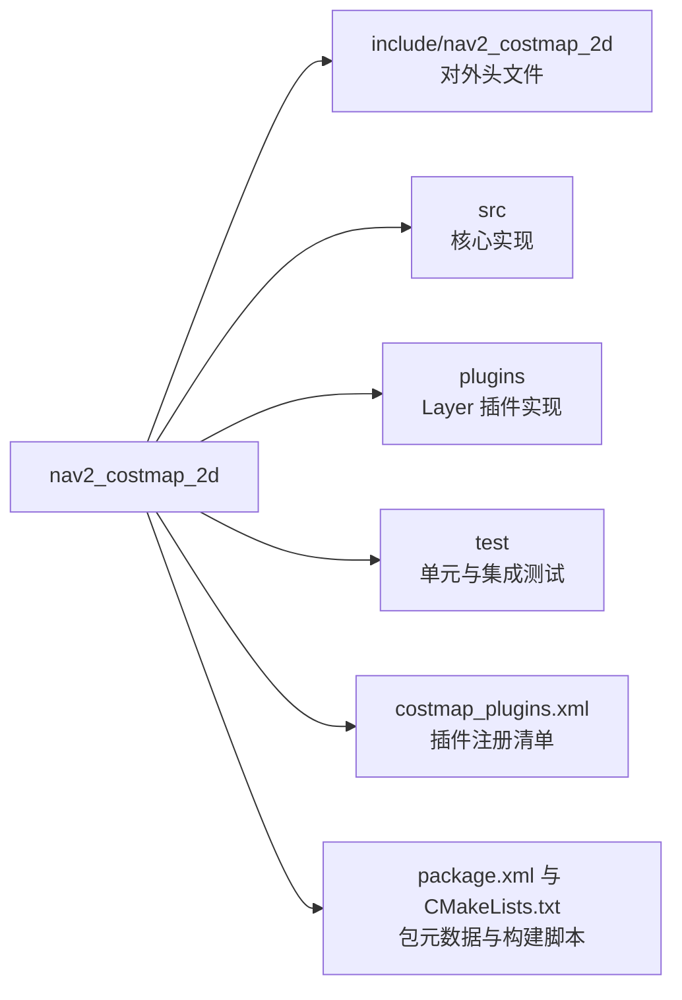
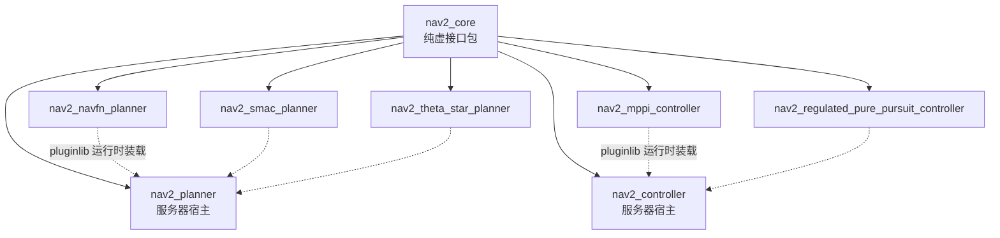
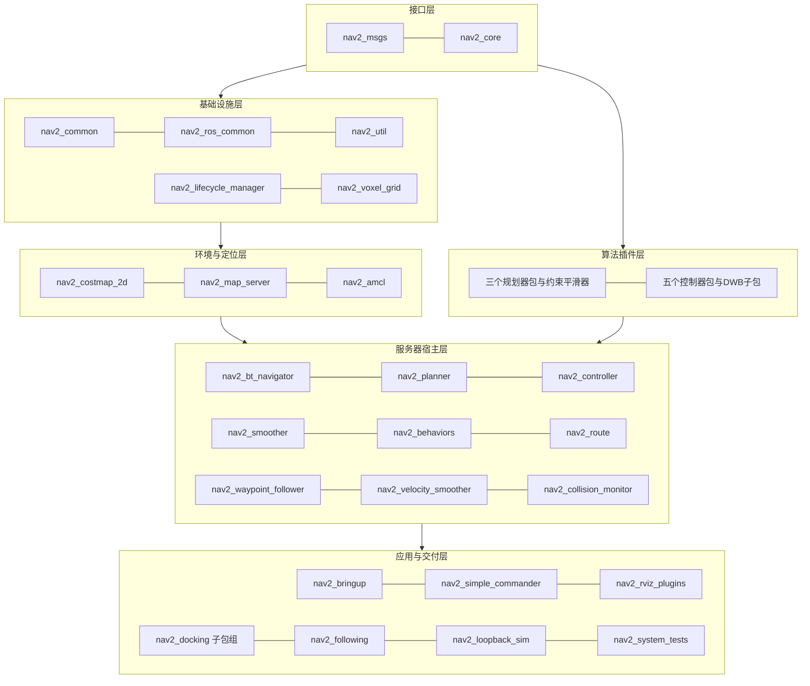

# 第 02 章 目录设计：一个仓库如何承载四十多个功能包

> **一句话总结**：navigation2 仓库以"一个 Git 仓库、四十多个 ament 功能包"的 monorepo 形态组织，目录设计的核心思想是三条分离原则——接口与实现分离（nav2_core 对各算法包）、服务器与算法分离（宿主包对插件包）、消息与代码分离（nav2_msgs 独立成包），使每个包都能被单独编译、测试与替换。

> **前置知识**：第 00 章 · 第 01 章 ｜ **知识依赖图**：[KnowledgeGraph/Knowledge](KnowledgeGraph/Knowledge.md)

## 2.1 为什么值得读懂目录

目录结构是架构意图最诚实的表达。Nav2 的维护者面对一个现实约束：这套系统要同时服务于"只想跑起来的使用者""只想换某个算法的开发者"和"要维护全栈的集成商"。目录设计因此必须回答三个问题——依赖如何单向流动、边界在哪个粒度上划分、新贡献者应该把代码放进哪里。读懂目录，等于拿到了阅读全部源码的索引和贡献代码的路标。

## 2.2 仓库顶层清单

顶层目录可以分为四类：功能包、聚合与启动、文档、工程设施。

| 目录 | 类别 | 性质与职责 |
|---|---|---|
| nav2_*/（三十余个） | 功能包 | Nav2 自研功能包，每个都是独立 ament 包 |
| nav2_docking/、nav2_following/ | 功能包容器 | 目录下嵌套 opennav_ 前缀的多个子包 |
| nav2_dwb_controller/ | 功能包容器 | 目录下嵌套 dwb_*、nav_2d_* 共 7 个子包 |
| navigation2/ | 聚合 | 元包（metapackage），只声明依赖不含代码，用于一键安装整栈 |
| nav2_bringup/ | 启动 | launch、params、maps、rviz 配置的集散地，不含算法 |
| doc/ | 文档 | 上游设计文档：architecture、design、requirements、use_cases |
| tools/ | 工程设施 | 构建与 CI 辅助脚本、underlay.repos 依赖清单、基准测试 |
| .circleci/、.github/ | 工程设施 | CI 流水线、Issue/PR 模板、mergify 与 dependabot 配置 |
| .devcontainer/、.vscode/ | 工程设施 | 容器化开发环境与编辑器任务配置 |
| Dockerfile、codecov.yml 等散件 | 工程设施 | 镜像构建、覆盖率、pre-commit、semgrep 静态检查配置 |

两个容易被误读的地方：其一，navigation2/ 子目录不是"主代码"而是空的元包，真正的代码全部在各 nav2_* 包里；其二，doc/ 存放的是面向上游开发的历史设计文档，用户文档在外部站点 docs.nav2.org 维护，仓库内不放教程。

## 2.3 单个功能包的内部约定

所有 C++ 功能包遵循同一套内部布局，以最典型的 nav2_costmap_2d 为例：

| 目录/文件 | 约定 |
|---|---|
| include/包名/ | 公共头文件，二级目录与包同名以保证 `#include "nav2_costmap_2d/xxx.hpp"` 全局唯一 |
| src/ | 实现文件与可执行入口（main），头文件中只留接口 |
| plugins/ | 本包提供的插件实现（如障碍层、膨胀层），与核心骨架代码物理隔离 |
| test/ | 单测与集成测试，CMake 中由 BUILD_TESTING 开关控制 |
| launch/、params/ | 仅在需要独立启动的包中出现（如 collision_monitor、map_server） |
| *_plugins.xml / plugins.xml | pluginlib 注册清单，声明"插件名 → 动态库 → 基类"映射 |
| package.xml、CMakeLists.txt、README.md、CHANGELOG.rst | ament 包四件套 |

更轻量的包如 nav2_planner 只保留 include/src/test 三件：它是纯粹的服务器宿主，一个 PlannerServer 类加参数处理，算法全部来自外部插件包——包的"瘦"恰恰是职责单一的证明。

## 2.4 包命名规律：前缀与后缀的语义

Nav2 的包名自带类型信息，掌握命名规律即可对陌生包"望文生义"：

| 命名形态 | 语义 | 例子 |
|---|---|---|
| nav2_ 前缀 | Nav2 原生功能包 | nav2_planner、nav2_amcl |
| opennav_ 前缀 | 源自 Open Navigation 生态、后并入仓库的扩展包 | opennav_docking、opennav_following |
| dwb_ / nav_2d_ 前缀 | 从 ROS 1 robot_navigation 项目迁移的 DWB 体系遗产 | dwb_core、nav_2d_utils |
| *_msgs 后缀 | 纯接口包，只含 msg/srv/action 定义 | nav2_msgs、dwb_msgs |
| *_core 后缀 | 纯头文件接口包，定义插件基类契约 | nav2_core、opennav_docking_core |
| *_util / *_common | 工具与构建设施 | nav2_util、nav2_ros_common、nav2_common |
| 算法名结尾 | 某类插件的具体算法实现 | nav2_smac_planner、nav2_mppi_controller |
| _server 概念包 | 以生命周期服务器为主体的宿主包 | nav2_planner、nav2_controller、nav2_smoother |

三个基础设施包的分工经常被混淆，值得单独澄清：**nav2_common** 只提供 CMake 宏与构建辅助（几乎没有运行时代码）；**nav2_ros_common** 提供对 rclcpp 的封装层——nav2::LifecycleNode、SimpleActionServer、ServiceServer 等通信基座；**nav2_util** 提供导航领域工具——TF 助手、OdomSmoother、几何计算等。依赖方向是 util 依赖 ros_common，而两者都不依赖任何算法包。

## 2.5 目录设计的三条分离原则

### 接口与实现分离

nav2_core 是全栈的"接口宪法"：它只有头文件，定义 GlobalPlanner、Controller、Behavior、Smoother 等十余个纯虚基类（逐一剖析见第 04 章）。所有算法包实现这些接口，所有服务器包只依赖接口。由此形成经典的依赖倒置——nav2_planner 不认识 nav2_smac_planner，两者只在运行时经 pluginlib 相遇：

### 服务器与算法分离

每类能力都拆成"一个宿主包 + N 个算法包"：nav2_planner 配三个规划器包，nav2_controller 配五个控制器包，nav2_smoother 配 nav2_constrained_smoother。宿主包负责 Action 接口、代价地图、异常与生命周期这些**不随算法变化的工程逻辑**；算法包只做数学。删除任何一个算法包，整栈依然可以编译运行——这是衡量边界是否干净的试金石。

### 消息独立成包

nav2_msgs 只含接口定义（20 个 Action、22 个 Msg、19 个 Srv），不依赖任何 Nav2 代码包。原因有三：接口包编译最快且最稳定，把它放在依赖链最底部可最大化 colcon 并行构建效率；外部系统（调度平台、监控界面）只需依赖 nav2_msgs 即可与导航栈通信，无需引入 C++ 实现；接口变更可以被单独 review，成为跨团队协作的契约文件。dwb_msgs、nav_2d_msgs 在各自子生态中遵循同样逻辑。

## 2.6 包分组全景

以目录视角把仓库收敛成一张分组图（各包职责速查表见第 03 章）：

nav2_docking 与 nav2_dwb_controller 采用"目录容器 + 子包"的嵌套形态，是历史与粒度的双重产物：docking 体系整体从 Open Navigation 独立仓库并入，保留其 core/实现/BT 节点三包结构；DWB 体系从 ROS 1 迁移时本就是多包设计，核心/评价函数/插件/消息各自独立，便于用户只替换 critic 而不动框架。

## 2.7 tools/ 与 doc/ 概览

tools/ 服务于"把这个仓库构建出来并测起来"：underlay.repos 声明需要从源码联编的上游依赖，构建与 CI 脚本供 CircleCI 与本地复现使用，另有基准测试与代码质量工具的入口。doc/ 则是设计记忆的存档——architecture/ 保存整体架构说明，design/ 保存若干子系统的早期设计文稿，requirements/ 与 use_cases/ 记录立项期的需求分析。阅读源码遇到"为什么这样设计"的困惑时，doc/ 里常有第一手答案；但注意其中部分文稿写于架构定型之前，与现状存在出入，应以代码为准。

## 2.8 知识总结

1. navigation2 是 **monorepo**：一个 Git 仓库承载 40+ 独立 ament 包，安装级别的聚合由空元包 navigation2/ 完成。
2. 包名即类型：**nav2_ 原生、opennav_ 生态并入、_msgs 接口、_core 契约、_util/_common 基建**，命名规律可直接用于定位代码。
3. 三条分离原则贯穿全仓：**接口与实现分离、服务器与算法分离、消息独立成包**，共同保障"改一个包不碰其他包"。
4. 每个 C++ 包遵循 **include/src/plugins/test + 插件注册 xml** 的统一布局，包的"瘦胖"直接反映职责大小。
5. nav2_common、nav2_ros_common、nav2_util 分别负责**构建设施、rclcpp 封装、领域工具**，是三个不同层面的"公共代码"。

## 2.9 常见面试题

1. **nav2_core 里为什么只有头文件？这样设计的好处是什么？**
   要点：它是纯接口包，定义插件基类契约；服务器与算法都只依赖它，形成依赖倒置；接口包无实现即无 ABI 负担，变更审查集中，编译依赖最小。
2. **nav2_msgs 为什么不并进 nav2_util 或各服务器包？**
   要点：接口独立可让外部系统零成本对接（只依赖消息包）；处于依赖链最底部利于并行构建；接口演进与实现演进解耦，便于版本管理。
3. **nav2_common、nav2_ros_common、nav2_util 有什么区别？**
   要点：common 是 CMake 构建辅助；ros_common 封装 rclcpp（LifecycleNode、SimpleActionServer 等通信基座）；util 是导航领域工具库；依赖方向 util → ros_common，均不依赖算法包。
4. **如果要贡献一个新的全局规划算法，代码应该放在哪里？**
   要点：新建独立包（如 nav2_xxx_planner），实现 nav2_core::GlobalPlanner 接口，提供 pluginlib 注册 xml；不修改 nav2_planner 服务器包；参数中引用插件名即可启用。
5. **opennav_ 前缀和 nav2_ 前缀的包有什么关系？**
   要点：opennav_ 包源自 Open Navigation 生态（如 docking、following），后并入主仓库，保留原命名与内部分包结构；它们同样遵循 core/实现分离与生命周期节点规范。

## 2.10 最佳实践与容易踩坑

- **选择性构建提速**：日常开发用 `colcon build --packages-up-to 目标包` 只编译依赖闭包，全仓库联编在笔记本上以小时计。
- **别把算法代码提交进服务器宿主包**：这是新贡献者最常见的 PR 打回原因；宿主包只接受工程骨架改动，算法一律走插件包。
- **头文件放进 include/包名/ 二级目录**：直接放 include/ 下会在多包联编时造成头文件命名冲突，且违反 ament 导出约定。
- **插件注册 xml 与 package.xml 的 export 段必须同步**：漏写 export 会导致 pluginlib 在运行时找不到插件，报错信息常与真实原因相距甚远。
- **doc/ 的设计文档仅供考古**：以其中与现状不符的描述为准做二次开发，是踩坑的高发路径；行为以 main 分支代码与 docs.nav2.org 为准。

## 2.11 延伸阅读

- navigation2/package.xml：元包依赖清单，即"官方认定的完整栈"定义
- tools/underlay.repos：了解 Nav2 对上游仓库的源码级依赖
- REP-144（ROS 包命名规范）与 ament 官方文档：理解包布局约定的上游出处
- nav2_costmap_2d/costmap_plugins.xml 与 nav2_controller/plugins.xml：插件注册清单的标准写法样本
- 本书第 03 章（各包职责速查）、第 04 章（nav2_core 接口详解）

## 2.C 阅读检查点

1. 顶层目录中 navigation2/ 子目录和 doc/ 目录分别容易被误读成什么？实际职责是什么？（见 2.2 节）
2. 一个典型 C++ 功能包的 include/src/plugins/test 布局约定各自承担什么角色？为什么头文件要放在 include/包名/ 二级目录下？（见 2.3 节与 2.10 节）
3. nav2_、opennav_、dwb_、*_msgs、*_core 等命名形态各自传递什么语义？（见 2.4 节）
4. nav2_common、nav2_ros_common、nav2_util 三个"公共包"的分工与依赖方向是什么？（见 2.4 节）
5. 三条分离原则（接口与实现、服务器与算法、消息独立）各自解决什么问题？判断边界干净的"试金石"是什么？（见 2.5 节）

> 下一章：03_模块总览
