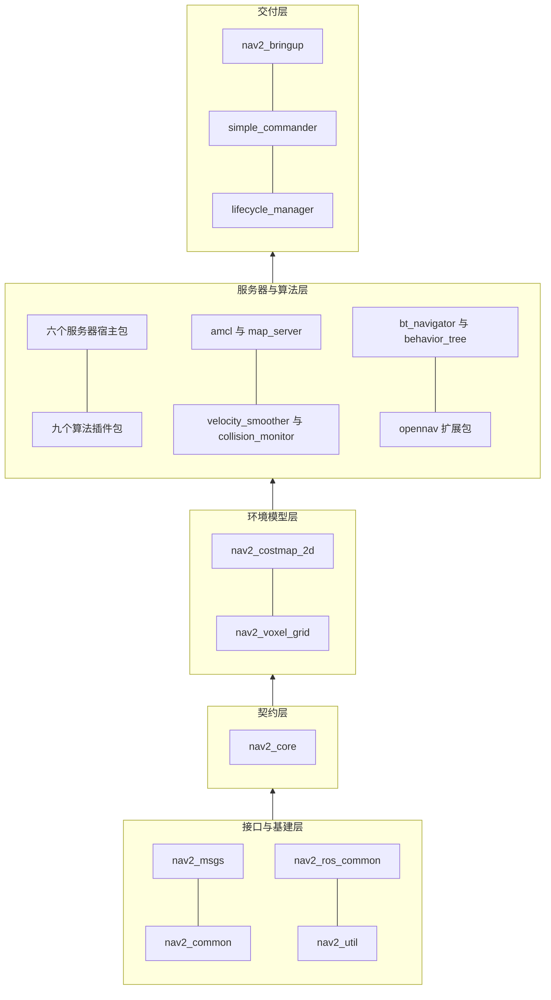
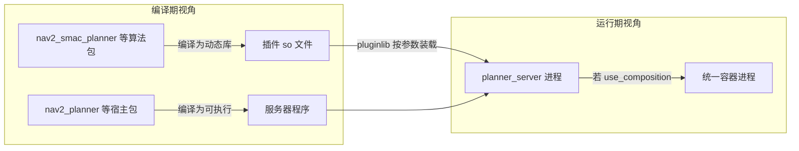

# 第 03 章 模块总览：四十多个功能包的职责地图

> **一句话总结**：Nav2 的 40+ 功能包可以收敛为十个功能组——任务编排、服务器宿主、规划算法、控制算法、环境感知、定位建图、安全执行、基础设施、接口消息、应用交付；组内包共享一种职责范式，组间沿"接口 → 基建 → 环境 → 服务器 → 应用"的单向依赖流动，本章给出全部包的速查表与依赖层次图，作为后续各章的导航索引。

> **前置知识**：第 01 章 · 第 02 章 ｜ **知识依赖图**：[KnowledgeGraph/Knowledge](KnowledgeGraph/Knowledge.md)

## 3.1 为什么需要一张模块地图

面对四十多个包，逐个通读源码是低效甚至不可行的。有经验的维护者面对陌生大型仓库的做法是：先建立"包 → 组 → 层"的三级心智模型，再按需要下钻。本章就是这张地图——每个包给出一句话职责、宿主进程与对应章节号；组级给出简短综述。读完本章，你应当能在任何 Nav2 相关讨论中迅速定位"这段逻辑在哪个包、书里哪一章讲"。

## 3.2 十大功能组速查表

宿主进程一栏标注该包代码最终运行在哪个进程中：独立生命周期节点、被别的进程加载的插件库、或纯编译期依赖。

### 第一组：任务编排

| 包名 | 一句话职责 | 宿主进程 | 章节 |
|---|---|---|---|
| nav2_bt_navigator | NavigateToPose 等导航 Action 的行为树编排服务器 | bt_navigator | 11 |
| nav2_behavior_tree | BT 引擎封装与 80+ 标准 BT 节点插件库 | 被 bt_navigator 加载 | 11 |

编排组是导航栈的"大脑皮层"。nav2_bt_navigator 本身只有薄薄一层：加载导航器插件、维护黑板、循环 tick 行为树；真正的词汇表在 nav2_behavior_tree——每个 BT 节点封装一次 Action 调用、一个条件判断或一种控制流。修改导航策略的正确入口几乎总是 XML 与 BT 节点，而不是各服务器代码。

### 第二组：算法服务器宿主

| 包名 | 一句话职责 | 宿主进程 | 章节 |
|---|---|---|---|
| nav2_planner | 全局规划 Action 服务器，持有全局代价地图 | planner_server | 07 |
| nav2_controller | 局部控制 Action 服务器，持有局部代价地图与检查器体系 | controller_server | 09 |
| nav2_smoother | 路径平滑 Action 服务器 | smoother_server | 15 |
| nav2_behaviors | 恢复行为 Action 服务器，内置 Spin/BackUp/Wait 等插件 | behavior_server | 12 |
| nav2_route | 基于稀疏图的路由 Action 服务器，支持 GeoJSON 图 | route_server | 17 |
| nav2_waypoint_follower | 多航点巡航服务器，带航点任务执行器插件 | waypoint_follower | 11 |

宿主组的六个包高度同构：每个都是"生命周期节点 + Action 服务器 + pluginlib 插件容器"三件套。它们不实现算法，只提供算法运行所需的工程环境——这正是第 02 章"服务器与算法分离"原则的落地。读懂其中任何一个（推荐 nav2_planner，最精简），其余五个的骨架就都读懂了。

### 第三组：全局规划算法插件

| 包名 | 一句话职责 | 宿主进程 | 章节 |
|---|---|---|---|
| nav2_navfn_planner | 经典 Dijkstra/A* 势场规划器，move_base 时代的延续 | 插件，载入 planner_server | 07 |
| nav2_smac_planner | Hybrid-A*、State Lattice 与 2D-A* 三套搜索规划器 | 插件，载入 planner_server | 08 |
| nav2_theta_star_planner | 任意角度 Theta* 规划器 | 插件，载入 planner_server | 07 |
| nav2_constrained_smoother | 基于非线性优化的约束路径平滑器 | 插件，载入 smoother_server | 15 |

规划组呈现清晰的能力梯度：navfn 面向圆形差速机器人的快速出解；theta_star 消除栅格路径的锯齿；smac 面向车辆运动学约束（阿克曼、全向、差速）提供运动学可行路径。constrained_smoother 虽名为平滑器，本质是把平滑表述为优化问题的规划后处理，故归入此组。

### 第四组：局部控制算法插件

| 包名 | 一句话职责 | 宿主进程 | 章节 |
|---|---|---|---|
| nav2_mppi_controller | 采样型模型预测控制器，动态环境首选 | 插件，载入 controller_server | 10 |
| nav2_regulated_pure_pursuit_controller | 调节纯追踪控制器，工业 AMR 常用 | 插件，载入 controller_server | 10 |
| nav2_dwb_controller | DWB 动态窗口控制器及其 critic 评价体系（7 个子包） | 插件，载入 controller_server | 09 |
| nav2_graceful_controller | 基于极坐标控制律的平滑到点控制器 | 插件，载入 controller_server | 09 |
| nav2_rotation_shim_controller | 旋转垫片：先原地转向再移交主控制器 | 插件，载入 controller_server | 09 |

控制组是 Nav2 算法密度最高的区域。五个包代表三种范式：采样优化（MPPI、DWB）、几何跟踪（RPP、Graceful）、装饰器组合（rotation_shim 包装其他控制器）。rotation_shim 尤其值得留意——它是"插件包装插件"的装饰器模式实战，展示了插件体系的组合能力。

### 第五组：环境感知

| 包名 | 一句话职责 | 宿主进程 | 章节 |
|---|---|---|---|
| nav2_costmap_2d | 分层代价地图框架与静态/障碍/膨胀等 Layer 插件 | 内嵌于 planner_server 与 controller_server | 06 |
| nav2_voxel_grid | 3D 体素栅格数据结构，支撑体素层的三维障碍记忆 | 被 costmap 体素层使用的库 | 06 |

感知组的核心事实：代价地图不是节点而是**被服务器进程内嵌的对象**，全局与局部两份实例分别活在规划、控制进程里，各自拥有独立的层配置与更新频率。Layer 本身也是插件（第四类插件边界），社区的高度定制大多发生在这里。

### 第六组：定位与建图

| 包名 | 一句话职责 | 宿主进程 | 章节 |
|---|---|---|---|
| nav2_amcl | 自适应蒙特卡洛定位，发布 map 到 odom 变换 | amcl | 13 |
| nav2_map_server | 地图加载、发布与保存三件套 | map_server | 14 |

定位组维持着"最小可用"哲学：Nav2 不绑定定位方案，amcl 只是默认实现；任何能发布 map→odom 变换的系统（SLAM Toolbox、融合定位）都可以无缝顶替，导航侧不需要任何改动。

### 第七组：安全与执行链

| 包名 | 一句话职责 | 宿主进程 | 章节 |
|---|---|---|---|
| nav2_velocity_smoother | 速度指令的加减速与死区约束 | velocity_smoother | 16 |
| nav2_collision_monitor | 基于原始传感器的碰撞监测与紧急降速停车 | collision_monitor | 16 |

安全组是 Nav2 区别于上一代导航栈的标志性设计：两个节点串联在 cmd_vel 链路末端（见第 01 章），与算法层完全解耦。collision_monitor 包内另含独立的 CollisionDetector 节点，可仅做检测报警而不干预速度。

### 第八组：基础设施

| 包名 | 一句话职责 | 宿主进程 | 章节 |
|---|---|---|---|
| nav2_core | 全部算法插件的纯虚接口契约 | 编译期头文件 | 04 |
| nav2_ros_common | rclcpp 封装：LifecycleNode、SimpleActionServer 等通信基座 | 编译期头文件为主 | 05、19 |
| nav2_util | 领域工具库：TF 助手、OdomSmoother、几何计算 | 被各节点链接的库 | 19、20 |
| nav2_common | CMake 宏与构建辅助 | 编译期 | 02 |
| nav2_lifecycle_manager | 生命周期编排器：统一启停与 Bond 存活监控 | lifecycle_manager | 05 |
| nav2_msgs | 20 Action、22 Msg、19 Srv 的接口定义 | 编译期生成代码 | 19 |

基础设施组是所有包的公共地基。阅读顺序建议：先 nav2_core（接口宪法）、再 nav2_ros_common（通信基座）、后 nav2_lifecycle_manager（编排机制），nav2_util 按需查阅即可。

### 第九组：扩展应用（opennav 生态）

| 包名 | 一句话职责 | 宿主进程 | 章节 |
|---|---|---|---|
| opennav_docking | 充电桩/工位自主靠泊服务器 | docking_server | 18 |
| opennav_docking_core | 靠泊插件（ChargingDock 等）接口契约 | 编译期头文件 | 18 |
| opennav_docking_bt | 靠泊相关 BT 节点 | 被 bt_navigator 加载 | 18 |
| opennav_following | 动态目标跟随服务器 | following_server | 18 |

扩展组完整复刻了 Nav2 的三层套路——core 接口包、服务器实现包、BT 节点包，是"如何为 Nav2 增加一种全新能力"的官方范本，二次开发前值得精读其结构。

### 第十组：应用交付与测试

| 包名 | 一句话职责 | 宿主进程 | 章节 |
|---|---|---|---|
| nav2_bringup | launch、参数、地图与 RViz 配置的官方发行样板 | 无（启动描述） | 01、21 |
| nav2_simple_commander | Python 高层 API，把导航栈封装为可编程库 | 用户 Python 进程 | 24 |
| nav2_rviz_plugins | RViz 面板与工具：目标下发、路径显示、生命周期控制 | rviz2 | 24 |
| nav2_loopback_sim | 无物理引擎的回环仿真器，秒级启动验证全栈 | loopback_simulator | 25 |
| nav2_system_tests | 系统级集成测试套件 | CI 测试进程 | 25 |
| navigation2 | 空元包，聚合全栈依赖 | 无 | 02 |

交付组决定了用户的第一印象：bringup 是所有教程的起点，simple_commander 是业务代码接入导航的推荐方式，loopback_sim 则让"不装 Gazebo 也能跑通全栈"成为现实。

## 3.3 依赖层次：单向流动的五层结构

把十个组按编译依赖投影到层次图上，可以看到严格的单向流动——上层依赖下层，下层从不回头：

这张图有三个实用推论：

- **修改的影响半径与所在层成反比**。改 nav2_msgs 的一个字段会触发几乎全栈重编译；改某个控制器插件只影响它自己。评估改动成本先看层。
- **学习路径应自下而上，调试路径应自上而下**。读源码从 core 与 ros_common 起步；排查现场问题从 bringup 参数与 BT 剧本入手，多数问题到不了算法层。
- **nav2_costmap_2d 是隐形的枢纽**。它上承接口层、下撑全部规划与控制算法，是依赖图中扇出最大的实体包——这解释了为什么第 06 章被标记为全书最高优先级章节之一。

## 3.4 从包地图到进程地图

同一批包在运行时收敛为约 14 个进程（独立进程模式下），两张地图的对应关系是理解部署问题的关键：

一句话概括：**包是分发与复用的单位，进程是隔离与调度的单位，插件机制负责把前者装配进后者**。第 02 章的目录分离原则、第 01 章的部署形态选择，在这张图上合流。

## 3.5 知识总结

1. 40+ 包收敛为**十大功能组**：编排、宿主、规划、控制、感知、定位、安全、基建、扩展、交付；组内职责范式一致。
2. 依赖呈**五层单向流动**：msgs/common/ros_common/util → core → costmap → 服务器与算法 → bringup，不存在反向依赖。
3. 六个服务器宿主包**结构同构**（生命周期节点 + Action + 插件容器），读懂一个即读懂全部骨架。
4. 代价地图与算法插件**没有自己的进程**：前者内嵌于规划/控制服务器，后者以动态库形式被宿主装载。
5. opennav_docking 三包结构（core/实现/BT 节点）是**为 Nav2 新增能力的官方范本**。

## 3.6 常见面试题

1. **Nav2 的包依赖分几层？为什么强调单向依赖？**
   要点：接口基建 → core 契约 → costmap 环境 → 服务器与算法 → bringup 交付五层；单向依赖保证影响半径可控、并行编译高效、任何上层包可被替换而不牵动下层。
2. **哪些包会变成独立进程，哪些不会？**
   要点：宿主包与 amcl、map_server、lifecycle_manager 等编译为可执行节点；算法包、BT 节点包、core/util 类包编译为库或插件，寄生于宿主进程；composition 模式下所有组件进一步合并进单一容器进程。
3. **想换掉默认控制器，需要动哪些包？**
   要点：零代码场景只改 nav2_bringup 参数中的 controller_plugins 插件名；自研场景新增一个实现 nav2_core::Controller 的插件包；nav2_controller 宿主包始终不动。
4. **nav2_behavior_tree 和 nav2_bt_navigator 为什么分成两个包？**
   要点：前者是 BT 节点词汇库（可被任何 BT 应用复用，含 docking 等扩展），后者是导航语义的编排服务器；分离使 BT 节点可独立测试、第三方可只依赖节点库构建自己的编排器。
5. **代价地图为什么不做成独立节点？**
   要点：规划与控制对地图的访问是高频同步读，进程内对象访问避免序列化与传输延迟；两份实例各随宿主生命周期管理，频率与尺寸可独立配置。

## 3.7 最佳实践与容易踩坑

- **按组学习而非按包学习**：同组包共享范式，对照着读事半功倍；跨组乱序阅读容易迷失在细节里。
- **确认插件的宿主再排障**：控制器插件的日志出现在 controller_server 进程里，BT 节点的日志在 bt_navigator 里；按包名找进程是常见的排障弯路。
- **区分"删包"与"禁用"**：不用 route_server 时从 lifecycle_manager 清单与 launch 中移除即可，无需从工作空间删除包；反之，删除算法包前先确认参数中无引用，否则宿主激活时插件装载会失败。
- **新能力优先套用 opennav 三包范式**：core 接口、服务器实现、BT 节点分包，未来向社区回馈或独立发布都不需要重构。
- **依赖新包前先看它所在的层**：让底层包（如 nav2_util）依赖上层包（如某控制器）会制造环形依赖，colcon 直接拒绝构建。

## 3.8 延伸阅读

- navigation2/package.xml：全栈包清单的权威定义，与本章速查表互为印证
- 各包 README.md：多数包首段即职责声明，是本章一句话职责的出处
- docs.nav2.org 的 Plugins 页：官方维护的社区插件登记表，展示十大组之外的生态版图
- ROS 2 pluginlib 与 ament_cmake 文档：理解"包如何变成插件、插件如何进入进程"的机制细节
- 本书第 04 章起进入逐模块深读，建议按 04 → 05 → 06 的顺序建立接口、生命周期、环境模型三块基石

## 3.C 阅读检查点

1. 六个服务器宿主包高度同构的"三件套"是什么？为什么推荐从 nav2_planner 读起？（见 3.2 节第二组）
2. 五个控制器包代表哪三种算法范式？rotation_shim 体现了什么设计模式？（见 3.2 节第四组）
3. 包依赖的五层单向流动结构是什么？"修改的影响半径与所在层成反比"如何指导改动评估？（见 3.3 节）
4. 为什么说 nav2_costmap_2d 是"隐形的枢纽"？（见 3.3 节）
5. "包是分发与复用的单位，进程是隔离与调度的单位"——插件机制在两张地图之间扮演什么角色？（见 3.4 节）

> 下一章：04_nav2_core插件接口
