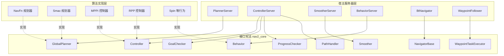
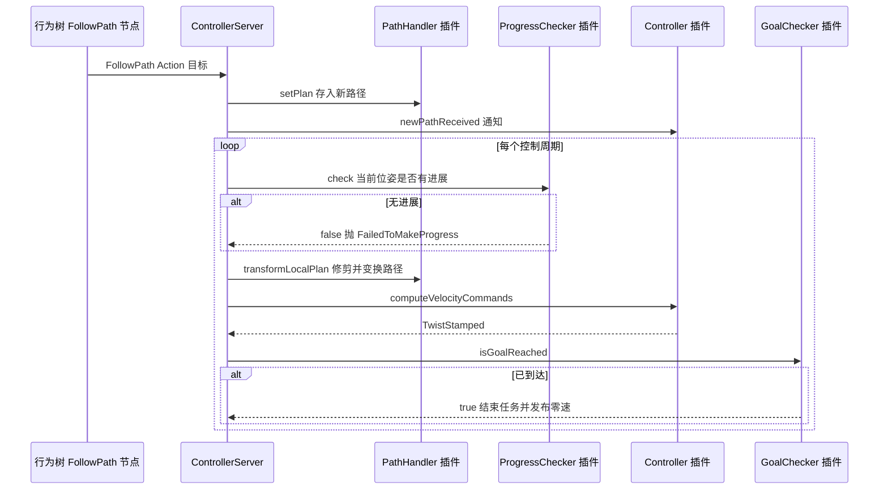

# 第 04 章 nav2_core 插件接口：导航栈的"接口宪法"

> **一句话总结**：nav2_core 是整个 Nav2 的"接口宪法"——它用一组纯虚基类为规划、控制、平滑、检查、行为、导航器等所有算法边界定义了稳定契约，配合 pluginlib 的动态加载与统一的四阶段生命周期回调，使任何算法都可以在不改一行服务器（Server）代码的前提下被替换、组合与热插拔。

> **前置知识**：第 01 章 · 第 03 章 ｜ **知识依赖图**：[KnowledgeGraph/Knowledge](KnowledgeGraph/Knowledge.md)

## 4.1 为什么需要一部"接口宪法"

回顾 move_base 时代，算法可替换性只覆盖了三个口子：全局规划器、局部规划器、恢复行为。规划与控制的调用逻辑、失败语义、参数注入方式都硬编码在 move_base 单体节点内部——想换一个目标判定策略？想在路点处执行自定义任务？只能改源码、重新编译整个导航栈。

Nav2 的设计者们从这段历史中提炼出一个判断：**算法可替换性的前提不是"留几个口子"，而是一套稳定、完备、语义清晰的接口契约**。这套契约必须满足三个条件：

1. **编译期解耦**：宿主服务器只依赖接口包，不链接任何具体实现；
2. **运行时装配**：用参数字符串决定加载哪个实现，由 pluginlib 完成动态发现与实例化；
3. **生命周期同步**：插件（Plugin）的资源分配与释放必须与宿主生命周期节点（Lifecycle Node）的状态机严格对齐。

nav2_core 就是这三个条件的产物。它是一个**纯头文件接口包**——没有一行 `.cpp` 实现，只有十余个头文件，却支配着 40 多个功能包的协作方式。这种"最小接口包"的做法保证了依赖方向的单向性：所有算法包依赖 nav2_core，而 nav2_core 不依赖任何算法包。

## 4.2 全接口一览

以宿主服务器为线索，nav2_core 的接口家族可以整理为下表（源码位于 `nav2_core/include/nav2_core/`）：

| 接口 | 头文件 | 宿主服务器 | 核心方法 | 生命周期回调 |
|---|---|---|---|---|
| GlobalPlanner | global_planner.hpp | nav2_planner::PlannerServer | `createPlan()` | configure / activate / deactivate / cleanup |
| Controller | controller.hpp | nav2_controller::ControllerServer | `computeVelocityCommands()` | configure / activate / deactivate / cleanup |
| Smoother | smoother.hpp | nav2_smoother::SmootherServer | `smooth()` | configure / activate / deactivate / cleanup |
| GoalChecker | goal_checker.hpp | ControllerServer 内部使用 | `isGoalReached()` | initialize / reset |
| ProgressChecker | progress_checker.hpp | ControllerServer 内部使用 | `check()` | initialize / reset |
| PathHandler | path_handler.hpp | ControllerServer 内部使用 | `transformLocalPlan()` | initialize |
| Behavior | behavior.hpp | nav2_behaviors::BehaviorServer | 各行为自定义执行逻辑 | configure / activate / deactivate / cleanup |
| NavigatorBase / BehaviorTreeNavigator | behavior_tree_navigator.hpp | nav2_bt_navigator::BtNavigator | `goalReceived()` `onLoop()` 等 | on_configure / on_activate / on_deactivate / on_cleanup |
| WaypointTaskExecutor | waypoint_task_executor.hpp | nav2_waypoint_follower::WaypointFollower | `processAtWaypoint()` | initialize |

一个值得注意的分野：GlobalPlanner、Controller、Smoother、Behavior 这类"重资产"接口拥有完整的四阶段生命周期回调；而 GoalChecker、ProgressChecker、PathHandler、WaypointTaskExecutor 这类"轻量判据"接口只有 `initialize()`（部分带 `reset()`）。设计者在这里做了明确的成本权衡——轻量插件没有需要随激活/去激活开关的资源（如发布者、线程），强行套用四阶段只会徒增样板代码。

用 classDiagram 呈现接口家族的全貌：

```mermaid
classDiagram
    class GlobalPlanner {
        <<interface>>
        +configure(parent, name, tf, costmap_ros)
        +activate()
        +deactivate()
        +cleanup()
        +createPlan(start, goal, viapoints, cancel_checker) Path
    }
    class Controller {
        <<interface>>
        +configure(parent, name, tf, costmap_ros)
        +activate()
        +deactivate()
        +cleanup()
        +newPathReceived(raw_global_path)
        +computeVelocityCommands(pose, velocity, goal_checker, plan, goal) TwistStamped
        +setSpeedLimit(limit, percentage)
        +cancel() bool
        +reset()
    }
    class Smoother {
        <<interface>>
        +configure(parent, name, tf, costmap_sub, footprint_sub)
        +activate()
        +deactivate()
        +cleanup()
        +smooth(path, max_time) bool
    }
    class GoalChecker {
        <<interface>>
        +initialize(parent, plugin_name, costmap_ros)
        +reset()
        +isGoalReached(query, goal, velocity, path) bool
        +isGoalXYReached(query, goal, velocity, path) bool
        +getTolerances(pose_tol, vel_tol, time_tol) bool
    }
    class ProgressChecker {
        <<interface>>
        +initialize(parent, plugin_name)
        +check(current_pose) bool
        +reset()
    }
    class PathHandler {
        <<interface>>
        +initialize(parent, logger, name, costmap_ros, tf)
        +setPlan(path)
        +findPlanSegment(pose) PathSegment
        +transformLocalPlan(begin, end) Path
        +getTransformedGoal(stamp) PoseStamped
    }
    class Behavior {
        <<interface>>
        +configure(parent, name, tf, local_checker, global_checker)
        +activate()
        +deactivate()
        +cleanup()
        +getResourceInfo() CostmapInfoType
    }
    class NavigatorBase {
        <<interface>>
        +on_configure(parent, libs, feedback_utils, muxer, odom_smoother) bool
        +on_activate() bool
        +on_deactivate() bool
        +on_cleanup() bool
        +preempt()
    }
    class BehaviorTreeNavigator~ActionT~ {
        <<abstract>>
        +getName()* string
        +getDefaultBTFilepath(node)* string
        #goalReceived(goal)* bool
        #onLoop()*
        #onPreempt(goal)*
        #goalCompleted(result, status)*
    }
    class WaypointTaskExecutor {
        <<interface>>
        +initialize(parent, plugin_name)
        +processAtWaypoint(pose, index) bool
    }
    NavigatorBase <|-- BehaviorTreeNavigator
    Controller ..> GoalChecker : 查询容差
```

## 4.3 逐接口精讲

### 4.3.1 GlobalPlanner：全局规划的契约

`nav2_core/include/nav2_core/global_planner.hpp` 是整个接口家族中最纯粹的样本，其契约方法只有五个：

| 方法 | 时机 | 职责 |
|---|---|---|
| `configure(parent, name, tf, costmap_ros)` | PlannerServer 的 on_configure | 声明参数、分配内存、保存依赖句柄 |
| `activate()` | on_activate | 启动发布者与工作线程 |
| `deactivate()` | on_deactivate | 暂停对外输出，保留资源 |
| `cleanup()` | on_cleanup | 彻底释放资源 |
| `createPlan(start, goal, viapoints, cancel_checker)` | 每次 ComputePathToPose 请求 | 计算并返回 `nav_msgs::msg::Path` |

configure 注入了四样东西：宿主节点的 `nav2::LifecycleNode::WeakPtr`（用于声明参数、创建发布者）、插件名（作为参数命名空间前缀）、TF 缓冲区、以及共享的 `Costmap2DROS` 句柄。规划器不拥有代价地图（Costmap），只是租借——这决定了它读取地图数据时必须遵守第 06 章讲到的加锁约定。

`createPlan` 的第四个参数 `std::function<bool()> cancel_checker` 是 1.x 系列的重要演进：长耗时规划器（如 Smac Hybrid-A* 在大地图上的搜索）可以在内循环中周期性调用它，实现毫秒级响应取消，而不必等一次完整搜索结束。viapoints 参数则让"途经点约束规划"成为一等公民。

### 4.3.2 Controller：控制闭环的核心

Controller 是契约最复杂的接口，因为它处在 20 Hz 以上的实时闭环里：

| 方法 | 说明 |
|---|---|
| `newPathReceived(raw_global_path)` | 新全局路径到达时的轻量通知，仅做状态复位，不做重计算 |
| `computeVelocityCommands(pose, velocity, goal_checker, transformed_plan, global_goal)` | 每个控制周期调用一次，输出 `TwistStamped` |
| `setSpeedLimit(speed_limit, percentage)` | 响应速度限制话题（如 SpeedFilter 发布的限速） |
| `cancel()` | 有默认实现返回 true；重写后可实现"减速停车"式优雅取消 |
| `reset()` | 任务退出后复位内部状态，有空默认实现 |

注意 `computeVelocityCommands` 收到的是**已经被 PathHandler 变换、修剪过的局部路径**，而非原始全局路径——路径预处理职责在 1.5.0 中被剥离为独立的 PathHandler 插件，控制器得以专注于轨迹优化本身。签名中传入 `GoalChecker*` 也别有深意：控制器可以查询当前任务的目标容差（`getTolerances`），据此在接近目标时切换减速策略，而不必自己重复声明一套容差参数。

其调用时序如下：

### 4.3.3 Smoother：路径的"美容师"

Smoother 的 configure 注入与前两者不同：它拿到的不是完整的 `Costmap2DROS`，而是 `CostmapSubscriber` 与 `FootprintSubscriber` 两个轻量订阅器。这个差别揭示了部署形态——SmootherServer 与代价地图宿主不在同一进程时，只能通过话题订阅获得地图快照。核心方法 `smooth(path, max_time)` 采用**原地修改 + 布尔返回**的风格：在时间预算内完成返回 true，超时则返回已部分平滑的路径并返回 false，把"要不要接受半成品"的决策权交给上层行为树（BT）。

### 4.3.4 GoalChecker 与 ProgressChecker：一对轻量判据

这两个接口是 ControllerServer 的"陪审团"：

- **GoalChecker** 回答"到了吗"：`isGoalReached(query_pose, goal_pose, velocity, path)` 同时考察位姿与速度，使"位置到了但还在滑行"不会被误判为完成；`isGoalXYReached` 只查平面位置不查朝向，供旋转收尾类控制器分阶段判定使用。
- **ProgressChecker** 回答"卡住了吗"：`check(current_pose)` 在时间窗口内检测位移量，返回 false 时 ControllerServer 抛出 `FailedToMakeProgress` 异常，触发行为树的恢复分支。

两者都可以配置多实例（如 `general_goal_checker` 与 `precise_goal_checker`），行为树发起 FollowPath 时按名字点选——同一台机器人在"跑走廊"与"进充电桩"两种场景下可以用截然不同的判定标准。

### 4.3.5 PathHandler：路径管道的新成员

PathHandler 是 1.5.0 引入的接口，把此前藏在各控制器内部反复实现的"路径修剪 + 坐标变换"逻辑抽为独立插件：`setPlan` 缓存全局路径，`findPlanSegment` 找出与当前位姿相关的路径段，`transformLocalPlan` 把该段变换到局部坐标系，`getTransformedGoal` 提供变换后的终点。它的存在让 MPPI、RPP 等控制器共享同一套修剪策略，也让用户可以只定制修剪逻辑而不动控制算法。

### 4.3.6 Behavior：恢复与辅助行为

Behavior 接口（`nav2_core/include/nav2_core/behavior.hpp`）服务于 Spin、BackUp、Wait 等由行为树按需调度的独立动作。它的 configure 注入了**局部与全局两个碰撞检查器**（`CostmapTopicCollisionChecker`），而非代价地图本体。独有方法 `getResourceInfo()` 返回枚举 `CostmapInfoType`（NONE / LOCAL / GLOBAL / BOTH），宿主 BehaviorServer 据此**按需创建代价地图订阅**——一个纯等待类行为声明 NONE，服务器就不会为它浪费任何地图带宽。这是接口设计中"让插件声明资源需求、让宿主统筹分配"的典型手法。

### 4.3.7 NavigatorBase 与 BehaviorTreeNavigator：导航器的双层设计

`behavior_tree_navigator.hpp` 里藏着接口家族中最精巧的一处双层结构：

- **NavigatorBase** 是非模板基类，只声明 `on_configure` / `on_activate` / `on_deactivate` / `on_cleanup` / `preempt` 五个纯虚方法。它存在的唯一理由是 pluginlib 无法直接加载模板类——需要一个共同的非模板锚点。
- **BehaviorTreeNavigator\<ActionT\>** 是模板中间层，把 NavigatorBase 的方法全部实现并标记为 `final`，内部完成 BtActionServer 的创建、黑板初始化、导航器互斥（NavigatorMuxer 保证同一时刻只有一个导航器在跑）等通用工作，再把 `goalReceived` / `onLoop` / `onPreempt` / `goalCompleted` / `getName` / `getDefaultBTFilepath` 留给最终插件。

这是教科书级的**模板方法模式**：骨架不可覆盖（final），变化点以纯虚函数下放。NavigateToPose 与 NavigateThroughPoses 两个导航器都是这个模板的具体化。

### 4.3.8 WaypointTaskExecutor：路点上的钩子

最简单的接口留给最开放的场景：`processAtWaypoint(pose, index)` 在机器人到达每个路点时被 WaypointFollower 调用，返回 false 且配置为不容忍失败时终止整个任务。拍照、扫码、装卸货——任何"到点做事"的业务逻辑都从这个两方法接口接入，是业务开发者最常实现的第一个 Nav2 插件。

## 4.4 统一设计特征：契约背后的工程共识

逐个看完接口后，值得后退一步观察它们的共性——这些共性才是 nav2_core 作为"宪法"的立法精神。

### 4.4.1 WeakPtr 传递宿主节点

所有接口的 configure/initialize 第一参数都是 `nav2::LifecycleNode::WeakPtr` 而非 SharedPtr。原因有三：

1. **防循环引用**：宿主节点持有插件的 shared_ptr（经由 pluginlib），插件若再持有节点的 shared_ptr，引用环将导致两者都无法析构；
2. **所有权语义明确**：节点属于服务器，插件只是租客，弱指针把这层关系写进了类型系统;
3. **强制有效性检查**：插件每次使用节点前必须 `lock()`，天然规避 use-after-free。

### 4.4.2 延迟依赖注入

所有插件都遵循"**构造函数零参数 + configure 注入依赖**"的模式。pluginlib 实例化时只能调用默认构造函数，这是技术约束；但更深层的收益是**构造与装配分离**：插件对象可以先创建、后配置、反复 cleanup/configure 循环，支撑参数动态重配置与热替换，而无需重启服务器进程。

### 4.4.3 生命周期回调与宿主状态同步

插件的 configure/activate/deactivate/cleanup 分别在宿主的 `on_configure` / `on_activate` / `on_deactivate` / `on_cleanup` 中被逐个转发调用。效果是：lifecycle_manager 编排宿主服务器时（见第 05 章），**插件的资源状态被顺带纳入了全系统的确定性启停序列**——插件作者不需要理解生命周期状态机，只要老实实现四个回调，就自动获得了受控启停能力。

### 4.4.4 异常即结果：异常体系与 Action 错误码

nav2_core 定义了四组异常层次（`planner_exceptions.hpp`、`controller_exceptions.hpp`、`smoother_exceptions.hpp`、`route_exceptions.hpp`），插件用抛异常表达失败语义，宿主服务器捕获后翻译为 Action 结果中的 error_code：

| 规划器异常 | error_code | 控制器异常 | error_code |
|---|---|---|---|
| InvalidPlanner | 400 | InvalidController | 500 |
| StartOccupied / GoalOccupied | 401 | ControllerTFError | 501 |
| StartOutsideMapBounds / GoalOutsideMapBounds | 402 | FailedToMakeProgress | 502 |
| NoValidPathCouldBeFound | 403 | PatienceExceeded | 503 |
| PlannerTimedOut | 404 | InvalidPath | 504 |
| PlannerTFError | 405 | NoValidControl | 505 |
| PlannerCancelled | 406 | ControllerTimedOut | 506 |

这条链路的价值在于**失败语义的端到端保真**：Smac 规划器在深处发现终点被占用，抛 `GoalOccupied`；PlannerServer 翻译为 401；行为树把它写入黑板；上层应用甚至可以据此弹出"目标点有障碍物，请重新选点"的用户提示。相比 move_base 时代只有"成功/失败"两种回答，这是可运维性的代际跃升。

## 4.5 与 pluginlib 的协作：从 XML 到实例

一个插件从源码到被服务器加载，要走完四步：

宿主侧的核心只有两行逻辑：用 `pluginlib::ClassLoader<nav2_core::GlobalPlanner>` 声明"我要加载实现了这个接口的库"，再用 `createSharedInstance(type_string)` 按参数字符串实例化。参数文件中的 `planner_plugins: ["GridBased"]` 与 `GridBased.plugin: "nav2_navfn_planner::NavfnPlanner"` 完成了"别名 → 实现"的绑定，同一个接口可以同时挂多个实例，行为树按别名点用。

## 4.6 设计模式盘点

| 模式 | 在 nav2_core 中的体现 |
|---|---|
| 策略模式 | 每个接口就是一族可互换策略；规划、控制、判定算法运行时按参数切换 |
| 抽象工厂 | pluginlib 的 ClassLoader 按类型字符串生产接口实例，服务器不知道具体产品 |
| 依赖注入 | configure/initialize 显式注入节点、TF、Costmap 等依赖，插件零全局状态 |
| 模板方法 | BehaviorTreeNavigator 固化流程骨架（final），变化点下放纯虚函数 |
| 空对象/默认实现 | Controller 的 cancel/reset 提供无害默认实现，降低最小实现门槛 |

## 4.7 扩展方式概览

为 Nav2 写一个自定义插件的最短路径是：选定接口 → 建包并依赖 nav2_core → 实现全部纯虚方法 → 注册宏 + plugins.xml → 参数文件切换类型字符串。其中最容易被低估的工作是**正确实现四阶段生命周期回调**（尤其 deactivate 时停线程、cleanup 时断引用）。完整的逐步实战（含 CMake 配置、测试与调试技巧）见第 24 章扩展开发。

## 4.A 源码导航与入手路径

入口链：宿主 on_configure()→pluginlib::ClassLoader::createSharedInstance(插件类型字符串)→插件 configure(parent, name, tf, costmap_ros)→宿主 on_activate() 转发 activate()→运行期调用核心方法（如 createPlan() / computeVelocityCommands()）。

源码地图：

| 文件（仓库相对路径，约 N 行） | 关键函数 | 作用 |
|---|---|---|
| nav2_core/include/nav2_core/global_planner.hpp（约 87 行） | createPlan() | 接口家族最纯粹样本，四阶段回调 + 单一算法方法 |
| nav2_core/include/nav2_core/controller.hpp（约 152 行） | computeVelocityCommands() / setSpeedLimit() | 契约最复杂的实时闭环接口 |
| nav2_core/include/nav2_core/behavior_tree_navigator.hpp（约 436 行） | NavigatorBase / BehaviorTreeNavigator::onGoalReceived() | 非模板锚点 + 模板骨架的双层结构 |
| nav2_core/include/nav2_core/planner_exceptions.hpp（约 125 行） | 异常类层次 | 失败语义到 Action 错误码的源头 |
| nav2_planner/src/planner_server.cpp（约 694 行） | on_configure() / getPlan() | 宿主如何加载插件并转发生命周期的现实样本 |

阅读顺序：

| 第一遍只看 | 第二遍补充 | 以后再看 |
|---|---|---|
| global_planner.hpp + controller.hpp（接口契约本体） | planner_server.cpp 的插件加载与异常映射 | behavior_tree_navigator.hpp 的模板双层结构 |

完整业务链路见 [NavigateToPose 端到端时序图](Assets/sequence/NavigateToPose.md)。

## 4.B 设计权衡

### pluginlib 动态加载 vs switch-case/if-else 硬编码

如果用硬编码分支选择算法，每接入一个新规划器都要修改并重编译服务器包，第三方算法永远无法以二进制形式分发接入；而 pluginlib 方案下，服务器只依赖接口包，算法以动态库 + XML 描述文件独立交付，参数字符串即可切换。代价是：错误从编译期推迟到运行期（拼写错的类型字符串只在启动时报 class not found），且动态符号解析有微小的加载开销。Nav2 选择前者，因为导航栈的核心价值主张就是"算法可替换"，而启动期失败可以被 lifecycle_manager 的 configure 失败机制平稳接住（工厂模式的更多实例见第 22 章）。

### 纯虚接口 + 异常 vs 返回错误码

接口方法失败时抛 nav2_core 语义化异常而非返回错误码，好处是算法内部任意深度的失败都能零成本上浮到宿主 catch 链，且异常类型即失败语义，不需要在每层函数签名里透传错误码参数；代价是异常路径的性能不可预测，故只用于"每次请求至多一次"的失败出口，而不用于高频控制循环内部的常规分支。宿主统一把异常翻译为 Action error_code，使失败语义能穿越进程边界抵达行为树。

### 轻重两档生命周期接口 vs 统一四阶段

把 GoalChecker、ProgressChecker 等轻量判据也套上 configure/activate/deactivate/cleanup，接口会更"整齐"，但这些插件没有需要随激活开关的资源（线程、发布者），四阶段只会制造四个空函数的样板代码。Nav2 选择按资源重量分档：重资产接口四阶段、轻量判据只留 initialize/reset。这是"接口一致性"向"实现成本"让步的典型权衡，代价是两套回调命名风格并存，新手需要记住哪个接口属于哪档。

## 知识总结

1. nav2_core 是纯头文件接口包，以纯虚基类 + pluginlib 实现"服务器只依赖接口、算法运行时装配"，是 Nav2 一切可替换性的基石。
2. 接口分两档：重资产接口（GlobalPlanner/Controller/Smoother/Behavior）具备完整四阶段生命周期回调；轻量判据接口（GoalChecker/ProgressChecker/PathHandler/WaypointTaskExecutor）仅有 initialize/reset。
3. 三大统一设计特征：WeakPtr 传节点防循环引用、延迟依赖注入支持热替换、异常体系到 Action 错误码的端到端失败语义保真。
4. NavigatorBase + BehaviorTreeNavigator 的双层结构同时解决了 pluginlib 不支持模板类与流程骨架防篡改两个问题，是模板方法模式的典范。
5. Behavior 的 getResourceInfo 展示了"插件声明资源需求、宿主统筹分配"的资源协商式接口设计。

## 常见面试题

1. **为什么 nav2_core 的 configure 用 WeakPtr 而不是 SharedPtr 传递节点？**
   要点：服务器经 pluginlib 持有插件 shared_ptr，插件若反向持有节点 shared_ptr 会形成引用环导致内存泄漏；WeakPtr 表达"使用但不拥有"的所有权语义；lock() 强制插件检查节点存活，防止悬垂访问。

2. **插件为什么必须默认构造，依赖为何延迟到 configure 注入？**
   要点：pluginlib 只能调用无参构造；构造与装配分离后支持 cleanup→configure 循环实现参数重配置与热替换；资源按需分配，未 configure 的插件几乎零开销。

3. **规划失败时，错误信息如何从算法内部传到应用层？**
   要点：插件抛出 nav2_core 异常（如 GoalOccupied）→ 宿主服务器 catch 并映射为 Action result 的 error_code（如 401）→ 行为树写入黑板并可据此选择恢复分支 → Action 客户端读取错误码呈现给用户。

4. **GoalChecker 和 ProgressChecker 的职责差异是什么？为什么允许多实例？**
   要点：前者判定"是否到达"（位姿 + 速度双条件），后者判定"是否卡死"（时间窗内位移）；多实例允许不同任务用不同容差档位（如巡航用宽容差、对接用紧容差），行为树发起请求时按名字选择。

5. **BehaviorTreeNavigator 为什么把 NavigatorBase 的方法实现为 final？**
   要点：on_configure 等方法内含 BtActionServer 创建、黑板初始化、导航器互斥等不容破坏的骨架逻辑；final 阻止子类绕过骨架，子类只能通过 goalReceived/onLoop 等受控扩展点定制行为——模板方法模式的强制执行。

## 最佳实践与容易踩坑

**最佳实践**

- configure 中做所有重活（内存、参数、订阅创建），activate 只做"开闸"动作，保证激活瞬间可服务。
- 长耗时规划算法内循环必须轮询 cancel_checker，否则取消请求会被拖到整次搜索结束。
- 失败时抛 nav2_core 语义化异常而非返回空路径，让上层拿到可操作的错误码。
- 控制器实现 setSpeedLimit 时同时支持绝对值与百分比两种语义，与 SpeedFilter 联动才完整。

**容易踩坑**

- 在插件成员里缓存 `parent.lock()` 的结果为 shared_ptr——等于绕过了 WeakPtr 设计，重新制造引用环。
- deactivate 里忘记停工作线程，导致节点已 INACTIVE 仍在发布消息，破坏生命周期语义。
- cleanup 后仍持有 Costmap2DROS 的 shared_ptr，阻碍代价地图重置内存回收。
- plugins.xml 中 base_class_type 拼错或 package.xml 漏掉 export 声明，运行时报"class not found"，编译期毫无提示。

## 延伸阅读

- 源码：`nav2_core/include/nav2_core/`（全部接口头文件，总量不足千行，值得通读）
- 宿主转发逻辑：`nav2_planner/src/planner_server.cpp`、`nav2_controller/src/controller_server.cpp`
- pluginlib 官方文档：Creating and Using Plugins（ROS 2）
- 本书第 01 章（整体架构中的服务器分工）、第 06 章（Costmap2D 与插件的加锁协作）、第 24 章（扩展开发实战）

## 4.C 阅读检查点

1. 接口家族为什么分成"重资产四阶段"与"轻量 initialize/reset"两档？各有哪些接口？（见 4.2 节）
2. createPlan() 的 cancel_checker 参数解决什么问题？长耗时规划器应如何使用它？（见 4.3.1 节）
3. NavigatorBase 与 BehaviorTreeNavigator 的双层结构分别解决了哪两个问题？（见 4.3.7 节）
4. 为什么所有接口都用 WeakPtr 而非 SharedPtr 传递宿主节点？三个理由分别是什么？（见 4.4.1 节）
5. 一次规划失败的信息如何从算法内部传到应用层？完整链路经过哪几站？（见 4.4.4 节）

> 下一章：05_生命周期管理
