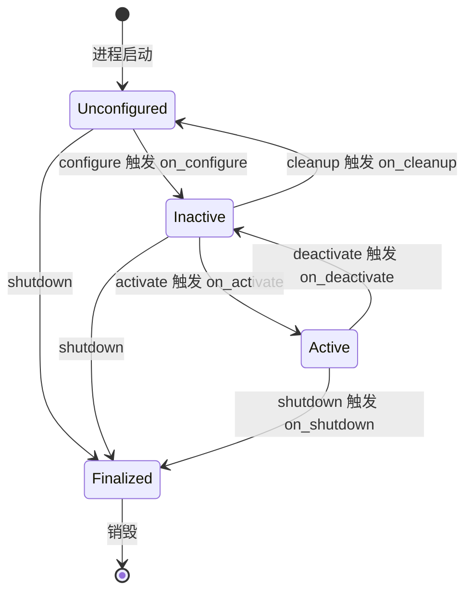
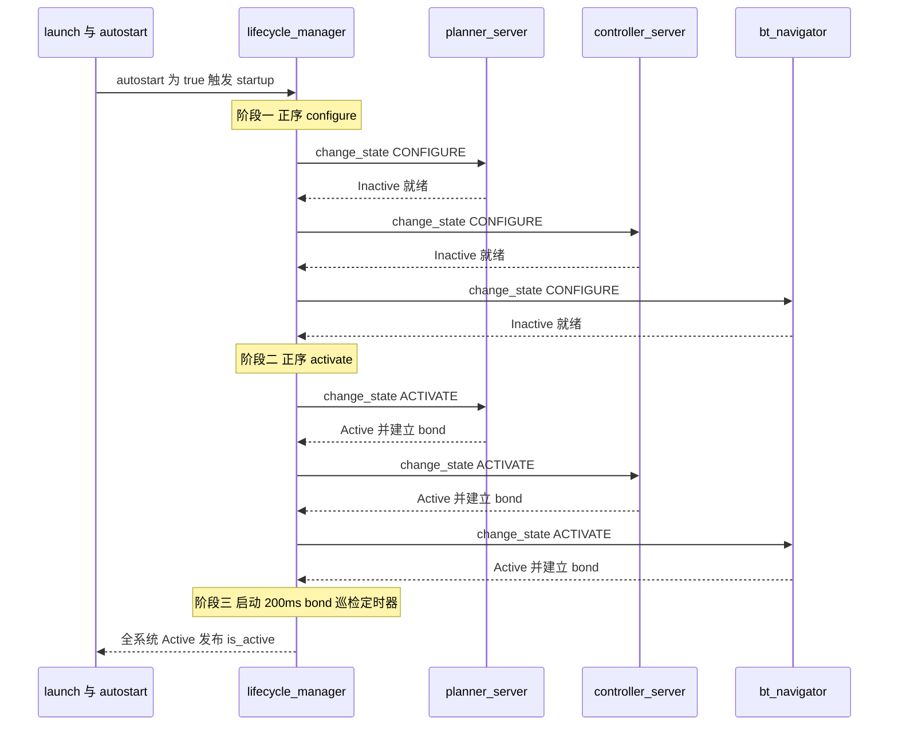
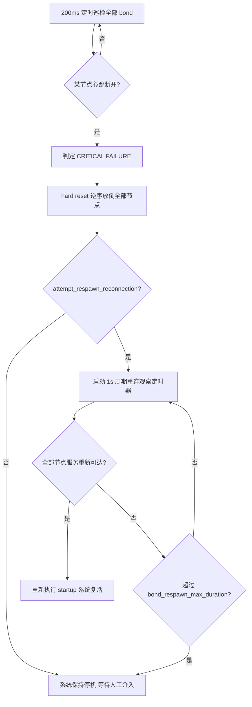

# 第 05 章 生命周期管理：让导航栈的启停成为确定性事件

> **一句话总结**：Nav2 用 rclcpp_lifecycle 状态机给每个服务器（Server）装上"可编程的电源开关"，再用 lifecycle_manager 作为总指挥按序拨动这些开关，并以 bond 心跳持续监听每个节点的生死——从此导航栈的启动、关停、暂停与故障恢复都是可预期、可编排、可观测的确定性事件。

> **前置知识**：第 01 章 · 第 04 章 ｜ **知识依赖图**：[KnowledgeGraph/Knowledge](KnowledgeGraph/Knowledge.md)

## 5.1 为什么需要确定性启动

move_base 时代有一个所有老玩家都心照不宣的仪式：launch 之后盯着终端刷屏，祈祷 map_server 比 amcl 先就绪、amcl 比 move_base 先发布 TF。节点一启动就开始工作，谁先谁后取决于进程调度与磁盘 IO 的心情——**启动顺序靠运气**。运气不好时，costmap 因为拿不到地图而报错退出，或者规划器在 TF 树残缺时给出荒谬路径。更糟的是运行期：某个节点悄然崩溃，系统其余部分毫无感知，机器人带着残缺的导航栈继续跑。

Nav2 的设计者把这个问题拆成三个需求：

1. **受控启停**：节点"进程启动"与"开始工作"必须解耦，工作时机由外部编排者决定；
2. **系统级顺序**：先感知（地图、代价地图）、后决策（规划器）、再执行（控制器、行为树导航器），关停则严格逆序；
3. **故障可感知可恢复**：任何被管理节点崩溃，系统必须在秒级检测到，并有能力整体降级、等待重启、自动恢复。

第一个需求由 ROS 2 原生的 Managed Node（rclcpp_lifecycle）满足，后两个则是 Nav2 自建的 nav2_lifecycle_manager 的使命。

## 5.2 rclcpp_lifecycle 状态机

ROS 2 的生命周期节点（Lifecycle Node）本质是一个五状态的确定性状态机——四个主状态加终态，主状态之间经由带回调的转换态迁移：

每个转换回调返回 `SUCCESS` / `FAILURE` / `ERROR`，返回 FAILURE 则状态回滚。各状态的工程语义在 Nav2 中被严格执行：

| 状态 | 语义 | 典型行为 |
|---|---|---|
| Unconfigured | 进程在、壳在，资源未分配 | 仅响应生命周期服务 |
| Inactive | 资源就绪但不工作 | 参数已声明、发布者已创建但未激活、Action 服务器已建但不收单 |
| Active | 全速运转 | 处理订阅、执行 Action、发布消息 |
| Finalized | 已终结，只待销毁 | 仅可被销毁回收 |

这个状态机给了 Nav2 两件 move_base 永远得不到的东西：**"就绪但不工作"的中间态**（Inactive），使全体节点可以先各自完成重量级初始化、再被瞬时统一激活；以及 **cleanup→configure 循环**，使"不杀进程重置节点"成为可能——这正是故障恢复的基石。

## 5.3 nav2::LifecycleNode：在标准状态机之上加了什么

Nav2 的所有服务器都不直接继承 `rclcpp_lifecycle::LifecycleNode`，而是继承封装层 `nav2::LifecycleNode`（`nav2_ros_common/include/nav2_ros_common/lifecycle_node.hpp`）。这层封装叠加了五类能力：

| 增强 | 机制 | 解决什么问题 |
|---|---|---|
| bond 心跳 | `createBond()` / `destroyBond()`，默认心跳周期 0.25 s，节点侧禁用超时 | 让 lifecycle_manager 能实时感知节点存活 |
| rcl 预关停钩子 | 构造时注册 `on_rcl_preshutdown` 回调，Ctrl+C 时自动补执行 deactivate/cleanup | 保证非正常退出也走完资源释放路径 |
| 节点级 autostart | 参数 `autostart_node` 为 true 时零延时定时器内自我 configure + activate | 让单个节点脱离管理器也能独立运行（如仿真调试） |
| 参数工具 | `declare_or_get_parameter()` 声明与读取合一 | 消除"参数已声明"异常这一高频样板错误 |
| 受管通信工厂 | `create_publisher` / `create_subscription` / `create_action_server` 等封装 | 统一 Nav2 QoS 档位；发布者自动纳入生命周期管理，节点已 Active 时创建的发布者自动激活 |

其中最值得品味的是 **bond 的双侧不对称设计**：节点侧构造函数里把 `DISABLE_HEARTBEAT_TIMEOUT_PARAM` 强制设为 true——节点永远不会因为"管理器没心跳"而自杀；超时判定只发生在管理器一侧。方向性很明确：管理器监督节点，节点不反向监督管理器，避免管理器重启引发全系统雪崩。

另一个细节是 `on_rcl_preshutdown` 与析构函数中的 `runCleanups()`：无论节点是被 lifecycle_manager 优雅关停、还是用户直接 Ctrl+C，只要 rcl 上下文开始关闭，节点都会按"Active 则先 deactivate、Inactive 则再 cleanup"的顺序补课。确定性关停不依赖使用者的自觉。

## 5.4 lifecycle_manager 深度解析

`nav2_lifecycle_manager::LifecycleManager`（`nav2_lifecycle_manager/src/lifecycle_manager.cpp`）本身是一个普通 rclcpp 节点——指挥官不需要被指挥。它的全部状态围绕三张表展开：`node_names_`（受管节点名的**有序列表**）、`node_map_`（节点名 → 生命周期服务客户端）、`bond_map_`（节点名 → bond 连接）。

### 5.4.1 关键参数

| 参数 | 默认值 | 作用 |
|---|---|---|
| `node_names` | 必填 | 受管节点列表，顺序即启动顺序 |
| `autostart` | false | 为 true 时管理器初始化完毕立即执行 startup |
| `bond_timeout` | 4.0 s | 心跳超时判死阈值；设 0 可整体关闭 bond 监测 |
| `bond_respawn_max_duration` | 10.0 s | 故障后等待节点重生的最大时长 |
| `attempt_respawn_reconnection` | true | 是否在故障后尝试自动重连重启 |
| `service_timeout` | 5.0 s | 调用节点生命周期服务的超时 |

### 5.4.2 七个编排动作与 manage_nodes 服务

管理器对外暴露 `<manager_name>/manage_nodes` 服务（类型 `nav2_msgs/srv/ManageLifecycleNodes`），七个命令对应七个编排动作：

| 命令 | 动作组合 | 遍历方向 |
|---|---|---|
| STARTUP | configure 全体 → activate 全体 → 启动 bond 定时器 | 正序 |
| CONFIGURE | 仅 configure | 正序 |
| PAUSE | deactivate 全体 | 逆序 |
| RESUME | activate 全体 | 正序 |
| RESET | deactivate → cleanup | 逆序 |
| CLEANUP | 仅 cleanup | 逆序 |
| SHUTDOWN | deactivate → cleanup → shutdown | 逆序 |

方向规则一以贯之：**凡是"向上"的转换（configure/activate）按 node_names 正序，凡是"向下"的转换（deactivate/cleanup/shutdown）按逆序**。`changeStateForAllNodes` 中对 CONFIGURE/ACTIVATE 用正向迭代器、其余用反向迭代器，正是这条规则的代码化。依赖者后启动、先关停——与析构顺序和构造顺序相反的 C++ 直觉一致。

### 5.4.3 启动编排时序

以默认 bringup 的导航管理器为例（节点列表精简为四个示意）：

要点有三：其一，configure 与 activate 是**两轮完整遍历**而非逐节点 configure+activate——全体先就绪、再统一上电，任何一个节点 configure 失败，系统不会出现"一半 Active 一半 Unconfigured"的撕裂态；其二，任一节点转换失败即中止流程并把管理器状态置为 UNKNOWN；其三，bond 连接在 activate 成功后逐个建立，管理器侧以 `bond_timeout` 设定超时。

关停则是镜像：逆序遍历，先 deactivate 摘掉 bond，再 cleanup 释放资源，最后 shutdown 送入 Finalized。行为树导航器最先停止接单，代价地图与地图服务最后退场，任何时刻存活的节点都拥有其依赖的完整下游。

### 5.4.4 bond 心跳监测与故障响应

启动完成后，管理器以 200 ms 周期执行 `checkBondConnections()`，故障响应是一套完整的"熔断—观察—恢复"流程：

设计上最激进的决策是"**一个倒下，全体放倒**"（if one is down, bring them all down）：单节点崩溃不做局部修补，而是 hard reset 整个受管集合。理由是导航栈的节点间存在紧密的状态耦合——控制器崩溃后重启，它对上一条路径、上一次速度限制一无所知，局部复活极易产生不一致行为。整体降级到安全态、再整体重启，才是可验证的恢复路径。

恢复闭环需要与 launch 的 `respawn` 机制配合：独立进程模式下 `use_respawn:=True` 让崩溃进程在 `respawn_delay` 后重生，重生的节点回到 Unconfigured 态；管理器的重连观察定时器探测到其生命周期服务重新可达后，重新走一遍 startup。**bond 负责发现死亡与重新编排，respawn 负责肉体复活**——两者缺一，故障恢复闭环就断了（组合容器模式无进程级 respawn，需自行监督容器进程）。

### 5.4.5 可观测性接口

管理器还暴露 `<manager_name>/is_active` 触发服务与锁存的 `is_active` 话题，并接入 diagnostics 体系（Nav2 Health 诊断项）：ACTIVE/INACTIVE/UNCONFIGURED 为 OK 档，FINALIZED 为 WARN，UNKNOWN（转换失败）为 ERROR。上层调度系统据此判断"导航栈是否可用"，无需理解生命周期细节。

## 5.5 与 launch 的协作：双管理器划分

默认 bringup 部署了两个并列的管理器实例：

| 管理器 | 受管节点 | 划分理由 |
|---|---|---|
| lifecycle_manager_localization | map_server、amcl | 定位链条独立启停；重定位、换图时只动这一组 |
| lifecycle_manager_navigation | controller_server、smoother_server、planner_server、route_server、behavior_server、bt_navigator、waypoint_follower、velocity_smoother、collision_monitor、docking_server、following_server | 导航执行链条，顺序体现依赖：执行层在前、编排层靠后 |

同一个 LifecycleManager 类靠 `node_names` 参数复用为两个实例——**编排逻辑与被编排对象彻底解耦**。这个划分还带来运维自由度：SLAM 建图模式下可以只关停 localization 组而导航组保持在线；多机器人场景下每个命名空间一对管理器，互不干扰。

## 5.6 设计模式盘点

| 模式 | 体现 |
|---|---|
| 中介者/编排者 | LifecycleManager 集中协调全部节点的状态迁移，节点之间零直接依赖，启动顺序知识只存在于一处 |
| 观察者 | bond 心跳本质是"存活事件"的持续订阅，管理器观察节点，断流即事件 |
| 状态模式 | 每个节点的行为由生命周期状态决定，同一消息在 Inactive 与 Active 下遭遇完全不同的处理 |
| 门面 | manage_nodes 服务把"逐节点、逐转换"的复杂操作封装为一个命令字 |

## 5.A 源码导航与入手路径

入口链：main()→LifecycleManager 构造（读 node_names 参数）→createLifecycleServiceClients()→autostart 触发 startup()→changeStateForAllNodes(CONFIGURE)→changeStateForAllNodes(ACTIVATE)→createBondConnection() 逐节点建立心跳→200 ms 定时器 checkBondConnections() 持续巡检。

源码地图：

| 文件（仓库相对路径，约 N 行） | 关键函数 | 作用 |
|---|---|---|
| nav2_lifecycle_manager/src/lifecycle_manager.cpp（约 632 行） | startup() / changeStateForAllNodes() / checkBondConnections() | 编排主逻辑：正序/逆序遍历、故障熔断与自动恢复 |
| nav2_lifecycle_manager/include/nav2_lifecycle_manager/lifecycle_manager.hpp（约 299 行） | 三张表 node_names_ / node_map_ / bond_map_ | 管理器全部状态的定义与注释 |
| nav2_ros_common/include/nav2_ros_common/lifecycle_node.hpp（约 475 行） | createBond() / destroyBond() / runCleanups() | 节点侧封装层：心跳、预关停钩子、autostart |
| nav2_msgs/srv/ManageLifecycleNodes.srv | 七个命令字 | 对外编排接口的契约定义 |

阅读顺序：

| 第一遍只看 | 第二遍补充 | 以后再看 |
|---|---|---|
| lifecycle_manager.cpp 的 startup() 与 changeStateForAllNodes() | checkBondConnections() 故障恢复链 | lifecycle_node.hpp 的预关停钩子与受管通信工厂 |

完整业务链路见 [NavigateToPose 端到端时序图](Assets/sequence/NavigateToPose.md)。

## 5.B 设计权衡

### LifecycleNode vs 普通 Node

普通 Node 构造即工作，多节点系统的就绪顺序取决于进程调度，无法表达"先感知后决策再执行"的依赖；LifecycleNode 把初始化拆进受控状态机，换来确定性启停与不杀进程的故障重置。代价也真实存在：每个节点多一套状态机服务开销，必须有外部编排者才能拉起来，调试时 ros2 run 单启一个节点默认停在 Unconfigured。Nav2 用 autostart_node 参数给单节点调试留了后门，算是对这个代价的补丁。

### bond 双向连接 vs 心跳话题

若用普通话题发心跳，管理器需要自己维护"谁该发、多久没收到算死"的记账逻辑，且话题无连接语义——订阅者掉电发布者无感。bond 库把"一对一连接 + 双向心跳 + 断开回调"封装为现成原语，断线即事件，不需要轮询记账。Nav2 进一步做了不对称裁剪：节点侧强制禁用心跳超时，只让管理器单向监督节点，避免管理器重启引发全栈雪崩自杀。代价是每节点多一条 bond 连接的流量与状态。

### "一个倒下全体放倒" vs 局部重启

单节点崩溃后只重启它自己看似代价最小，但导航栈节点间存在紧密状态耦合：重生的控制器对上一条路径、速度限制一无所知，局部复活极易产生不一致行为。Nav2 选择整体降级到安全态再整体重启（hard reset + 重新 startup），用更长的恢复时间换可验证的一致性。这个决策隐含前提：机器人停下来是安全的——对于不能随意停的场景（如车流中），需要上层系统另做兼底。

## 知识总结

1. 生命周期节点把"进程启动"与"开始工作"解耦，Inactive 中间态使"全体就绪、瞬时统一激活"成为可能，cleanup→configure 循环则是不杀进程重置节点的基础。
2. nav2::LifecycleNode 在标准状态机之上叠加 bond 心跳、rcl 预关停钩子、autostart、参数工具与受管通信工厂五类能力；bond 超时判定只在管理器侧，节点侧永不因心跳自杀。
3. lifecycle_manager 的编排铁律：向上转换按 node_names 正序、向下转换逆序；configure 与 activate 分两轮全体遍历，任一失败即中止并置 UNKNOWN。
4. 故障响应哲学是"一个倒下，全体放倒"：bond 断开触发 hard reset 全体降级，再在 bond_respawn_max_duration 窗口内观察节点重生并自动重新 startup；恢复闭环需 launch 的 respawn 配合。
5. 双管理器（localization/navigation）按职能划分受管集合，同一类靠参数复用，编排逻辑与被编排对象解耦。

## 常见面试题

1. **Nav2 为什么要用生命周期节点而不是普通节点？**
   要点：普通节点启动即工作，多节点系统的就绪顺序不可控；生命周期节点提供 Unconfigured/Inactive/Active 的受控状态，允许外部编排者决定"何时开始工作"；Inactive 态支持全体先初始化再统一激活；cleanup 循环支持不杀进程的故障重置。

2. **lifecycle_manager 的启动与关停顺序规则是什么？为什么？**
   要点：configure/activate 按 node_names 正序，deactivate/cleanup/shutdown 逆序；保证任何时刻存活节点的依赖完整——感知层先于决策层就绪，编排层先于执行层退场；与 C++ 构造/析构顺序相反的直觉一致。

3. **bond 机制如何工作？节点侧和管理器侧有什么不对称？**
   要点：activate 后节点与管理器各建一端 bond，节点默认 0.25 s 心跳；管理器 200 ms 巡检、bond_timeout（默认 4 s）判死；节点侧强制禁用心跳超时，只有管理器监督节点、没有反向监督，防止管理器重启引发全系统自杀。

4. **某个受管节点崩溃后，Nav2 会发生什么？**
   要点：管理器巡检发现 bond 断开 → 打印 CRITICAL FAILURE → hard reset 逆序放倒全部节点 → 若 attempt_respawn_reconnection 开启，1 s 周期探测全部节点服务是否重新可达 → 全部复活则重新 startup，超过 bond_respawn_max_duration 则放弃并保持停机；进程重生本身依赖 launch 的 respawn。

5. **如何手动控制/调试一个生命周期节点？**
   要点：`ros2 lifecycle set /node_name configure|activate` 逐步驱动单节点；`ros2 lifecycle get` 查看当前状态；调用 `/lifecycle_manager_navigation/manage_nodes` 服务下发 STARTUP/PAUSE/RESUME/RESET 等命令编排全体；`is_active` 服务/话题确认系统整体状态。

## 最佳实践与容易踩坑

**最佳实践**

- node_names 顺序按依赖排：map_server → amcl → 各执行服务器 → bt_navigator 类编排层，永远让被依赖者靠前。
- 自定义服务器继承 nav2::LifecycleNode 并在 on_activate 末尾调用 createBond、on_deactivate 中 destroyBond，否则管理器视其为"从未上线"。
- 生产环境保持 autostart=true + use_respawn=True（独立进程模式）组合，形成完整的无人值守恢复闭环。
- 用 diagnostics 中的 Nav2 Health 与 is_active 话题接入监控系统，而不是解析日志判断导航栈状态。

**容易踩坑**

- 节点列表漏写或多写：漏写的节点永远停在 Unconfigured 却不报错；多写不存在的节点会让 startup 卡在 service_timeout。
- 仿真中盲目调大 bond_timeout 掩盖性能问题；反过来在 CPU 紧张的嵌入式平台上 4 s 默认值可能误杀健康节点——应结合负载实测调整。
- 组合容器（use_composition）模式下以为 use_respawn 有效：容器内组件崩溃通常带走整个容器进程，需要监督的是容器本身。
- 手动 `ros2 lifecycle set` 调试后忘记恢复，节点状态与管理器内部记录（managed_nodes_state_）失去同步，后续 manage_nodes 命令行为诡异——调试后用 RESET + STARTUP 重新对齐。
- on_configure 中做阻塞等待（如等某话题首帧）导致整个 startup 卡死：转换回调应快速返回，长等待放到 activate 后的工作线程里。

## 延伸阅读

- 源码：`nav2_ros_common/include/nav2_ros_common/lifecycle_node.hpp`（封装层全貌）、`nav2_lifecycle_manager/src/lifecycle_manager.cpp`（编排与故障恢复主逻辑）
- 服务定义：`nav2_msgs/srv/ManageLifecycleNodes.srv`
- ROS 2 设计文档：Managed Nodes（design.ros2.org/articles/node_lifecycle.html）
- 本书第 01 章（启动链路与 launch 体系）、第 04 章（插件生命周期回调如何与宿主状态同步）

## 5.C 阅读检查点

1. Inactive 中间态和 cleanup→configure 循环分别给 Nav2 带来了什么 move_base 没有的能力？（见 5.2 节）
2. nav2::LifecycleNode 在标准状态机之上叠加了哪五类能力？bond 的双侧不对称设计体现在哪里？（见 5.3 节）
3. 七个编排命令的遍历方向规则是什么？为什么 configure 与 activate 要分两轮完整遍历？（见 5.4.2 节与 5.4.3 节）
4. 某节点 bond 断开后，从判定 CRITICAL FAILURE 到系统复活的完整流程是什么？respawn 在其中承担什么角色？（见 5.4.4 节）
5. 默认 bringup 为什么部署两个并列的管理器实例？这种划分带来什么运维自由度？（见 5.5 节）

> 下一章：06_Costmap2D
