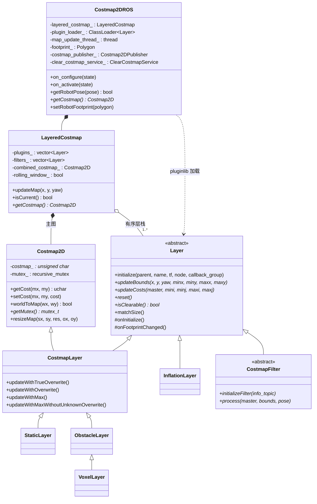
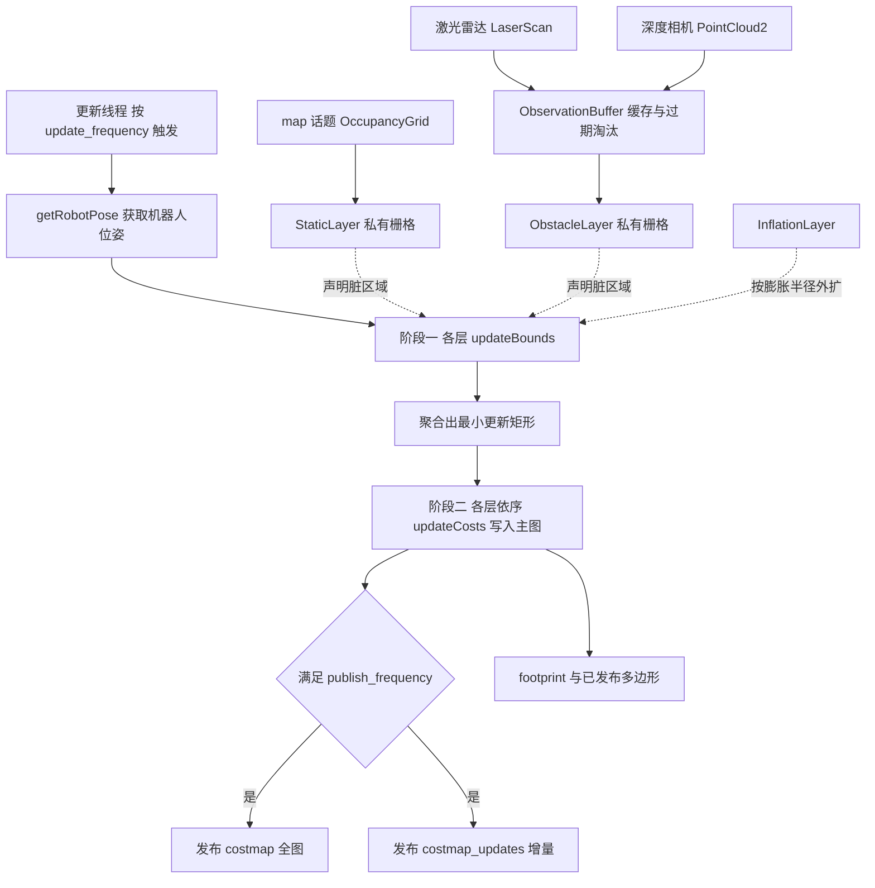
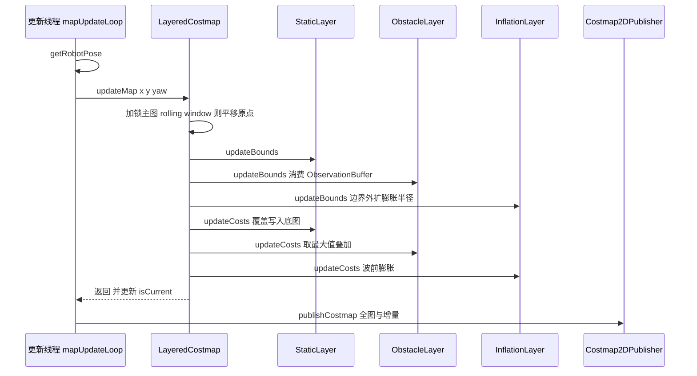

# 第 06 章 Costmap2D：把"世界长什么样"翻译成"哪里能走"

> **一句话总结**：nav2_costmap_2d 用"分层代价地图"把静态地图、动态障碍、安全膨胀等异构信息源拆成一组可插拔的 Layer 插件（Plugin），由 LayeredCostmap 按序合成一张 0~255 的统一栅格，再由 Costmap2DROS 这个生命周期节点（Lifecycle Node）外观封装插件加载、更新线程、footprint 管理与话题发布——规划器与控制器各自持有一份实例，读到的是同一套代价语义、不同视野的世界模型。

> **前置知识**：第 04 章 · 第 05 章 ｜ **知识依赖图**：[KnowledgeGraph/Knowledge](KnowledgeGraph/Knowledge.md)

## 6.1 为什么需要分层代价地图

导航栈对环境表达的需求天然是多源、多时效的：SLAM 建出的静态地图几乎不变；激光与深度相机看到的动态障碍每秒都在刷新；而"离墙远一点"的安全偏好根本不来自任何传感器，是对已有障碍的二次加工。如果把这些信息都塞进一张单一栅格，就会遇到经典难题——新的传感器数据该不该覆盖静态地图？障碍消失后如何恢复被膨胀污染的区域？每接入一种新传感器都要改动整个地图维护逻辑。

Nav2 沿用了 Lu 等人在论文 *Layered Costmaps for Context-Sensitive Navigation*（IROS 2014）中提出的思想：**每种信息源独占一层，各层维护自己的私有栅格与更新语义，只在合成阶段按固定顺序、按声明的合并策略写入主图**。静态层被传感器层覆盖、传感器层被膨胀层加工，语义边界清晰；新增一种信息源只需新增一个 Layer 插件，不触碰任何既有层。这是典型的"用组合替代修改"的开闭原则实践。

## 6.2 代价语义：一张栅格上的通行契约

所有层最终写入的主图共享同一套代价语义，定义在 nav2_costmap_2d/include/nav2_costmap_2d/cost_values.hpp：

| 代价值 | 常量 | 语义 |
| --- | --- | --- |
| 255 | NO_INFORMATION | 未知区域，是否可通行取决于规划器配置 |
| 254 | LETHAL_OBSTACLE | 致命障碍，机器人**中心**落在此格必然碰撞 |
| 253 | INSCRIBED_INFLATED_OBSTACLE | 距障碍不足内接圆半径，机器人中心在此**一定**碰撞轮廓 |
| 1~252 | — | 膨胀衰减带，代价随离障碍距离递减，可通行但应尽量避开 |
| 0 | FREE_SPACE | 完全自由 |

理解 253 与 254 的差别必须引入 footprint 的两个派生量：**内接圆半径**（inscribed radius，轮廓内切圆）与**外接圆半径**（circumscribed radius，轮廓外接圆）。距障碍小于内接半径时，无论机器人朝向如何都会碰撞，所以可以直接判死（253）；距离介于内接与外接半径之间时，是否碰撞取决于朝向，这正是需要 FootprintCollisionChecker 做精确多边形检查的灰色地带。规划器把 253 当作"中心不可进入"的硬边界，就能在只查中心点代价的前提下保证安全——这是代价语义设计中最精妙的一笔。

## 6.3 核心类图：四个角色的分工

四个角色的职责边界：

- **Costmap2D**（nav2_costmap_2d/include/nav2_costmap_2d/costmap_2d.hpp）：纯粹的栅格数据结构，负责底层 `unsigned char*` 存储、世界坐标与栅格坐标互换、以及一把 `recursive_mutex`。它不知道 ROS 的存在，可以独立单元测试。
- **Layer / CostmapLayer**（layer.hpp / costmap_layer.hpp）：Layer 定义 `updateBounds` / `updateCosts` 的更新契约；CostmapLayer 额外继承 Costmap2D，为"需要私有栅格"的层（静态层、障碍层）提供四种合并策略的工具方法。InflationLayer 不需要私有栅格，因此只继承 Layer——继承结构本身就是一份"该层是否持有数据"的文档。
- **LayeredCostmap**（layered_costmap.hpp）：层容器与合成引擎，持有主图 `combined_costmap_`，实现两阶段更新协议（见 6.4），并管理 rolling window 下的地图平移。
- **Costmap2DROS**（costmap_2d_ros.hpp）：唯一与 ROS 深度耦合的类。它继承 `nav2::LifecycleNode`，在 `on_configure` 阶段用 pluginlib 按参数加载各层插件、订阅 footprint、创建发布器与清图服务；在 `on_activate` 阶段拉起 `map_update_thread_` 更新线程。外部使用者（规划器、控制器插件）只需要 `getCostmap()`、`getRobotPose()`、`getRobotFootprint()` 寥寥几个入口。

值得强调的是持有关系：**PlannerServer 与 ControllerServer 各自内嵌一个 Costmap2DROS 实例**（分别是全局图与局部图，详见第 07、09 章），二者参数独立——全局图通常静态、覆盖全场；局部图通常 rolling window、只看机器人周边数米。同一套类，两种配置，两个世界视野。

## 6.4 更新循环：两阶段协议与数据流

代价地图的心跳是 `mapUpdateLoop`（nav2_costmap_2d/src/costmap_2d_ros.cpp），以 `update_frequency` 频率驱动。每一拍的完整数据流：

两阶段协议是性能的关键。**阶段一 updateBounds**：每层根据自己的新数据声明"我这次弄脏了哪个矩形"，各层只做 min/max 扩展，把全图更新收缩为最小脏区域；InflationLayer 会在前序层声明的边界上再向外扩一个膨胀半径，保证边界处的膨胀完整。**阶段二 updateCosts**：在聚合出的栅格边界内，按插件配置顺序逐层写主图——StaticLayer 通常用 overwrite 语义打底，ObstacleLayer 用 max 语义叠加，InflationLayer 最后就地读主图做膨胀。**层的顺序就是语义的顺序**，把 InflationLayer 放在 ObstacleLayer 之前是最常见的配置事故之一。

传感器侧则是典型的观察者模式：订阅回调只把观测塞进 ObservationBuffer（observation_buffer.hpp），由 buffer 负责按 `observation_persistence` 淘汰过期数据；更新线程在 `updateBounds` 时才批量取走观测。回调线程与更新线程通过 buffer 内部锁解耦，传感器频率再高也不会拖垮更新循环。

一次典型更新的时序：

## 6.5 内置 Layer 逐个精讲

| Layer | 源文件（nav2_costmap_2d/plugins/） | 数据来源 | 主图写入语义 | 典型位置 |
| --- | --- | --- | --- | --- |
| StaticLayer | static_layer.cpp | map 话题 OccupancyGrid | overwrite 打底 | 全局图第一层 |
| ObstacleLayer | obstacle_layer.cpp | LaserScan / PointCloud2 | max 叠加 | 静态层之后 |
| VoxelLayer | voxel_layer.cpp | 同上，含 3D 体素 | max 叠加 | 替代 ObstacleLayer |
| RangeSensorLayer | range_sensor_layer.cpp | Range 单点测距 | 概率更新后叠加 | 超声/红外场景 |
| InflationLayer | inflation_layer.cpp | 主图自身 | 就地膨胀 | 层栈最后 |
| DenoiseLayer | denoise_layer.cpp | 主图自身 | 形态学去噪 | 膨胀之前 |
| PluginContainerLayer | plugin_container_layer.cpp | 嵌套子插件 | 子层先内部合成 | 需要分组合并策略时 |

**StaticLayer**：把 OccupancyGrid 的 0~100/-1 翻译为 costmap 语义（100→254、-1→255），`trinary_costmap` 参数决定是否保留中间概率值。它订阅 map 话题必须使用 transient_local QoS——map_server 只在地图变化时发布一次，靠 durability 语义让后启动的 costmap 也能拿到"最后一张地图"。

**ObstacleLayer**：marking 与 clearing 双机制。marking 把观测命中的栅格写为 LETHAL（受 `obstacle_max_range` 限制）；clearing 沿传感器原点到命中点做 raytrace，把沿途栅格清为 FREE（受 `raytrace_max_range` / `raytrace_min_range` 限制）。两组 range 参数各司其职：raytrace 决定"多远的空旷可信"，obstacle 决定"多远的障碍可信"，前者通常应大于后者，否则清不掉已驶离的幽灵障碍。

**VoxelLayer**：在 ObstacleLayer 之上维护三维体素栅格（`z_voxels` × `z_resolution`），投影到 2D 前先在垂直方向判断占据，能正确处理桌面下方可通行、悬空障碍等 2D 激光无法表达的场景，代价是更高的内存与计算开销。

**RangeSensorLayer**：面向声呐类宽波束传感器，命中点不是一个点而是一个锥形概率分布，层内做概率融合后再离散为代价，避免单次噪声测量直接判死一片区域。

**InflationLayer**：从所有 LETHAL 栅格出发做波前扩散（优先队列按距离出队），对每个格子套用衰减函数：距离小于内接半径写 253，否则按 `exp(-cost_scaling_factor × (distance - inscribed_radius)) × 252` 指数衰减，超出 `inflation_radius` 归零。距离与代价均预先按分辨率制表缓存，膨胀只发生在脏区域外扩一圈的范围内。仓库中另有 asymmetric_inflation_layer.cpp（前后左右不同膨胀半径）与 legacy_inflation_layer.cpp（旧实现）两个变体可选。

**DenoiseLayer**：用形态学操作剔除孤立障碍点——传感器噪声形成的单像素障碍会被膨胀层放大成一大片高代价区，先去噪再膨胀能显著改善路径质量。

## 6.6 Costmap Filters：作用于"行为"而非"代价合成"

Costmap Filter（nav2_costmap_2d/include/nav2_costmap_2d/costmap_filters/）在类层次上也是 Layer 的子类，但设计意图完全不同：**Layer 回答"世界哪里有障碍"，Filter 回答"运营上希望机器人在哪里做什么"**。Filter 不参与传感器数据合成，而是订阅一对外部话题——`filter_info`（CostmapFilterInfo，声明 mask 的解码方式：type、base、multiplier）与 `filter_mask`（OccupancyGrid，空间标注图）——在主图合成完毕后按机器人当前位姿做后处理，是层栈末端的装饰器。

| Filter | 头文件 | mask 语义 | 输出效果 |
| --- | --- | --- | --- |
| KeepoutFilter | keepout_filter.hpp | 占据=禁入区 | 把禁入区写为 LETHAL 或指定代价，规划器自动绕开 |
| SpeedFilter | speed_filter.hpp | 值映射为限速 | 发布 SpeedLimit 消息，控制器降速，不改代价 |
| BinaryFilter | binary_filter.hpp | 超过阈值即翻转 | 发布 Bool 状态，触发外部逻辑如关闭喷涂 |

注意 SpeedFilter 与 BinaryFilter 甚至**完全不修改主图**——它们借用 costmap 的更新循环拿到机器人位姿与 mask 的空间对应关系，输出的是话题消息。这解释了为什么 Filter 被单列一族而不是普通 Layer：mask 是运营人员手绘的语义标注（通常用另一个 map_server 实例发布），与传感器无关，随业务随时更换。

## 6.7 线程与锁：谁在写、谁该锁

Costmap2DROS 的线程模型可以概括为"一写多读"：

- **更新线程**：`on_activate` 中创建的 `map_update_thread_` 是主图的唯一写者，`updateMap` 全程持有主图的 `recursive_mutex`。
- **回调线程**：传感器回调只写各层私有的 ObservationBuffer，footprint 回调更新多边形，均不直接碰主图。
- **外部读者**：规划器、控制器通过 `getCostmap()` 拿到主图指针后，**必须自行加锁**——`std::unique_lock<Costmap2D::mutex_t> lock(*costmap->getMutex())`——这是仓库明文约定而非可选项，漏锁的后果是规划到一半地图被更新线程改写，轻则路径异常，重则读到 `resizeMap` 后的悬空指针。选用递归锁是为了允许"外部已持锁的情况下调用内部同样加锁的查询方法"。

rolling window 模式下，`updateMap` 开头会把主图原点平移到以机器人为中心的位置，平移只移动原点、按需搬运重叠区域数据，窗口外的历史信息直接丢弃——这也是局部图不配 StaticLayer 的原因：窗口一动，静态数据就得靠反复重贴，得不偿失。

## 6.8 辅助设施：围绕代价地图的工具箱

- **FootprintCollisionChecker**（footprint_collision_checker.hpp）：给定位姿与 footprint 多边形，沿多边形边做栅格化并返回覆盖格的最大代价，是 6.2 节所述"内接/外接半径灰色地带"的精确仲裁者，被 Smac 规划器、行为服务器广泛复用。
- **CostmapSubscriber / FootprintSubscriber**（costmap_subscriber.hpp / footprint_subscriber.hpp）：不方便进程内持有 Costmap2DROS 的组件（如 SmootherServer、跨进程的碰撞监测）通过订阅 costmap 话题在本地重建一份 Costmap2D。这是"重外观、轻订阅"两种消费模式中的轻量一侧，代价是数据存在一个发布周期的滞后。
- **ClearCostmapService**（clear_costmap_service.hpp）：暴露 clear_entirely / clear_around / clear_except 三个服务，逐层调用 `isClearable()` 为真的层的重置接口。行为树中的 ClearCostmap 恢复节点正是打到这里——机器人被"幽灵障碍"困住时，清图往往是代价最小的自救手段。
- **Costmap2DPublisher**（costmap_2d_publisher.hpp）：全图按 `publish_frequency` 节流发布，增量走 costmap_updates 话题只携带脏矩形，RViz 与 CostmapSubscriber 都依赖这套全量+增量协议。

## 6.9 设计模式盘点

| 模式 | 落点 | 收益 |
| --- | --- | --- |
| 模板方法 | Layer::initialize 固定流程，子类只覆盖 onInitialize / updateBounds / updateCosts | 更新协议由框架统一执行，插件无法破坏两阶段契约 |
| 组合 | LayeredCostmap 持有有序 Layer 栈 | 信息源的增删改均不触碰合成引擎 |
| 外观 | Costmap2DROS 收拢插件加载、线程、TF、发布 | 使用方只面对 getCostmap 等极小接口面 |
| 观察者 | 传感器回调 → ObservationBuffer → 更新线程消费 | 回调与更新解耦，各自节拍互不阻塞 |
| 装饰器 | CostmapFilter 在合成结果上做后处理 | 运营语义叠加不侵入传感器层 |

## 6.10 扩展：写一个自定义 Layer 的最小步骤

自定义层只需五步：继承 `nav2_costmap_2d::Layer`（需私有栅格则继承 CostmapLayer）；实现 `onInitialize`（声明参数、建订阅）、`updateBounds`（声明脏区域）、`updateCosts`（写主图）、`reset` 与 `isClearable`；用 `PLUGINLIB_EXPORT_CLASS` 导出；编写插件描述 XML 并在 package.xml 中 export；最后把插件名加入 costmap 的 `plugins` 参数列表。完整模板与陷阱解析见第 24 章。

## 6.11 最佳实践与容易踩坑

1. **inflation_radius 与 cost_scaling_factor 要成对调**：半径决定衰减带宽度，系数决定陡峭度。系数过大等于没有衰减带（路径贴墙走），过小则窄通道被高代价堵死。先定半径（建议 ≥ 外接圆半径的 1.5~2 倍），再用系数微调路径的"离墙偏好"。
2. **footprint 未配置或配错，253 语义整体失效**：内接半径由 footprint 派生，若只给了 `robot_radius` 却按矩形车体运行，InflationLayer 判死区将小于真实车体，碰撞检查形同虚设。改 footprint 后务必确认各层收到 `onFootprintChanged` 后的行为。
3. **raytrace 与 obstacle 两组 range 分开理解**：`raytrace_max_range` 略大于 `obstacle_max_range`，才能清除刚移出标记范围的障碍；`raytrace_min_range` 用于跳过打在自身车体上的近距离回波。
4. **update_frequency 与 publish_frequency 解耦配置**：更新频率服务于控制回路（局部图常 5 Hz 以上），发布频率只服务于可视化与订阅方，盲目拉高发布频率是白烧带宽。
5. **静态层订阅必须 transient_local**：map_server 不周期发布，Volatile QoS 的后启动订阅者会永远收不到地图，表现为全局图整片 NO_INFORMATION。
6. **外部读图永远先加锁**：任何绕过 `getMutex()` 的 `getCharMap()` 直读都是数据竞争，问题往往在现场压力测试时才暴露。

## 6.A 源码导航与入手路径

入口链：Costmap2DROS::on_configure()（pluginlib 加载各层插件）→on_activate()（拉起 map_update_thread_）→mapUpdateLoop()→Costmap2DROS::updateMap()→LayeredCostmap::updateMap()→各层 updateBounds()/updateCosts()→Costmap2DPublisher 发布全图与增量。

源码地图：

| 文件（仓库相对路径，约 N 行） | 关键函数 | 作用 |
|---|---|---|
| nav2_costmap_2d/src/costmap_2d_ros.cpp（约 946 行） | on_configure() / mapUpdateLoop() / getRobotPose() | 外观类：插件加载、更新线程、footprint 管理 |
| nav2_costmap_2d/src/layered_costmap.cpp（约 323 行） | updateMap() / isCurrent() | 两阶段合成引擎与 rolling window 平移 |
| nav2_costmap_2d/src/costmap_2d.cpp（约 603 行） | getCost() / worldToMap() | 纯栅格数据结构，不依赖 ROS |
| nav2_costmap_2d/plugins/obstacle_layer.cpp（约 876 行） | updateBounds() / raytraceFreespace() | marking/clearing 双机制的传感器层样本 |
| nav2_costmap_2d/plugins/inflation_layer.cpp（约 494 行） | updateCosts() / computeCaches() | 波前膨胀与衰减函数查表 |

阅读顺序：

| 第一遍只看 | 第二遍补充 | 以后再看 |
|---|---|---|
| layered_costmap.cpp 的 updateMap()（两阶段协议骨架） | costmap_2d_ros.cpp 的 mapUpdateLoop() 与 inflation_layer.cpp | obstacle_layer.cpp 的 ObservationBuffer 细节与 voxel/range 变体 |

完整更新链路见 [Costmap 更新循环时序图](Assets/sequence/Costmap更新循环.md)。

## 6.B 设计权衡

### 分层 costmap vs 单层格网

单层格网把所有信息源写进同一张栅格，写入即丢失来源——障碍消失后无法区分"该格是静态墙还是旧观测"，膨胀污染的区域也无法恢复；新接一种传感器就要改整张地图的维护逻辑。分层方案让每层私有栅格自治更新、合成阶段按序写入，新增信息源只加一层不碰既有层。代价是内存翻倍（每个持栅格层一份副本）与每拍多一轮合成开销；Nav2 用两阶段脏区域协议把合成成本压到最小，让这个代价可接受。

### 内嵌对象 vs 独立地图节点

把 costmap 做成独立节点，规划器每次读图都要跨进程序列化整张栅格，延迟与带宽都不可接受；内嵌进 PlannerServer / ControllerServer 后，插件拿共享指针零拷贝随机访问，代价是必须用递归锁约定管理"更新线程写、外部读者锁读"的并发，且全局/局部两份实例各占一份内存。对于确实需要跨进程消费的组件（如 SmootherServer），Nav2 提供 CostmapSubscriber 轻量订阅作为退路，接受一个发布周期的滞后。

### 两阶段更新协议 vs 每帧全图重算

每帧全图重算逻辑最简单，但大地图下无法维持 update_frequency；两阶段协议要求每层先用 updateBounds 声明脏矩形、再在聚合边界内 updateCosts，把计算量收缩到最小脏区域。代价是插件契约变复杂：层必须诚实声明自己弄脏的范围，声明不足会留下残影，InflationLayer 还必须额外外扩膨胀半径才能保证边界膨胀完整——这也是"层顺序即语义顺序"配置铁律的由来（模板方法模式的更多实例见第 22 章）。

## 6.12 知识总结

1. 分层代价地图的本质是**把"信息源的维护"与"代价的合成"分离**：每层私有栅格自治更新，LayeredCostmap 以两阶段协议（updateBounds 聚合脏区域 → updateCosts 依序合成）产出主图，层的顺序即语义顺序。
2. 代价值 0/1~252/253/254/255 是一份**以内接圆半径为锚点的通行契约**：253 保证"中心在此必碰撞"，让规划器仅查中心点即可安全，灰色地带交给 FootprintCollisionChecker。
3. Costmap2DROS 是**外观 + 生命周期宿主**：pluginlib 加载层栈、独立更新线程、footprint 与发布器全部收拢其后；Nav2 中它从不独立运行，而是被 PlannerServer / ControllerServer 各内嵌一份。
4. Costmap Filter 与 Layer 同根不同用：Layer 合成传感器世界，Filter 用运营人员标注的 mask 在合成结果上叠加禁入、限速、开关等**业务语义**，其中限速与二值过滤甚至不改代价只发消息。
5. 并发模型是"更新线程唯一写、回调写缓冲、外部读者持锁读"，递归锁 + ObservationBuffer 解耦是整个包保持实时性的基石。

## 6.13 常见面试题

**Q1：253（INSCRIBED）和 254（LETHAL）有什么区别？为什么需要两个值？**
答题要点：254 表示该格本身是障碍，机器人中心进入必然物理碰撞；253 表示该格离障碍的距离小于内接圆半径，中心进入则轮廓必然碰撞。区分二者后，规划器只需查询机器人中心点的代价即可保证安全（把 ≥253 当作不可通行），无需对每个候选点做昂贵的多边形碰撞检查；朝向相关的灰色地带（内接与外接半径之间）才交给 FootprintCollisionChecker。

**Q2：描述一次 updateMap 的完整流程，两阶段设计解决了什么问题？**
答题要点：更新线程先取机器人位姿；rolling window 则平移原点；阶段一遍历各层 updateBounds，各层声明自己的脏矩形并做 min/max 聚合（InflationLayer 额外外扩膨胀半径）；阶段二在聚合边界内依序调用各层 updateCosts 写主图；最后按发布频率发出全图与增量。两阶段把"每帧全图重算"收缩为"只算最小脏区域"，是大地图下维持更新频率的关键。

**Q3：ObstacleLayer 的 marking 与 clearing 分别做什么？相关 range 参数如何配？**
答题要点：marking 把观测命中点写为 LETHAL（受 obstacle_max_range 限制）；clearing 沿传感器到命中点 raytrace 清空沿途栅格（受 raytrace_min/max_range 限制）。raytrace_max_range 应略大于 obstacle_max_range 以清除幽灵障碍；raytrace_min_range 用于过滤打在车体上的回波；raytrace 范围过大则 CPU 开销剧增。

**Q4：InflationLayer 的代价衰减函数是什么形式？两个参数如何影响机器人行为？**
答题要点：距离 ≤ 内接半径写 253；内接半径到 inflation_radius 之间按 exp(-cost_scaling_factor × (distance − inscribed_radius)) × 252 指数衰减；之外为 0。inflation_radius 决定"离墙偏好"的作用范围，cost_scaling_factor 决定衰减陡峭度——系数越大高代价带越窄，路径越敢贴近障碍。

**Q5：Costmap Filter 与普通 Layer 的本质区别？举例说明。**
答题要点：Layer 从传感器/地图合成"世界哪里有障碍"；Filter 订阅 filter_info + filter_mask 两个话题，用人工标注的语义 mask 在合成完的主图上做后处理，表达"运营希望机器人怎么做"。KeepoutFilter 改代价实现禁入区；SpeedFilter/BinaryFilter 不改代价，只按机器人所处 mask 区域发布限速/布尔消息。

**Q6：规划器插件直接读 Costmap2DROS 的地图时要注意什么？为什么用递归锁？**
答题要点：主图由更新线程周期改写，外部读者必须先 `getMutex()` 加 `unique_lock` 再访问数据，否则存在数据竞争甚至 resize 后的悬空指针。选择 recursive_mutex 是允许同一线程嵌套加锁——外部已持锁时再调用内部同样加锁的查询接口不会死锁。

## 6.14 延伸阅读

- Lu, D., Hershberger, D., Smart, W. D. *Layered Costmaps for Context-Sensitive Navigation*, IROS 2014——分层代价地图的原始论文。
- nav2_costmap_2d/README.md 与 Nav2 官方文档 Costmap 2D / Costmap Filters 配置指南。
- 源码精读建议路线：cost_values.hpp → layer.hpp → layered_costmap.cpp 的 updateMap → costmap_2d_ros.cpp 的 mapUpdateLoop → plugins/inflation_layer.cpp。
- 第 04 章：nav2_core 接口契约中 costmap_ros 的注入方式；第 07 / 09 章：PlannerServer 与 ControllerServer 如何各自持有并消费一份 Costmap2DROS；第 24 章：自定义 Layer 实战。

## 6.C 阅读检查点

1. 代价值 253 与 254 的区别是什么？为什么说 253 让规划器"只查中心点即可安全"？（见 6.2 节）
2. Costmap2D、Layer/CostmapLayer、LayeredCostmap、Costmap2DROS 四个角色的职责边界分别是什么？（见 6.3 节）
3. updateBounds/updateCosts 两阶段协议各做什么？InflationLayer 为什么要在边界上额外外扩膨胀半径？（见 6.4 节）
4. ObstacleLayer 的 raytrace_max_range 为什么应略大于 obstacle_max_range？配反了会出现什么症状？（见 6.5 节）
5. Costmap Filter 与普通 Layer 的本质区别是什么？哪两个 Filter 甚至完全不修改主图？（见 6.6 节）

> 下一章：07_PlannerServer与全局规划
