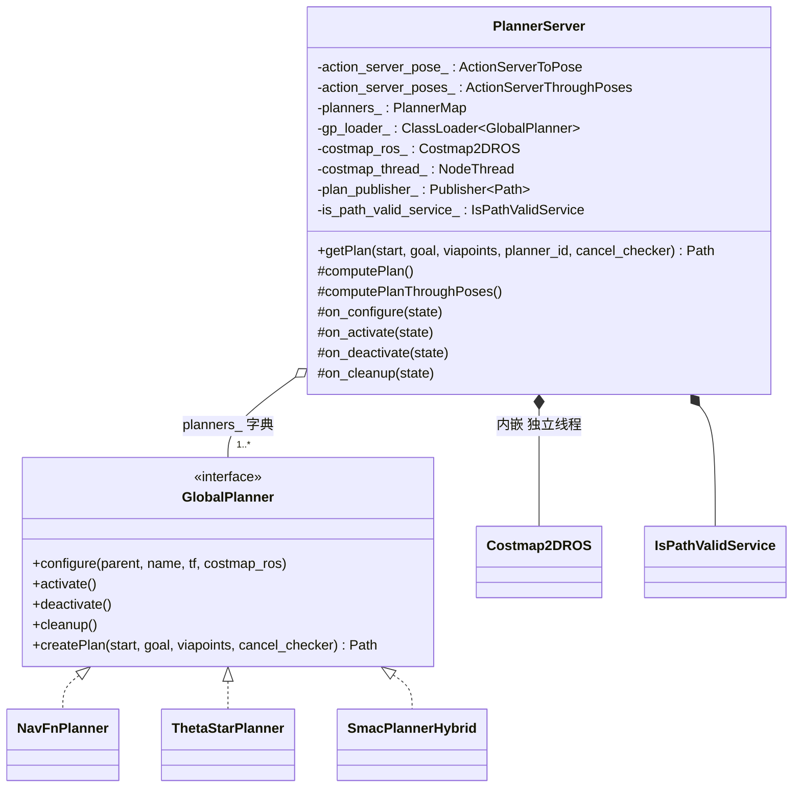
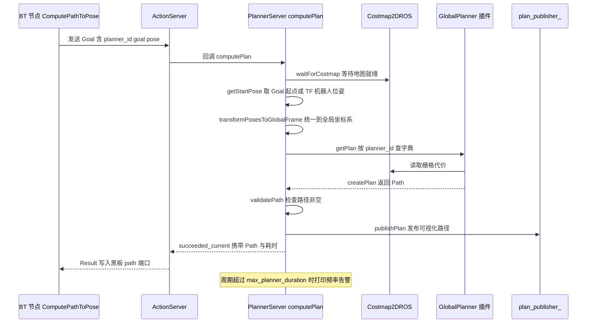
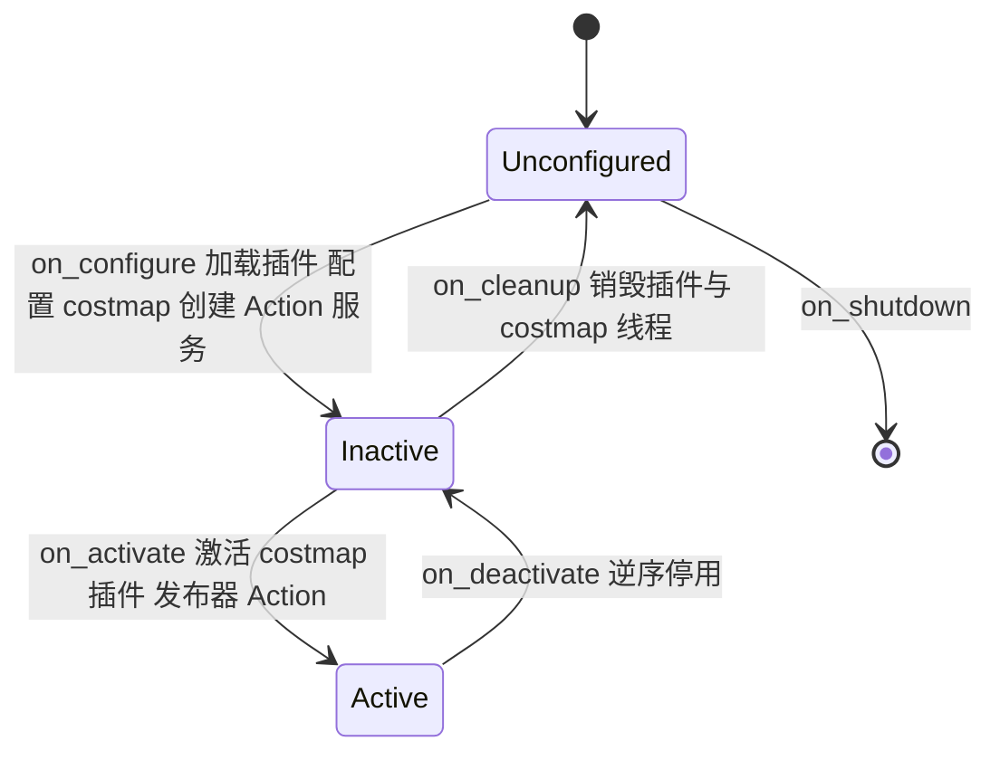

# 第 07 章 PlannerServer 与全局规划：把"怎么走"做成一个可插拔的服务

> **一句话总结**：PlannerServer 是 Nav2 中承载全局规划的生命周期节点（Lifecycle Node），它内嵌一份全局代价地图（Costmap）并在独立线程中维护其更新，通过 ComputePathToPose / ComputePathThroughPoses 两个 Action 对外提供规划能力，用插件（Plugin）字典同时挂载多个 GlobalPlanner 算法实现请求级热切换，并以统一的异常体系把算法失败翻译成行为树（BT）可以决策的错误码。

> **前置知识**：第 04 章 · 第 05 章 · 第 06 章 ｜ **知识依赖图**：[KnowledgeGraph/Knowledge](KnowledgeGraph/Knowledge.md)

## 7.1 为什么需要独立的规划服务器

move_base 时代，全局规划器与局部控制器被硬编码在同一个单体节点里，规划失败只能触发写死的恢复序列，替换算法要重新编译整个节点（对比详见第 00 章）。Nav2 把"全局规划"单独拆成一个服务器（Server），本质上是回答三个工程问题：

1. **职责边界**：规划是低频、计算密集、可容忍秒级延迟的任务，而控制是高频实时任务，二者对线程模型、失败语义、抢占策略的要求完全不同，不应共享一个进程内的状态机。
2. **算法可替换**：全局规划算法百花齐放——Dijkstra、A*、Theta*、Hybrid-A*、State Lattice——框架必须允许用户在不触碰框架代码的前提下替换乃至并存多种算法。
3. **失败可编排**：规划失败的原因（起点被占用、目标被占用、TF 超时、超时无解）对上层恢复策略的意义截然不同，服务器必须把异常语义完整地传递给行为树，而不是笼统地返回"失败"。

PlannerServer 对这三个问题的回答分别是：**Action 化的服务边界**、**插件字典 + pluginlib 工厂**、**异常类型到 Action error code 的显式映射**。

## 7.2 整体设计

PlannerServer 定义于 nav2_planner/include/nav2_planner/planner_server.hpp，实现在 nav2_planner/src/planner_server.cpp，继承自 `nav2::LifecycleNode`。其静态结构如下：

四个设计决策值得展开：

**双 Action 接口**。`ComputePathToPose` 处理单目标规划；`ComputePathThroughPoses` 接受一串中间点（viapoints），支持"途经多个位置"的场景。两者共享同一套 `getPlan()` 内核，区别只在目标解析与异常集合（后者多一个 `NoViapointsGiven`）。这也是 `nav2_core::GlobalPlanner::createPlan()` 签名中带 `viapoints` 参数的原因（接口契约详见第 04 章）。

**插件字典与多规划器热切换**。`PlannerMap` 是 `unordered_map<string, GlobalPlanner::Ptr>`，键为插件的配置名（如 `GridBased`）。每个 Action Goal 携带 `planner_id` 字段，服务器按名查表分发；若系统只配置了一个规划器且 `planner_id` 为空则默认使用它，否则查不到即抛 `InvalidPlanner`。这意味着**同一台机器人可以同时挂载 NavFn 与 Smac Hybrid，由行为树在不同任务上下文里选择不同算法**——切换发生在请求级，无需重启任何节点。

**内嵌 Costmap2DROS 与独立线程**。全局代价地图不是独立进程，而是在 PlannerServer 构造函数中作为子节点创建的 `Costmap2DROS` 实例，由 `costmap_thread_`（`nav2::NodeThread`）驱动其执行器独立旋转。规划器插件通过 `configure()` 拿到这份 costmap 的共享指针，直接在进程内读取栅格数据，避免了跨进程序列化整张地图的开销（Costmap 内部机制详见第 06 章）。规划前服务器还会调用 `waitForCostmap()` 阻塞等待代价地图拿到最新传感器数据，防止在清除恢复行为之后基于空地图规划。

**is_path_valid 服务**。除了"算一条路"，服务器还提供"验一条路"的能力：`IsPathValidService`（nav2_planner/src/is_path_valid_service.cpp）沿既有路径逐点检查当前代价地图上的代价值，供行为树里的 `IsPathValid` 条件节点周期性判断旧路径是否已被新出现的障碍物截断——这是"规划一次、监督执行"闭环里的关键一环。

## 7.3 一次 ComputePathToPose 的完整旅程

数据流可概括为：**Goal（目标位姿 + planner_id）→ 起点解析（消息或 TF）→ 坐标系归一化 → 插件搜索（读 Costmap）→ Path 校验 → Result + 可视化话题**。其中起点解析是一个容易被忽略的细节：Goal 中的 `use_start` 允许调用方显式指定起点（例如离线批量规划），缺省则通过 TF 获取机器人当前位姿——`getStartPose()` 失败会直接以 `TF_ERROR` 终止。

### 异常体系与错误码映射

规划器插件不返回错误码，而是**抛出 nav2_core/planner_exceptions.hpp 中定义的语义化异常**；`computePlan()` 的 catch 链把它们翻译成 Action Result 中的 `error_code`：

| 异常类型 | Action error code | 语义 | 行为树的典型反应 |
|---|---|---|---|
| `nav2_core::InvalidPlanner` | INVALID_PLANNER | planner_id 不在字典中 | 配置错误，直接失败上报 |
| `nav2_core::StartOccupied` | START_OCCUPIED | 起点在致命障碍内 | 触发清除代价地图 / 后退行为 |
| `nav2_core::GoalOccupied` | GOAL_OCCUPIED | 目标在致命障碍内 | 触发清除代价地图或放弃目标 |
| `nav2_core::NoValidPathCouldBeFound` | NO_VALID_PATH | 搜索完成但无解 | 换规划器重试或等待环境变化 |
| `nav2_core::PlannerTimedOut` | TIMEOUT | 超过规划时限 | 重试或降级 |
| `nav2_core::PlannerTFError` | TF_ERROR | 坐标变换失败 | 系统级告警 |
| `nav2_core::NoViapointsGiven` | NO_VIAPOINTS_GIVEN | ThroughPoses 未给中间点 | 调用方参数错误 |
| `nav2_core::PlannerException` | UNKNOWN | 其余未细分异常 | 通用恢复 |

这套映射的价值在于：**恢复策略的决策权留给行为树，而不是埋在服务器里**。第 00 章提到的"错误码驱动恢复"正是靠各服务器统一遵守这一约定实现的。

### 频率告警机制

每次规划结束后，服务器把本周期耗时与 `expected_planner_frequency` 推导出的 `max_planner_duration` 比较，超时则打印"Planner loop missed its desired rate"警告。这不是硬实时约束——规划照常返回——而是一个**运维信号**：提醒使用者当前地图规模、算法选择与期望频率不匹配，应当调低频率、启用下采样或更换更快的算法。

## 7.4 生命周期

作为生命周期节点，PlannerServer 的资源获取与释放严格对齐状态机：

`on_configure` 阶段依次完成：配置内嵌 Costmap → 通过 `pluginlib::ClassLoader<nav2_core::GlobalPlanner>` 按参数列表 `planner_plugins` 逐个实例化插件并调用其 `configure()` → 创建路径发布器、两个 Action 服务器与 is_path_valid 服务。`on_activate` 按"costmap → 发布器 → Action → 插件"的顺序激活并注册与 lifecycle_manager 的 bond 心跳；`on_deactivate` 逆序执行；`on_cleanup` 释放全部资源包括 costmap 线程。插件的四个生命周期回调（configure/activate/deactivate/cleanup）与宿主节点完全同步——这是 nav2_core 对所有算法插件的统一要求（详见第 04 章）。

## 7.5 内置规划器一：NavFn

NavFn（nav2_navfn_planner）是从 ROS 1 时代延续下来的经典栅格规划器，算法核心在 nav2_navfn_planner/src/navfn.cpp，插件包装在 navfn_planner.cpp。

其本质是**势场（potential field）上的波前传播 + 梯度回溯**：

1. **波前传播**：从目标点出发向外扩散势能波，`potarr[]` 记录每个栅格到目标的最小累计代价，`costarr[]` 提供栅格通行代价，三层优先级缓冲（pb1/pb2/pb3）近似优先级队列。传播有两种模式：`calcNavFnDijkstra()` 完整传播覆盖起点（准确但慢）、`calcNavFnAstar()` 加入到起点的启发式提前终止（快）。
2. **二次插值更新**：势能更新不是简单的 4 邻接取小，而是用两个最低邻居做平面波二次插值，使势场在栅格间连续，为后续梯度回溯提供光滑基础。
3. **梯度回溯**：`calcPath()` 从起点出发，对势场求数值梯度，按 0.5 像素步长沿最陡下降方向前进直到目标——因此 NavFn 输出的路径点并不严格落在栅格中心上。

| 参数 | 含义 | 调参影响 |
|---|---|---|
| `use_astar` | 用 A* 启发式替代纯 Dijkstra | 提速明显；但势场非全局最优，路径质量可能略降 |
| `allow_unknown` | 允许穿越未知区域 | 建图导航必开；已知地图导航建议关闭以免钻入未探测区 |
| `tolerance` | 目标不可达时在其周围搜索可行终点的半径（米） | 过大可能匹配到错误的局部极小值，建议 0.125~0.5 |

## 7.6 内置规划器二：Theta*

Theta*（nav2_theta_star_planner）解决的是传统 A* 的"折线病"：8 邻接搜索的路径方向被量化为 45° 的整数倍，走出来的路又长又抖。Theta* 在 A* 骨架上加入 **Line-of-Sight（LOS）父节点重连**：

| 步骤 | 做法 |
|---|---|
| LOS 检查 | 扩展节点时，用 Bresenham 线算法检查"当前节点能否直连祖父节点"，沿线累加通行代价，遇障碍即失败 |
| 父节点重连 | 若 LOS 成立且经祖父节点的代价更低，则跳过父节点直接认祖父为父（`ThetaStar::resetParent()`，见 nav2_theta_star_planner/src/theta_star.cpp） |
| 回溯 | 从目标沿父指针回溯，天然得到任意角度的折线段路径 |

代价上，每次扩展都可能触发一次 O(线长) 的 LOS 检查，最坏复杂度高于 A*；收益是路径由少数几段任意角度直线构成，几乎不需要再平滑。

### NavFn 与 Theta* 对比

| 维度 | NavFn | Theta* |
|---|---|---|
| 算法族 | 势场波前传播 Dijkstra/A* | 任意角度 A* 变体 |
| 路径形态 | 梯度回溯，较平滑但贴障碍 | 少数长直线段，角度任意 |
| 代价敏感度 | 全场传播，天然感知代价梯度 | 依赖 LOS 线积分与 `w_traversal_cost` 权重 |
| 计算开销 | 大地图上传播成本高但稳定 | 开阔环境快，障碍密集时 LOS 开销放大 |
| 运动学约束 | 无 | 无 |
| 适用建议 | 差速/全向底盘的默认选择，行为最可预期 | 开阔仓储环境、追求长直线路径的全向/差速底盘 |

两者都把机器人视为可原地转向的质点。一旦底盘存在最小转弯半径（阿克曼、类车），就必须换用第 08 章的 SmacPlanner 家族。

## 7.7 设计模式与扩展方式

PlannerServer 是 Nav2 服务器设计范式的标准样本：

- **策略模式 + 插件工厂**：`nav2_core::GlobalPlanner` 定义算法策略接口，`pluginlib::ClassLoader` 充当工厂在运行期按字符串实例化具体策略，`planners_` 字典让多个策略并存、按请求分发。
- **外观模式**：`getPlan()` 把"等地图、取起点、转坐标、查字典、调插件、验路径、发话题"七步收敛为单一入口，Action 回调与两个 Action 类型共用这层外观。
- **模板方法**：`computePlan()` 与 `computePlanThroughPoses()` 共享同一处理骨架，仅目标解析步骤不同。

编写自定义全局规划器只需实现 `GlobalPlanner` 的五个虚函数并导出 pluginlib 描述文件，再在参数里注册插件名即可——完整步骤在第 24 章展开。

## 7.A 源码导航与入手路径

入口链：main()→PlannerServer 构造（创建内嵌 Costmap2DROS）→on_configure()（pluginlib 加载插件 + 创建双 Action 服务器）→computePlan() 回调→waitForCostmap()→getPlan()→planner_->createPlan()→publishPlan()。

源码地图：

| 文件（仓库相对路径，约 N 行） | 关键函数 | 作用 |
|---|---|---|
| nav2_planner/src/planner_server.cpp（约 694 行） | computePlan() / getPlan() / waitForCostmap() / transformPosesToGlobalFrame() | 服务器主体：双 Action 回调、异常映射、频率告警 |
| nav2_planner/include/nav2_planner/is_path_valid_service.hpp（约 308 行） | IsPathValidService | 旧路径有效性校验服务 |
| nav2_navfn_planner/src/navfn_planner.cpp（约 530 行） | createPlan() / makePlan() | NavFn 的插件包装层 |
| nav2_navfn_planner/src/navfn.cpp（约 1035 行） | calcNavFnDijkstra() / calcNavFnAstar() / calcPath() | 势场波前传播与梯度回溯的算法本体 |
| nav2_theta_star_planner/src/theta_star.cpp（约 252 行） | generatePath() / resetParent() / losCheck() | LOS 父节点重连的任意角度 A* |

阅读顺序：

| 第一遍只看 | 第二遍补充 | 以后再看 |
|---|---|---|
| planner_server.cpp 的 computePlan()→getPlan() 主链与 catch 异常映射链 | navfn.cpp 的势场传播与 theta_star.cpp 的 LOS 重连 | is_path_valid_service.hpp 与 ThroughPoses 分支细节 |

完整业务链路见 [NavigateToPose 端到端时序图](Assets/sequence/NavigateToPose.md)。

## 7.B 设计权衡

### Action vs Service：规划为什么用 Action

规划看似"请求-应答"，用 Service 就够，但 Service 缺两样关键能力：不可取消与不可抢占。大地图上一次 Hybrid-A* 搜索可能耗时数秒，目标变更时行为树必须能立即抽回旧请求发起新请求，Action 的 cancel 通道配合 createPlan() 的 cancel_checker 实现了毫秒级响应取消；Service 调用一旦发出只能干等。代价是 Action 协议比 Service 多一套目标/反馈/结果状态机、实现更重。Nav2 的取舍界线很清晰：长耗时、需抢占的用 Action，瞬时完成的校验类能力（如 is_path_valid）仍用 Service（通信范式全景见第 19 章）。

### 内嵌 costmap + 独立线程 vs 共享地图服务

全局代价地图作为子节点内嵌在 PlannerServer 进程内并由 costmap_thread_ 独立驱动，插件零拷贝直读栅格；若改成跨进程地图服务，每次规划都要传输数 MB 的栅格快照。独立线程则保证传感器更新不被长耗时搜索阻塞——规划跑在 Action 回调线程，地图更新跑在自己的执行器里。代价是规划与控制各持一份 costmap，内存翻倍且两图短暂不一致；Nav2 接受这一点，因为全局/局部地图的尺寸、频率、层配置本就应该分离。

### 异常映射错误码 vs 布尔返回值

若 createPlan() 只返回空路径表示失败，行为树只能知道"没规划出来"，无从区分"起点被占"该清图、"目标被占"该换目标、"TF 超时"该系统告警。异常类型到 error_code 的显式映射把失败语义完整保真到 Action 结果，恢复策略的决策权留给行为树而非埋在服务器里。代价是每新增一种失败语义都要同步改异常类、catch 链与 Action 定义三处；换来的是运维上"错误码即诊断"的代际跃升（异常体系的契约层视角见第 04 章）。

## 知识总结

1. PlannerServer 用**双 Action + 插件字典**把全局规划做成请求级可切换的服务：同一进程可挂载多个 GlobalPlanner 插件，行为树通过 `planner_id` 逐次选择。
2. 全局代价地图以 **Costmap2DROS 内嵌 + 独立线程**方式运行，插件进程内直读栅格；规划前 `waitForCostmap()` 保证不用陈旧地图规划。
3. 失败语义靠**异常类型 → Action error code** 的显式映射传递，恢复决策权完全交给行为树；频率告警只是运维提示而非硬约束。
4. NavFn 是势场波前传播 + 梯度回溯，Theta* 是 LOS 父节点重连的任意角度 A*；两者均不考虑运动学约束，适用于可原地转向的底盘。
5. 生命周期上，插件的 configure/activate/deactivate/cleanup 与宿主 Lifecycle Node 严格同步，资源获取与释放对称成对。

## 常见面试题

1. **PlannerServer 如何支持多个规划器共存？切换的粒度是什么？**
   要点：`on_configure` 时按 `planner_plugins` 参数用 pluginlib 加载多个 GlobalPlanner 实例存入 `unordered_map`；每个 Action Goal 携带 `planner_id` 按名查表；切换粒度是单次规划请求，无需重启节点。
2. **规划失败时上层如何知道失败原因？**
   要点：插件抛出 nav2_core 语义化异常（StartOccupied、GoalOccupied、NoValidPathCouldBeFound、PlannerTFError 等），服务器 catch 后映射为 Action Result 的 error_code；行为树据此选择清除代价地图、换规划器或放弃等不同恢复分支。
3. **NavFn 中 use_astar 与 tolerance 各自的作用与风险？**
   要点：`use_astar` 让波前传播加启发式提前终止，提速但势场非全局最优；`tolerance` 是目标不可达时的替代终点搜索半径，设置过大可能落到错误的局部极小值上。
4. **Theta* 与 A* 的核心差别是什么？代价是什么？**
   要点：Theta* 在扩展时做 Line-of-Sight 检查，允许节点直连祖父节点，路径角度不受栅格方向量化限制；代价是每次扩展多一次 Bresenham 线积分，障碍密集场景开销显著。
5. **全局代价地图为什么内嵌在 PlannerServer 里而不是独立节点？**
   要点：规划器需要高频随机访问整张栅格，进程内共享指针读取零拷贝；独立线程保证 costmap 更新不被规划计算阻塞；代价是 PlannerServer 与 ControllerServer 各持一份 costmap，语义上全局/局部本就应分离。

## 最佳实践与容易踩坑

- **按底盘选算法**：可原地转向选 NavFn/Theta*/Smac2D；有最小转弯半径必须用 Smac Hybrid/Lattice，否则控制器无法跟踪规划出的原地急转。
- **expected_planner_frequency 不要拍脑袋**：先在目标地图规模上实测单次规划耗时，再设定频率；频率告警刷屏说明该降频率或换算法，而不是忽略日志。
- **tolerance 陷阱**：NavFn 的 tolerance 是"目标附近找替代终点"的半径，SmacPlanner 的 tolerance 语义不同（见第 08 章），迁移配置时不要照抄数值。
- **allow_unknown 与建图状态联动**：SLAM 建图阶段开启，定位于已知地图时关闭，否则路径可能穿过从未观测的区域，执行期频繁触发重规划。
- **善用 is_path_valid 服务**：行为树中周期性校验旧路径比盲目按固定频率重规划更省算力，也能更快响应突现障碍。

## 延伸阅读

- nav2_planner/src/planner_server.cpp —— 双 Action 回调、异常映射与频率告警的完整实现
- nav2_core/include/nav2_core/global_planner.hpp 与 planner_exceptions.hpp —— 插件契约与异常体系
- nav2_navfn_planner/src/navfn.cpp —— 势场传播与梯度回溯的原始实现（含 ROS 1 时代注释）
- nav2_theta_star_planner/src/theta_star.cpp —— LOS 检查与父节点重连
- Nash et al., *Theta\*: Any-Angle Path Planning on Grids*, AAAI 2007

## 7.C 阅读检查点

1. 把全局规划拆成独立服务器回答了哪三个工程问题？PlannerServer 分别用什么机制回应？（见 7.1 节）
2. 插件字典 PlannerMap 如何实现多规划器热切换？切换的粒度是什么？（见 7.2 节）
3. 一次 ComputePathToPose 从 Goal 到 Result 经过哪几步？起点解析的 use_start 细节是什么？（见 7.3 节）
4. NavFn 的势场传播 + 梯度回溯与 Theta* 的 LOS 父节点重连各自的优势和代价是什么？（见 7.5 节与 7.6 节）
5. 两个内置规划器都不考虑运动学约束，什么情况下必须换用 SmacPlanner 家族？（见 7.6 节）

> 下一章：08_SmacPlanner
