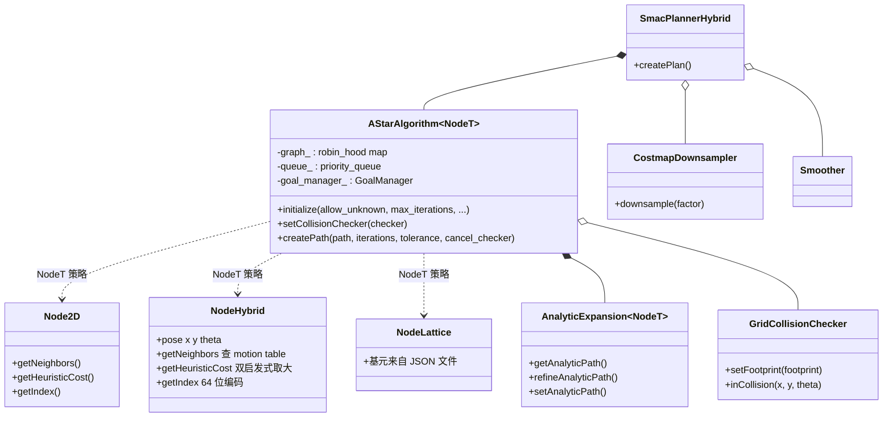
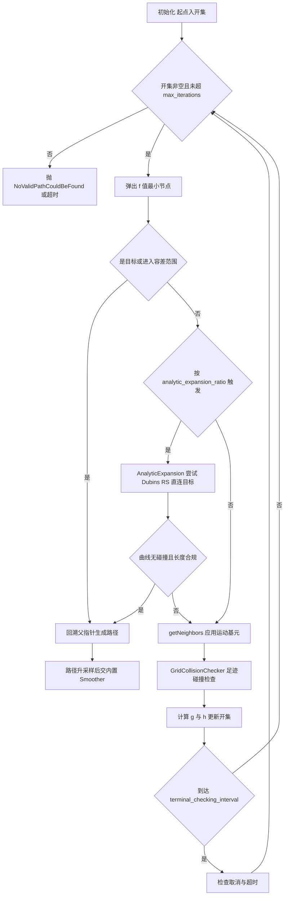

# 第 08 章 SmacPlanner：面向运动学约束的模板化 A* 规划器家族

> **一句话总结**：nav2_smac_planner 用一个模板化的 `AStarAlgorithm<NodeT>` 内核，通过替换节点类型（Node2D / NodeHybrid / NodeLattice）派生出 2D、Hybrid-A* 与 State Lattice 三个全局规划器插件，配合解析扩展（Dubins/Reeds-Shepp）、双启发式预计算、代价地图（Costmap）下采样与内置平滑器，把"考虑最小转弯半径的可行路径搜索"做到了生产级性能。

> **前置知识**：第 06 章 · 第 07 章 ｜ **知识依赖图**：[KnowledgeGraph/Knowledge](KnowledgeGraph/Knowledge.md)

## 8.1 为什么需要考虑运动学约束的规划器

第 07 章的 NavFn 与 Theta* 都把机器人抽象为二维平面上的质点：状态是 (x, y)，任何相邻栅格间都可以直接移动。这个假设对差速、全向底盘成立——它们能原地转向，路径的朝向不连续没有关系。但对阿克曼转向（类车）、带拖挂、高速行驶的底盘，这个抽象是致命的：

- 底盘存在**最小转弯半径**，质点规划器给出的直角折线在物理上不可执行；
- 控制器被迫在跟踪时"修路"，把不可行路径强行拟合成可行轨迹，结果是贴障碍、倒车抖动甚至陷入死锁；
- 倒车、多点掉头这类**方向切换动作**根本无法在 (x, y) 状态空间里表达。

正确的做法是把搜索空间从 2D 提升到 **SE(2)**——状态是 (x, y, θ)，节点间的转移不再是"移动到邻接栅格"，而是"执行一段满足曲率约束的运动基元（motion primitive）"。这就是 Hybrid-A*（Dolgov et al., DARPA Urban Challenge）与 State Lattice（Pivtoraiko & Kelly）两条路线的共同出发点，也是 nav2_smac_planner 的立身之本。

## 8.2 三个规划器：一个内核，三种节点

nav2_smac_planner 对外注册三个 `nav2_core::GlobalPlanner` 插件（可直接挂入第 07 章的 PlannerServer 插件字典）：

| 规划器 | 节点类型 | 状态空间 | 适用底盘 | 特点 |
|---|---|---|---|---|
| SmacPlanner2D | `Node2D` | (x, y) | 全向 / 差速 | 纯栅格 A*，无方向量化，三者中最快，作为 NavFn 的现代替代 |
| SmacPlannerHybrid | `NodeHybrid` | (x, y, θ) | 阿克曼、类车、差速皆可 | Dubins / Reeds-Shepp 运动基元，最小转弯半径约束，支持倒车（RS 模型） |
| SmacPlannerLattice | `NodeLattice` | (x, y, θ) | 任何提供运动基元文件的底盘 | 运动基元从 JSON 文件加载（lattice_filepath），可精确编码差速原地转、全向斜移等能力，约束表达最精确 |

三个插件的包装类分别位于 nav2_smac_planner/src/smac_planner_2d.cpp、smac_planner_hybrid.cpp、smac_planner_lattice.cpp，它们的 `createPlan()` 都只是薄薄一层：把世界坐标换算为栅格坐标、调用 A* 内核、把结果路径升采样并交给内置 Smoother。真正的算法复用发生在模板层。

## 8.3 核心架构：AStarAlgorithm 模板类

内核定义于 nav2_smac_planner/include/nav2_smac_planner/a_star.hpp，关键签名：

```cpp
template<typename NodeT>
class AStarAlgorithm {
  typedef robin_hood::unordered_node_map<uint64_t, NodeT> Graph;
  typedef std::priority_queue<NodeElement, std::vector<NodeElement>, NodeComparator> NodeQueue;
  bool createPath(CoordinateVector & path, int & num_iterations,
    const float & tolerance, std::function<bool()> cancel_checker, ...);
};
```



设计要点：

- **NodeT 即策略**：A* 主循环（开集弹出、邻居扩展、g/h 代价更新、回溯）完全由模板类固定，而"什么是邻居""启发式怎么算""状态如何编码为索引"全部委托给 `NodeT` 的静态与成员方法。`a_star_impl.hpp` 中大量使用 `if constexpr (std::is_base_of_v<Node2D, NodeT>)` 在编译期裁剪分支——Node2D 不做解析扩展、不查 SE(2) 启发式，零运行期开销。
- **NodeHybrid 的运动表（motion table）**：`on_configure` 阶段根据 `motion_model_for_search`（DUBIN / REEDS_SHEPP）与 `minimum_turning_radius` 预生成一组固定的运动基元（直行、最小半径左转、右转，RS 再加倒车镜像），扩展时逐一应用并查碰撞。角度维度按 `angle_quantization_bins` 离散化（默认 72 bins，5° 一格），(x, y, θ) 编码进一个 64 位索引作为哈希键。
- **NodeLattice** 的扩展逻辑相同，只是基元换成从 lattice 文件（由 lattice_primitives 工具离线生成的 JSON）读入的集合，因此能表达 Hybrid 模型写不出来的能力（如差速底盘原地转向 + 前进的组合）。

## 8.4 A* 主循环与解析扩展



**解析扩展（AnalyticExpansion）**是 Hybrid-A* 的招牌优化，实现于 nav2_smac_planner/include/nav2_smac_planner/analytic_expansion.hpp：当搜索推进到离目标较近时，不再一步步扩展，而是直接用 OMPL 的 Dubins / Reeds-Shepp 状态空间**解析计算一条到目标的闭式曲线**，逐点碰撞检查通过即宣告成功。三个细节：

- 触发频率由 `analytic_expansion_ratio` 控制——离目标越近尝试越频繁，避免每次扩展都做昂贵的曲线计算;
- `analytic_expansion_max_length` 限制曲线长度，防止在远距离生成一条"绕大弯贴障碍"的次优接入;
- `refineAnalyticPath()` 会以略增的转弯半径重试若干次，在可行前提下让接入曲线更舒展。

解析扩展只对 NodeHybrid / NodeLattice 生效；Node2D 在编译期即被排除。这一步通常把搜索的最后 20% 迭代压缩为一次曲线求解，是 Hybrid 规划秒级性能的关键。

## 8.5 双启发式：admissible 的两条下界取大

SE(2) 搜索的启发式要同时回答两个问题：**绕障碍要走多远**（拓扑）与**受曲率约束要走多远**（运动学）。SmacPlanner 分别预计算，再取两者最大值作为 h 值——两条都是可采纳下界，取大后仍可采纳且更紧：

| 启发式 | 实现 | 计算方式 | 复杂度 |
|---|---|---|---|
| Obstacle heuristic | nav2_smac_planner/src/node_hybrid.cpp 中的动态规划 | 目标出发的逆向 Dijkstra / 代价感知波前传播，在（可下采样的）代价地图上算出每个栅格绕障最短代价 | 一次预计算 O(n log n)，查询 O(1) |
| Distance heuristic | distance_heuristic 查找表 | 以目标为原点，预计算窗口内每个 (Δx, Δy, Δθ) 的 Dubins/RS 精确距离，利用对称性减半内存；窗口外退化为欧氏距离 | 启动期一次性构建，查询 O(1) 查表 |

Obstacle heuristic 支持 `cache_obstacle_heuristic`：目标不变的连续重规划（行为树按频率触发的典型场景）可直接复用上次的势场，只在目标变化时调用 `resetObstacleHeuristic()` 重算。

## 8.6 性能工程：让 SE(2) 搜索跑进实时预算

SmacPlanner 的论文级算法能落地，靠的是一整套系统性的性能手段：

| 手段 | 位置 | 收益 |
|---|---|---|
| robin_hood 哈希图 | `Graph = robin_hood::unordered_node_map<uint64_t, NodeT>` | 比 std::unordered_map 更快的开放寻址哈希，节点地址稳定可存父指针 |
| 启发式查表 | distance_heuristic 查找表 + obstacle heuristic 缓存 | 把每节点的启发式计算从曲线求解降为 O(1) 查表 |
| 运动基元预生成 | NodeHybrid/NodeLattice 的 motion table | 扩展时只做查表加法，不做三角函数 |
| CostmapDownsampler | costmap_downsampler.hpp | `downsampling_factor=2` 让搜索栅格数降为四分之一；聚合取 NxN 子块最大代价保证保守性 |
| 解析扩展 | AnalyticExpansion | 用一次闭式曲线求解替代末段成千上万次节点扩展 |
| 编译期分支裁剪 | `if constexpr` 特化 | Node2D 路径零 SE(2) 开销 |
| 周期性终止检查 | `terminal_checking_interval` | 取消与超时检查按批进行，不拖慢主循环 |

## 8.7 关键参数与调参影响

| 参数 | 作用域 | 影响 | 参考值 |
|---|---|---|---|
| `motion_model_for_search` | Hybrid | DUBIN 只前进；REEDS_SHEPP 允许倒车——能否倒车库、三点掉头由它决定 | 类车取 REEDS_SHEPP |
| `minimum_turning_radius` | Hybrid/Lattice | 必须不小于底盘物理极限；偏大路径更舒展但狭窄区可能无解 | 0.4 m 起按实车标定 |
| `angle_quantization_bins` | Hybrid | 角度分辨率；越大越精细，图规模与内存线性增长 | 72 |
| `lattice_filepath` | Lattice | 运动基元 JSON；必须与底盘分辨率、能力匹配，错配即产出不可行路径 | lattice_primitives 生成 |
| `allow_unknown` | 全部 | 是否可穿越未知区 | 建图时 true |
| `tolerance` | 全部 | 目标不可达时接受的终点容差（米），语义与 NavFn 不同 | 0.1~0.25 |
| `max_iterations` / `max_planning_time` | 全部 | 搜索预算双保险，先到先终止 | 1000000 / 5.0 s |
| `downsampling_factor` | 2D/Hybrid | 大地图提速利器；过大（>3）会让窄通道被保守聚合"堵死" | 1~2 |
| `analytic_expansion_ratio` / `analytic_expansion_max_length` | Hybrid/Lattice | 前者越小尝试越频繁；后者限制接入曲线长度防贴障 | 3.5 / 3.0 m 量级 |
| `cache_obstacle_heuristic` | Hybrid/Lattice | 同目标重规划显著提速；目标频繁变化时无益 | true |

## 8.8 设计模式与生态位

- **模板方法 + 泛型编程**：`AStarAlgorithm<NodeT>::createPath()` 固定算法骨架，可变步骤不靠虚函数而靠模板参数静态注入，配合 `if constexpr` 实现零成本抽象——这是 Nav2 代码库里最典型的一处现代 C++ 泛型设计。
- **策略模式**：NodeT 三种实现是搜索空间策略；对外三个插件类又是 PlannerServer 眼中的 GlobalPlanner 策略，两层策略嵌套。
- **享元/缓存思想**：motion table、distance 查找表、obstacle heuristic 缓存都是"一次计算、处处共享"的实例。

规划输出的路径还会经过包内自带的 Smoother（简化的梯度平滑）做后处理，去除搜索离散化带来的微小抖动；与之独立的 nav2_smoother 服务器提供的是系统级平滑管线，二者关系在第 15 章展开。

## 8.A 源码导航与入手路径

入口链：`SmacPlannerHybridT<NodeT>::configure()`（构建 motion table 与 A* 内核）→ `createPlan()` → `AStarAlgorithm<NodeT>::createPath()` → `NodeHybrid::getNeighbors()` / `getHeuristicCost()` → `AnalyticExpansion::tryAnalyticExpansion()` → `Smoother::smooth()`。

| 文件（仓库相对路径，约 N 行） | 关键函数 | 作用 |
|---|---|---|
| nav2_smac_planner/include/nav2_smac_planner/smac_planner_hybrid_impl.hpp（约 912 行） | `configure()` / `createPlan()` | 插件包装层：参数解析、下采样、调 A* 内核与平滑器（.cpp 只做模板实例化） |
| nav2_smac_planner/include/nav2_smac_planner/a_star_impl.hpp（约 592 行） | `createPath()` / `initialize()` | 模板 A* 主循环：开集弹出、扩展、解析扩展触发、回溯 |
| nav2_smac_planner/src/node_hybrid.cpp（约 540 行） | `initMotionModel()` / `getNeighbors()` / `getHeuristicCost()` | SE(2) 节点策略：运动基元表与双启发式 |
| nav2_smac_planner/include/nav2_smac_planner/analytic_expansion_impl.hpp（约 494 行） | `tryAnalyticExpansion()` / `getAnalyticPath()` | 近目标 Dubins/RS 闭式曲线直连 |
| nav2_smac_planner/src/smoother.cpp（约 459 行） | `smooth()` | 包内梯度平滑后处理 |

| 第一遍只看 | 第二遍补充 | 以后再看 |
|---|---|---|
| a_star_impl.hpp 的 `createPath()` 主循环 | node_hybrid.cpp 的运动表与启发式、analytic_expansion_impl.hpp | smac_planner_hybrid_impl.hpp 的参数处理与 smoother.cpp |

完整业务链路见 [NavigateToPose 端到端时序图](Assets/sequence/NavigateToPose.md)。

## 8.B 设计权衡

### 模板化 A* 统一框架 vs 三套独立实现

2D、Hybrid、Lattice 三个规划器完全可以各写一份 A*——代码更直白、互不牵连。SmacPlanner 却选择用 `AStarAlgorithm<NodeT>` 统一骨架，把差异压进 NodeT 策略。收益是三重的：主循环的正确性修复与性能优化（解析扩展触发、超时批检查、robin_hood 图）一次生效于三个规划器；新增搜索空间只需写一个节点类；三者的参数语义（tolerance、max_iterations）天然一致。代价是模板代码可读性下降、编译期报错难懂、实现必须放进 `_impl.hpp` 头文件。对一个算法密集且长期演进的包，维护一份内核的收益远超模板带来的门槛。

### 模板静态多态 vs 虚函数动态多态

插件边界（GlobalPlanner）用虚函数，因为调用频率是"每次规划一次"；搜索内核用模板，因为 `getNeighbors()` / `getHeuristicCost()` 每秒被调用数十万次，虚表跳转与无法内联的代价会被放大成可测的耗时。`if constexpr` 进一步在编译期把 Node2D 用不到的解析扩展、SE(2) 启发式整段裁掉，做到零运行期开销。同一个包里两种多态并存，选择依据只有一条：调用频率与热路径位置（模式层面的系统对比见第 22 章，语言机制细节见第 23 章）。

### 下采样保守聚合 vs 全分辨率搜索

CostmapDownsampler 以 `downsampling_factor` 把搜索栅格数按平方级缩减，factor=2 即降为四分之一，是大地图提速最直接的手段。聚合策略取 N×N 子块的**最大**代价——宁可把可通行区域误判为障碍，也不把障碍误判为可通行，保证下采样后的解在原图上依然安全。代价是窄通道可能被保守聚合"堵死"而无解。这是典型的"性能换完备性"权衡：SmacPlanner 把选择权交给参数，并在文档中明确建议 factor≤2~3，而不是在代码里替用户做决定。

## 知识总结

1. SmacPlanner 家族 = **一个模板 A* 内核 × 三种节点策略**：Node2D 面向全向/差速，NodeHybrid 以 Dubins/RS 基元编码最小转弯半径，NodeLattice 从 JSON 加载任意运动基元。
2. **解析扩展**在近目标处用闭式 Dubins/RS 曲线直连目标，是 Hybrid-A* 性能与终态精确对准的关键；仅 SE(2) 节点可用。
3. 启发式取 **obstacle heuristic（逆向 Dijkstra 势场）与 distance heuristic（Dubins/RS 查表）的最大值**，两条可采纳下界取大，兼顾拓扑绕障与曲率约束。
4. 性能来自系统工程：robin_hood 哈希、查表、缓存、下采样、编译期分支裁剪，而非单点算法技巧。
5. 参数上最重要的三件事：运动模型选对（能否倒车）、转弯半径不小于物理极限、下采样因子不超过 2~3。

## 常见面试题

1. **Hybrid-A* 与普通 A* 的本质区别？**
   要点：搜索空间从 (x, y) 提升到 SE(2) 的 (x, y, θ)；节点转移是满足曲率约束的运动基元而非邻接栅格；输出路径天然运动学可行，代价是状态空间增大一个维度，需靠启发式与解析扩展补偿性能。
2. **为什么 AStarAlgorithm 用模板而不是虚函数多态？**
   要点：A* 主循环每秒扩展数十万节点，虚调用开销和无法内联会成为瓶颈；模板把 NodeT 策略静态绑定，`if constexpr` 在编译期裁剪掉与节点类型无关的代码路径，实现零成本抽象。
3. **解析扩展为什么能加速，何时会失败？**
   要点：近目标时用 OMPL 闭式 Dubins/RS 曲线替代逐步扩展，一次求解替代末段大量迭代；曲线逐点碰撞检查不通过、长度超 `analytic_expansion_max_length` 时失败回退继续常规扩展，`refineAnalyticPath()` 还会放宽半径重试。
4. **obstacle heuristic 与 distance heuristic 为什么要同时存在并取最大值？**
   要点：前者感知障碍拓扑但忽略曲率（假设质点），后者精确刻画曲率约束但忽略障碍（假设自由空间）；各自都是真实代价的下界，取 max 后仍可采纳且是更紧的估计，显著减少扩展量。
5. **Lattice 与 Hybrid 如何选择？**
   要点：Hybrid 的基元由转弯半径参数即时生成，配置简单，适合类车模型；Lattice 需离线生成基元文件但表达力更强，可编码差速原地转、全向斜移等 Hybrid 表达不了的能力，且搜索受基元约束更贴近底盘真实可执行动作。

## 最佳实践与容易踩坑

- **想要弧线却选了 SmacPlanner2D**：Node2D 是质点搜索，不会产生曲率受限路径；需要 SE(2) 请用 Hybrid 或 Lattice。
- **`use_astar` 是 NavFn 的参数**：SmacPlanner 本身就是 A* 实现，配置里写 `use_astar` 不会生效，属于典型的跨规划器参数照抄错误。
- **下采样因子克制使用**：factor=8 时一个搜索栅格代表 64 个原始栅格，最大代价聚合会把窄通道判为不可通行；建议 ≤2~3，慎用 `use_min_cost_neighbor`。
- **转弯半径与控制器联动**：规划端 `minimum_turning_radius` 应与控制器（如 RPP 的曲率约束，见第 09 章）一致或略保守，否则控制器跟不上规划的曲线。
- **Lattice 文件与地图分辨率匹配**：基元按特定分辨率生成，代价地图分辨率变更后必须重新生成 lattice 文件。
- **重规划频率高时开启 `cache_obstacle_heuristic`**，但目标频繁改变的巡检类任务收益有限，反而多占内存。

## 延伸阅读

- nav2_smac_planner/include/nav2_smac_planner/a_star.hpp 与 a_star_impl.hpp —— 模板内核与编译期特化
- nav2_smac_planner/include/nav2_smac_planner/node_hybrid.hpp —— motion table 与双启发式实现
- nav2_smac_planner/include/nav2_smac_planner/analytic_expansion.hpp —— 解析扩展三部曲
- Dolgov et al., *Practical Search Techniques in Path Planning for Autonomous Driving*, 2008（Hybrid-A* 原始论文）
- Pivtoraiko & Kelly, *Generating Near Minimal Spanning Control Sets for Constrained Motion Planning in Discrete State Spaces*, 2005（State Lattice）
- nav2_smac_planner/README.md —— 官方参数全表与基准测试数据

## 8.C 阅读检查点

1. 为什么质点规划器的输出对阿克曼底盘"物理上不可执行"？SE(2) 状态空间解决了什么问题？（见 8.1 节）
2. `AStarAlgorithm<NodeT>` 的主循环固定了什么、把什么委托给了 NodeT？`if constexpr` 在其中起什么作用？（见 8.3 节）
3. 解析扩展在什么时机触发、成功与失败的判定条件各是什么？（见 8.4 节）
4. obstacle heuristic 与 distance heuristic 各自忽略了什么信息？为什么取最大值后仍是可采纳启发式？（见 8.5 节）
5. `downsampling_factor` 过大时会出现什么现象？其根源是下采样的哪个设计决策？（见 8.6 节与 8.B 节）

> 下一章：09_ControllerServer与局部控制
