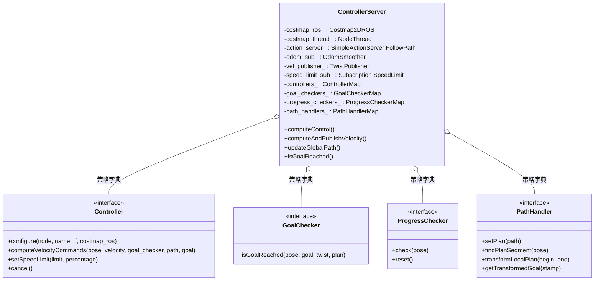
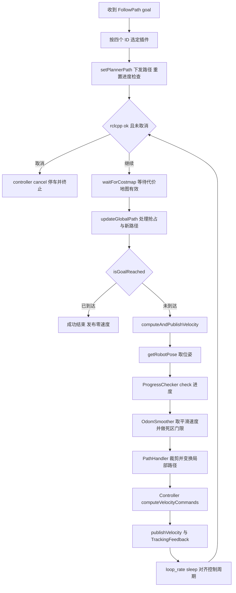

# 第 09 章 ControllerServer 与局部控制：高频闭环的路径执行引擎

> **一句话总结**：nav2_controller 的 ControllerServer 是一个生命周期节点（Lifecycle Node），以 FollowPath Action 为对外契约、以 controller_frequency 为节拍，在独立 spin 线程中运行"取位姿→PathHandler 裁剪变换路径→ProgressChecker 查进度→GoalChecker 判到达→Controller 算速度→发布 cmd_vel"的高频闭环，并通过 Controller / GoalChecker / ProgressChecker / PathHandler 四类插件（Plugin）字典把"怎么跟路径、怎么算到了、怎么算卡住、怎么切局部路径"全部开放为可替换策略。

> **前置知识**：第 06 章 · 第 07 章 ｜ **知识依赖图**：[KnowledgeGraph/Knowledge](KnowledgeGraph/Knowledge.md)

## 9.1 为什么控制要独立成服务器

第 07 章的 PlannerServer 回答的是"路怎么走"，它工作在秒级、面向全局静态信息、输出一条几何路径。但路径本身不能驱动电机——机器人需要有人把这条路径翻译成每一时刻的速度指令，并且在行人穿行、轮子打滑、定位漂移时实时纠偏。这就是局部控制的职责，它与规划有三点本质差异：

- **频率**：规划按需触发（目标变更、周期重规划），控制必须以 20 Hz 甚至更高的固定频率闭环运行，一次迟到的 cmd_vel 就是一次失控；
- **信息域**：规划看全局代价地图（Costmap），控制只看机器人周围几米的局部 Costmap（第 06 章），滚动窗口跟随机器人移动，反映动态障碍；
- **状态依赖**：规划是"给定起终点求解"，控制是"给定当前位姿与当前速度求下一步"，强依赖里程计反馈。

把两者混在一个节点里，规划的长耗时会阻塞控制节拍，控制的实时要求又会限制规划的算法选型。Nav2 的答案是彻底分离：ControllerServer 独立成服务器（Server），拥有自己的局部 Costmap、自己的 odom 订阅、自己的控制循环线程，通过 FollowPath Action 接受行为树（BT，第 11 章）的调度。它算出的 cmd_vel 也不直接到底盘，而是经速度平滑器与碰撞监视器组成的下游链路（第 16 章）后才落地。

## 9.2 整体设计：一个循环、四类插件

ControllerServer 定义于 nav2_controller/include/nav2_controller/controller_server.hpp，继承 `nav2::LifecycleNode`。它的核心资产可以概括为"一个 Action 服务器 + 一个控制循环 + 四类插件字典 + 一组周边设施"：

四类插件的接口契约都定义在 nav2_core（第 04 章），容器统一是 `std::unordered_map<std::string, 接口::Ptr>`。这个"字符串 ID → 插件实例"的字典设计有两个用意：

1. **多插件共存**：同一个服务器可以同时加载 RPP 与 MPPI 两个控制器、精确停车与宽松停车两个 GoalChecker，FollowPath goal 里携带 `controller_id`、`goal_checker_id`、`progress_checker_id`、`path_handler_id` 四个字段，由行为树按场景逐次选择——例如"进电梯用精确停车、走廊巡航用宽松停车"，不需要重启任何节点。
2. **默认回退**：`findControllerId()` 等四个查找函数实现了统一的回退语义——ID 为空且字典里只有一个插件时自动选用它；ID 非空但查无此插件时返回失败，映射为 `INVALID_CONTROLLER` 错误码终止动作。ProgressChecker 额外允许"完全不配置"从而跳过进度检查。

值得注意的是 main 分支的一个演进：路径裁剪与坐标变换从早年各控制器内部的私有实现，抽象成了独立的 PathHandler 插件族（默认实现 `nav2_controller::FeasiblePathHandler`）。ControllerServer 在每个控制周期先调用 PathHandler 把全局路径裁出机器人附近的局部段并变换到 Costmap 坐标系，再把这段"预处理过的路径"交给 Controller 插件——控制器从此只关心"跟这段路"，不再重复造裁剪的轮子。

周边设施同样值得一提：odom 不是裸订阅，而是经 `nav2_util::OdomSmoother` 做时间窗口平滑，再经 `getThresholdedTwist()` 把小于 `min_x/y/theta_velocity_threshold` 的分量置零，滤掉里程计噪声；cmd_vel 通过 `nav2_util::TwistPublisher` 发布；此外还订阅 `speed_limit` 话题，收到 `nav2_msgs::msg::SpeedLimit` 后广播给所有 Controller 插件的 `setSpeedLimit()`——这是限速区（Costmap 限速滤波器）与控制器之间的桥梁。

## 9.3 FollowPath Action 与线程模型

FollowPath 的服务器类型是 `nav2::SimpleActionServer<nav2_msgs::action::FollowPath>`，创建于 `on_configure()`（nav2_controller/src/controller_server.cpp），有两个关键选项：

- **独立 spin 线程**：`computeControl()` 整个控制循环运行在 Action 服务器自己的线程里，与节点主 executor 解耦，保证参数回调、话题回调不会挤占控制节拍；
- **软实时优先级**：`use_realtime_priority` 参数为 true 时，该线程以更高调度优先级运行，配合实时内核可以显著压缩 cmd_vel 的抖动——这是 Nav2 面向工业场景的"软实时"选项。

局部 Costmap 则由另一个 `nav2::NodeThread` 独立驱动，控制线程只在需要时通过 `waitForCostmap()` 等待其就绪（例如 Costmap 刚被清理后）。三个线程各司其职：主线程管生命周期与回调，Costmap 线程管感知更新，Action 线程管控制闭环。

## 9.4 控制循环：一个周期内发生了什么

`computeControl()` 是理解 ControllerServer 的主线。收到 FollowPath goal 后，它先按 goal 中的四个 ID 选定插件、调用 `setPlannerPath()` 下发路径并重置 ProgressChecker，然后以 `nav2::Rate loop_rate(controller_frequency)` 进入主循环：

单周期内部（`computeAndPublishVelocity()`）的顺序刻意安排：先取位姿——拿不到就抛 `ControllerTFError`；再查进度——ProgressChecker 认定停滞就抛 `FailedToMakeProgress`；再由 PathHandler 的 `findPlanSegment()` 找到离机器人最近的路径点、按累积长度裁出局部段、`transformLocalPlan()` 变换到 Costmap 坐标系；最后才调用当前 Controller 的 `computeVelocityCommands(pose, twist, goal_checker, transformed_plan, goal)`。注意 GoalChecker 指针也传给了控制器——控制器可以据此在终点附近调整策略，比如 RPP 用它判断"XY 已到、只差朝向"从而切入原地旋转。

循环末尾的 `loop_rate.sleep()` 若发现实际周期超时，会打印警告——最常见的原因是 `controller_frequency` 设得比 Costmap 更新频率高太多，`waitForCostmap()` 频繁阻塞（见 9.8 踩坑）。

**抢占与新路径**：行为树周期性重规划时，新路径以 preempt goal 的形式到达。`updateGlobalPath()` 在每个周期检查 pending goal：接受后校验新 goal 的四个插件 ID（无效则以 `INVALID_CONTROLLER` 终止），若 ProgressChecker 或 PathHandler 的 ID 变化则重置对应状态，然后把新路径经 `setPlannerPath()` 下发——各 Controller 插件在自己的 `setPlan()` 中感知"路径换了"（即传统意义的 newPathReceived），据此重置内部的路径游标或旋转状态。整个切换发生在两个控制周期之间，机器人平滑续行，无需停车。

## 9.5 内置辅助插件精讲

nav2_controller 自带一批 GoalChecker / ProgressChecker / PathHandler 实现（nav2_controller/plugins/ 目录），覆盖了绝大多数场景：

| 插件 | 类别 | 判定逻辑 | 典型场景 |
|---|---|---|---|
| SimpleGoalChecker | GoalChecker | XY 距离小于 `xy_goal_tolerance` 且 yaw 差小于 `yaw_goal_tolerance`；`stateful` 为 true 时位置一旦达标即锁存，之后只查朝向 | 默认选择，绝大多数导航任务 |
| StoppedGoalChecker | GoalChecker | 继承 SimpleGoalChecker，额外要求线速度与角速度低于 `trans/rot_stopped_velocity` | 到点必须完全静止的对接、取料任务 |
| PositionGoalChecker | GoalChecker | 只判 XY 位置，进入容差圈后带 buffer 锁存，轻微漂出不反复翻转判定 | 不关心朝向的中途路点 |
| AdaptiveToleranceGoalChecker | GoalChecker | 双层容差，依据终点附近的停滞表现动态放宽 | 打滑地面等难以精确停车的环境 |
| SimpleProgressChecker | ProgressChecker | `movement_time_allowance` 秒内位移须超过 `required_movement_radius`，否则判停滞 | 默认选择 |
| PoseProgressChecker | ProgressChecker | 在位移之外叠加角度变化判据，原地小幅摆动同样算无进展 | 防止"原地打转假装在动" |
| FeasiblePathHandler | PathHandler | 保存全局路径，按 `prune_distance` 裁剪、近邻搜索受 `max_robot_pose_search_dist` 限制、支持 `enforce_path_inversion` 处理带倒车路径 | 默认且目前唯一的官方实现 |

这些小插件常被忽视，却直接决定导航的"手感"：GoalChecker 的容差决定停车精度与末端震荡，ProgressChecker 的阈值决定"卡死多久才触发恢复行为（第 12 章）"，PathHandler 的裁剪长度决定控制器视野。

## 9.6 失败处理：异常层次与错误码

Nav2 控制侧的错误传递是一条清晰的三级链路：**Controller 插件抛 nav2_core 异常 → ControllerServer 统一捕获并映射 → FollowPath result 携带 error_code 返回行为树**。异常层次定义在 nav2_core/include/nav2_core/controller_exceptions.hpp：

| 异常类型 | error_code | 典型触发 |
|---|---|---|
| InvalidController | INVALID_CONTROLLER | goal 指定的插件 ID 不存在 |
| ControllerTFError | TF_ERROR | 取机器人位姿失败、TF 超时 |
| NoValidControl | NO_VALID_CONTROL | 控制器算不出无碰撞速度 |
| FailedToMakeProgress | FAILED_TO_MAKE_PROGRESS | ProgressChecker 判停滞 |
| PatienceExceeded | PATIENCE_EXCEEDED | 持续无有效控制超过容忍时间 |
| InvalidPath | INVALID_PATH | 路径为空或不合法 |
| ControllerTimedOut | CONTROLLER_TIMED_OUT | 单周期计算超时 |
| 其他异常 | UNKNOWN | 兜底 |

其中 `failure_tolerance` 参数值得专门理解，它定义了对 `NoValidControl` 的三种态度：

- **= 0**：零容忍，控制器一算不出有效速度立即失败退出；
- **> 0**（默认 0.3 秒）：捕获异常后发布零速度原地等待，若距上一次有效指令超过该时长仍无解，抛 `PatienceExceeded` 终止——给动态障碍"让个路"的时间窗口；
- **= -1.0**：无限耐心，永远发零速度等待，不会因此失败。

这套错误码由行为树消费：`FAILED_TO_MAKE_PROGRESS` 可触发清理 Costmap，`NO_VALID_CONTROL` 可触发重规划或倒退行为——错误码越精确，恢复策略越有的放矢。这正是 Nav2 用"异常类型体系 + 数值错误码"替代布尔成败的原因。

## 9.7 五个控制器插件横向对比

ControllerServer 生态里有五个官方 Controller 插件，选型对照如下：

| 控制器 | 原理 | 适用底盘 | 算力开销 | 特点 |
|---|---|---|---|---|
| RPP（Regulated Pure Pursuit） | 几何纯追踪 + 曲率/障碍双重调速 | 差速、阿克曼、合法差速 | 极低 | 确定性强、路径贴合好，默认推荐，详见第 10 章 |
| MPPI | 采样型模型预测控制，千级轨迹并行评分 | 差速、全向、阿克曼 | 高 | 动态环境最优、行为可由 critics 定制，详见第 10 章 |
| DWB | 动态窗口采样 + critics 评分 | 差速、全向 | 中 | ROS 1 DWA 的插件化重写，历史地位高，新项目少用 |
| Graceful | 基于极坐标的平滑控制律闭式解 | 差速 | 极低 | 曲线优雅、天然支持倒车接近，适合对接场景 |
| RotationShim | 装饰器，先原地旋转对准再移交内部主控制器 | 可原地转向的底盘 | 取决于主控制器 | 解决"背对路径起步"时控制器画大弧的通病 |

三个"配角"各有值得记住的一笔：

- **DWB**（nav2_dwb_controller）把 DWA 拆解为 TrajectoryGenerator 插件产生候选速度、二十余个 TrajectoryCritic 插件逐条评分累加、`coreScoringAlgorithm()` 挑最优的架构，还支持评分短路（当前累计分已劣于已知最优即放弃该轨迹）。它是"评分型控制器"的架构鼻祖——MPPI 的 critics 体系正是这一思想在采样优化框架下的延续。全部候选都非法时抛出的 `NoLegalTrajectoriesException` 最终映射为 `NoValidControl`。
- **Graceful**（nav2_graceful_controller）实现了一个基于李雅普诺夫稳定性分析的平滑控制律 `SmoothControlLaw`：以 k_phi、k_delta、beta、lambda 四个增益把"到目标点的距离与两个角度误差"映射为线角速度，轨迹是解析意义上的光滑曲线。它对每个候选目标点先用控制律仿真出局部轨迹、再做 footprint 碰撞检查，找到第一个"既平滑又安全"的点；`allow_backward` 允许沿路径倒退接近，这让它在泊车、对接类任务中很受欢迎。
- **RotationShim**（nav2_rotation_shim_controller）是教科书式的装饰器（Decorator）：它自己也是 `nav2_core::Controller`，内部通过 pluginlib 再加载一个 `primary_controller`（通常是 RPP）。收到新路径时，若机器人朝向与路径起始方向的夹角超过阈值，就先生成受角加速度约束的纯旋转指令；对准后把 `computeVelocityCommands()` 原样转发给主控制器。`rotate_to_goal_heading` 还能让它在终点接管"旋转到目标朝向"的收尾。对外，ControllerServer 完全感知不到这层包装。

## 9.8 设计模式与工程要点

- **策略模式**：四类插件字典是同一模式的四次复用——接口在 nav2_core 定义契约，pluginlib 完成运行期装配，FollowPath goal 里的 ID 完成运行期切换。
- **装饰器模式**：RotationShim 包装主控制器、透明增强行为；FeasiblePathHandler 亦可视为对"原始全局路径"的前置装饰层。
- **模板方法模式**：`computeControl()` 固定了"等 Costmap→更新路径→判到达→算速度→睡眠"的算法骨架，可变步骤全部委托给插件填充——与第 07 章 PlannerServer 的骨架式主循环一脉相承。

工程细节上，控制循环全程持有 ParameterHandler 的互斥锁以保证动态调参的一致性；`on_deactivate()` 退出前必发一次零速度，保证生命周期切换不会让底盘带着残留速度失控。

## 9.A 源码导航与入手路径

入口链：main()→ControllerServer 构造→on_configure() 加载四类插件并 create_action_server()→FollowPath goal 触发 computeControl()→循环内 computeAndPublishVelocity()→controller_->computeVelocityCommands()→publishVelocity()。

| 文件（仓库相对路径，约 N 行） | 关键函数 | 作用 |
|---|---|---|
| nav2_controller/src/controller_server.cpp（约 946 行） | computeControl() / computeAndPublishVelocity() / updateGlobalPath() | 控制主循环、抢占处理与异常到错误码的映射 |
| nav2_core/include/nav2_core/controller.hpp（约 152 行） | computeVelocityCommands() / setSpeedLimit() | Controller 插件接口契约 |
| nav2_controller/plugins/simple_goal_checker.cpp（约 273 行） | isGoalReached() | 默认到达判定插件 |
| nav2_regulated_pure_pursuit_controller/src/regulated_pure_pursuit_controller.cpp（约 439 行） | computeVelocityCommands() | 默认控制器插件的对照实现样本 |

| 第一遍只看 | 第二遍补充 | 以后再看 |
|---|---|---|
| computeControl() 主循环骨架 | computeAndPublishVelocity() 单周期顺序与异常映射 | 各 GoalChecker/ProgressChecker 插件与 RotationShim 装饰器 |

完整业务链路见 [NavigateToPose 端到端时序图](Assets/sequence/NavigateToPose.md)。

## 9.B 设计权衡

### 软实时控制循环 vs 硬实时

Nav2 没有把控制循环做成硬实时任务，而是选择"独立 spin 线程 + 可选 use_realtime_priority 提升调度优先级"的软实时方案。硬实时要求全链路（内核、DDS、Costmap 更新）都给出确定性时延保证，工程成本极高且与 ROS 2 的回调模型冲突；软实时用线程隔离挡住参数与话题回调的干扰，把抖动压到普通场景可接受的水平，缺失的兜底交给下游：底盘侧 cmd_vel 超时刹车、CollisionMonitor（第 16 章）做最后防线。这是"框架保节拍、安全靠链路"的分层取舍——20 Hz 迟到一拍不致命，因为致命性已经被安全层接管。

### Action 抢占语义 vs 停车重发

行为树周期重规划时若采用"取消旧 goal→等停车→发新 goal"的朴素方案，机器人每秒都会顿挫一次。ControllerServer 选择 preempt 语义：updateGlobalPath() 在两个控制周期之间接受 pending goal，校验插件 ID、按需重置状态后直接换路径，控制循环不中断、速度连续。代价是插件必须在 setPlan() 中自理"路径换了"的状态重置（路径游标、旋转状态），把复杂度从用户侧转移到了插件作者侧——框架用一次性的接口复杂度换取运行期的行为平滑，这笔账在高频重规划场景下明显划算。

## 知识总结

1. 控制独立成服务器的根本原因是**频率与职责差异**：规划秒级按需、控制 20 Hz 硬节拍，ControllerServer 用独立 Action spin 线程 + 独立 Costmap 线程 + 可选软实时优先级保住节拍。
2. 四类插件字典（Controller / GoalChecker / ProgressChecker / PathHandler）配合 FollowPath goal 中的四个 ID，实现**多策略共存与逐目标切换**，空 ID 时回退到唯一插件。
3. 控制循环单周期顺序固定：位姿→进度→平滑速度→PathHandler 局部路径→computeVelocityCommands→发布；路径裁剪已抽象为 PathHandler 插件，控制器不再自理。
4. 失败处理是三级链路：插件抛 nav2_core 异常→服务器映射 error_code→行为树按码恢复；`failure_tolerance` 定义对 NoValidControl 的耐心（0 零容忍 / 正数限时零速等待 / -1 无限等待）。
5. 五控制器选型：RPP 默认、MPPI 动态环境、Graceful 平滑对接、RotationShim 装饰起步旋转、DWB 历史架构参考。

## 常见面试题

1. **ControllerServer 为什么不和 PlannerServer 合并成一个节点？**
   要点：控制需要固定高频闭环且对延迟敏感，规划耗时不定且按需触发；合并后规划长尾会阻塞控制节拍。分离后各自持有独立 Costmap（局部滚动窗口 vs 全局）、独立线程模型，通过行为树在 Action 层协调。
2. **FollowPath 的抢占（preempt）流程是怎样的？**
   要点：行为树重规划后发新 goal，`updateGlobalPath()` 在控制周期间检查 pending goal，接受后校验四个插件 ID（无效则 INVALID_CONTROLLER 终止）、必要时重置 ProgressChecker/PathHandler，再经 setPlannerPath 下发新路径；控制循环不中断，机器人平滑续行。
3. **failure_tolerance 的三种取值语义？**
   要点：0 表示 NoValidControl 立即失败；正数表示发布零速度等待，超时未恢复抛 PatienceExceeded；-1 表示无限期零速等待不报错。生产环境建议 0.3~2.0 秒，过大或 -1 会掩盖配置问题。
4. **GoalChecker 为什么要传进控制器的 computeVelocityCommands？**
   要点：控制器需要与服务器一致的"到达"定义来做末端行为决策，例如 RPP 借它判断 XY 已达从而切入原地旋转、接近段减速；避免控制器与服务器各自维护一套容差导致行为矛盾。
5. **ProgressChecker 与 GoalChecker 的职责边界？**
   要点：GoalChecker 判"是否成功到达"（终点条件），ProgressChecker 判"是否还在有效推进"（过程条件）；前者达成走成功分支，后者失败抛 FailedToMakeProgress 走恢复分支，二者独立可替换。
6. **RotationShim 解决什么问题，为何用装饰器而不是改各控制器？**
   要点：几何/采样控制器在机器人背对路径时会画大弧甚至倒退起步；把"先原地对准"做成包装层，对任意主控制器零侵入复用，符合开闭原则；对外仍是标准 Controller 接口，服务器无感知。

## 最佳实践与容易踩坑

- **controller_frequency 与局部 Costmap 更新频率联动**：控制频率远高于 Costmap 频率时 `waitForCostmap()` 频繁阻塞、循环打超时警告；两者应同量级设置（如 20 Hz 控制 + 10~20 Hz Costmap）。
- **odom 死区阈值别设为零**：`min_x/y/theta_velocity_threshold` 用于滤除里程计噪声，置零后微小噪声会进入控制器的速度反馈，低速段尤其明显。
- **stateful GoalChecker 的锁存语义**：位置达标即锁存后只查朝向，若机器人在旋转中被推离容差圈仍会判成功；对停车精度苛刻的场景改用 StoppedGoalChecker。
- **多插件 ID 拼写错误在运行期才暴露**：goal 里的 controller_id 写错会直接 INVALID_CONTROLLER 终止动作，行为树 XML 与 YAML 插件名务必对齐检查。
- **别忘了 speed_limit 链路**：限速区滤波器发布 SpeedLimit 话题，只有实现了 `setSpeedLimit()` 的控制器才会响应；自研控制器漏实现该接口会导致限速区失效。
- **on_deactivate 会发零速度，但异常崩溃不会**：底盘侧应有 cmd_vel 超时自动刹车的兜底，不能完全依赖上游。

## 延伸阅读

- nav2_controller/src/controller_server.cpp —— 控制循环、异常映射与插件字典的完整实现
- nav2_core/include/nav2_core/controller.hpp 与 path_handler.hpp —— 控制器与路径处理器的接口契约（第 04 章）
- nav2_controller/plugins/ —— 内置 GoalChecker / ProgressChecker / FeasiblePathHandler 实现
- nav2_rotation_shim_controller/src/nav2_rotation_shim_controller.cpp —— 装饰器模式实战样本
- nav2_bringup/params/nav2_params.yaml —— controller_server 段的默认参数组合
- nav2_system_tests/src/error_codes/ —— FollowPath 错误码的端到端验证

## 9.C 阅读检查点

1. 控制循环单周期内"取位姿→查进度→平滑速度→裁剪路径→算速度→发布"的顺序为什么这样安排？哪一步失败抛哪种异常？（见 9.4 与 9.6）
2. FollowPath goal 中四个插件 ID 的回退语义是什么？ID 拼写错误会在什么时机以什么错误码暴露？（见 9.2 与 9.6）
3. failure_tolerance 取 0、正数、-1 分别对应对 NoValidControl 的哪三种态度？（见 9.6）
4. GoalChecker 指针为什么要传入控制器的 computeVelocityCommands()？（见 9.4）
5. RotationShim 为什么用装饰器而不是修改各控制器的方式解决起步大弧问题？（见 9.7 与 9.8）

> 下一章：10_MPPI与RPP控制器
