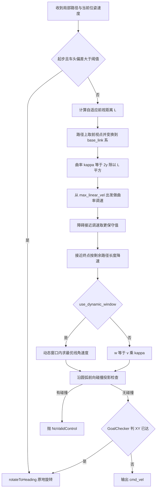
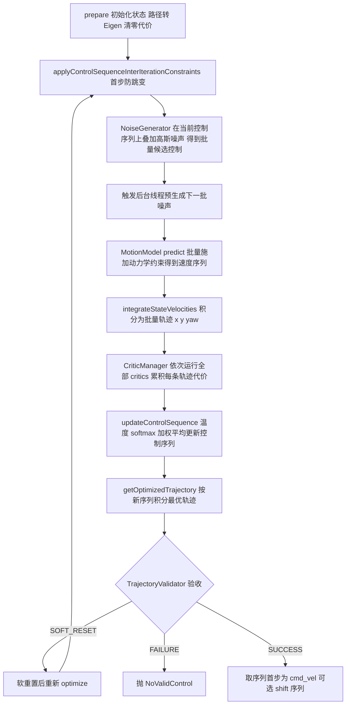

# 第 10 章 MPPI 与 RPP：当代主力控制器精讲

> **一句话总结**：RPP（Regulated Pure Pursuit）用"自适应前视点 + 曲率与障碍双重调速 + 碰撞投影"把六十年代的纯追踪算法打磨成论文级的默认推荐控制器；MPPI 则用"批量噪声采样→critics 责任链评分→温度 softmax 加权更新控制序列"的采样型模型预测控制（MPC），以纯 Eigen 向量化实现，在动态环境与复杂行为约束下给出最优解——一个是几何确定性的极致，一个是随机优化表达力的极致。

> **前置知识**：第 04 章 · 第 09 章 ｜ **知识依赖图**：[KnowledgeGraph/Knowledge](KnowledgeGraph/Knowledge.md)

## 10.1 为什么是这两个

第 09 章的五控制器对比里，RPP 与 MPPI 是官方与社区双重意义上的"当代主力"。DWB 采样离散的速度对（v, w）逐条评分，采样密度与前瞻深度受算力制约，行为调优要在二十多个 critic 权重里摸索；Graceful 优雅但只适合低速对接类场景。RPP 与 MPPI 分别从两个方向突破：

- **RPP** 走确定性路线。它是 Nav2 维护者发表的论文级工作（Macenski et al.），在经典 Pure Pursuit 的几何骨架上加入"曲率减速、障碍接近减速、碰撞前瞻"三层安全调节（regulation 之名由此而来）——计算量几乎可以忽略，行为完全可预期，是差速与阿克曼底盘的默认推荐。
- **MPPI**（Model Predictive Path Integral）走随机优化路线。每个控制周期采样上千条带噪声的控制序列、用运动模型批量前推轨迹、用一组 critics 打分、按 softmax 权重融合出新控制序列。它不解析求解最优（那需要凸性假设），而是"用大量采样逼近最优"，因此目标函数可以任意非凸——避障、贴路径、偏好前进、抑制打转，全部写成 critic 叠加即可。动态障碍环境与全向底盘上，MPPI 是目前 Nav2 生态的最优解。

两者都实现第 04 章的 `nav2_core::Controller` 接口，在第 09 章的 ControllerServer 中即插即用。

## 10.2 RPP：被"调节"的纯追踪

### 10.2.1 几何骨架与自适应前视点

Pure Pursuit 的核心只有一步：在路径上取一个前视距离 L 处的"胡萝卜点"（carrot），机器人以圆弧驶向它，曲率为 `κ = 2y / L²`（y 是前视点在 base_link 系下的横向偏移），角速度 `w = v · κ`。前视距离是唯一的灵魂参数：

- `use_velocity_scaled_lookahead_dist` 关闭时，使用固定 `lookahead_dist`；
- 开启时，`L = |vx| · lookahead_time`，再截断到 `[min_lookahead_dist, max_lookahead_dist]`——快则看远（稳定）、慢则看近（贴合），这是"自适应"的含义。

曲率估计还可以使用独立的 `curvature_lookahead_dist`（配 `use_fixed_curvature_lookahead`）：转向用的前视点与减速判断用的前视点解耦，避免高速时长前视距离把弯道曲率"平均"掉。

### 10.2.2 双重调速：Regulated 的含义

原始 Pure Pursuit 恒速行驶，弯道甩尾、贴墙不减速。RPP 在每个周期从 `max_linear_vel` 出发做两层缩减，取最保守值：

1. **曲率调节**（`use_regulated_linear_velocity_scaling`）：曲率半径小于 `regulated_linear_scaling_min_radius` 时按比例压低线速度，下限 `regulated_linear_scaling_min_speed`——弯越急走越慢；
2. **障碍接近调节**（`use_cost_regulated_linear_velocity_scaling`）：查询局部代价地图（Costmap，第 06 章）中机器人附近的代价值，在 `cost_scaling_dist` 范围内按 `cost_scaling_gain` 缩放线速度——离障碍越近走越慢，与膨胀层的 `inflation_cost_scaling_factor` 配合工作。

接近终点时再叠加一层按剩余路径长度的线性降速（`approach_velocity_scaling_dist`、`min_approach_linear_velocity`），保证平稳停车。

### 10.2.3 碰撞投影检测与旋转到位

调速之外，RPP 还做**前向碰撞投影**：以当前 (v, w) 沿圆弧向前仿真，逐点用 footprint 在 Costmap 上做碰撞检查，检查范围覆盖到前视点、时间上限 `max_allowed_time_to_collision_up_to_carrot`；一旦命中障碍即抛 `nav2_core::NoValidControl`，交给第 09 章的 failure_tolerance 机制处理。

原地旋转出现在两处：起步时路径方向与车头夹角超过 `rotate_to_heading_min_angle`（`use_rotate_to_heading` 开启时），以及终点 XY 已达只差朝向时。`rotateToHeading()` 生成的角速度受两条约束夹逼：单周期角加速度不超过 `max_angular_accel`，且不超过"还能在剩余角度内刹住"的 `sqrt(2·a·Δθ)` 上限——保证不过冲。

main 分支还提供了 **Dynamic Window Pure Pursuit（DWPP）** 分支（`use_dynamic_window`，实现见 nav2_regulated_pure_pursuit_controller/include/nav2_regulated_pure_pursuit_controller/dynamic_window_pure_pursuit_functions.hpp）：先由加减速约束算出本周期 (v, w) 的动态窗口，再在窗口内沿 `w = κ·v` 直线找线速度最大的可行点——把"调节后的期望速度"进一步约束为动力学严格可行的速度。

### 10.2.4 单周期流程

### 10.2.5 关键参数与调参影响

| 参数 | 作用 | 调参影响 |
|---|---|---|
| `lookahead_dist` / `lookahead_time` | 前视距离（固定 / 速度缩放） | 过短：路径跟踪震荡、蛇形；过长：弯道内切、切角撞障 |
| `min/max_lookahead_dist` | 自适应前视的上下限 | 下限防低速抖动，上限防高速切弯 |
| `use_regulated_linear_velocity_scaling` | 曲率减速开关 | 关闭即退化为接近原始 PP，弯道甩尾风险 |
| `regulated_linear_scaling_min_radius` | 触发曲率减速的半径 | 应与底盘安全转弯半径联动（对照第 08 章规划侧 minimum_turning_radius） |
| `cost_scaling_dist` / `cost_scaling_gain` | 障碍减速范围与力度 | dist 应不小于膨胀半径，否则形同虚设 |
| `rotate_to_heading_min_angle` | 起步旋转触发角 | 过小频繁原地转，过大起步画大弧 |
| `allow_reversing` | 允许倒车 | 配合含倒车段的路径（Smac Hybrid 的 RS 模型）必开 |
| `max_allowed_time_to_collision_up_to_carrot` | 碰撞投影时域 | 过大高速下过于保守，过小反应不及 |

## 10.3 MPPI：采样型 MPC 的工业级实现

### 10.3.1 分层架构

nav2_mppi_controller 的分工非常清晰：`MPPIController`（Controller 插件层）只做参数锁与 Costmap 锁的管理、调用 Optimizer、发布可视化；核心全部在 **Optimizer**（nav2_mppi_controller/src/optimizer.cpp）。周边是三个可替换组件：NoiseGenerator（噪声生产）、MotionModel（pluginlib 加载的运动模型）、TrajectoryValidator（轨迹验收），加上 CriticManager 管理的评分插件族与 TrajectoryVisualizer 调试可视化。自 main 分支起，底层数学库已从 xtensor 全面迁移为 **Eigen**：状态、轨迹、代价全部是 `Eigen::ArrayXXf` 的批量运算，向量化是 MPPI 能跑实时的前提。

### 10.3.2 Optimizer 主循环

`evalControl()` 每周期执行"prepare→若干次 optimize→取控制"的流程，其中一次 `optimize()` 迭代是 MPPI 的心脏：

理解这个循环的关键在于：MPPI 优化的对象不是"一条轨迹"而是"一条控制序列"（未来 N 个时间步的 vx/vy/wz）。每周期在上一周期序列的基础上迭代——温启动使得相邻周期的解连续，这是它输出平滑的第一层保障。

### 10.3.3 NoiseGenerator：生产者消费者的流水线

噪声采样（batch_size × time_steps × 3 个高斯随机数）本身不便宜。NoiseGenerator 用一个后台 `std::thread` 加 `std::condition_variable` 实现流水线：优化线程调用 `setNoisedControls()` 取走已备好的噪声并置位 ready，后台线程被条件变量唤醒后立即生成下一批（`generateNoisedControls()` 填充 `noises_vx/vy/wz` 的 Eigen 数组）；下个控制周期到来时噪声已经就绪。生成与消费在时间上重叠，优化线程的关键路径上只剩一次内存交换——典型的生产者消费者模式。

### 10.3.4 MotionModels 与温度参数

运动模型通过 pluginlib 加载（`mppi::MotionModel` 基类），`predict()` 把带噪控制批量映射为满足约束的速度序列：

- **DiffDriveMotionModel**：差速底盘，vy 恒为零；
- **OmniMotionModel**：全向底盘，vx/vy/wz 全部有效；
- **AckermannMotionModel**：以最小转弯半径约束 wz 与 vx 的比值，模拟类车底盘。

`updateControlSequence()` 中的温度 softmax 是 MPPI"软约束"思想的数学核心：每条轨迹的总代价 J_i 经 `w_i = exp(-J_i / temperature)` 归一化为权重，再对全部候选控制序列加权平均。temperature 越低越接近硬取最小（贪心、易抖动），越高越"民主"（平滑但可能收敛慢）；gamma 项额外惩罚偏离当前序列过远的样本，防止解在迭代间剧烈跳变。更新后的序列还要过 Savitzky-Golay 滤波平滑与 `applyControlSequenceConstraints()` 的速度加速度硬约束——软优化、硬裁剪，两手都要。

### 10.3.5 Critics 体系全表

Critics 位于 nav2_mppi_controller/include/nav2_mppi_controller/critics/，每个都是独立插件，权重（cost_weight）与幂次（cost_power）可配，CriticManager 依次运行、代价累加——这是把"行为偏好"翻译为"代价几何"的责任链：

| Critic | 一句话职责 | 权重语义 |
|---|---|---|
| ConstraintCritic | 惩罚超出速度约束的控制样本 | 越大越严格贴合动力学边界 |
| CostCritic | 按 footprint 查询 Costmap 代价惩罚近障轨迹，处理致命与内切区 | 避障强度，过大导致离障碍很远就绕行 |
| ObstaclesCritic | CostCritic 的另一实现，基于膨胀层代价与临界距离加权 | 与 CostCritic 二选一使用 |
| GoalCritic | 接近目标时惩罚轨迹终点与目标的距离 | 终点吸引力，仅在目标进入局部窗口后主导 |
| GoalAngleCritic | 接近目标时惩罚终点朝向误差 | 决定停车朝向精度 |
| PathAlignCritic | 惩罚轨迹与全局路径的横向偏离 | 越大越"贴线"，动态避障灵活性越低 |
| PathAngleCritic | 惩罚车头方向与路径方向的夹角，支持前进/双向等模式 | 影响转弯姿态与倒车意愿 |
| PathFollowCritic | 奖励沿路径的前向推进量 | 越大越"赶路"，防止原地徘徊 |
| PreferForwardCritic | 惩罚倒退运动 | 差速底盘常开，全向底盘酌情 |
| TwirlingCritic | 惩罚行进途中的多余旋转 | 全向底盘防"边走边转" |
| VelocityDeadbandCritic | 惩罚落入执行器死区的微小速度 | 硬件死区明显的底盘启用 |

调 MPPI 行为的本质就是调这张表的权重配比：想贴路径加 PathAlign，想绕行人减 PathAlign 加 CostCritic，倒车异常先查 PreferForward 与 PathAngle 的模式。

## 10.4 RPP vs MPPI 选型

| 维度 | RPP | MPPI |
|---|---|---|
| 方法论 | 确定性几何 + 规则调速 | 随机采样优化 采样型 MPC |
| 单周期算力 | 微秒级，嵌入式无压力 | 毫秒级，建议 x86 多核，batch 2000 时占用可观 |
| 动态障碍 | 只能减速停车等待重规划 | 轨迹层主动绕行 |
| 路径贴合 | 严格贴线 | 允许偏离路径，由 PathAlign 权重决定 |
| 底盘支持 | 差速 / 阿克曼（不支持全向侧移） | 差速 / 全向 / 阿克曼 |
| 行为可定制性 | 参数有限，行为固定 | critics 插件自由增删，可自研 critic |
| 可预测性与调试 | 高，行为可手推 | 中，需可视化轨迹分布辅助调试 |
| 典型场景 | 仓储固定路线、走廊巡航、算力受限平台 | 人流密集、动态环境、全向底盘、行为要求复杂 |

一个常见的组合拳：RotationShim 包 MPPI 或 RPP 解决起步大角度问题（第 09 章），规划侧用 Smac Hybrid 保证路径运动学可行（第 08 章），控制侧 RPP 严格执行——各层职责清晰。

## 10.5 设计模式回望

- **责任链 + 策略组合**：CriticManager 对每批轨迹依次运行 critics，每个 critic 是独立策略插件，代价累加即"链式裁决"——与 DWB 的 critics 一脉相承，但作用于批量 Eigen 数组而非逐条轨迹。
- **生产者消费者**：NoiseGenerator 后台线程与优化线程通过条件变量交接噪声批次，隐藏采样延迟。
- **策略模式**：MotionModel 经 pluginlib 注入，换底盘只换模型插件；TrajectoryValidator 同理。
- **模板方法**：Optimizer 的 evalControl 固定"准备→迭代→验收→取控制"骨架，可变环节（噪声、模型、评分、验收）全部外置。

## 10.A 源码导航与入手路径

入口链（MPPI）：ControllerServer::computeAndPublishVelocity()（第 09 章）→MPPIController::computeVelocityCommands()→Optimizer::evalControl()→optimize() 迭代→CriticManager::evalTrajectoriesScores()→updateControlSequence()；RPP 入口链同源，落在 RegulatedPurePursuitController::computeVelocityCommands()→rotateToHeading()。

| 文件（仓库相对路径，约 N 行） | 关键函数 | 作用 |
|---|---|---|
| nav2_mppi_controller/src/optimizer.cpp（约 726 行） | evalControl() / optimize() / updateControlSequence() | MPPI 采样优化主循环与温度 softmax 更新 |
| nav2_mppi_controller/src/controller.cpp（约 172 行） | computeVelocityCommands() | 插件层封装：参数锁、Costmap 锁与可视化 |
| nav2_mppi_controller/src/noise_generator.cpp（约 121 行） | noiseThread() / generateNoisedControls() | 后台噪声生产者消费者流水线 |
| nav2_mppi_controller/src/critic_manager.cpp（约 123 行） | loadCritics() / evalTrajectoriesScores() | critics 责任链的装配与调度 |
| nav2_regulated_pure_pursuit_controller/src/regulated_pure_pursuit_controller.cpp（约 439 行） | computeVelocityCommands() / rotateToHeading() | RPP 几何主流程与双重调速 |

| 第一遍只看 | 第二遍补充 | 以后再看 |
|---|---|---|
| RPP 的 computeVelocityCommands() 与 Optimizer::optimize() 两段主干 | updateControlSequence() 的 softmax 数学与 NoiseGenerator 线程交接 | 各 critic 插件源码与 DWPP 动态窗口函数族 |

完整业务链路见 [NavigateToPose 端到端时序图](Assets/sequence/NavigateToPose.md)。

## 10.B 设计权衡

### 采样最优控制 MPPI vs 几何追踪 RPP

两者共存而非二选一，是因为它们在"表达力↔确定性"轴上占据两端。MPPI 把行为偏好写成 critics 叠加，目标函数可以任意非凸，代价是每周期毫秒级算力、行为需可视化才能归因；RPP 的行为可以手推验证，微秒级开销适合嵌入式平台，但遇到动态障碍只能减速等重规划。Nav2 把选择权交给部署者而非框架：两者实现同一 nav2_core::Controller 接口（第 04 章），切换只是改一行插件名——接口统一让"算法路线之争"降级为配置选项。

### 温启动控制序列 vs 每周期从零优化

MPPI 每周期在上一周期控制序列基础上迭代，而非重新撸一条轨迹。从零优化每周期都要在全控制空间里重新收敛，采样预算销得起才能稳定；温启动让相邻周期的解天然连续，同样的 batch_size 下搜索集中在上一解附近，输出平滑且收敛快。代价是惯性：环境突变时旧序列可能把搜索困在局部最优，所以配套了 TrajectoryValidator 验收与 SOFT_RESET 机制——验收不过就重置序列重优化，用显式的失败处理对冲温启动的惯性风险。

### Eigen 向量化 vs 逐条轨迹循环

main 分支把 xtensor 替换为 Eigen，并坚持把状态、轨迹、代价全部组织为 ArrayXXf 批量运算而非"for 循环逐条评分"。逐条循环直观易读，但千条轨迹×几十步的规模下分支预测失败与缓存失效会吞噬实时性；向量化把内层循环下沉到 SIMD，是 MPPI 能在 CPU 上跑实时的前提。代价是 critic 作者必须用数组语义思考，调试也从"单步断点"变成"看分布可视化"——这是用开发体验换运行性能的典型权衡（工程化细节另见第 23 章，不在此重复）。

## 知识总结

1. RPP = 纯追踪几何骨架 + 三层调节：自适应前视距离（速度缩放 + 上下限）、曲率减速、障碍接近减速，外加圆弧碰撞投影与受加速度约束的旋转到位；DWPP 分支进一步把输出限制在动态窗口内。
2. MPPI 每周期对控制序列做"噪声采样→运动模型批量前推→critics 评分→温度 softmax 加权更新"，优化对象是控制序列而非单条轨迹，温启动 + SG 滤波 + 硬约束裁剪共同保证平滑可行。
3. main 分支 MPPI 底层已全面迁移到 Eigen 向量化（无 xtensor），NoiseGenerator 用后台线程 + 条件变量预生成噪声，是算力可行的两大工程支柱。
4. critics 是 MPPI 的行为语言：十余个插件各管一个偏好维度，调行为即调权重配比；temperature 控制"贪心与平滑"的权衡，gamma 抑制迭代间跳变。
5. 选型口诀：算力紧、路线固定选 RPP；动态环境、全向底盘、行为定制选 MPPI；两者都可被 RotationShim 装饰解决起步朝向问题。

## 常见面试题

1. **Pure Pursuit 的"regulated"体现在哪里？**
   要点：原始 PP 恒速跟踪前视点；RPP 增加曲率调速（弯急减速）、障碍接近调速（查 Costmap 代价缩放线速度）、接近终点降速三层调节，并叠加碰撞投影检测与旋转到位，把纯几何算法改造为具备安全语义的生产级控制器。
2. **RPP 前视距离过短/过长各会怎样？**
   要点：过短导致跟踪增益过高，路径震荡蛇形；过长导致弯道内切切角、贴障碍，且对路径细节钝化。速度缩放前视（L = v·t）配合上下限截断是标准解法。
3. **MPPI 为什么不用梯度优化而用采样？**
   要点：代价函数含 Costmap 查询、碰撞标记等非凸不可导项，梯度法需要凸化近似；采样 + softmax 加权（路径积分理论）对目标函数零光滑性要求，任何行为偏好都能写成 critic 叠加，代价是算力换表达力。
4. **temperature 参数的物理意义与调参方向？**
   要点：softmax 权重 exp(-J/λ) 中的 λ；低温接近硬最小化，控制激进、迭代间易跳变；高温权重摊平，输出保守平滑但收敛慢。轨迹抖动先升温，行为迟钝先降温，配合 gamma 与噪声标准差联调。
5. **NoiseGenerator 为什么要单独一个线程？**
   要点：batch×steps×3 的高斯采样耗时可观且与上一周期的评分互不依赖；生产者消费者模式让噪声生成与控制计算在时间上重叠，优化线程关键路径只剩内存交换，等效提升控制频率余量。
6. **PathAlignCritic 与 PathFollowCritic 的区别？**
   要点：PathAlign 惩罚横向偏离（贴不贴线），PathFollow 奖励沿路径的纵向推进（赶不赶路）；只开前者机器人可能贴线不前进，只开后者可能抄近道离线。二者权重配比决定"贴线度与灵活性"的平衡。

## 最佳实践与容易踩坑

- **MPPI 的 batch_size / time_steps 与频率是一组联立方程**：batch 2000、steps 56 在中端 x86 上约占一个核；盲目加大 batch 会让单周期超过控制周期，触发第 09 章的超时警告甚至 CONTROLLER_TIMED_OUT。先保频率，再加采样。
- **MPPI 要求控制周期不大于 model_dt**：Optimizer 显式校验，controller_frequency 提高后忘了同步调小 model_dt 会直接抛异常拒绝启动。
- **RPP lookahead 双参数陷阱**：开了 `use_velocity_scaled_lookahead_dist` 后 `lookahead_dist` 不再生效，实际范围由 min/max 截断决定；调参无效先确认走的是哪个分支。
- **RPP 的障碍减速依赖膨胀层**：`cost_scaling_dist` 落在膨胀半径之外时代价恒为零，调速形同虚设；规划侧、控制侧、Costmap 膨胀参数需三方对齐。
- **critics 权重不要一次动多个**：代价是加和的，多参数同调无法归因；固定其余、单变量扫描，并开启 TrajectoryVisualizer 观察轨迹分布与被否决样本。
- **温度与噪声标准差联动**：噪声大 + 低温 = 序列跳变，噪声小 + 高温 = 原地发散；一般先定噪声（约为速度上限的 1/5~1/3），再扫温度。
- **allow_reversing 与路径来源匹配**：RPP 跟含倒车段的 Smac Hybrid 路径必须开 allow_reversing，否则在方向切换点反复进退。

## 延伸阅读

- nav2_regulated_pure_pursuit_controller/src/regulated_pure_pursuit_controller.cpp —— RPP 主流程与旋转到位实现
- nav2_regulated_pure_pursuit_controller/include/nav2_regulated_pure_pursuit_controller/dynamic_window_pure_pursuit_functions.hpp —— DWPP 动态窗口函数族
- nav2_mppi_controller/src/optimizer.cpp —— evalControl 与 updateControlSequence 的完整实现
- nav2_mppi_controller/src/noise_generator.cpp —— 后台噪声线程与条件变量
- nav2_mppi_controller/include/nav2_mppi_controller/critics/ —— 全部 critic 插件源码
- Macenski et al., *Regulated Pure Pursuit for Robot Path Tracking*, Autonomous Robots, 2023（RPP 论文）
- Williams et al., *Information Theoretic MPC for Model-Based Reinforcement Learning*, ICRA 2017（MPPI 理论基础）

## 10.C 阅读检查点

1. RPP 的"regulated"具体指哪几层调节？各自由什么参数开关？（见 10.2.2）
2. MPPI 优化的对象为什么是"控制序列"而非"单条轨迹"？温启动带来什么好处？（见 10.3.2）
3. NoiseGenerator 的后台线程与优化线程如何交接噪声批次？（见 10.3.3）
4. temperature 与 gamma 各自控制什么？轨迹抖动时应往哪个方向调？（见 10.3.4）
5. PathAlignCritic 与 PathFollowCritic 只开其一各会出现什么病态行为？（见 10.3.5）

> 下一章：11_行为树与BTNavigator
