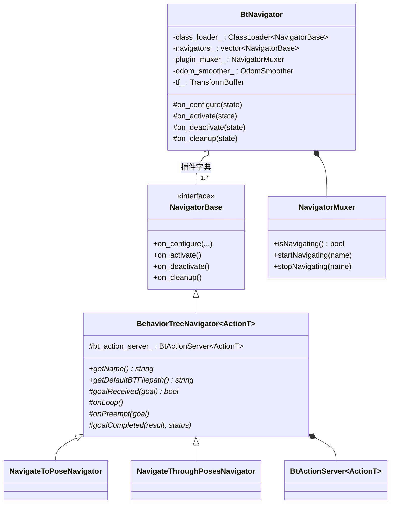
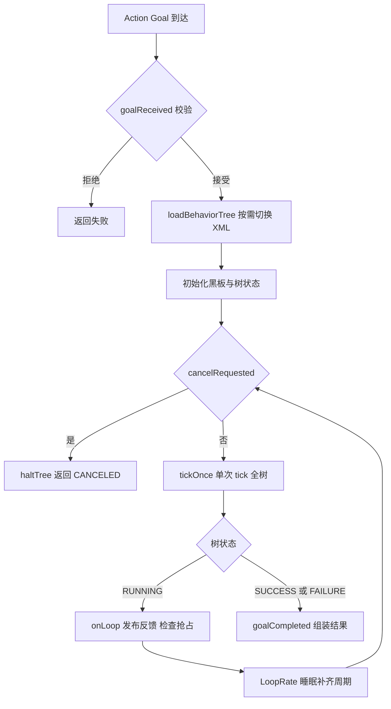
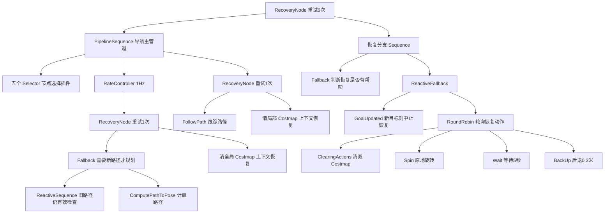

# 第 11 章 行为树与 BTNavigator：把导航逻辑写在 XML 里

> **一句话总结**：BtNavigator 是 Nav2 的任务编排大脑——它以生命周期节点（Lifecycle Node）为宿主，通过 Navigator 插件（Plugin）体系挂载 NavigateToPose 与 NavigateThroughPoses 两类导航器，每个导航器内嵌一个 BtActionServer 以固定周期 tick 一棵由 XML 描述的行为树（BT），树上的 Action/Condition/Control/Decorator 节点把规划、控制、恢复等服务器（Server）的 Action 接口组合成"执行—监督—恢复"的完整闭环，而这一切逻辑均可通过更换 XML 与插件在零编译的前提下重塑。

> **前置知识**：第 07 章 · 第 09 章 ｜ **知识依赖图**：[KnowledgeGraph/Knowledge](KnowledgeGraph/Knowledge.md)

## 11.1 为什么是行为树，而不是状态机

move_base 时代的导航主逻辑是一台硬编码的有限状态机：规划中、控制中、恢复中三个状态加固定的迁移边，恢复序列写死在代码里。这种设计随着逻辑复杂度上升而崩坏——每加一种新行为，状态与迁移边的数量组合式增长，且任何改动都要重新编译。Nav2 选择行为树，本质上是用三个特性换掉状态机的三个痛点：

1. **组合性替代枚举性**。状态机必须显式枚举所有状态迁移；行为树用 Sequence、Fallback 等控制节点递归组合子树，新增逻辑只是在树上挂一个分支，不影响其余部分。
2. **XML 可配置替代硬编码**。树结构以 XML 文件描述，运行时加载。调整"先重规划还是先清地图"这类策略问题，改的是配置而非代码，甚至可以按 Goal 逐次指定不同的树。
3. **局部恢复语义替代全局恢复状态**。状态机的"恢复"是一个全局状态，无法表达"规划失败清全局代价地图（Costmap）、控制失败清局部代价地图"这种上下文相关的策略；行为树的 Fallback/RecoveryNode 天然把恢复限定在失败发生的子树内，重试逻辑就长在失败点旁边。

代价是学习成本：理解一棵树的行为需要掌握每个控制节点的 tick 语义。Nav2 的应对是提供一套语义明确的自定义控制节点（PipelineSequence、RecoveryNode、RoundRobin），并让默认 XML 覆盖绝大多数场景。

## 11.2 整体设计：宿主、导航器与互斥器

BtNavigator（nav2_bt_navigator/src/bt_navigator.cpp）本身非常薄：它不含任何导航逻辑，只做三件事——加载 Navigator 插件、维护 TF 缓冲与里程计平滑器 OdomSmoother、把生命周期事件逐一转发给各插件。真正的骨架在 `nav2_core::BehaviorTreeNavigator<ActionT>` 模板基类（nav2_core/include/nav2_core/behavior_tree_navigator.hpp）：

三个设计决策值得展开：

**Navigator 也是插件**。与规划器、控制器一样，导航器通过 `pluginlib::ClassLoader<nav2_core::NavigatorBase>` 按 `navigators` 参数加载（插件描述见 nav2_bt_navigator/navigator_plugins.xml）。内置两个：`NavigateToPoseNavigator` 面向单目标导航，暴露 `NavigateToPose` Action；`NavigateThroughPosesNavigator` 面向多途经点导航，暴露 `NavigateThroughPoses` Action。用户完全可以自定义第三种导航范式（例如巡逻导航器）而不触碰框架。

**NavigatorMuxer 保证互斥**。一台机器人同一时刻只能执行一个导航任务。所有导航器共享一个 NavigatorMuxer，收到 Goal 时先尝试 `startNavigating()` 占锁，若另一导航器正在执行则直接拒绝新 Goal。互斥发生在任务级而非消息级，语义清晰且无死锁风险。

**OdomSmoother 作为共享设施**。里程计平滑器对 odom 话题做滑动窗口平均，写入黑板供 BT 节点（如速度相关条件节点）读取，避免每个节点各自订阅、各自滤波。

## 11.3 BT 引擎与执行模型

### BtActionServer：模板化的"树执行器"

每个导航器内部持有一个 `BtActionServer<ActionT>`（nav2_behavior_tree/include/nav2_behavior_tree/bt_action_server.hpp），它把"接收 Action Goal → 加载 XML → tick 树 → 返回结果"的全流程模板化，导航器只需通过回调注入个性化逻辑（Goal 校验、反馈组装、抢占处理）。其执行核心是 BehaviorTreeEngine（nav2_behavior_tree/src/behavior_tree_engine.cpp）的 `run()` 循环：

循环周期由 `bt_loop_duration` 参数控制（默认 10 ms，即 100 Hz 的 tick 上限）；每轮 tick 后若树仍在 RUNNING，则执行 `onLoop()` 回调——NavigateToPoseNavigator 在此计算剩余距离、预计到达时间与恢复次数并作为 Action 反馈发布。若单轮耗时超过周期，LoopRate 会告警提示某个 BT 节点阻塞过久：**BT 节点必须是非阻塞的**，这是整个执行模型的第一纪律。

### 黑板：树的共享内存

BtActionServer 在配置阶段向黑板写入一组基础条目，树上任何节点都可读取：

| 黑板条目 | 类型 | 含义 |
|---|---|---|
| `node` | LifecycleNode::SharedPtr | 宿主节点引用，供 BT 节点创建客户端 |
| `tf_buffer` | TransformBuffer::SharedPtr | TF 缓冲区 |
| `server_timeout` | milliseconds | BT 节点发送/取消目标后等待 Action 服务器确认响应的超时，默认 20 ms |
| `bt_loop_duration` | milliseconds | tick 周期，默认 10 ms |
| `cancel_timeout` | milliseconds | 取消 Action 的等待超时 |
| `wait_for_service_timeout` | milliseconds | 等待服务/Action 上线的超时 |
| `initial_pose_received` | bool | 初始位姿是否已接收 |
| `number_recoveries` | int | 本次任务累计恢复次数 |
| `odom_smoother` | OdomSmoother::SharedPtr | 平滑里程计 |

导航器再叠加任务级条目：`goal`（目标位姿）、`path`（当前路径）以及各 Action 的 `error_code`/`error_msg`。黑板是全局键值空间，没有作用域隔离——这既是灵活性来源，也是拼写错误难以被发现的根源（见 11.6 节）。

### 动态切换 BT XML

Goal 消息携带 `behavior_tree` 字段：为空则使用导航器的默认 XML；否则 BtActionServer 按 `bt_search_directories` 参数指定的目录搜索并加载指定文件。这意味着上层应用可以按任务类型逐次选择不同的树——精细对接用一棵、开阔巡航用另一棵。抢占（preempt）场景下，若新 Goal 请求同一棵树则直接更新黑板中的 `goal` 继续执行，实现"目标热更新"而不中断树。

## 11.4 剖析默认树：navigate_to_pose_w_replanning_and_recovery.xml

默认 XML（nav2_bt_navigator/behavior_trees/navigate_to_pose_w_replanning_and_recovery.xml）是理解 Nav2 编排哲学的最佳教材。骨架结构如下：

逐层解读这棵树的意图：

**根节点 RecoveryNode（重试 6 次）**把整棵树分为"主管道"与"系统级恢复"两半：主管道失败一次，就执行一轮恢复分支，然后重试主管道，最多 6 轮。

**PipelineSequence 实现持续重规划**。它与普通 Sequence 的区别在于：后面的子节点处于 RUNNING 时，前面已成功的子节点会被继续 tick。因此当 FollowPath 长时间 RUNNING 时，前面的 RateController 分支仍以 1 Hz 被 tick——路径以固定频率刷新，控制器始终跟踪较新的路径。这是"边走边重规划"的全部秘密，没有任何额外线程。

**RateController 控制重规划频率**。规划是秒级开销的计算，不应以 100 Hz 的 tick 频率触发。RateController 以 `hz="1.0"` 把子树的 tick 降频到 1 Hz。其子树里还有一层优化：ReactiveSequence 先检查目标未变、目标尚远、旧路径仍然有效，全部成立则跳过本轮规划——1.5.0 版本的默认树已经不是"无脑周期重规划"，而是"必要时才重规划"。

**上下文恢复与系统恢复分层**。ComputePathToPose 与 FollowPath 各自包在一层 RecoveryNode 里，失败时先做代价最小的上下文恢复（清对应的 Costmap 后重试一次）；两层都救不回来，失败才上抛到根节点触发系统级恢复。恢复分支先用 `WouldAPlannerRecoveryHelp`/`WouldAControllerRecoveryHelp` 检查错误码——若失败原因是"目标本身被占用"这类恢复无益的错误，直接放弃而不浪费时间。RoundRobin 则在多轮恢复中轮换动作：第一轮清地图、第二轮旋转、第三轮等待、第四轮后退，避免重复执行同一种无效恢复。

through_poses 版本的差异一句话可以概括：以 `ComputePathThroughPoses` 替代单点规划、重规划频率降至 0.333 Hz、增加 `RemovePassedGoals` 移除已途经的中间点。

## 11.5 节点库：四类节点与两个模板基类

nav2_behavior_tree 提供约 80 个现成节点（完整端口定义见 nav2_behavior_tree/nav2_tree_nodes.xml），按 BT 语义分四类：

| 类别 | 数量 | 代表节点与一句话职责 |
|---|---|---|
| Action | 40+ | ComputePathToPose 调用全局规划；FollowPath 调用控制器；Spin/BackUp/Wait/DriveOnHeading/AssistedTeleop 调用恢复行为；ClearEntireCostmap 清地图；TruncatePathLocal/RemovePassedGoals 等路径处理；PlannerSelector/ControllerSelector 等按话题动态选插件；6 个 Cancel 变体取消在途 Action |
| Condition | 19 | GoalReached 判断到达；GoalUpdated 检测新目标；IsStuck 判断卡住；IsBatteryLow 电量检查；IsPathValid 路径有效性；WouldAPlannerRecoveryHelp 等 4 个错误码研判节点；TransformAvailable、TimeExpired、DistanceTraveled 等 |
| Control | 6 | RecoveryNode 失败转恢复再重试；PipelineSequence 运行中持续 tick 前置节点；RoundRobin 轮询子节点；PauseResumeController 外部暂停恢复；PersistentSequence、NonblockingSequence |
| Decorator | 7 | RateController 限频；DistanceController 按行进距离触发；SpeedController 按速度调频；GoalUpdater 更新目标；SingleTrigger 只放行一次；PathLongerOnApproach、GoalUpdatedController |

数量庞大，但绝大多数 Action 节点只是薄薄一层适配器，真正的骨架是两个模板基类。

**BtActionNode\<ActionT\>**（nav2_behavior_tree/include/nav2_behavior_tree/bt_action_node.hpp）把"BT 同步 tick 语义"与"ROS 2 异步 Action 语义"之间的阻抗失配一次性解决：它自动创建 Action 客户端（挂在 MutuallyExclusive 回调组上以隔离执行器）、发送 Goal、非阻塞地轮询结果，并把派生类的定制点收敛为五个钩子：

| 钩子 | 调用时机 | 典型用途 |
|---|---|---|
| `on_tick()` | 每次 tick、发送 Goal 前 | 从黑板读输入端口，组装 Goal |
| `on_wait_for_result(feedback)` | 等待结果期间每轮 tick | 处理反馈，必要时置位重发新 Goal |
| `on_success()` | 服务器返回成功 | 把结果写输出端口，决定返回 SUCCESS 与否 |
| `on_aborted()` | 服务器中止 | 写 error_code 到黑板，返回 FAILURE |
| `on_cancelled()` | 取消完成 | 清理状态，通常返回 SUCCESS |

派生一个新 Action 节点通常不足百行：声明端口、在 `on_tick()` 填 Goal、在 `on_success()` 写结果。**BtServiceNode\<ServiceT\>** 是服务版的同构设计，钩子为 `on_tick()` 与 `on_completion()`；**BtCancelActionNode\<ActionT\>** 则专司向指定服务器发送取消请求。

## 11.6 插件注册机制与经典陷阱

BT 节点以 BehaviorTree.CPP 的插件机制注册：每个节点源文件末尾用 `BT_REGISTER_NODES` 宏向工厂注册"XML 标签名 → C++ 类"的映射；BtActionServer 构造时按 `plugin_lib_names` 参数（1.5.0 起默认聚合为单一的 `nav2_behavior_tree_nodes` 库）逐一 `registerFromPlugin()` 加载共享库。XML 解析时按标签名查工厂，查不到即抛异常。

由此产生一组高频陷阱：

- **XML 用了未注册的节点**：自定义节点忘了加入 `plugin_lib_names`，或库名拼错，树加载直接失败，报"未知节点类型"。
- **标签名大小写不匹配**：注册名是 `ComputePathToPose`，XML 写成 `ComputePathToPose2` 或大小写有出入，同样加载失败——错误信息明确，但常被误判为库没装。
- **黑板变量拼写错误**：`{path}` 写成 `{paths}` 不会在加载期报错，而是在运行期读到空值或类型转换异常，排查成本远高于前两类。对照 nav2_tree_nodes.xml 中的端口定义逐一核对是唯一可靠的办法。

## 11.7 设计模式盘点与扩展方式

- **组合模式**：行为树本身即组合模式的教科书实现——控制节点与叶子节点共享统一的 tick 接口，树的行为由结构递归决定。
- **模板方法**：BtActionNode/BtServiceNode 固化通信骨架，钩子留给子类；BehaviorTreeNavigator 固化"配置黑板—启动服务器—处理完成"的骨架，导航器只填校验与反馈逻辑。
- **命令模式**：每个 Action 节点把一次远程调用封装为可执行、可取消的对象，BT 引擎作为调用者无需了解命令细节。
- **外观模式**：BehaviorTreeEngine 把 BehaviorTree.CPP 的工厂、树创建、Groot 监控与 tick 循环收敛为少数几个入口，上层不直接接触底层库。

扩展路径按侵入程度从低到高排列：改 XML 重排现有节点、新写 Condition/Action 节点并注册插件、派生 BehaviorTreeNavigator 实现新的导航范式。三条路径互不干扰，且都不需要修改 Nav2 框架代码。

## 11.A 源码导航与入手路径

入口链：main()→BtNavigator::on_configure() 加载 Navigator 插件→NavigateToPoseNavigator 内的 BtActionServer::on_configure() 注册节点库与默认 XML→Action goal 触发 executeCallback()→loadBehaviorTree()→BehaviorTreeEngine::run() 周期 tick 全树。

| 文件（仓库相对路径，约 N 行） | 关键函数 | 作用 |
|---|---|---|
| nav2_bt_navigator/src/bt_navigator.cpp（约 196 行） | on_configure() / on_activate() | 薄宿主：插件加载与生命周期转发 |
| nav2_bt_navigator/src/navigators/navigate_to_pose.cpp（约 292 行） | goalReceived() / onLoop() / onPreempt() | 单目标导航器的回调注入样本 |
| nav2_behavior_tree/include/nav2_behavior_tree/bt_action_server_impl.hpp（约 553 行） | executeCallback() / loadBehaviorTree() | 黑板初始化、XML 加载与抢占处理 |
| nav2_behavior_tree/src/behavior_tree_engine.cpp（约 218 行） | run() / createTreeFromFile() | tick 循环与 LoopRate 频率控制 |
| nav2_behavior_tree/include/nav2_behavior_tree/bt_action_node.hpp（约 509 行） | tick() 与五个钩子 | BT 同步 tick 与 ROS 2 异步 Action 的适配层 |

| 第一遍只看 | 第二遍补充 | 以后再看 |
|---|---|---|
| executeCallback()→run() 的 tick 主循环与默认 XML 结构 | BtActionNode 钩子体系与黑板条目流转 | 具体 Condition/Decorator 节点实现与 NavigatorMuxer 细节 |

完整业务链路见 [NavigateThroughPoses 与 FollowWaypoints 时序图](Assets/sequence/NavigateThroughPoses与FollowWaypoints.md)，单目标主链路另见 [NavigateToPose 端到端时序图](Assets/sequence/NavigateToPose.md)。

## 11.B 设计权衡

### BT vs FSM：组合性买单的是 tick 开销

11.1 节已说明 BT 用组合性、XML 可配置、局部恢复换掉状态机的三个痛点，这里补充被略过的另一面：FSM 是事件驱动的，状态不变就零开销；BT 必须以 bt_loop_duration 周期性重 tick 全树，哪怕什么都没发生——100 Hz 的轮询是组合语义的硬成本。Nav2 接受这笔开销，因为导航主逻辑的节点数量有限且每个节点都非阻塞，换来的是"边走边重规划"这类并发语义不需要任何额外线程（PipelineSequence 的全部秘密）。模式层面的组合/命令模式剖析另见第 22 章，不在此重复。

### 黑板全局键空间 vs 强类型接口传参

黑板是无作用域隔离的键值空间，任意节点可读写任意条目。强类型方案（每个节点声明完整参数结构体）能在编译期抓住拼写错误，但会让 XML 重排、新节点接入都变成接口适配工程，“改配置不改代码”的核心价值丢失。Nav2 选择灵活性，把代价明码标在 11.6 节：黑板变量拼错只在运行期暴露，排查成本高。工程上的对冲手段是 nav2_tree_nodes.xml 这份端口契约清单——用文档化的单一真相源弥补类型系统缺席留下的安全网。

### 同树抢占热更新 vs 重启整棵树

新 goal 请求同一棵 XML 时，BtActionServer 只更新黑板中的 goal 而不重建树。重建方案语义干净（所有节点状态归零），但在途 Action 全部被取消、机器人行为中断，频繁改点目标的场景（如跟随移动目标）下体验灾难性；热更新保持树与在途动作连续，代价是自定义节点若缓存了旧目标相关状态，必须自行在 on_tick() 中检测目标变化——这是把一致性责任下放给节点作者换取任务连续性的典型交易。

## 知识总结

1. Nav2 用行为树替代状态机，核心收益是**组合性、XML 可配置与局部恢复语义**；PipelineSequence + RateController 用纯树结构实现了"边走边重规划"。
2. BtNavigator 是薄宿主，**Navigator 插件体系**（BehaviorTreeNavigator 模板 + NavigatorMuxer 互斥）承载具体导航范式，内置单点与多途经点两种导航器。
3. **BtActionServer** 模板化树执行流程：`bt_loop_duration` 周期 tick、黑板注入基础条目（node/tf_buffer/server_timeout 等）、支持按 Goal 动态切换 XML 与抢占式目标热更新。
4. 默认树以**根 RecoveryNode 分隔主管道与系统恢复**，上下文恢复（清对应 Costmap）与系统恢复（RoundRobin 轮换清图/Spin/Wait/BackUp）分层，错误码研判节点避免无效恢复。
5. 节点库四类共约 80 个节点，几乎全部构建在 **BtActionNode/BtServiceNode 模板基类**之上，五个钩子方法是自定义节点的全部接口面。

## 常见面试题

1. **Nav2 为什么用行为树而不是状态机？**
   要点：状态机迁移边随复杂度组合爆炸且需重编译；行为树以控制节点递归组合、XML 运行时可配、Fallback/RecoveryNode 提供失败点局部的恢复语义；代价是需要理解各控制节点的 tick 语义。
2. **PipelineSequence 与普通 Sequence 的区别？它如何实现持续重规划？**
   要点：Sequence 中已成功的子节点不再被 tick；PipelineSequence 在后续子节点 RUNNING 时仍会重新 tick 前面的子节点。FollowPath RUNNING 期间规划分支持续被 tick，配合 RateController 限频即得周期重规划。
3. **BtActionNode 解决了什么问题？列举其钩子方法。**
   要点：弥合 BT 同步 tick 与 ROS 2 异步 Action 的语义差异，统一管理 Action 客户端、超时与回调组隔离；钩子为 on_tick、on_wait_for_result、on_success、on_aborted、on_cancelled（另有 on_timeout）。
4. **黑板中 server_timeout 与 bt_loop_duration 分别是什么？配置不当有何后果？**
   要点：前者是 BT 节点发送/取消目标后等待 Action 服务器确认响应的超时（默认 20 ms），后者是全树 tick 周期（默认 10 ms）。bt_loop_duration 过小空耗 CPU，过大导致反馈与抢占响应迟钝；server_timeout 过小会在服务器确认目标稍慢时误判为失败。
5. **一次导航任务中"恢复"发生在哪些层次？**
   要点：三层——规划/控制各自的上下文 RecoveryNode（清对应 Costmap 重试一次）；根 RecoveryNode 的系统恢复分支（最多 6 轮，RoundRobin 轮换动作）；恢复前还有错误码研判与 GoalUpdated 中断检查。

## 最佳实践与容易踩坑

- **BT 节点严禁阻塞**：任何在 tick 中同步等待的实现都会拖垮整棵树的周期，LoopRate 超时告警刷屏时优先排查自定义节点。
- **改树先画树**：修改 XML 前先用 Groot2 可视化确认结构，控制节点语义（尤其 PipelineSequence 与 ReactiveSequence 的差异）最容易凭直觉写错。
- **黑板端口名逐字核对**：以 nav2_tree_nodes.xml 为唯一权威来源，拼写错误不会在加载期暴露。
- **自定义节点务必注册进 plugin_lib_names**：并保持 XML 标签名与注册名严格一致（大小写敏感）。
- **抢占语义要留意**：同一棵树的新 Goal 走黑板热更新而非重启树，若自定义节点缓存了旧目标相关状态，需在 on_tick 中检测目标变化。

## 延伸阅读

- nav2_bt_navigator/src/navigators/navigate_to_pose.cpp —— 导航器回调注入与反馈组装的完整样本
- nav2_behavior_tree/include/nav2_behavior_tree/bt_action_server_impl.hpp —— 黑板初始化、XML 加载与抢占处理
- nav2_behavior_tree/src/behavior_tree_engine.cpp —— tick 循环与 LoopRate 频率控制
- nav2_bt_navigator/behavior_trees/ —— 全部 15 棵内置树，对照阅读体会编排差异
- BehaviorTree.CPP 官方文档（v4）—— 控制节点基础语义与端口系统

## 11.C 阅读检查点

1. PipelineSequence 与普通 Sequence 的 tick 语义差异是什么？它如何不用额外线程实现边走边重规划？（见 11.4）
2. 默认树中上下文恢复与系统级恢复分别发生在哪一层？错误码研判节点起什么作用？（见 11.4）
3. BtActionNode 的五个钩子各在什么时机被调用？自定义一个 Action 节点至少要实现哪几个？（见 11.5）
4. 黑板中 server_timeout 与 bt_loop_duration 各控制什么？配置失衡各有什么后果？（见 11.3）
5. 黑板变量拼写错误为什么比节点标签名写错更难排查？唯一可靠的核对依据是什么？（见 11.6）

> 下一章：12_Behaviors恢复行为
