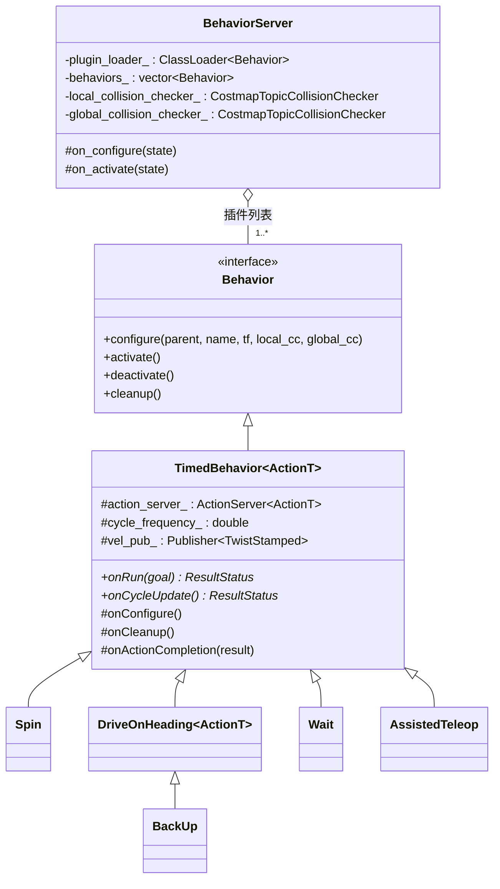
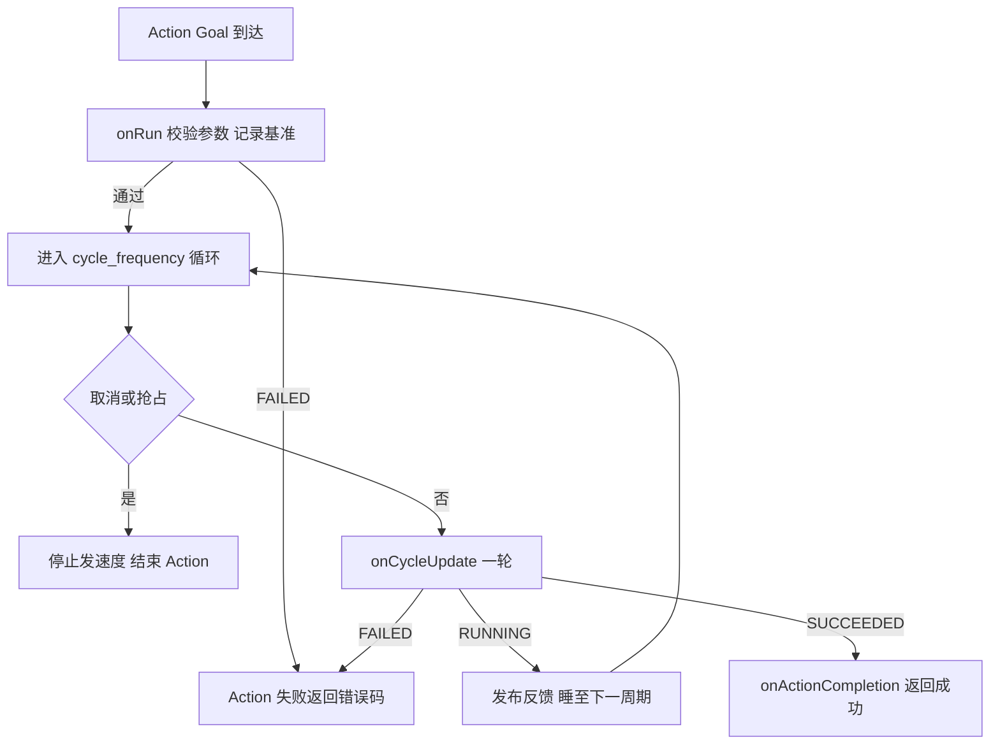
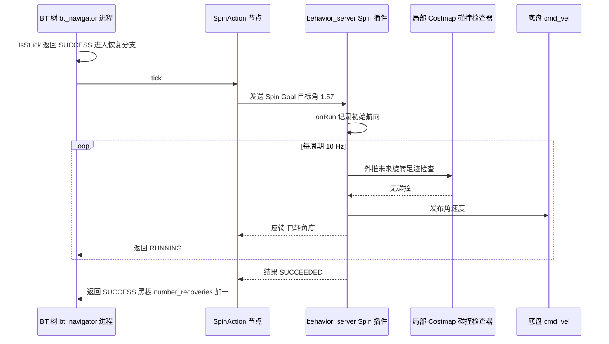

# 第 12 章 Behaviors 恢复行为：导航失败时的兜底动作库

> **一句话总结**：BehaviorServer 是 Nav2 的恢复行为宿主——一个生命周期节点（Lifecycle Node）通过插件（Plugin）机制加载 Spin、BackUp、DriveOnHeading、Wait 等多个 Behavior 插件，每个插件各自暴露独立的 Action 接口并共享 TF 与基于局部代价地图（Costmap）的碰撞检查器，TimedBehavior 模板基类以 onRun 加 onCycleUpdate 的周期执行契约统一了所有行为的骨架，使行为树（BT）的恢复分支可以像调用规划器一样按需调用这些短平快的兜底动作。

> **前置知识**：第 06 章 · 第 11 章 ｜ **知识依赖图**：[KnowledgeGraph/Knowledge](KnowledgeGraph/Knowledge.md)

## 12.1 为什么需要独立的恢复行为服务器

导航失败是常态而非异常：传感器噪声在代价地图上留下"幽灵障碍"、机器人贴墙过近导致规划无解、动态行人把机器人围在角落。第 11 章展示了行为树如何**决策**"何时恢复、按什么顺序恢复"，但决策之外还需要有人**执行**"旋转一圈刷新传感器视野"、"后退半米脱离障碍"这些具体动作。Nav2 把执行侧独立成 behavior_server（nav2_behaviors），而非塞进控制器服务器（Server）或 BT 进程，理由有三：

1. **与主控制流解耦**。恢复动作恰恰在规划/控制失败时才需要执行，若与控制器同宿主，控制器的异常状态可能波及恢复能力本身。独立进程保证"救援队"不与"事故现场"共享故障域。
2. **动作语义自洽**。恢复行为是有明确终止条件的短时动作（转过目标角度、退够目标距离、等够目标时长），与"持续跟踪路径直到到达"的控制任务在生命周期上完全不同，各自暴露 Action 更符合语义。
3. **不只服务于恢复**。Spin、DriveOnHeading、AssistedTeleop 同样可以被应用层直接调用——狭窄空间辅助遥控、对接前的定向微调——独立服务器让这些能力不依赖导航任务存在。

## 12.2 BehaviorServer 结构：一个宿主、多个 Action

与 planner/controller 服务器"单一主 Action、插件按 id 分发"的模式不同，behavior_server 采用**每个插件各开一个 Action 服务器**的结构：

| 特性 | PlannerServer / ControllerServer | BehaviorServer |
|---|---|---|
| Action 数量 | 单个主 Action（Goal 内携带 plugin id） | 每个行为插件一个独立 Action |
| 插件选择方式 | 服务器按 id 查字典分发 | 客户端直接连接对应 Action 名 |
| 并发语义 | 同类请求串行 | 不同行为的 Action 相互独立 |
| 共享资源 | 内嵌一份 Costmap2DROS | 共享 TF 与两个 Costmap 话题碰撞检查器 |

这个差异源于任务性质：规划请求同构（都是"给我一条路"），适合统一入口；恢复行为异构（旋转要角度、后退要距离、等待要时长），Goal 消息类型各不相同，强行统一反而丢失类型安全。宿主（nav2_behaviors/src/behavior_server.cpp）按 `behavior_plugins` 参数加载插件，默认四件套为 spin、backup、drive_on_heading、wait；碰撞检查不内嵌完整的 Costmap2DROS，而是订阅已发布的 costmap 话题构建 `CostmapTopicCollisionChecker`——恢复行为只读代价地图，无需自己维护一份。

## 12.3 TimedBehavior：周期执行的模板契约

所有内置行为都不直接实现 `nav2_core::Behavior`，而是继承 `TimedBehavior<ActionT>`（nav2_behaviors/include/nav2_behaviors/timed_behavior.hpp）。这个模板基类固化了"Action 服务器管理 + 定频循环"的骨架，把行为差异压缩为两个纯虚函数：

- **`onRun(goal)`**：Goal 到达时调用一次。负责校验参数、记录初始位姿/时间等基准状态。返回 FAILED 则整个 Action 立即以失败终止。
- **`onCycleUpdate()`**：以 `cycle_frequency` 参数（默认 10 Hz）反复调用。每轮完成"读当前状态 → 判断终止条件 → 碰撞检查 → 发一帧速度命令"，返回 RUNNING 继续循环，SUCCEEDED/FAILED 终止。

配套的可选钩子有 `onConfigure()`（读取行为专属参数）、`onCleanup()` 与 `onActionCompletion()`（结束时收尾，例如发零速）。返回值 `ResultStatus` 除状态外还携带 `error_code` 与 `error_msg`，与第 07/09 章规划、控制服务器的错误码体系同构，供 BT 的错误码研判节点消费。

这个契约的价值在第 11 章 BtActionNode 处已见过同款：**框架吃掉所有通信与调度的复杂度，算法作者只写领域逻辑**。写一个自定义恢复行为（例如"鸣笛警示"）只需实现两个函数加一份插件描述文件。

## 12.4 内置行为逐个解析

五个内置行为都遵循同一安全准则：**动作前用局部 Costmap 做前瞻碰撞检查，检查不过宁可失败也不硬闯**。前瞻窗口由 `simulate_ahead_time` 参数控制（默认 2 s），即沿当前命令外推未来 2 秒的位姿逐点查询代价地图。

| 行为 | Action 类型 | 终止条件 | 碰撞检查方式 | 典型场景 |
|---|---|---|---|---|
| Spin | nav2_msgs/action/Spin | 累计旋转角达到 spin_dist 或超时 | 沿旋转方向外推未来角度，检查机器人足迹 | 刷新传感器视野、清除幽灵障碍 |
| BackUp | nav2_msgs/action/BackUp | 后退距离达到 backup_dist 或超时 | 沿后退方向外推位姿逐点检查 | 脱离前方障碍死角 |
| DriveOnHeading | nav2_msgs/action/DriveOnHeading | 前进距离达标或超时 | 同 BackUp，方向为正 | 定向脱困、对接前微调 |
| Wait | nav2_msgs/action/Wait | 等待时长达到 wait_duration | 无（不产生运动） | 等行人走开、等传感器数据稳定 |
| AssistedTeleop | nav2_msgs/action/AssistedTeleop | 时长耗尽或被显式取消 | 沿遥控指令方向外推，碰撞前缩减速度 | 狭窄空间人工脱困 |

**Spin**（nav2_behaviors/plugins/spin.cpp）在 `onRun` 中记录初始航向，`onCycleUpdate` 每轮用 TF 计算已转角度、按剩余角度做梯形减速，并模拟未来旋转扫过的足迹是否与障碍相交。旋转是恢复动作中风险最低的一种——原地不位移——但足迹非圆形的机器人在狭窄处旋转仍可能扫到障碍，碰撞检查不可省略（可用 `disable_collision_checks` 显式关闭，仅建议在仿真调试时使用）。

**DriveOnHeading 与 BackUp**（nav2_behaviors/include/nav2_behaviors/plugins/drive_on_heading.hpp、plugins/back_up.cpp）是一对典型的模板复用：BackUp 直接继承 `DriveOnHeading<nav2_msgs::action::BackUp>`，仅约束速度与距离取负号。`onRun` 校验 Goal 仅含 X 方向分量且速度与距离同号；`onCycleUpdate` 以时间步长沿运动方向外推位姿序列，任何一点碰撞即失败终止——这正是"预防性失败优于事后碰撞"的设计立场。

**Wait**（nav2_behaviors/plugins/wait.cpp）是最简单的行为：`onRun` 记录截止时刻，`onCycleUpdate` 比较当前时间，期间不发布任何速度。它的价值在于把"以时间换环境变化"显式建模为一个可编排、可取消的动作，而不是让上层 sleep。

**AssistedTeleop**（nav2_behaviors/plugins/assisted_teleop.cpp）性质特殊：它不自主运动，而是订阅遥控速度指令，逐帧沿指令方向做前瞻碰撞投影，临近障碍时按比例缩减速度直至截停，再把过滤后的速度转发给底盘。它默认不在 `behavior_plugins` 四件套中，需显式配置启用，是"人机共驾"式的安全垫而非恢复动作。

## 12.5 与行为树的衔接

第 11 章默认树的恢复分支里，Spin/Wait/BackUp 以 BT Action 节点形式出现在 RoundRobin 下。BT 节点（nav2_behavior_tree 的 SpinAction 等）与行为插件之间是标准的 Action 客户端/服务器关系，一次由 IsStuck 条件触发 Spin 的时序如下：

值得注意的分工：**BT 决定"是否、何时、按什么顺序"恢复，行为插件决定"怎么安全地执行"**。BT 侧的 RoundRobin 保证多轮失败时轮换不同动作；行为侧的碰撞检查保证单个动作不制造新事故。若恢复期间新 Goal 到达，恢复分支上方的 GoalUpdated 条件会中断恢复，BT 节点随即向 behavior_server 发送取消请求——这依赖 TimedBehavior 循环中每轮的取消检查，也再次印证周期执行模型的必要性。

## 12.6 设计模式盘点

- **模板方法**：TimedBehavior 固化"Action 管理 + 定频循环 + 取消处理"骨架，onRun/onCycleUpdate 是子类唯一必须填充的空白；DriveOnHeading 又作为二级模板被 BackUp 复用。
- **策略模式**：`nav2_core::Behavior` 是策略接口，behavior_server 按参数装配任意策略组合，自定义行为与内置行为地位平等。
- **命令模式**：每个行为封装为带参数、可取消、有明确完成语义的 Action，BT 恢复分支作为调用者按序派发命令而无需了解执行细节。

## 12.A 源码导航与入手路径

入口链：main()→BehaviorServer::on_configure()→loadBehaviorPlugins() 按参数装配插件→各插件 configure() 各自开 Action 服务器→Goal 到达触发 TimedBehavior::execute()→onRun() 一次性校验→cycle_frequency 循环调 onCycleUpdate() 直到终止。

| 文件（仓库相对路径，约 N 行） | 关键函数 | 作用 |
|---|---|---|
| nav2_behaviors/src/behavior_server.cpp（约 238 行） | on_configure() / loadBehaviorPlugins() | 插件装配与两个碰撞检查器的创建 |
| nav2_behaviors/include/nav2_behaviors/timed_behavior.hpp（约 312 行） | execute() / onRun() / onCycleUpdate() | 周期执行骨架与取消处理的模板基类 |
| nav2_behaviors/plugins/spin.cpp（约 184 行） | onRun() / onCycleUpdate() | 旋转行为：梯形减速与足迹前瞻检查 |
| nav2_behaviors/include/nav2_behaviors/plugins/drive_on_heading.hpp（约 285 行） | onRun() / onCycleUpdate() | 定向行驶与外推碰撞检查的代表实现 |
| nav2_behaviors/plugins/back_up.cpp（约 51 行） | 继承特化 | 二级模板复用：负向速度与距离 |

| 第一遍只看 | 第二遍补充 | 以后再看 |
|---|---|---|
| timed_behavior.hpp 的 execute() 循环骨架 | spin.cpp 与 drive_on_heading.hpp 的碰撞外推细节 | AssistedTeleop 与 CostmapTopicCollisionChecker 内部实现 |

恢复分支在全局链路中的位置见 [NavigateToPose 端到端时序图](Assets/sequence/NavigateToPose.md)。

## 12.B 设计权衡

### 并联输出 cmd_vel_nav vs 串接在控制器下游

behavior_server 与 ControllerServer 是**并联**关系：两者都直接向 cmd_vel_nav 发布，再经 velocity_smoother→collision_monitor 的统一下游链路落地（第 16 章）。若把恢复动作串接在控制器之下（作为一种特殊 Controller 插件），控制器异常时恢复能力会随之瘫痪——而恢复恰恰在控制失败时才需要。并联的代价是互斥责任上移：框架不阻止两者同时发速度，靠行为树的编排语义（恢复分支与 FollowPath 不会同时处于 RUNNING）保证互斥——用编排层的约束换取执行层的故障隔离。

### 每行为独立 Action vs 单 Action 按 id 分发

与 planner/controller 的"单主 Action + 插件 id"相比，每插件各开一个 Action 看似冗余，实则由任务异构性决定：旋转要角度、后退要距离、等待要时长，Goal 消息类型各不相同，强行统一入口就要把参数塞进通用字段，丢失类型安全与接口自描述性。代价是客户端要记住 N 个 Action 名、新增行为需新增接口定义——对于数量有限、语义彼此无关的恢复动作，这笔代价远小于类型安全的收益。

### 订阅 Costmap 话题 vs 内嵌 Costmap2DROS

恢复行为只在短时短距动作前做只读碰撞检查，为此维护一份完整的 Costmap2DROS（独立线程 + 全套图层）得不偿失。CostmapTopicCollisionChecker 订阅已发布的 costmap 话题，代价是数据新鲜度受发布频率限制、跨进程多一拷贝内存；收益是零维护成本与单一数据源一致性。这与第 15 章 SmootherServer 的选择同源：按访问频率决定数据布局，低频消费者不配拥有独立副本。

## 知识总结

1. behavior_server 把导航失败的**兜底动作与主控制流解耦**：独立进程、每个 Behavior 插件各自暴露 Action，与 planner/controller 的"单 Action + 插件 id 分发"模式形成互补的两种插件宿主范式。
2. **TimedBehavior 模板契约**：onRun 一次性校验与建立基准，onCycleUpdate 以 cycle_frequency 定频执行"状态—终止判断—碰撞检查—发速度"循环，错误码体系与规划/控制服务器同构。
3. 内置五行为中 Spin/BackUp/DriveOnHeading/Wait 是恢复四件套，AssistedTeleop 是需显式启用的人工脱困通道；BackUp 通过继承 DriveOnHeading 实现零重复代码。
4. 所有运动型行为共享**基于局部 Costmap 话题的前瞻碰撞检查**（simulate_ahead_time 外推），行为服务器只读代价地图而不维护自己的 Costmap2DROS。
5. BT 与行为的分工边界清晰：树负责恢复的**编排与中断**（RoundRobin 轮换、GoalUpdated 打断），插件负责动作的**安全执行**（碰撞检查、超时、可取消）。

## 常见面试题

1. **behavior_server 为什么每个行为一个 Action，而不像 PlannerServer 那样单 Action 分发？**
   要点：恢复行为的 Goal 语义异构（角度/距离/时长），独立 Action 保留类型安全；行为间生命周期独立，客户端直连对应 Action 名；规划请求同构则适合统一入口按 id 分发。
2. **TimedBehavior 的核心契约是什么？**
   要点：onRun（Goal 到达时一次性校验与初始化，返回 FAILED 立即终止）与 onCycleUpdate（按 cycle_frequency 周期调用，返回 RUNNING/SUCCEEDED/FAILED 驱动循环）；辅以 onConfigure/onCleanup/onActionCompletion 钩子与携带错误码的 ResultStatus。
3. **恢复行为如何做碰撞检查？为什么用局部 Costmap？**
   要点：沿当前命令按 simulate_ahead_time 外推未来位姿序列，逐点用 CostmapTopicCollisionChecker 检查机器人足迹；局部 Costmap 以机器人为中心、更新频率高、包含最新传感器信息，最适合短距离短时程的动作安全判断。
4. **BackUp 与 DriveOnHeading 是什么关系？**
   要点：BackUp 直接继承 DriveOnHeading 模板并以负向速度与距离特化，二者共享外推碰撞检查与距离终止逻辑，是模板方法模式的二级复用。
5. **默认恢复分支中清 Costmap、Spin、Wait、BackUp 的顺序有何讲究？**
   要点：RoundRobin 按代价与风险递增轮换——清地图零运动风险且常能直接解除幽灵障碍；Spin 原地不位移；Wait 以时间换环境变化；BackUp 产生位移风险最高放最后；每轮失败换下一种，避免重复无效恢复。

## 最佳实践与容易踩坑

- **simulate_ahead_time 要与速度匹配**：外推窗口过短则高速时刹不住，过长则在开阔区也频繁误报碰撞导致恢复失败；调整速度参数时同步复核该值。
- **狭窄空间慎用 Spin 与 BackUp**：非圆形足迹旋转会扫到侧向障碍，后退方向通常没有传感器覆盖；此类场景优先 Wait 与清地图，或改用 AssistedTeleop 人工介入。
- **先清地图再运动是有意的顺序**：若把 BackUp 排在清地图之前，机器人可能基于陈旧的幽灵障碍地图判定后方碰撞而恢复失败；自定义恢复子树时保持"零运动动作在前"的梯度。
- **不要关闭碰撞检查图省事**：`disable_collision_checks` 仅用于仿真排障；实机关闭等于放弃恢复动作的最后一道安全网。
- **恢复次数需要预算**：黑板 number_recoveries 配合根 RecoveryNode 的重试上限决定任务最终失败前的总尝试量，部署时按场景实测设定，而不是无限重试掩盖环境问题。

## 延伸阅读

- nav2_behaviors/src/behavior_server.cpp —— 插件加载与碰撞检查器装配
- nav2_behaviors/include/nav2_behaviors/timed_behavior.hpp —— 周期执行骨架与取消处理的完整实现
- nav2_behaviors/include/nav2_behaviors/plugins/drive_on_heading.hpp —— 前瞻碰撞检查外推的代表性实现
- nav2_costmap_2d 的 CostmapTopicCollisionChecker —— 基于话题订阅的足迹碰撞检查
- nav2_msgs/action/ 下的 Spin、BackUp、DriveOnHeading、Wait、AssistedTeleop 接口定义（接口体系详见第 04 章）

## 12.C 阅读检查点

1. behavior_server 为什么每个行为各开一个 Action，而不采用 PlannerServer 式的单 Action 按 id 分发？（见 12.2 与 12.B）
2. TimedBehavior 的 onRun() 与 onCycleUpdate() 各承担什么职责？返回值如何驱动循环？（见 12.3）
3. 运动型行为的前瞻碰撞检查如何工作？simulate_ahead_time 设得过短或过长各有什么后果？（见 12.4 与最佳实践）
4. BackUp 与 DriveOnHeading 的代码复用关系是怎样实现的？（见 12.4）
5. 默认恢复序列为什么把清地图排在运动型动作之前？（见 12.5 与最佳实践）

> 下一章：13_AMCL定位
