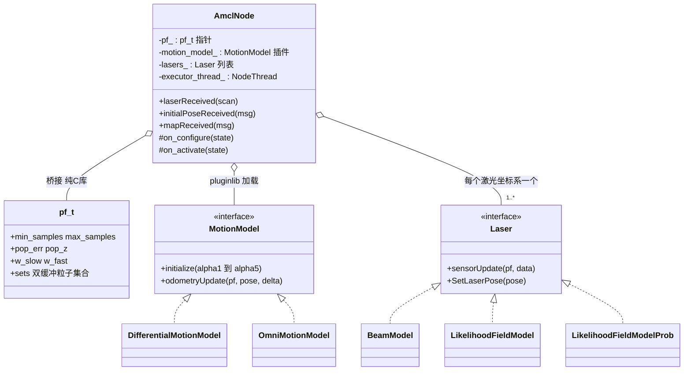
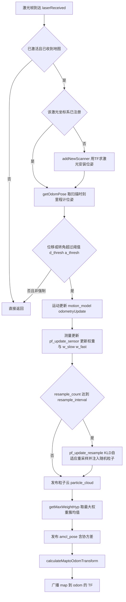

# 第 13 章 AMCL 定位：用一群粒子回答"我在哪"

> **一句话总结**：AMCL 是 Nav2 中基于粒子滤波的已知地图定位节点，它以生命周期节点（Lifecycle Node）AmclNode 封装一套纯 C 实现的粒子滤波库 pf，通过插件（Plugin）化的运动模型与激光模型完成"运动更新→测量更新→KLD 自适应重采样→聚类求位姿"的循环，最终以 map→odom 的 TF 变换向整个导航栈交付全局定位结果。

> **前置知识**：第 01 章 · 第 05 章 ｜ **知识依赖图**：[KnowledgeGraph/Knowledge](KnowledgeGraph/Knowledge.md)

## 13.1 为什么需要 AMCL

导航栈的所有上层模块——全局规划、局部控制、行为树（BT）决策——都建立在一个前提上：机器人知道自己在地图坐标系里的位置。里程计（轮式编码器或 IMU 积分）能给出短时间内相当精确的相对位移，但误差会随行驶距离无界累积：轮子打滑、地面不平、标定偏差，都让 odom 坐标系与真实世界渐行渐远。已知地图定位问题因此可以概括为一句话：**用外部传感器观测持续修正里程计的漂移**。

粒子滤波给出的答案非常直觉：与其维护一个"最优位姿估计"，不如同时维护成百上千个位姿假设（粒子）。机器人每移动一段，就按运动模型把所有粒子向前推（并注入噪声）；每收到一帧激光，就用"如果我真的站在这个粒子的位置，应该看到什么"与实际观测比对，给每个粒子打分；得分低的粒子在重采样中被淘汰，得分高的被复制。粒子云收敛到哪里，机器人就在哪里。AMCL 中的 A 代表 Adaptive——粒子数量不是固定的，而是随定位置信度自适应伸缩，这正是它区别于朴素蒙特卡洛定位（MCL）的关键。

值得强调的是 AMCL 在 TF 树中的角色：它**不直接发布机器人位姿**，而是发布 map→odom 变换。odom→base 由里程计维护，平滑连续但漂移；map→odom 由 AMCL 维护，跳变但全局正确。两者叠加，上层拿到的 map→base 既全局准确又不失连续性——这一"分层纠偏"设计是 ROS 定位体系的基石（TF 链全貌见第 01 章）。

## 13.2 架构分层：ROS 封装层与纯 C 算法库

nav2_amcl 包在结构上呈现清晰的两层：上层是继承 `nav2::LifecycleNode` 的 `AmclNode`（nav2_amcl/src/amcl_node.cpp），负责参数、话题、服务、TF、线程等一切 ROS 事务；下层是从 Player 项目继承下来的纯 C 粒子滤波库 pf（nav2_amcl/src/pf/pf.c），只认 `pf_t`、`pf_vector_t` 这些与 ROS 毫无耦合的结构体。两层之间靠少数几个函数指针与结构体传参衔接，是典型的**桥接思想**：算法库可以独立测试、独立演进，甚至脱离 ROS 复用。

三个设计决策值得展开：

**专用执行器线程**。`on_configure()` 中，AmclNode 创建一个 `SingleThreadedExecutor` 并交给 `nav2::NodeThread` 独立驱动，激光回调、地图回调、服务回调全部集中在这条线程上串行执行。粒子滤波的一次完整更新在大粒子数下可能耗时数十毫秒，独立线程既避免拖慢同进程的其他节点，也天然免除了大部分并发竞争（临界区内仍以递归互斥锁兜底）。

**运动模型插件化**。`nav2_core` 之外，nav2_amcl 自带一套 pluginlib 体系（nav2_amcl/plugins.xml）：参数 `robot_model_type` 默认取 `nav2_amcl::DifferentialMotionModel`，差速底盘按经典的 rot1-trans-rot2 分解注入噪声；全向底盘换成 `nav2_amcl::OmniMotionModel`，同时对 x、y、yaw 三轴建模。麦克纳姆轮机器人若忘记切换模型，侧向平移会被差速模型完全无视，粒子云立刻发散——这是插件选型直接决定算法正确性的典型案例。

**激光模型策略化**。`AmclNode::createLaserObject()` 按参数 `laser_model_type` 三选一：`beam` 是概率机器人教科书上的光束模型，对每束激光做地图射线投射，物理意义完整但计算昂贵且似然面多峰；`likelihood_field`（默认）预计算障碍物距离场，把每个激光端点到最近障碍的距离代入高斯，快且平滑；`likelihood_field_prob` 在其上增加 beam skipping，剔除与地图严重不符的光束（如人群遮挡），提高动态环境鲁棒性。

## 13.3 laserReceived 主流程

一帧激光从进入回调到产出 TF，完整旅程如下：

几个环节的设计意图值得注意。**更新门控**：`shouldUpdateFilter()` 要求机器人累计移动超过 `update_min_d` 或转动超过 `update_min_a` 才触发滤波更新，静止时不做无谓计算——这也是为什么机器人静止时粒子云"冻结"，需要 `request_nomotion_update` 服务强制刷新。**多激光支持**：`lasers_` 是列表而非单例，每个激光坐标系首次出现时通过 TF 解算安装位姿并注册独立的 Laser 对象。**位姿的取法**：发布的位姿取最大权重簇的均值而非全体粒子均值，避免多峰分布下"两团粒子的平均落在两团中间"的荒谬结果；协方差则取整体集合的统计量，如实反映不确定度。

### KLD 自适应与失效恢复

重采样环节浓缩了 AMCL 最精华的两个机制，实现均在 nav2_amcl/src/pf/pf.c：

**KLD 自适应采样**。`pf_resample_limit()` 根据粒子在 KD-tree 中占据的分箱数 k、允许误差 `pf_err`（对应参数默认 0.05）与置信度 `pf_z`（默认 0.99）计算统计意义上"足够"的粒子数，并截断在 `[min_particles, max_particles]` 之间。直觉是：粒子云收敛时占据分箱少，几百个粒子足矣；全局定位初期粒子铺满地图，则自动扩张到上限。计算资源随不确定度按需分配。

**w_slow / w_fast 随机注入**。滤波器同时维护平均似然的长期滑动均值 `w_slow` 与短期滑动均值 `w_fast`（衰减系数 `alpha_slow`、`alpha_fast`）。当机器人被"绑架"或定位错误时，短期似然骤降，`w_diff = 1 - w_fast / w_slow` 变大，重采样时就有相应比例的粒子直接在地图自由空间随机撒点，给滤波器重新发现真实位姿的机会。定位良好时 `w_diff` 趋近于零，随机注入自动关闭。

## 13.4 话题与服务接口

| 接口 | 名称 | 类型 | 方向与说明 |
|---|---|---|---|
| 话题 | scan | sensor_msgs/LaserScan | 输入，经 message_filters 与 TF 同步后进入回调 |
| 话题 | map | nav_msgs/OccupancyGrid | 输入，来自 MapServer，转换为内部 map_t |
| 话题 | initialpose | PoseWithCovarianceStamped | 输入，RViz 2D Pose Estimate 即发到此 |
| 话题 | particle_cloud | nav2_msgs/ParticleCloud | 输出，带权重的粒子云，调参可视化利器 |
| 话题 | amcl_pose | PoseWithCovarianceStamped | 输出，最大权重簇均值与整体协方差 |
| TF | map → odom | tf2 | 输出，AMCL 的最终交付物 |
| 服务 | reinitialize_global_localization | std_srvs/Empty | 全图自由空间均匀撒粒子，重启全局定位 |
| 服务 | set_initial_pose | nav2_msgs/SetInitialPose | 程序化设置初始位姿，等价于 initialpose 话题 |
| 服务 | request_nomotion_update | std_srvs/Empty | 静止状态下强制执行一次测量更新 |

ROS 1 时代的 `set_map` 服务在 Nav2 中已被拆解：地图的加载与切换归 MapServer 的 `load_map` 服务（下一章详述），AMCL 只通过 map 话题被动接收新地图。

## 13.5 关键参数与调参思路

| 参数 | 默认值 | 调参要点 |
|---|---|---|
| min_particles / max_particles | 500 / 2000 | 下限保多峰假设存活，上限控 CPU；大地图全局定位可临时调高上限 |
| alpha1 到 alpha5 | 0.2 | 运动噪声系数，轮子打滑严重的场地适当调大，过大则粒子云松散 |
| laser_model_type | likelihood_field | 动态障碍多的环境考虑 likelihood_field_prob 并配置 beam_skip 系列参数 |
| z_hit / z_rand / sigma_hit | 0.5 / 0.5 / 0.2 | 似然场三要素；sigma_hit 过小对地图误差过敏，过大则位姿分辨力下降 |
| laser_likelihood_max_dist | 2.0 | 距离场截断，负值会被参数校验重置并告警 |
| update_min_d / update_min_a | 0.25 / 0.2 | 更新门控阈值，调小定位更细腻但 CPU 更高 |
| resample_interval | 1 | 每几次测量更新重采样一次；调大可缓解粒子贫化 |
| pf_err / pf_z | 0.05 / 0.99 | KLD 公式输入，一般不动 |

调参的总原则：先看 particle_cloud。粒子云过散说明运动噪声偏大或测量模型区分度不足；粒子云过早收敛到错误位置说明噪声偏小、`min_particles` 太少或环境存在对称歧义。参数合法性方面 AmclNode 做了防御：`min_particles > max_particles`、`resample_interval <= 0` 等错误配置会被自动修正并打印警告，但依赖默认修正不是好习惯。

## 13.6 设计模式小结

- **桥接模式**：AmclNode 与 pf 库通过函数指针（如重采样时的 `random_pose_fn`）和纯数据结构体解耦，ROS 抽象与算法实现各自独立演化。
- **策略模式**：MotionModel 与 Laser 两个抽象基类各自定义算法族接口，运动模型经 pluginlib 动态加载，激光模型经工厂方法 `createLaserObject()` 按参数实例化，替换算法不触碰主流程。
- **模板方法的雏形**：`laserReceived()` 固化"门控→运动→测量→重采样→发布"骨架，各步骤的具体行为由所选策略决定。

扩展方式与其余 Nav2 服务器一脉相承：实现 `nav2_amcl::MotionModel` 接口并在 plugins.xml 注册，即可为特殊底盘（如履带、四足）提供自定义运动模型，无需改动 AmclNode 一行代码。

## 13.A 源码导航与入手路径

入口链：main()→AmclNode 构造→on_configure() 分配 pf_t 并加载运动/激光模型插件→laserReceived() 门控通过→motion_model_->odometryUpdate() 运动更新→pf_update_sensor() 测量更新→pf_update_resample() KLD 重采样→calculateMaptoOdomTransform()→广播 map→odom TF。

| 文件（仓库相对路径，约 N 行） | 关键函数 | 作用 |
|---|---|---|
| nav2_amcl/src/amcl_node.cpp（约 1650 行） | on_configure() / laserReceived() / createLaserObject() / initialPoseReceived() | ROS 封装层：参数、话题、服务、TF 与主流程编排 |
| nav2_amcl/src/pf/pf.c（约 645 行） | pf_update_sensor() / pf_update_resample() / pf_resample_limit() | 纯 C 粒子滤波核心：权重更新、KLD 重采样与随机注入 |
| nav2_amcl/src/sensors/laser/likelihood_field_model.cpp（约 154 行） | sensorFunction() / sensorUpdate() | 默认激光测量模型：距离场似然计算 |
| nav2_amcl/src/motion_model/differential_motion_model.cpp（约 122 行） | odometryUpdate() | 差速运动模型：rot1-trans-rot2 分解与噪声注入 |

| 第一遍只看 | 第二遍补充 | 以后再看 |
|---|---|---|
| laserReceived() 主流程对照 13.3 流程图 | pf.c 的 KLD 重采样与 w_slow/w_fast 注入 | beam 模型与 likelihood_field_prob 的 beam skipping |

定位结果如何被导航主链消费，见 [NavigateToPose 端到端时序图](Assets/sequence/NavigateToPose.md)。

## 13.B 设计权衡

### KLD 自适应采样 vs 固定粒子数

固定粒子数是朴素 MCL 的做法：数量按最坏情况（全局定位）配置，则收敛后 90% 以上的粒子在重复表达同一个假设，纯属浪费；按最好情况配置，则绑架恢复时假设覆盖不足。KLD 采样用 KD-tree 分箱数把"分布复杂度"变成可测量的量，代入 KL 散度误差上界公式动态决定粒子数——收敛时降到 min_particles 附近省 CPU，发散时冲到 max_particles 保召回。代价是引入 pf_err/pf_z 两个不直观的统计参数与 KD-tree 维护开销，但对嵌入式平台上"定位与规划抢 CPU"的现实，这笔交换几乎总是划算的。

### 保留纯 C 算法库 vs 全面 C++ 重写

pf 库从 Player 项目沿用至今仍是纯 C：结构体 + 函数指针，没有类、没有异常、没有智能指针。Nav2 历次重构都没有重写它，是刻意的取舍：这段代码经受了近二十年实战检验，重写的收益（风格统一、类型安全）远小于引入回归风险的成本；而桥接层（AmclNode 持有 pf_t 指针、以 random_pose_fn 回调注入 ROS 侧能力）已经把 C 库隔离得足够干净。这与 MPPI 用现代 C++/Eigen 从零实现形成对照——新算法用新范式，老算法尊重存量，判断标准是"改动风险与收益之比"，不是语言洁癖。

### 更新门控节流 vs 每帧更新

AMCL 只在累计位移超过 update_min_d 或转角超过 update_min_a 时才触发滤波更新，而非每帧激光都算。收益直接：静止时 CPU 占用近零，且避免了"原地重采样导致粒子贫化"——不动时测量几乎不变，反复重采样只会让粒子多样性单调流失。代价是引入了"静止时定位冻结"的反直觉行为，需要 request_nomotion_update 服务作为逃生门。这是典型的"以接口复杂度换运行时效率"：多暴露一个服务，换取默认路径上的大幅节流。

## 知识总结

1. AMCL 交付的是 **map→odom TF** 而非机器人位姿本身，与里程计的 odom→base 叠加后形成"全局正确 + 局部平滑"的分层定位体系。
2. 包内呈**双层架构**：AmclNode 承担全部 ROS 事务并跑在专用执行器线程上，纯 C 的 pf 库承担粒子滤波算法，二者以桥接方式衔接。
3. 运动模型（Differential/Omni）与激光模型（beam/likelihood_field/likelihood_field_prob）均为**可替换策略**，选型必须与底盘类型、环境动态性匹配。
4. **KLD 自适应采样**让粒子数随不确定度伸缩，**w_slow/w_fast 随机注入**赋予滤波器从绑架与定位失败中自恢复的能力，两者合称 Adaptive。
5. 更新受 `update_min_d/a` 门控、重采样受 `resample_interval` 节流，静止时需 `request_nomotion_update` 强制刷新——理解这三个节流点是排查"定位不更新"问题的钥匙。

## 常见面试题

1. **AMCL 为什么发布 map→odom 而不是 map→base？**
   要点：TF 树要求单亲；odom→base 已由里程计以高频连续发布，AMCL 以低频修正的方式发布 map→odom，两段叠加得到 map→base。定位跳变被隔离在 map→odom 一段，控制器消费的局部信息仍然平滑。
2. **KLD 采样如何决定粒子数？**
   要点：以 KD-tree 分箱数近似状态空间复杂度，代入 KL 散度误差上界公式（参数 pf_err、pf_z）求所需样本数，截断在 min/max_particles 之间；粒子云越收敛分箱越少，粒子数自动下降。
3. **机器人被绑架后 AMCL 如何恢复？**
   要点：短期平均似然 w_fast 相对长期均值 w_slow 骤降，w_diff = 1 - w_fast/w_slow 变大，重采样时按该比例在自由空间随机注入粒子；也可主动调用 reinitialize_global_localization 服务全图撒粒子。
4. **beam 模型与 likelihood_field 模型如何取舍？**
   要点：beam 对每束做射线投射，物理建模完整但慢、似然面多峰易震荡；likelihood_field 预计算距离场，快且平滑，是默认选择；动态遮挡严重时用 likelihood_field_prob 的 beam skipping 剔除异常光束。
5. **为什么发布位姿取最大权重簇均值而非全体粒子均值？**
   要点：多峰分布下全体均值可能落在两个假设中间的无意义位置；按 KD-tree 聚类后取最大权重簇的均值，保证输出始终是一个真实存在的假设，协方差另取整体统计以如实反映不确定度。

## 最佳实践与容易踩坑

- **全向底盘务必切换 OmniMotionModel**：差速模型不建模侧向位移，麦轮机器人横移时粒子云会迅速发散。
- **初始位姿别偷懒**：启动后通过 RViz 或 set_initial_pose 给一个大致准确的初始位姿；直接依赖全局定位在大地图上既慢又容易收敛到对称歧义位置。
- **走廊与对称环境**：长直走廊中激光观测无法区分纵向位置，粒子云沿走廊拉长属正常现象，可结合提高 min_particles、降低 update_min_d 缓解，必要时在环境中增加非对称特征。
- **地图质量决定定位上限**：建图时的鬼影、双重墙会让 likelihood_field 距离场失真，与其调参不如先修地图。
- **仿真时间陷阱**：use_sim_time 不一致会导致 message_filters 的 TF 同步永远等不到变换，表现为"激光正常但 AMCL 毫无输出"。

## 延伸阅读

- nav2_amcl/src/amcl_node.cpp —— laserReceived 主流程、参数校验与服务回调
- nav2_amcl/src/pf/pf.c —— KLD 重采样、w_slow/w_fast 与聚类统计的原始实现
- nav2_amcl/src/sensors/laser/likelihood_field_model.cpp —— 距离场似然计算
- Thrun, Burgard, Fox, *Probabilistic Robotics*, MIT Press —— 第 5、6、8 章对应本章全部算法
- 第 05 章生命周期节点、第 14 章 MapServer —— AMCL 的宿主机制与地图来源

## 13.C 阅读检查点

1. AMCL 为什么发布 map→odom 而不是 map→base？这一分层对控制器消费的位姿意味着什么？（见 13.1）
2. AmclNode 与纯 C 的 pf 库之间靠什么衔接？这种双层架构的收益是什么？（见 13.2）
3. laserReceived() 链路上有哪三个节流点可能导致"定位不更新"？各自如何强制刷新？（见 13.3）
4. KLD 自适应采样如何根据 KD-tree 分箱数决定本次重采样的粒子数？（见 13.3）
5. 机器人被"绑架"后，w_slow/w_fast 机制如何让滤波器自动恢复？还有哪个服务可以人工干预？（见 13.3、13.4）

> 下一章：14_MapServer
