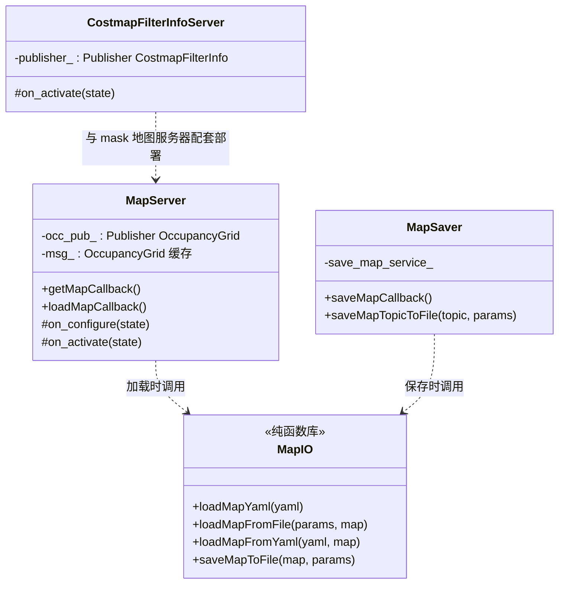
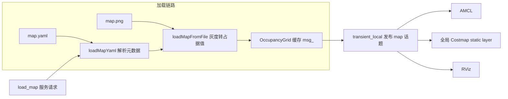

# 第 14 章 MapServer：把静态地图变成一等公民服务

> **一句话总结**：nav2_map_server 用"三件套"把地图管理做成独立的生命周期节点（Lifecycle Node）服务——MapServer 负责把 YAML + 图像加载为 OccupancyGrid 并以 transient_local QoS 常驻发布，MapSaver 负责把话题上的地图落盘，MapIO 作为无 ROS 依赖的编解码库承载两者的格式转换逻辑，外加 CostmapFilterInfoServer 为代价地图（Costmap）过滤功能广播元信息。

> **前置知识**：第 05 章 · 第 06 章 ｜ **知识依赖图**：[KnowledgeGraph/Knowledge](KnowledgeGraph/Knowledge.md)

## 14.1 为什么地图服务要独立成包

地图在导航栈中是被多方消费的共享资源：AMCL 拿它做定位参考，全局代价地图拿它做 static layer 底图，RViz 拿它做可视化背景。如果地图加载逻辑内嵌在任何一个消费者体内，其余消费者就得各自重复实现一遍文件解析，格式变更时牵一发动全身。Nav2 把地图管理独立成 nav2_map_server 包，本质上是三条工程原则的落地：

1. **单一数据源**：整个系统只有一处从磁盘读地图，所有消费者订阅同一话题，保证各模块看到的世界一致。
2. **读写分离**：加载（MapServer）与保存（MapSaver）是两个生命周期、两种触发方式完全不同的操作，拆成两个节点各司其职。
3. **格式逻辑下沉**：YAML 解析、图像灰度到占据值的映射规则收敛进 MapIO 纯函数库，节点层只做 ROS 接线，格式演进不波及节点接口。

包内四个角色的分工如下：

MapServer、MapSaver、CostmapFilterInfoServer 均继承 `nav2::LifecycleNode`，由 lifecycle_manager 统一编排（机制见第 05 章）；MapIO（nav2_map_server/include/nav2_map_server/map_io.hpp）则是一组不持有任何节点句柄的自由函数，可被命令行工具或第三方程序直接链接复用。

## 14.2 地图文件格式与三种模式

一张 Nav2 地图由两个文件构成：图像文件（PGM/PNG）记录每个栅格的灰度，YAML 文件记录元数据。以 nav2_bringup/maps/warehouse.yaml 为例，关键字段与语义如下：

| 字段 | 示例值 | 语义 |
|---|---|---|
| image | warehouse.png | 图像文件名，相对 YAML 所在目录解析 |
| resolution | 0.05 | 米每像素，决定物理尺寸 |
| origin | [-2.5, -2.5, 0.0] | 图像左下角像素在地图坐标系中的 x、y、yaw |
| mode | trinary | 灰度到占据值的映射模式，三选一 |
| negate | 0 | 是否反转黑白语义 |
| occupied_thresh | 0.65 | 占据概率高于此值判为占据 |
| free_thresh | 0.1 | 占据概率低于此值判为自由 |

加载时，MapIO 先把像素灰度归一化为"占据概率"p（negate 为 0 时 p = (255 - 灰度) / 255，即越黑越占据），再按 mode 映射成 OccupancyGrid 的单元值：

| 模式 | p > occupied_thresh | p < free_thresh | 中间地带 | 适用场景 |
|---|---|---|---|---|
| trinary | 100 | 0 | -1 未知 | 默认；SLAM 输出的二值地图 |
| scale | 100 | 0 | 按区间线性缩放到 0 到 99 | 需要中间代价的灰度地图 |
| raw | 直接输出像素值 0 到 255 映射为 0 到 100 语义 | 同左 | 同左 | 保存后无损往返、外部工具生成的地图 |

trinary 把世界简化为"自由/占据/未知"三态，是 AMCL 与 static layer 最舒服的输入；scale 保留了中间灰度作为渐变代价；raw 则完全绕过阈值逻辑，像素值即占据值。理解这张映射表，就能解释大多数"地图加载出来不对劲"的现场问题。

## 14.3 MapServer：加载与常驻发布

MapServer（nav2_map_server/src/map_server/map_server.cpp）的生命周期行为体现了"地图即状态"的思路：

- `on_configure()`：读取 `yaml_filename`、`topic_name`（默认 map）、`frame_id`（默认 map）三个参数。若 `yaml_filename` 非空则立即调用 MapIO 的 `loadMapFromYaml()` 加载并缓存进成员 `msg_`；若为空则跳过加载，等待后续 `load_map` 服务请求——支持"先启动、后指定地图"的部署形态。同时注册 GetMap、LoadMap 两个服务与地图发布者。
- `on_activate()`：激活发布者，若地图已就绪则**立即发布一次**，随后创建 bond 心跳。
- `on_deactivate()` / `on_cleanup()`：对称地停发与释放。

发布只发生在激活与换图两个时刻，却要保证任何时刻新加入的订阅者都能拿到地图，靠的是 QoS：`occ_pub_` 使用 LatchedPublisherQoS，即 **reliable + transient_local**。transient_local 让 DDS 在发布端保留最后一份样本，晚加入的订阅者（如中途重启的 AMCL、后打开的 RViz）连接时会自动补发——这正是 ROS 1 latched topic 的 ROS 2 等价物。需要注意的是订阅端也必须声明 transient_local 才能收到历史样本，QoS 是双向契约。

## 14.4 MapSaver：把话题落盘

MapSaver（nav2_map_server/src/map_saver/map_saver.cpp）解决相反方向的问题：SLAM 建好的地图只存在于话题上，掉电即失。它的 `save_map` 服务接受 `nav2_msgs/SaveMap` 请求，核心实现 `saveMapTopicToFile()` 的流程颇具 ROS 2 特色：临时创建一个地图话题订阅，把首条消息写入 promise，用节点自身回调组上的 SingleThreadedExecutor spin 等待，在 `save_map_timeout` 内收到即调用 MapIO 的 `saveMapToFile()` 落盘，超时则失败返回。请求中阈值为零时回退到节点默认值并告警，mode 字符串解析失败时回退 trinary——防御性处理贯穿始终。

参数 `map_subscribe_transient_local` 决定订阅端 QoS 是否声明 transient_local：对着 MapServer 这类 latched 发布者保存时必须为真，否则等不到补发的历史样本；对着 SLAM 这类持续发布者则无所谓。

| 服务清单 | 所属节点 | 类型 | 作用 |
|---|---|---|---|
| map_server/map | MapServer | nav_msgs/GetMap | 拉取当前地图，仅 ACTIVE 状态响应 |
| map_server/load_map | MapServer | nav2_msgs/LoadMap | 运行期切换地图并重新发布 |
| map_saver/save_map | MapSaver | nav2_msgs/SaveMap | 订阅指定话题并按参数落盘 |

多楼层场景的换图即由 `load_map` 服务承担：调用后 MapServer 重新加载并在同一 latched 话题上发布，AMCL 与代价地图随之刷新，无需重启任何节点。

## 14.5 CostmapFilterInfoServer：过滤功能的元信息广播

代价地图过滤器（KeepoutFilter 禁行区、SpeedFilter 限速区等，机制见第 06 章）需要两份输入：一张 mask 地图，以及"mask 像素值如何解读"的元信息。前者由一个额外的 MapServer 实例发布到 `mask_topic`（默认 filter_mask）；后者就是 CostmapFilterInfoServer（nav2_map_server/src/costmap_filter_info/costmap_filter_info_server.cpp）的职责：把 `type`（过滤类型枚举）、`base`、`multiplier`（mask 值到实际语义的线性变换系数）打包成 `nav2_msgs/CostmapFilterInfo` 消息，在 `on_activate()` 时以同样的 LatchedPublisherQoS 发布一次。

nav2_bringup 的 keepout_zone_launch.py 与 speed_zone_launch.py 展示了标准部署形态：mask 用 MapServer、元信息用 CostmapFilterInfoServer，两者作为一对节点由生命周期管理器共同拉起。一个是"数据"，一个是"数据字典"，分离设计让同一张 mask 可以在不同 multiplier 下复用为不同强度的限速区。

## 14.6 设计模式与扩展方式

- **外观模式**：MapIO 的 `loadMapFromYaml()` 把"解析 YAML → 校验参数 → 读图像 → 阈值映射"收敛为单一入口，并以 `LOAD_MAP_STATUS` 枚举返回精确失败原因（文件不存在、元数据非法、数据非法），节点层据此生成服务响应。
- **策略语义的枚举化**：三种 mode 本质是三个映射策略，以 `MapMode` 枚举 + 分支实现——策略数量固定且轻量时，枚举比插件更务实，这与 Nav2 在规划器、控制器上采用 pluginlib 形成有意味的对比：扩展点的开放程度应与实际变化频率匹配。
- **发布订阅 + latched QoS**：以 DDS durability 机制实现"状态型话题"，让低频状态数据获得"随到随取"的服务语义，又保留话题的一对多广播能力。

扩展方面，MapIO 目前支持 OccupancyGrid 的 PGM/PNG/BMP 编解码；若需支持新格式（如 GeoTIFF），只需在 MapIO 层扩展读写函数，MapServer/MapSaver 的服务接口与 QoS 行为原样保留。

## 14.A 源码导航与入手路径

入口链：main()→MapServer 构造→on_configure() 读 yaml_filename 并调用 loadMapFromYaml() 缓存 OccupancyGrid→on_activate() 以 transient_local QoS 发布一次→运行期 loadMapCallback() 换图重发；保存方向则是 save_map 服务→saveMapCallback()→saveMapTopicToFile()→saveMapToFile() 落盘。

| 文件（仓库相对路径，约 N 行） | 关键函数 | 作用 |
|---|---|---|
| nav2_map_server/src/map_server/map_server.cpp（约 256 行） | on_configure() / on_activate() / getMapCallback() / loadMapCallback() | 生命周期编排、双服务与 latched 发布 |
| nav2_map_server/src/map_io.cpp（约 673 行） | loadMapYaml() / loadMapFromFile() / loadMapFromYaml() / saveMapToFile() | 无 ROS 依赖的编解码库：YAML 解析、三种模式映射与落盘 |
| nav2_map_server/src/map_saver/map_saver.cpp（约 237 行） | saveMapCallback() / saveMapTopicToFile() | 临时订阅 + promise + 超时的按需落盘 |
| nav2_map_server/src/costmap_filter_info/costmap_filter_info_server.cpp（约 115 行） | on_activate() | 过滤器元信息的 latched 广播 |

| 第一遍只看 | 第二遍补充 | 以后再看 |
|---|---|---|
| map_server.cpp 的生命周期四回调与两个服务 | map_io.cpp 的模式映射与阈值逻辑 | map_saver.cpp 与 costmap_filter_info_server.cpp |

地图作为 static layer 底图进入代价地图的完整路径，见 [Costmap 更新循环时序图](Assets/sequence/Costmap更新循环.md)。

## 14.B 设计权衡

### 地图服务化 vs 各消费者静态加载

另一种可行设计是让 AMCL、全局代价地图各自持有 yaml 路径、启动时自读文件——省掉一个节点、一次话题传输。Nav2 选择服务化的代价是多一个进程与一份内存拷贝，换来的是三件事：所有消费者看到**同一份**地图（自读文件在多楼层换图时会出现版本不一致）；换图成为一次服务调用而非全栈重启；地图来源可以透明替换（文件、SLAM 实时输出、数据库）而消费者无感。当共享资源有多个消费者且需要运行期变更时，"单一数据源 + 广播"几乎总是优于"各自加载"，这是数据一致性对资源开销的胜利。

### transient_local 话题 vs GetMap 服务拉取

地图分发本可以只留 GetMap 服务：谁需要谁来拉。但服务是一对一的拉模式，每个消费者都要写"启动时调用 + 失败重试"的样板代码，且换图后服务端无法主动通知。transient_local 话题把地图变成"状态型广播"：发布端保留最后样本，晚加入者自动补发，换图即重发、全员同步刷新。代价是 QoS 成为双向契约——订阅端忘记声明 transient_local 就会静默收不到，这是 Nav2 现场问题的高频来源。MapServer 两者都保留：话题做主通道，GetMap 服务留给一次性查询的工具型客户端。

### 模式映射枚举化 vs 插件化

trinary/scale/raw 三种灰度映射用 MapMode 枚举 + 分支实现，而不是像规划器那样开 pluginlib 扩展点。这个反差是刻意的：地图格式由社区标准约束，十年间映射策略就没变过第四种，为它维护插件描述文件、类加载器与 ABI 兼容性纯属过度设计。Nav2 在这里给出了扩展点开放程度的判断标准——**变化频率决定机制重量**：规划算法百家争鸣所以插件化，灰度映射三分天下已定所以枚举化。读 22 章设计模式专题时可以把本例当作"不滥用模式"的反面参照物。

## 知识总结

1. nav2_map_server 由 **MapServer（加载发布）、MapSaver（落盘）、MapIO（编解码库）** 三件套加 CostmapFilterInfoServer 组成，读写分离、格式逻辑下沉。
2. 地图 = 图像 + YAML 元数据；灰度先归一化为占据概率，再经 **trinary/scale/raw** 三种模式映射为 OccupancyGrid 单元值，negate 与双阈值共同决定映射结果。
3. 地图话题使用 **reliable + transient_local** QoS，等价于 ROS 1 的 latched topic；订阅端必须同样声明 transient_local 才能获得补发。
4. `load_map` 服务支持运行期换图（多楼层导航的基础设施），`save_map` 服务用"临时订阅 + promise + 超时"模式实现按需落盘。
5. 代价地图过滤功能采用 **mask 地图 + CostmapFilterInfo 元信息**双话题设计，数据与数据字典分离，均为 latched 发布。

## 常见面试题

1. **transient_local QoS 在 MapServer 中解决了什么问题？**
   要点：地图只在激活与换图时发布一次，晚启动的订阅者会错过；transient_local 让 DDS 在发布端保留最后样本并向新订阅者补发，实现 ROS 1 latched 语义；订阅端必须匹配声明 durability，否则收不到。
2. **trinary、scale、raw 三种模式的区别？**
   要点：trinary 按双阈值输出 100/0/-1 三值；scale 把阈值间的概率线性映射为 0 到 99 的中间代价；raw 跳过概率换算直接使用像素值。trinary 适合二值 SLAM 地图，raw 适合无损往返。
3. **free_thresh 与 occupied_thresh 配置颠倒会怎样？**
   要点：归一化占据概率与阈值比较的区间错乱，地图几乎全占据或全自由，AMCL 距离场与代价地图 static layer 同时失效；表现为规划处处失败或机器人无视墙体。
4. **运行期如何切换地图？涉及哪些节点联动？**
   要点：调用 map_server/load_map 服务，MapServer 重新加载并在 latched 话题重发；AMCL 的 mapReceived 回调重建内部 map_t 与距离场，代价地图 static layer 重置底图；通常还需重设初始位姿。
5. **MapSaver 为什么用临时订阅而非持有常驻订阅？**
   要点：保存是低频按需操作，常驻订阅浪费带宽与内存；临时订阅 + promise + 执行器 spin 在超时窗口内取首条消息，用完即弃，并可按目标话题灵活选择 QoS。

## 最佳实践与容易踩坑

- **阈值与 negate 联动检查**：改 negate 而不审视阈值语义，常得到"负片地图"；保存后用图像查看器目检黑白语义是否符合预期。
- **origin 与 resolution 是定位的隐形前提**：手工裁剪地图图像后忘记同步修改 origin，AMCL 初始位姿会整体偏移一个常量；resolution 与建图时不一致则地图整体缩放。
- **保存时机**：SLAM 结束前调用 save_map 要确认建图节点仍在发布且 QoS 匹配，否则 saveMapTopicToFile 等到超时；建图完成后先保存再关 SLAM。
- **YAML 路径相对性**：image 字段相对 YAML 文件所在目录解析，把 YAML 挪目录而不挪图像是常见的"地图不存在"来源。
- **过滤器双话题必须成对**：只发 mask 不发 CostmapFilterInfo，过滤层收不到解读规则会保持沉默，禁行区形同虚设。

## 延伸阅读

- nav2_map_server/src/map_io.cpp —— 模式映射与阈值逻辑的权威实现
- nav2_map_server/src/map_server/map_server.cpp —— 生命周期编排与 latched 发布
- nav2_map_server/src/map_saver/map_saver.cpp —— 临时订阅保存模式
- nav2_bringup/launch/keepout_zone_launch.py —— mask 与 filter info 的成对部署示例
- 第 06 章 Costmap2D —— static layer 与代价地图过滤器如何消费本章的输出

## 14.C 阅读检查点

1. MapServer 为什么用 reliable + transient_local QoS 发布地图？订阅端需要注意什么？（见 14.3）
2. trinary、scale、raw 三种模式各自的映射规则与适用场景是什么？（见 14.2）
3. 运行期换图走哪个服务？哪些下游节点会联动刷新，通常还需补做什么操作？（见 14.4）
4. MapSaver 的"临时订阅 + promise + 超时"模式解决了什么问题？为什么不用常驻订阅？（见 14.4）
5. 代价地图过滤功能为什么要 mask 地图与 CostmapFilterInfo 两个话题成对部署？（见 14.5）

> 下一章：15_Smoother路径平滑
