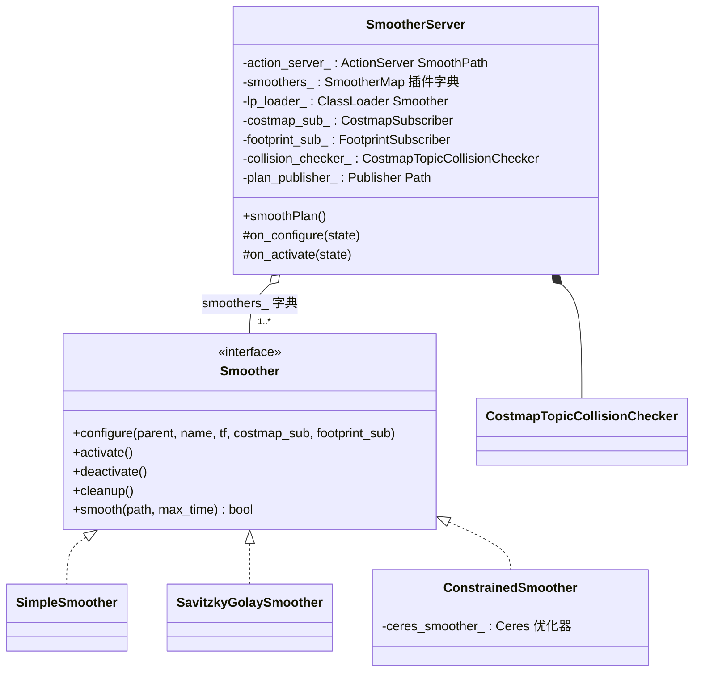
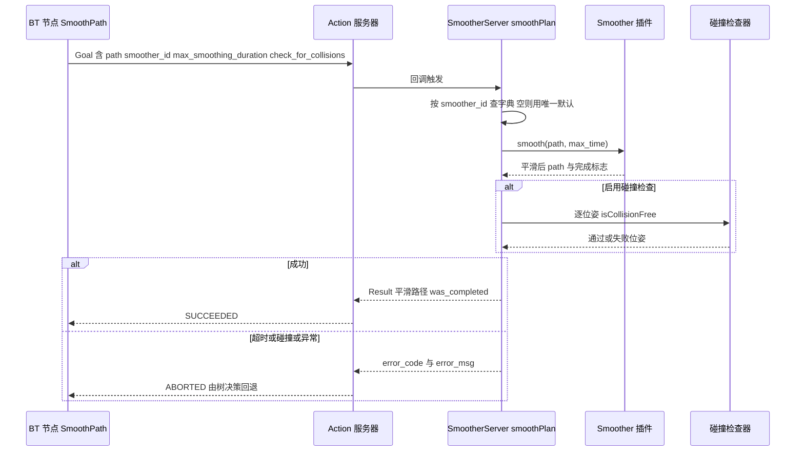

# 第 15 章 Smoother 路径平滑：给路径做一次"抛光"

> **一句话总结**：SmootherServer 是承载路径后处理的生命周期节点（Lifecycle Node），它通过 SmoothPath Action 对外提供服务，用插件（Plugin）字典挂载多个 nav2_core::Smoother 实现（SimpleSmoother 梯度迭代、SavitzkyGolaySmoother 信号滤波、ConstrainedSmoother 基于 Ceres 的约束优化），并内置基于代价地图（Costmap）话题的碰撞检查，把"平滑但不能撞"的矛盾在服务器层统一裁决。

> **前置知识**：第 07 章 · 第 11 章 ｜ **知识依赖图**：[KnowledgeGraph/Knowledge](KnowledgeGraph/Knowledge.md)

## 15.1 为什么平滑要独立成服务器

栅格搜索类规划器的输出天然带有"数字化伤痕"：8 邻接 A* 的路径方向被量化为 45° 整数倍，走出来是锯齿；Theta* 的长直线段在转接处是尖锐折角；即便 Smac Hybrid 满足运动学，其路径在栅格分辨率尺度上仍有微小抖动。这些几何瑕疵传导到控制器，就是速度曲线的振荡与执行器的无谓磨损。

Nav2 把平滑做成独立的 SmootherServer（nav2_smoother/src/nav2_smoother.cpp），而不是塞进规划器或控制器，出于三点考虑：

1. **正交性**：平滑是纯几何/优化操作，与"搜索可行路径"和"实时跟踪路径"都不是一件事。独立成服务器后，任意规划器的输出都能接受任意平滑算法处理，形成 N×M 的自由组合。
2. **可编排性**：平滑变成行为树（BT）中的一个显式节点（SmoothPath），用户可以决定平滑发生在规划之后、截断之前，也可以在时间紧张时干脆跳过——策略权在树，不在框架。
3. **失败可容忍**：平滑失败（超时、不收敛、平滑后碰撞）不应导致导航失败，行为树可以捕获错误码后退回原始路径继续执行。

与 SmacPlanner 内置平滑器（nav2_smac_planner/src/smoother.cpp）的分工也由此清晰：后者是 Smac 家族的私有后处理，深度耦合其搜索结果与最小转弯半径语义，不对外暴露；SmootherServer 则是面向全栈的公共服务，两者可以叠加使用。

## 15.2 SmootherServer 整体设计

与 PlannerServer（第 07 章）的结构对照阅读会发现刻意的相似：插件字典 + pluginlib 加载器 + Action 入口 + 结果话题。差异在于代价地图的获取方式——SmootherServer **不内嵌** Costmap2DROS，而是通过 `CostmapSubscriber` 订阅 `global_costmap/costmap_raw` 话题、通过 `FootprintSubscriber` 订阅足迹，再组装成 `CostmapTopicCollisionChecker`。平滑是低频操作，跨进程订阅一份现成的代价地图比自己维护一份划算得多，这是"按访问频率决定数据布局"的又一例证。

一次 SmoothPath 请求的完整旅程：

Goal 中的 `max_smoothing_duration` 是硬时间预算：插件必须在预算内返回，做不完可以返回部分平滑的结果（`was_completed = false`）或抛出 `nav2_core::SmootherTimedOut`。碰撞检查发生在平滑**之后**：平滑本质上是把路径往折角内侧拉，狭窄通道里完全可能拉进障碍物，服务器据此抛出 `FailedToSmoothPath` 并终止 Action——宁可要安全的锯齿，不要危险的丝滑。

## 15.3 三个内置插件精讲

### SimpleSmoother：加权均值迭代

SimpleSmoother（nav2_smoother/src/simple_smoother.cpp）是教科书式的迭代平滑：每轮把每个中间点向"相邻点均值"与"原始位置"的加权组合方向挪一步（权重 `w_smooth` 与 `w_data`），反复迭代直到整体位移变化量低于 `tolerance` 或达到最大迭代次数。三个实现细节体现了工程成熟度：

- **方向段切分**：先用 `nav2_util::findDirectionalPathSegments()` 把路径按前进/倒车切成段，逐段平滑，避免把倒车切换点（cusp）这一关键语义抹掉；短于阈值的段直接跳过。
- **代价约束**：迭代中若点被拉进高代价区域会回退该次更新，从算法内部就抑制"平滑进障碍"。
- **朝向重建**：平滑改变了点位，原朝向失效，收尾统一用 `nav2_util::updateApproximatePathOrientations()` 按相邻点连线重算 yaw。

### SavitzkyGolaySmoother：信号滤波视角

SavitzkyGolaySmoother（nav2_smoother/src/savitzky_golay_smoother.cpp）换了一个学科的武器：把路径的 x、y 序列各视为一维信号，在固定窗口上做 Savitzky-Golay 多项式拟合滤波。系数预先算好，每个点的新位置只是邻域点的一次线性组合，因此**单遍时间复杂度 O(n)、耗时确定、不存在收敛问题**，可通过 `refinement_num` 叠加多轮。它不读代价地图，纯几何去噪，适合"路径本身安全、只是采样噪声大"的场景，例如平滑 GPS 航点串或数据回放路径。

### ConstrainedSmoother：约束优化视角

ConstrainedSmoother（nav2_constrained_smoother/src/constrained_smoother.cpp）是三者中唯一"改变路径性质"的重型选手：把平滑表述为 Ceres 非线性最小二乘问题，每个路径点的残差由四项加权组成（nav2_constrained_smoother/include/nav2_constrained_smoother/smoother_cost_function.hpp）：

| 目标项 | 权重 | 作用 |
|---|---|---|
| 平滑项 | w_smooth | 惩罚相邻位移向量的差异，拉直路径 |
| 曲率项 | w_curve | 惩罚超过最大曲率（由最小转弯半径换算）的弯，保证可跟踪 |
| 距离项 | w_dist | 惩罚偏离原始路径，保留规划器的全局意图 |
| 代价项 | w_cost | 惩罚落入高代价区域，主动推离障碍；cusp 区可单独加权 |

求解器默认 SPARSE_NORMAL_CHOLESKY，收敛判据与迭代上限由 `OptimizerParams` 控制；解可用且总代价下降才接受，否则抛异常。它是唯一能对**运动学约束**给出保证的平滑器，代价是引入 Ceres 依赖与十倍以上的计算时间。

### 三插件对比

| 维度 | SimpleSmoother | SavitzkyGolaySmoother | ConstrainedSmoother |
|---|---|---|---|
| 算法本质 | 加权均值迭代 | SG 多项式滤波 | Ceres 非线性优化 |
| 感知代价地图 | 是 迭代内回退 | 否 | 是 作为目标项 |
| 运动学约束 | 无 | 无 | 最小转弯半径硬约束 |
| 耗时特征 | 迭代型 依赖收敛 | 线性 确定 | 优化型 最重 |
| 失败模式 | 超时 不收敛 | 几乎不失败 | 解不可用 代价上升 |
| 典型搭配 | NavFn Theta* 默认 | 航点与回放路径 | 类车底盘 高质量产线 |

## 15.4 生命周期、设计模式与扩展

插件的 configure/activate/deactivate/cleanup 与宿主服务器严格同步（第 05 章的通用契约）；`smoother_plugins` 参数默认只含 `simple_smoother`，多插件并存时由 Goal 的 `smoother_id` 逐请求选择——与规划器、控制器一致的**策略模式 + 插件工厂**范式。服务器层的碰撞检查则是**装饰语义**：无论哪个插件产出的路径，统一追加一道安全验收，插件作者无需各自重复实现。

自定义平滑器只需实现 `nav2_core::Smoother`（nav2_core/include/nav2_core/smoother.hpp）的五个虚函数，导出 pluginlib 描述并注册参数即可。接口刻意极简——`smooth(path, max_time)` 就地修改路径并返回是否完成——把时间预算的尊重责任下放给插件，是契约设计中"简单接口 + 严格语义"的范本。

## 15.A 源码导航与入手路径

入口链：main()→SmootherServer 构造→on_configure() 加载插件字典并组装 CostmapSubscriber/碰撞检查器→create_action_server(SmoothPath)→smoothPlan()→findSmootherId() 选插件→smoothers_[id]->smooth(path, max_time)→validate() 碰撞验收→返回结果。

| 文件（仓库相对路径，约 N 行） | 关键函数 | 作用 |
|---|---|---|
| nav2_smoother/src/nav2_smoother.cpp（约 372 行） | on_configure() / smoothPlan() / findSmootherId() / validate() | 服务器壳：Action 编排、插件字典与碰撞验收 |
| nav2_smoother/src/simple_smoother.cpp（约 225 行） | smooth() / smoothImpl() | 加权均值迭代平滑，带代价回退与方向段切分 |
| nav2_smoother/src/savitzky_golay_smoother.cpp（约 179 行） | smooth() / smoothImpl() | SG 多项式滤波，单遍线性时间 |
| nav2_constrained_smoother/src/constrained_smoother.cpp（约 169 行） | smooth() | Ceres 约束优化入口，唯一保证运动学可行 |

| 第一遍只看 | 第二遍补充 | 以后再看 |
|---|---|---|
| nav2_smoother.cpp 的 smoothPlan() 全流程 | simple_smoother.cpp 的迭代与代价回退 | constrained_smoother 与其四项残差代价函数 |

完整业务链路见 [NavigateToPose 端到端时序图](Assets/sequence/NavigateToPose.md)。

## 15.B 设计权衡

### 独立 Smoother 服务器 vs 规划器内置平滑

把平滑内置进规划器（如 SmacPlanner 的私有 smoother）看似省一次 Action 往返，但代价是 N 个规划器 × M 种平滑需求要写 N×M 次胶水代码，且"是否平滑"的决策权被锁死在规划器参数里。独立成服务器后，平滑是行为树中一个可插拔的 SmoothPath 节点：任意规划器输出 × 任意平滑算法自由组合，失败可被树捕获后回退原路径，时间紧张时可直接跳过。两者并非互斥——Smac 的内置平滑深度耦合其搜索语义，公共服务可叠加其上，边界是"私有后处理"与"公共基础设施"之分。

### 服务器层统一碰撞验收 vs 插件内各自保证

碰撞检查完全可以下放给插件：SimpleSmoother 本就在迭代内做代价回退。但 Nav2 仍在服务器层保留 validate() 统一验收，因为插件的自律是"尽力"而非"担保"：SG 滤波器根本不读代价地图，第三方插件质量参差不齐。把安全验收做成所有插件输出的统一后置关卡，插件作者无需重复实现、也无法绕过——这是装饰语义的典型用法：宁可多一次 O(n) 的逐位姿检查，也不把"平滑进障碍"的风险寄托于插件自觉。代价仅是狭窄通道里偶发的"平滑成功但验收失败"，由行为树回退兜底。

### 硬时间预算 vs 尽力而为

smooth(path, max_time) 把 max_smoothing_duration 作为硬预算传进插件，超时应返回部分结果（was_completed=false）或抛 SmootherTimedOut，而不是让优化跑到收敛为止。这是导航管线的实时性要求倒逼出的契约：SmoothPath 处在"拿到新路径"的关键路径上，一次不收敛的 Ceres 优化若无预算约束可以吃掉数秒，动态环境中足以让机器人撞上移动障碍。把时间预算的尊重责任写进接口语义而非框架强制中断，是"简单接口 + 严格契约"的取舍：框架信任插件，但用 was_completed 标志让调用方知情。

## 知识总结

1. 平滑独立成服务器的核心收益是**正交性与可编排性**：任意规划器输出 × 任意平滑算法自由组合，行为树决定是否平滑、何时平滑、失败后如何回退。
2. SmootherServer 复用 PlannerServer 的**插件字典 + Action** 范式，但代价地图改为**话题订阅**而非内嵌，低频操作不值得独占一份栅格维护线程。
3. 三个内置插件代表三种学科视角：**迭代松弛**（Simple）、**信号滤波**（SG）、**约束优化**（Constrained）；只有 Constrained 保证运动学可行性。
4. 碰撞检查在平滑**之后**统一执行，"平滑进障碍"会使 Action 失败——安全验收权在服务器层而非插件层。
5. `max_smoothing_duration` 是硬预算，插件超时应返回部分结果或抛 SmootherTimedOut，保证行为树的时序可控。

## 常见面试题

1. **SmootherServer 为什么不像 PlannerServer 那样内嵌 Costmap2DROS？**
   要点：平滑是低频、短时操作，只在检查碰撞与代价项时读栅格；通过 CostmapSubscriber 订阅 costmap_raw 话题复用全局代价地图，省去独立维护线程与内存；PlannerServer 高频随机访问整张栅格才值得进程内嵌。
2. **平滑后的路径为什么可能碰撞？框架如何兜底？**
   要点：平滑本质是把折角向内侧收缩，狭窄通道中会切进障碍；SimpleSmoother 迭代内做代价回退，ConstrainedSmoother 把代价作为目标项，服务器层再对最终路径逐位姿做足迹碰撞检查，失败则 Action 返回错误码由行为树回退原始路径。
3. **ConstrainedSmoother 的目标函数由哪几项组成？各解决什么问题？**
   要点：平滑项拉直路径、曲率项保证最小转弯半径可跟踪、距离项防止偏离规划意图、代价项推离障碍；cusp 区域可单独加权以保护倒车切换点。权重失衡是调参失败的主因。
4. **SavitzkyGolaySmoother 相比 SimpleSmoother 的优势与局限？**
   要点：优势是单遍线性时间、耗时确定、无收敛问题；局限是不感知代价地图、不改变路径的可行性性质，只做几何去噪，狭窄环境需依赖服务器层碰撞检查兜底。
5. **SmoothPath Action 的 Goal 里 smoother_id 为空会怎样？**
   要点：与规划器同一约定——系统只配置一个插件时默认使用它；配置了多个而未指定则报错终止，防止歧义选择。

## 最佳实践与容易踩坑

- **按底盘选插件**：差速/全向底盘用 SimpleSmoother 即可；有最小转弯半径的类车底盘要么上游用 Smac Hybrid + 内置平滑，要么在此处用 ConstrainedSmoother，否则平滑会破坏原路径的曲率可行性。
- **tolerance 与迭代上限联动**：SimpleSmoother 的 tolerance 设得过小会在噪声路径上迭代到超时；先放宽 tolerance 观察收敛轮数，再逐步收紧。
- **狭窄通道慎用大 w_smooth**：无论哪个插件，平滑强度越大切角越狠；通道宽度接近足迹时应调低平滑权重或干脆跳过平滑节点。
- **ConstrainedSmoother 不收敛先查权重量级**：w_cost 与 w_smooth 数量级失衡是"解不可用"的头号原因；官方建议从默认参数出发单变量微调，并开启 debug 输出观察各项残差占比。
- **时间预算要给控制器留余量**：SmoothPath 位于规划与跟踪之间，max_smoothing_duration 过长会拉大"拿到新路径"的端到端延迟，动态环境中建议 100 到 300 毫秒量级。

## 延伸阅读

- nav2_smoother/src/nav2_smoother.cpp —— Action 编排、插件加载与碰撞验收
- nav2_smoother/src/simple_smoother.cpp 与 savitzky_golay_smoother.cpp —— 两种轻量算法实现
- nav2_constrained_smoother/include/nav2_constrained_smoother/smoother_cost_function.hpp —— 四项残差的数学表达
- nav2_smac_planner/src/smoother.cpp —— 对比阅读：规划器私有平滑与公共平滑服务的边界
- 第 07 章 PlannerServer、第 11 章行为树 —— 平滑在导航管线中的上下游

## 15.C 阅读检查点

1. 平滑独立成 SmootherServer 相对内置在规划器里有哪三点收益？（见 15.1）
2. 碰撞检查为什么放在平滑之后、由服务器层统一执行？失败后行为树如何兜底？（见 15.2）
3. 三个内置插件各代表什么学科视角？哪个能保证运动学可行性，代价是什么？（见 15.3）
4. max_smoothing_duration 耗尽后，插件的两种合法行为分别是什么？（见 15.2）
5. Goal 中 smoother_id 为空且配置了多个插件时会发生什么？这个约定与哪些服务器一致？（见 15.4）

> 下一章：16_CollisionMonitor与VelocitySmoother
