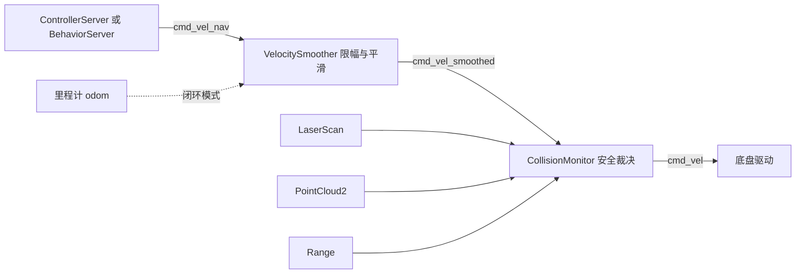
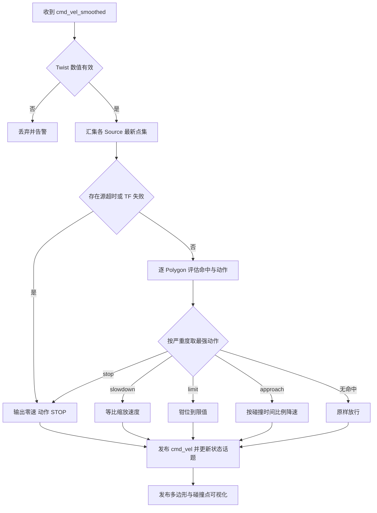

# 第 16 章 CollisionMonitor 与 VelocitySmoother：cmd_vel 出厂前的最后两道工序

> **一句话总结**：在控制器算出的速度指令与底盘执行之间，Nav2 串联了两个独立的生命周期节点（Lifecycle Node）——VelocitySmoother 对 cmd_vel 施加加减速与死区约束，让指令物理可执行、驱动不受冲击；CollisionMonitor 以多边形安全区加多传感器源做确定性的碰撞检查，在算法层全部失效时充当停止、减速与限速的最后防线。

> **前置知识**：第 05 章 · 第 09 章 ｜ **知识依赖图**：[KnowledgeGraph/Knowledge](KnowledgeGraph/Knowledge.md)

## 16.1 为什么需要独立的安全与整形层

Nav2 的规划器、控制器已经做了大量避障工作，为什么还要在 cmd_vel 链路上再加两个节点？答案在于**故障假设的层级不同**。代价地图（Costmap）可能因传感器延迟而滞后于世界，控制器可能因参数失配输出激进指令，行为树（BT）可能陷在某个恢复分支里——这些都是"算法在正常运行但结果错误"的场景。安全层的设计哲学是：不信任上游的任何智能，只用最简单、最可验证的几何与运动学规则做最后把关（这一"确定性兜底"的立场在第 00 章已有论述）。两个节点各管一半问题：

- **VelocitySmoother** 管"指令是否物理合理"：控制器以 20 Hz 输出的速度阶跃对电机驱动是冲击，可能触发过流保护、让底盘打滑、令乘员不适。
- **CollisionMonitor** 管"执行了会不会撞"：直接对照原始传感器数据检查速度指令的后果，绕过代价地图与控制算法的全部中间环节。

两者在话题链路上的位置经 nav2_bringup/launch/navigation_launch.py 的重映射固定下来：

控制器与行为服务器的输出被重映射为 `cmd_vel_nav`；VelocitySmoother 订阅它并发布 `cmd_vel_smoothed`；CollisionMonitor 订阅 `cmd_vel_smoothed`，把最终裁决结果发布到 `cmd_vel`。顺序不可颠倒：若 CollisionMonitor 在前，它输出的紧急停止会再被平滑器"缓释"，安全动作被人为延迟——**安全裁决必须是链路上的最后一环**。

## 16.2 VelocitySmoother：速度指令整形器

VelocitySmoother（nav2_velocity_smoother/src/velocity_smoother.cpp）的运行模型与链路上其他节点都不同：它**不是回调驱动而是定时器驱动**。输入回调只缓存最新指令，真正的输出由 `smoothing_frequency`（默认 20 Hz）的定时器周期性产生。这一解耦意味着控制器可以以任意频率、甚至不稳定的频率发指令，底盘侧永远收到等间隔、平滑变化的速度流；输出频率通常设为等于或高于控制器频率，插值填补输入间隙。

核心算法是逐轴限幅加同比缩放：`findEtaConstraint()` 先对每个轴计算"本周期允许的最大变化量"与"期望变化量"之比，取所有轴中最严格的缩放因子 eta；`applyConstraints()` 再用同一个 eta 缩放所有轴的变化量。同比缩放的意义在于**保持速度向量的方向**——若只对超限的轴单独截断，线速度与角速度的比例被破坏，机器人会偏离控制器预期的曲率轨迹。

其余机制围绕安全与工程实用展开：

| 机制 | 参数 | 行为 |
|---|---|---|
| 加减速约束 | max_accel / max_decel | 逐轴限制速度变化率，减速限值通常大于加速限值 |
| 速度上下限 | max_velocity / min_velocity | 输出钳位；数组长度必须为 3 或 6 否则拒绝配置 |
| 死区 | deadband_velocity | 绝对值低于阈值的轴直接置零，滤掉驱动器无法响应的微小指令 |
| 超时置零 | velocity_timeout 默认 1 秒 | 超过时限未收到新指令即按减速约束缓降到零，防止上游崩溃后底盘"带着旧指令跑" |
| 开环模式 | feedback 为 OPEN_LOOP | 假设底盘完美执行，用上一周期输出作为当前速度基准，默认选择 |
| 闭环模式 | feedback 为 CLOSED_LOOP | 用 nav2_util::OdomSmoother 从里程计估计真实速度作基准，适合打滑或负载多变场景，但要求里程计低噪且低延迟 |

参数校验相当严格：feedback 字符串非法、限值数组长度不符都会导致配置失败或动态更新被拒——安全组件宁可拒绝启动，也不带病运行。

## 16.3 CollisionMonitor：多边形与传感器源的笛卡尔积

CollisionMonitor（nav2_collision_monitor/src/collision_monitor_node.cpp）的模型抽象为两个正交集合的组合：**Polygon（安全区）× Source（数据源）**。每个 Polygon 是机器人周身的一块检查区域并绑定一种动作；每个 Source 把一种传感器数据统一转换为机器人坐标系下的障碍点集；每个处理周期把点集投入各多边形做命中判定。

**Polygon 的四种动作模型**（nav2_collision_monitor/include/nav2_collision_monitor/polygon.hpp）：

| 动作 | 行为 | 典型配置 |
|---|---|---|
| stop | 区内点数达到 min_points 即输出零速 | 贴近足迹的红色禁区 |
| slowdown | 按 slowdown_ratio 等比降速 | 中距离黄色缓冲区 |
| limit | 线速度与角速度钳位到 linear_limit 与 angular_limit | 人机混行区域的硬限速 |
| approach | 用当前速度前推模拟足迹轨迹，估算碰撞时间，低于 time_before_collision 则按比例降速 | 动态逼近场景，区域随速度自适应 |

前三种是静态几何判定，approach 则是动态的：它以仿真步长把足迹沿当前速度向量外推，找到最早命中的时间，速度越快检查得越远——等效于"随速伸缩的安全区"。Polygon 还支持以 footprint 话题动态更新形状、以 `trigger_consecutive_points` 与 `release_consecutive_points` 做进入/退出去抖，避免单帧噪点导致急停振荡。

**Source 的五种类型**：scan（LaserScan）、pointcloud（PointCloud2）、range（超声/红外锥面）、costmap 与 polygon_source（外部多边形实例）。所有源共享同一契约：带时间戳的数据经 TF 转换到机器人基座坐标系，超过 `source_timeout` 未更新或 TF 失败即视为失效——默认策略是**数据不可信则触发停止**，把"传感器坏了"与"前方有障碍"同等对待。每个 Polygon 可通过 `sources_names` 只绑定部分源，实现"前向区域看激光、尾部区域看超声"的精细组合。

一次速度裁决的完整流程：

裁决结果连同触发的 Polygon 名称经 `collision_monitor_state` 话题对外广播，供行为树或运维监控感知"机器人为什么慢了/停了"；MarkerArray 可视化则让 RViz 中的安全区状态一目了然。

**CollisionDetector 的区别**：同包还提供一个 CollisionDetector 独立节点，它复用同一套 Polygon/Source 模型，但**不介入 cmd_vel 链路**，只把各区域的命中状态发布到话题，供上层逻辑（如点亮警示灯、行为树条件节点）消费。一个是执法者，一个是观察员。此外注意与 nav2_route 包中同名的 CollisionMonitor 路线操作插件区分——后者是 Route 功能里基于代价地图的路径校验组件，与本章的实时安全节点无关。

## 16.4 生命周期、线程模型与设计模式

两个节点都遵循标准生命周期契约（第 05 章）：configure 阶段解析 Polygon/Source 配置或校验运动学数组，非法配置直接返回失败；activate 激活发布者并创建 bond；deactivate 时 VelocitySmoother 停掉定时器、CollisionMonitor 停止裁决，保证 lifecycle_manager 能整体拉停系统。线程上两者都刻意保持轻量：CollisionMonitor 在订阅回调内同步完成全部几何计算，VelocitySmoother 的定时器回调只做几次乘加——**最后防线的代码路径必须短到无可再短**，任何异步、任何锁竞争都是延迟风险。

设计模式的视角：Polygon 与 Source 是两个独立演化的**策略族**，节点按配置组装其笛卡尔积，是组合优于继承的教科书案例；四种动作按严重度排序取最强，是简化版的**责任链**；VelocitySmoother 的开环/闭环切换同样是运行期可选的策略。扩展方面，新增传感器类型只需继承 Source 基类实现点集转换，新增区域行为则扩展 Polygon 的动作枚举与处理分支。

## 16.A 源码导航与入手路径

入口链：cmd_vel_nav→VelocitySmoother::inputCommandCallback() 缓存最新指令→smootherTimer() 定时输出→findEtaConstraint() 求最严缩放因子→applyConstraints() 同比缩放→cmd_vel_smoothed→CollisionMonitor::cmdVelInCallbackStamped()→process() 逐 Polygon 裁决→processStopSlowdownLimit()/processApproach()→cmd_vel。

| 文件（仓库相对路径，约 N 行） | 关键函数 | 作用 |
|---|---|---|
| nav2_velocity_smoother/src/velocity_smoother.cpp（约 636 行） | inputCommandCallback() / smootherTimer() / findEtaConstraint() / applyConstraints() | 定时器驱动的速度整形：eta 同比缩放、死区与超时置零 |
| nav2_collision_monitor/src/collision_monitor_node.cpp（约 774 行） | cmdVelInCallbackStamped() / process() / processStopSlowdownLimit() / processApproach() | 安全裁决主流程：汇集点集、逐 Polygon 评估取最强动作 |
| nav2_collision_monitor/src/polygon.cpp（约 718 行） | getPointsInside() / getCollisionTime() | 安全区几何命中判定与 approach 碰撞时间估算 |
| nav2_collision_monitor/src/scan.cpp（约 116 行） | configure() | Source 示例：LaserScan 到基座坐标系点集的转换 |

| 第一遍只看 | 第二遍补充 | 以后再看 |
|---|---|---|
| 16.1 链路图与 velocity_smoother.cpp 的 smootherTimer() | collision_monitor_node.cpp 的 process() 裁决分支 | polygon.cpp 的 approach 外推与去抖、各 Source 实现 |

完整业务链路见 [NavigateToPose 端到端时序图](Assets/sequence/NavigateToPose.md)。

## 16.B 设计权衡

### 三级 cmd_vel 安全链 vs 单点安全检查

把限幅、平滑、碰撞检查全塔进控制器或合并成一个"安全节点"看似更简洁，但 Nav2 选择 cmd_vel_nav→velocity_smoother→cmd_vel_smoothed→collision_monitor→cmd_vel 的三级链式拆分，核心理由是**故障假设分层**：整形层假设"指令合法但物理不可执行"，安全层假设"上游全部智能都可能出错"，两者的信任边界、测试方法、失效后果完全不同，合并后任一侧的参数变更都要重验整体安全性。链式拆分还让每级可独立旁路：不需要平滑的底盘可以只部署 CollisionMonitor。代价是两跳额外话题延迟与重映射配置复杂度——后者正是现场事故高发区。

### 定时器驱动整形 vs 回调驱动直通

若 VelocitySmoother 在输入回调里直接处理转发，输出节奏就被上游控制器绑死：控制器卡顿一拍，底盘就断流一拍。改为"回调只缓存、定时器按 smoothing_frequency 输出"后，输入频率与输出频率完全解耦：底盘永远收到等间隔的平滑速度流，控制器偶发抖动被插值填平。代价是引入最多一个定时周期的额外延迟，以及"上游已死但旧指令仍在输出"的风险——后者由 velocity_timeout 超时缓降兜底。对比第 09 章控制器的"回调触发 + 循环限频"，可以看到同一个频率问题在不同信任边界下的两种解法。

### 数据失效即停止 vs 尽力放行

CollisionMonitor 对源超时或 TF 失败的默认策略是直接输出零速，把"传感器坏了"与"前方有障碍"同等对待。反向选择（数据缺失时沿用旧点集或直接放行）能消除误停，但把漏停的概率交给了故障时序的运气。安全组件的决策准则是非对称代价：误停的代价是可用性下降与运营投诉，漏停的代价可能是人身事故，两者不在同一量级。框架同时把调节阀门交给部署者：source_timeout 可按源配置、低频传感器可单独放宽、特定源可豁免——默认保守，显式放宽，责任转移路径清晰。

## 知识总结

1. cmd_vel 链路的固定顺序是 **cmd_vel_nav → VelocitySmoother → cmd_vel_smoothed → CollisionMonitor → cmd_vel**，安全裁决必须是最后一环，顺序颠倒会延迟紧急停止。
2. VelocitySmoother 是**定时器驱动**的整形器：逐轴计算最严格缩放因子后同比缩放全轴，保持速度向量方向；死区滤微小指令，velocity_timeout 兜底上游崩溃。
3. CollisionMonitor 的模型是 **Polygon × Source** 的笛卡尔积：四种动作（stop/slowdown/limit/approach）按严重度取最强，approach 用足迹前推实现随速伸缩的动态安全区。
4. **数据失效即停止**：源超时或 TF 失败默认触发 STOP，把传感器故障与障碍物同等对待，体现安全组件"宁可误停不可漏停"的取向。
5. CollisionDetector 与 CollisionMonitor 共享模型但只发状态不改速度；开环/闭环、Polygon/Source 均为可配置策略，扩展无需改动主流程。

## 常见面试题

1. **为什么 VelocitySmoother 必须在 CollisionMonitor 之前？**
   要点：CollisionMonitor 输出的是安全裁决（含紧急停止），若再经过平滑器会被加减速约束"缓释"，停止延迟数个周期；反之控制器的阶跃指令先整形再安检，安全层看到的就是底盘将真实执行的速度，裁决才准确。
2. **approach 动作与 stop 动作的本质区别？**
   要点：stop 是静态几何判定——点在区内即停；approach 是动态时域判定——以当前速度外推足迹轨迹估算碰撞时间，低于阈值按比例降速，检查范围随速度自动伸缩，高速时更保守、低速时更宽容。
3. **VelocitySmoother 为什么用统一缩放因子而不逐轴独立截断？**
   要点：逐轴截断会改变线速度与角速度的比例，破坏控制器规划的曲率，机器人实际轨迹偏离预期；取所有轴最严格的 eta 同比缩放，牺牲一点速度幅值换取方向保真。
4. **传感器数据超时时 CollisionMonitor 的行为？为什么这样设计？**
   要点：source_timeout 内无有效数据或 TF 转换失败即触发 STOP（可按源配置豁免）；安全组件对不可观测区域必须做最坏假设，"看不见"等价于"可能有障碍"。
5. **开环与闭环模式如何选择？**
   要点：开环以上周期输出为基准，简单稳定，是默认；闭环用里程计估计真实速度，适合打滑、重载导致执行偏差大的场景，但里程计噪声会直接注入速度环，低质量里程计下反而更抖。

## 最佳实践与容易踩坑

- **Polygon 尺寸与足迹联动维护**：stop 区应略大于代价地图 footprint，加装外设后只改 footprint 不改 Polygon，安全区会小于真实车身，等于裸奔。
- **两节点顺序与话题重映射逐一核对**：手写 launch 时最常见的事故是 CollisionMonitor 直接订阅 cmd_vel_nav 或底盘同时订阅了多个环节的话题，用 ros2 topic info 验证每个话题的发布者与订阅者各只有一个。
- **source_timeout 按传感器实际频率设置**：低频超声设 0.5 秒会周期性误触发 STOP；但也不要为省事设成 10 秒，那等于放弃失效保护。
- **deadband 与驱动器死区匹配**：过大导致起步迟钝、原地小角度调整失败；过小则微小噪声指令让电机嗡嗡作响；从驱动器手册的最小响应速度出发标定。
- **善用 collision_monitor_state 话题**：现场"机器人莫名其妙停住"时先看状态话题里触发的 Polygon 名称与动作类型，再看 MarkerArray 中的碰撞点，绝大多数问题五分钟内定位。
- **减速限值大于加速限值**：max_decel 过小会让停止距离拉长，与 CollisionMonitor 的 stop 区尺寸联动计算——安全区大小本质上应由"最大速度 × 最大减速时间"推导而来。

## 延伸阅读

- nav2_collision_monitor/src/collision_monitor_node.cpp 与 polygon.cpp —— 裁决主流程与四种动作实现
- nav2_velocity_smoother/src/velocity_smoother.cpp —— eta 约束求解与定时器平滑循环
- nav2_bringup/launch/navigation_launch.py —— cmd_vel 链路重映射的权威出处
- nav2_collision_monitor/params/collision_monitor_params.yaml —— Polygon 与 Source 的标准配置样例
- 第 09/10 章控制器、第 05 章生命周期 —— 链路上游的指令来源与节点编排机制

## 16.C 阅读检查点

1. cmd_vel 链路为什么必须是 VelocitySmoother 在前、CollisionMonitor 在后？颠倒会发生什么？（见 16.1）
2. findEtaConstraint() 为什么取所有轴中最严格的缩放因子同比缩放，而不是逐轴独立截断？（见 16.2）
3. approach 动作与 stop 动作的判定机制有何本质区别？检查范围如何随速度变化？（见 16.3）
4. 传感器源超时或 TF 失败时 CollisionMonitor 的默认行为是什么？为什么这样设计？（见 16.3）
5. CollisionDetector 与 CollisionMonitor 共享什么、区别在哪？它们各适合什么场景？（见 16.3）

> 下一章：17_Route路线规划
