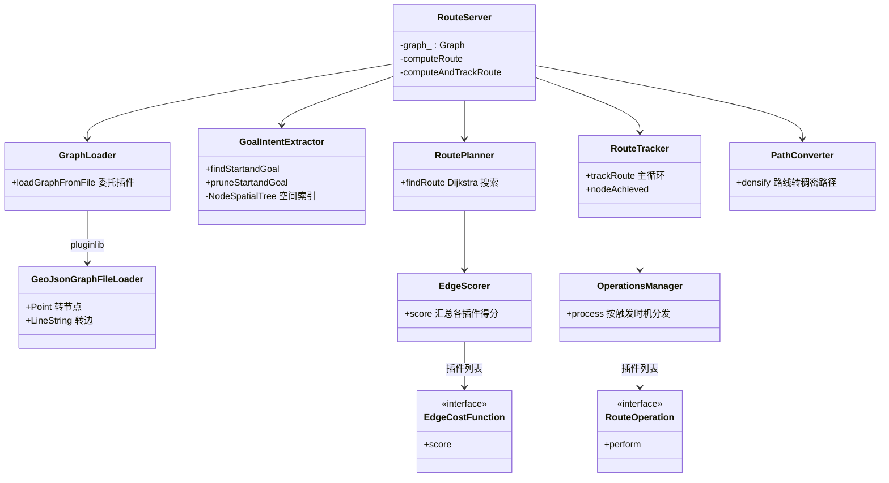
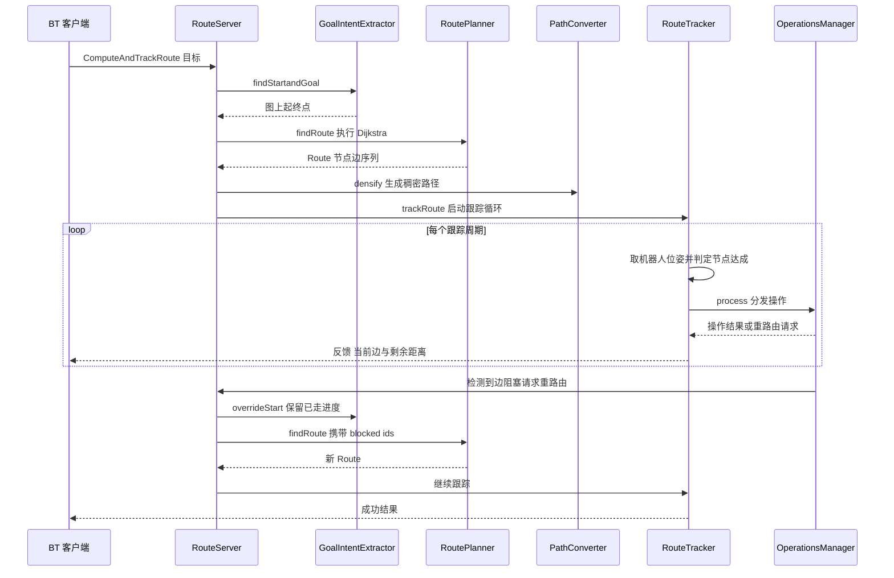

# 第 17 章 Route 路线规划：预定义路网上的图搜索与实时跟踪

> **一句话总结**：nav2_route 把"在预定义路网图上找一条节点序列"做成了一个独立的生命周期节点（Lifecycle Node）服务器（Server）——RouteServer 通过 ComputeRoute 与 ComputeAndTrackRoute 双 Action 对外服务，内部由 GraphLoader 插件（Plugin）加载 GeoJSON 路网、EdgeScorer 插件体系为边打分、RoutePlanner 执行图搜索、RouteTracker 在执行期跟踪进度并触发 Operations 插件，与第 07 章的自由空间规划形成"路由给骨架、自由空间补首尾"的互补关系。

> **前置知识**：第 07 章 · 第 11 章 ｜ **知识依赖图**：[KnowledgeGraph/Knowledge](KnowledgeGraph/Knowledge.md)

## 17.1 为什么需要图路由

第 07 章的 PlannerServer 在栅格代价地图（Costmap）上做密集搜索，理论上"哪里能走就能规划到哪里"。但把它直接扔进十万平米的仓库或跨楼宇的园区，会遇到两类工程问题：

- **算力问题**。自由空间规划的复杂度正比于栅格数量。地图边长翻一倍，搜索空间翻四倍；NavFn、Smac 在小场景下毫秒级返回，在超大地图上会膨胀到秒级，且启发式缓存、下采样等手段治标不治本。
- **可控性问题**。密集搜索给出的是"数学最优"路径，而运营方要的往往是"制度最优"路径：AGV 必须走划定巷道、靠右行驶、某些通道单行、消防门前禁停。这些业务规则很难塞进代价地图，却天然适合表达为一张带语义的有向图。

预定义路网正是传统 AGV 行业沉淀了几十年的答案：把可通行区域抽象成节点与有向边，规划退化为稀疏图搜索——复杂度从 O(栅格数) 降到 O(边数 log 节点数)，且每条边都可以携带速度限制、语义标签、惩罚值等运营元数据。

nav2_route 的设计者没有让图路由取代自由空间规划，而是让两者互补：**Route 给骨架，freespace 补首尾**。机器人当前位姿和目标位姿通常不落在图节点上，路网路由给出中段的确定性走廊，起点到最近节点、最后一个节点到目标的"最后几米"仍交给 PlannerServer 或控制器完成。这一分工在行为树（BT）里可以自由编排，本章 17.7 节会给出具体模式。

## 17.2 整体设计：RouteServer 与双 Action

RouteServer（nav2_route/include/nav2_route/route_server.hpp、nav2_route/src/route_server.cpp）是一个标准的 Nav2 生命周期节点，对外暴露两个 Action：

| Action | 语义 | 生命周期 |
|---|---|---|
| ComputeRoute | 一次性计算：输入起终点，返回 Route 与稠密 Path | 请求-响应式，立即返回 |
| ComputeAndTrackRoute | 计算并跟踪：规划后持续监控执行进度，触发 Operations，必要时重路由 | 长任务，随执行过程持续发布反馈 |

内部由六个协作组件构成，全部在 `on_configure()` 阶段装配完毕：

这个拆分方式与 PlannerServer"服务器壳 + 算法插件"的两层结构不同：RouteServer 是**流水线式**的——加载、意图萃取、搜索、转换、跟踪各司其职，而插件化发生在流水线的三个内部环节（图加载器、边评分器、路由操作），扩展粒度更细。

## 17.3 图数据模型与加载

路网的核心数据结构定义在 nav2_route/include/nav2_route/types.hpp：

- **Node**：节点 ID、坐标（含 frame_id）、出边集合 neighbors、元数据 Metadata；
- **DirectionalEdge**：有向边，持有起止节点指针、EdgeCost（cost 与 overridable 标志）、元数据与挂接的 Operations。

两点设计值得留意。其一，边是**有向**的：双向通道在图中是两条边，这让"单行巷道"表达为天然能力而非补丁。其二，节点与边都携带开放式 Metadata 字典，速度限制、语义类别、惩罚值都存在这里，评分插件与操作插件按约定键名读取——数据模型不为任何具体业务硬编码字段，这是它能承载多样运营规则的根基。

图的加载走 GraphFileLoader 插件接口，默认实现 GeoJsonGraphFileLoader（nav2_route/src/plugins/graph_file_loaders/geojson_graph_file_loader.cpp）把 GeoJSON 的 Point 特征解析为节点、LineString 解析为边。选择 GeoJSON 是务实的：它是开放标准，QGIS 等 GIS 工具可以直接绘制和编辑路网，properties 字段天然映射到 Metadata。对应地还有 GeoJsonGraphFileSaver 支持把内存图序列化回文件，供运行期修改后持久化。

## 17.4 RoutePlanner 与 EdgeScorer 插件体系

RoutePlanner（nav2_route/src/route_planner.cpp）的搜索算法是经典 Dijkstra，支持迭代上限。有趣的不是搜索本身——稀疏图上的 Dijkstra 没有花样可玩——而是**边的代价从哪来**。答案是 EdgeScorer 管理的一组 EdgeCostFunction 插件（nav2_route/plugins.xml 中注册）：

| 插件 | 评分语义 |
|---|---|
| DistanceScorer | 边长按速度限制折算，乘以权重 |
| TimeScorer | 基于历史通行时间或速度估计的时间代价 |
| PenaltyScorer | 读取边元数据中的静态惩罚值 |
| SemanticScorer | 按语义类别查表加成本，如"人行区加权" |
| CostmapScorer | 沿边采样代价地图，取最大或平均代价 |
| DynamicEdgesScorer | 经 ROS 服务在运行期封闭边或注入动态代价 |
| GoalOrientationScorer | 校验终端边方向与目标朝向的一致性 |
| StartPoseOrientationScorer | 校验起始边方向与机器人当前朝向的一致性 |

评分的叠加语义必须准确理解：EdgeScorer 按配置顺序调用每个插件并**加总**得分；但任一插件返回 false，该边立即被判为不可通行，整条边从本次搜索中剔除。也就是说插件同时扮演"计价器"与"闸门"两种角色——DistanceScorer 通常只计价，DynamicEdgesScorer 与 CostmapScorer 则可能落闸。理解这一点才能解释"为什么加了 CostmapScorer 后某些路线永远搜不出来"：不是代价太高，而是边被判死。

## 17.5 GoalIntentExtractor 与 route 到 path 的衔接

用户的请求可能是图节点 ID，也可能是任意位姿，两者到"图上起终点"的翻译由 GoalIntentExtractor（nav2_route/include/nav2_route/goal_intent_extractor.hpp）完成：

- 给定节点 ID 时直接采用；
- 给定位姿时通过 NodeSpatialTree 空间索引找最近节点，可选做视线碰撞检查（LoSCollisionChecker，Bresenham 直线采样）确保"机器人到入图节点"这一段真实可达；
- `pruneStartandGoal()` 修剪首尾边：若机器人已越过首节点，就不必回头先去"打卡"。

搜索得到的 Route 只是节点与边的序列，交给下游控制器前还要经 PathConverter（nav2_route/include/nav2_route/path_converter.hpp）的 `densify()` 线性插值为稠密 nav_msgs/Path，插值间距、转角平滑与平滑半径均可由参数调节。这条 Path 既可以直接发给 FollowPath 控制器，也可以只当参考骨架。

## 17.6 RouteTracker 与 Operations：一次 ComputeAndTrackRoute 的完整旅程

ComputeAndTrackRoute 是 nav2_route 相比"纯规划器"的真正增量。RouteTracker（nav2_route/src/route_tracker.cpp）维护一个跟踪状态（当前边、上一节点、下一节点、边索引、是否进入节点半径），主循环里按 `tracker_update_rate` 频率获取机器人位姿、用半径与向量夹角双重判据判定 `nodeAchieved()`、发布 Action 反馈，并把状态变化喂给 OperationsManager。

Operations 插件按三种时机触发：ON_GRAPH（图文件里挂在节点或边上的操作，进入或到达时执行）、ON_STATUS_CHANGE（任何跟踪状态变化）、ON_QUERY（每个跟踪周期）。内置插件覆盖了三类典型需求：

| 插件 | 触发场景 |
|---|---|
| TriggerEvent | 到达指定节点或边时调用外部服务，如开门、呼叫电梯 |
| AdjustSpeedLimit | 按边元数据发布速度限制，联动控制器减速 |
| CollisionMonitor | 沿前方路线采样代价地图，发现阻塞则请求重路由 |
| ReroutingService | 暴露服务给外部系统主动请求重路由 |
| TimeMarker | 把实际通行时间写回边元数据，供 TimeScorer 越用越准 |

一次带重路由的完整时序如下：

重路由时 `overrideStart()` 会以跟踪进度覆盖起点，PathConverter 也支持部分路径拼接——机器人不会因为一次改道而"从头开始"。CollisionMonitor 报告的 blocked_ids 会传入下一次搜索，配合 DynamicEdgesScorer 把坏边挡在门外。

## 17.7 在行为树中使用 Route

nav2_behavior_tree 为路由提供了配套 BT 节点（注册于 nav2_behavior_tree/nav2_tree_nodes.xml）：ComputeRoute、ComputeAndTrackRoute，以及一个衔接件 ExtractRouteNodesAsGoals——把 Route 中的节点序列转成目标列表。由此产生两种典型编排（BT 机制本身见第 11 章）：

- **Route 直出路径**：ComputeRoute 产出的稠密 Path 直接进 FollowPath。适合路网本身贴近可行驶中心线的场景，规划开销最小。
- **Route 骨架 + freespace 精修**：ExtractRouteNodesAsGoals 把节点交给 PlannerServer 的 ComputePathThroughPoses 逐段做自由空间规划，再拼接执行。路网只管拓扑走向，避障细节由代价地图规划兜底，是大场景下的推荐姿势。

## 17.8 源码实现要点与设计模式

- **策略模式三连**：GraphFileLoader、EdgeCostFunction、RouteOperation 三个接口各自经 pluginlib 加载，与第 04 章的插件契约完全同构——虚基类定义生命周期与工作方法，XML 声明导出，参数列表决定装配。
- **数据与行为分离**：图只存数据（坐标、元数据），一切行为（评分、操作）由插件在运行期解释元数据，同一张图换一套插件配置就是另一套运营策略。
- **服务器即协调者**：RouteServer 不做任何算法，只负责流水线编排与 Action 生命周期管理（抢占、取消、异常转错误码），与 PlannerServer 的职责划分理念一致。

## 17.9 扩展方式

三个扩展点全部走标准插件流程（详细步骤见第 24 章）：

- **自定义 EdgeScorer**：继承 `nav2_route::EdgeCostFunction`，实现 `score()`，可表达"电量低时避开坡道"这类动态策略；
- **自定义 Operation**：继承 `nav2_route::RouteOperation`，在节点或边事件上执行任意逻辑，如对接 WMS 上报位置；
- **自定义 GraphParser**：继承 `nav2_route::GraphFileLoader`，支持自有路网格式或直接从数据库拉图。

## 17.A 源码导航与入手路径

入口链：main()→RouteServer 构造→on_configure() 装配 GraphLoader/GoalIntentExtractor/RoutePlanner/PathConverter/RouteTracker 流水线→ComputeAndTrackRoute goal→findStartandGoal() 定位图上起终点→findRoute() Dijkstra 搜索→densify() 稠密化→trackRoute() 跟踪循环→OperationsManager 按时机分发操作插件。

| 文件（仓库相对路径，约 N 行） | 关键函数 | 作用 |
|---|---|---|
| nav2_route/src/route_server.cpp（约 412 行） | on_configure() / findRoute() | 流水线装配与双 Action 生命周期编排 |
| nav2_route/src/route_planner.cpp（约 217 行） | findRoute() | 稀疏图 Dijkstra 搜索与 EdgeScorer 调用 |
| nav2_route/src/route_tracker.cpp（约 249 行） | trackRoute() / nodeAchieved() | 执行期跟踪、反馈发布与操作触发 |
| nav2_route/src/goal_intent_extractor.cpp（约 305 行） | findStartandGoal() / pruneStartandGoal() / overrideStart() | 位姿到图节点的翻译与重路由起点覆盖 |
| nav2_route/src/plugins/graph_file_loaders/geojson_graph_file_loader.cpp（约 241 行） | loadGraphFromFile() | GeoJSON 路网解析为节点与有向边 |

| 第一遍只看 | 第二遍补充 | 以后再看 |
|---|---|---|
| route_server.cpp 流水线装配对照 17.6 时序图 | route_planner.cpp 与 goal_intent_extractor.cpp | 各 EdgeScorer 与 Operations 插件实现 |

完整业务链路见 [Route 图路由端到端时序图](Assets/sequence/Route图路由.md)。

## 17.B 设计权衡

### 图路由 vs 自由空间规划

两者的分歧不在算法而在**世界建模**：自由空间规划把世界看作均质栅格，哪里代价低走哪里，适合避障细节；图路由把世界压缩成带语义的稀疏图，复杂度从 O(栅格数) 降到 O(m log n)，且单行道、限速区这些"制度最优"规则直接长在边上。代价是丢失自由度：图外的捷径永远不会被发现，路网维护成为新的运营成本。Nav2 的答案不是二选一而是分工：Route 给骨架、freespace 补首尾，由行为树自由编排——这比传统 AGV 行业"只能走磁条"的单一范式和纯 freespace 的失控感都更工程化。

### 流水线式拆分 vs 服务器壳 + 算法插件两层结构

PlannerServer 的结构是"壳 + 插件"：算法整体可换，但壳内部铁板一块。RouteServer 改用流水线：加载、意图萃取、搜索、转换、跟踪五个环节各司其职，插件化下沉到其中三个环节内部（图加载器、边评分器、路由操作）。原因是变化点粒度不同：用户几乎不会换掉 Dijkstra，但经常要换路网格式、加一条计价规则、挂一个到达动作。把插件点开在真正会变的地方而非机械地"整个算法一个插件"，是扩展点设计的细化演进，与第 04 章的接口哲学一脉相承。

### 评分插件"计价 + 闸门"双角色 vs 纯代价函数

EdgeCostFunction 的返回值设计成"bool 可行性 + float 代价"双通道：任一插件返回 false 整条边立即剥除，而非用"天文数字代价"近似表达不可通行。好处是语义精确（封边就是封边，不会被其他插件的负向加成"救活"）且搜索可提前剪枝；风险是调试难度上升——"全图无路"时需要逐插件排查是谁在落闸，而纯代价模型里只需看一个总分。理解这一双重角色是配置 CostmapScorer、DynamicEdgesScorer 的前提，也是 17.4 节那个高频现场问题的根源。

## 知识总结

1. nav2_route 用稀疏图搜索替代大场景下的密集栅格搜索，复杂度 O(m log n)，并让边携带运营语义；它与 PlannerServer 是互补而非替代关系。
2. RouteServer 是流水线协调者：GraphLoader 加载、GoalIntentExtractor 定位起终点、RoutePlanner 搜索、PathConverter 稠密化、RouteTracker 跟踪。
3. 边代价来自 EdgeCostFunction 插件列表的加总，任一插件返回 false 即整边失效——插件兼具计价与闸门双重角色。
4. ComputeAndTrackRoute 在执行期由 OperationsManager 按 ON_GRAPH、ON_STATUS_CHANGE、ON_QUERY 三种时机触发操作插件，支持进度保留式重路由。
5. 图加载器、边评分器、路由操作三处插件化扩展点均遵循第 04 章的 nav2_core 式插件契约。

## 常见面试题

1. **图路由与自由空间规划各适合什么场景？如何协同？**
   要点：大场景、强运营规则用图路由，复杂度低且可控；小范围精细避障用自由空间。协同模式是 Route 给中段骨架，PlannerServer 补首尾或逐段精修，BT 中经 ExtractRouteNodesAsGoals 衔接。
2. **EdgeScorer 多插件叠加的语义是什么？**
   要点：按配置顺序调用、得分加总；任一插件返回 false 则边不可通行。既是代价函数又是硬约束过滤器。
3. **ComputeAndTrackRoute 如何实现"不从头开始"的重路由？**
   要点：GoalIntentExtractor 的 overrideStart 以跟踪进度覆盖起点；阻塞边 ID 传入下次搜索被剔除；PathConverter 支持部分路径拼接。
4. **Route 的 Operations 有哪三种触发时机？各举一例。**
   要点：ON_GRAPH——图上挂载的 TriggerEvent 开门；ON_STATUS_CHANGE——状态切换时 AdjustSpeedLimit；ON_QUERY——每周期 CollisionMonitor 检查前方阻塞。
5. **为什么边设计为有向？**
   要点：单行道、靠右行驶等规则要求两个方向代价与可达性独立；双向通道建模为两条边，方向语义零成本表达。

## 最佳实践与容易踩坑

- **坐标系一致性**：GeoJSON 中所有节点的 frame 必须与 `route_frame`（通常 map）一致，跟踪判据依赖 TF 中 `base_frame` 到 `route_frame` 的变换；坐标系配错的典型症状是 nodeAchieved 永远不触发或立即全部触发。
- **节点连通性**：图是有向的，绘图工具里画了一条线不代表双向可走；上线前用 GraphSaver 回存并可视化检查孤岛节点与"只进不出"的死端。
- **评分插件叠加**：给 CostmapScorer 配置过严的阈值会让边频繁被判死而不是加价，与 DynamicEdgesScorer 的封边叠加时尤其容易出现"全图无路"；建议先单插件调通再逐个叠加。
- **跟踪频率与节点半径**：`tracker_update_rate` 过低配上过小的节点达成半径，高速机器人可能在一个周期内穿过节点导致漏判。
- **首尾修剪**：不开启 pruneStartandGoal 时机器人会先倒回起始节点"打卡"，观感极差；除非业务要求严格走全图，否则保持默认修剪。

## 延伸阅读

- nav2_route/README.md：官方最完整的参数表、GeoJSON 格式说明与示例图。
- nav2_route/graphs/：随包提供的示例路网文件，适合作为绘图模板。
- 第 07 章 PlannerServer 与全局规划：自由空间规划一侧的对照阅读。
- 第 11 章 行为树与 BTNavigator：Route 相关 BT 节点的编排语境。
- 第 04 章 nav2_core 插件接口：三个扩展点共同遵循的插件契约。

## 17.C 阅读检查点

1. 图路由相对自由空间规划解决了哪两类工程问题？两者在行为树中如何协同？（见 17.1、17.7）
2. RouteServer 的流水线式拆分与 PlannerServer 的两层结构有何不同？插件化发生在哪三个环节？（见 17.2）
3. EdgeScorer 多插件叠加的语义是什么？为什么加了 CostmapScorer 后某些路线会"永远搜不出来"？（见 17.4）
4. 重路由时框架靠哪三个机制做到"不从头开始"？（见 17.6）
5. Operations 插件的三种触发时机各是什么？各举一个内置插件为例。（见 17.6）

> 下一章：18_Docking靠泊
