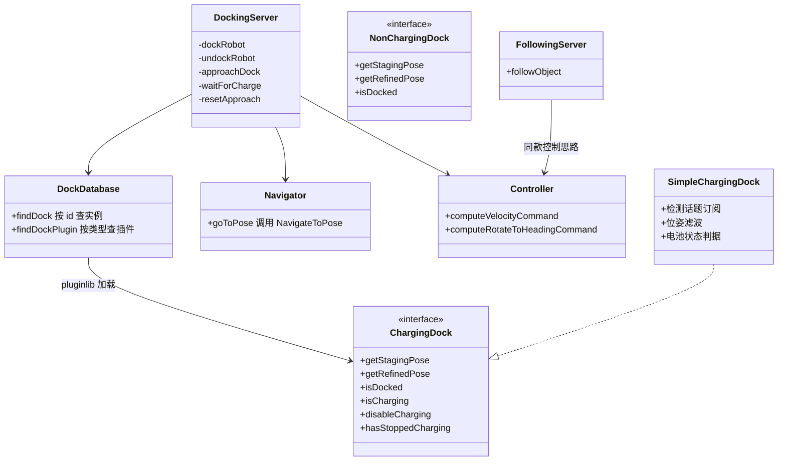
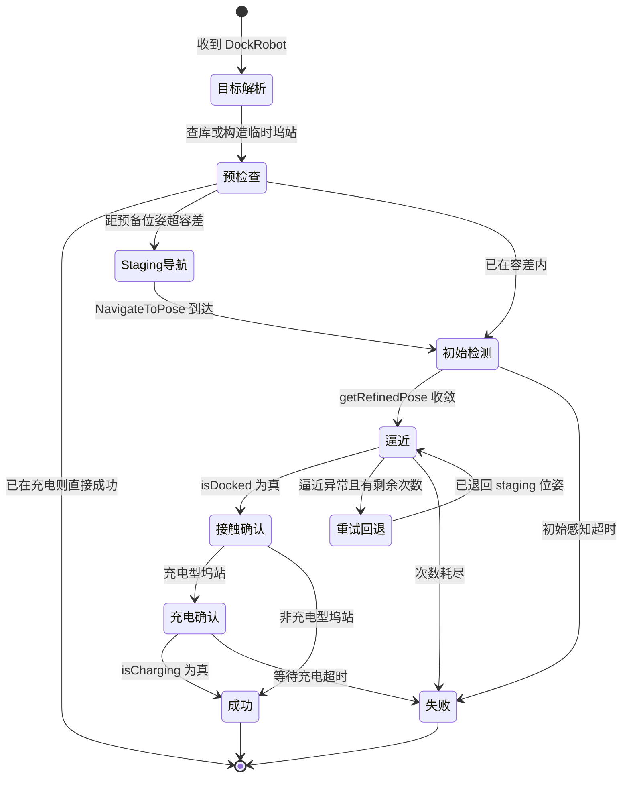

# 第 18 章 Docking 靠泊：最后一米的高精度对接框架

> **一句话总结**：nav2_docking 把"导航到坞站附近"与"最后一米精确对接"解耦——DockingServer 作为生命周期节点（Lifecycle Node）通过 DockRobot 与 UndockRobot 双 Action 编排全流程，先复用 NavigateToPose 行为树（BT）抵达 staging 位姿，再基于 ChargingDock 插件（Plugin）的实时检测与专用控制律闭环逼近，配合坞站数据库、充电确认与失败重试，构成一套可插拔的生产级靠泊框架。

> **前置知识**：第 04 章 · 第 11 章 ｜ **知识依赖图**：[KnowledgeGraph/Knowledge](KnowledgeGraph/Knowledge.md)

## 18.1 为什么靠泊值得一个独立框架

自主充电是移动机器人从"演示"走向"无人值守运营"的分水岭：机器人必须能自己回桩、对准、接触、确认充电，整个闭环不允许人工干预。但常规导航栈到这里恰好失灵——代价地图（Costmap）的分辨率与定位误差合计通常在厘米到分米级，而充电触点的对接容差往往只有一两厘米；坞站在全局地图上的标注位姿与其真实位姿也总有出入。这决定了靠泊必须依赖**局部实时检测**（视觉标记、激光反光板等）而非全局定位，必须使用**专用控制律**而非通用路径跟踪，还必须处理接触检测、充电确认、失败重试这些导航栈从不关心的硬件语义。

与其让每个厂商各写一套私有回桩逻辑，Nav2 社区选择沉淀一个开放框架（NVIDIA 赞助了这项工作，背景见第 00 章）。nav2_docking 的核心立场是：**流程通用、感知与硬件私有**——服务器把"去附近、看清楚、贴上去、确认电"的骨架固化下来，把"怎么检测坞站、怎么判断在充电"留给插件。

## 18.2 整体架构：三个包的分工

nav2_docking 目录下是三个包，加上独立的 nav2_following：

| 包 | 职责 |
|---|---|
| opennav_docking_core | 定义 ChargingDock、NonChargingDock 插件接口，纯头文件契约 |
| opennav_docking | DockingServer 主体、坞站数据库、内部 Navigator、专用控制律、SimpleChargingDock 参考实现 |
| opennav_docking_bt | DockRobot、UndockRobot 的 BT 节点与示例行为树 |
| nav2_following | FollowObject 动态目标跟随服务器，与靠泊共享控制思路 |

DockingServer（nav2_docking/opennav_docking/src/docking_server.cpp）自身不含任何感知代码：它持有速度发布器、里程计平滑器与 TF，把导航委托给 Navigator、把控制委托给 Controller、把感知与硬件语义委托给 Dock 插件——一个纯粹的流程编排者。

## 18.3 插件契约与坞站数据库

opennav_docking_core 定义的接口（nav2_docking/opennav_docking_core/include/opennav_docking_core/charging_dock.hpp 及 non_charging_dock.hpp）遵循第 04 章的插件生命周期约定（configure、activate、deactivate、cleanup），工作方法围绕四个问题展开：

- **去哪等**：`getStagingPose()` 由插件根据坞站位姿与偏移量给出预备位姿；
- **在哪里**：`startDetectionProcess()` 启动检测管线，`getRefinedPose()` 持续给出实时精化的坞站位姿；
- **到了吗**：`isDocked()` 判断物理接触；
- **充上了吗**：ChargingDock 额外提供 `isCharging()`、`disableCharging()`、`hasStoppedCharging()`，覆盖充电闭环与安全脱离。

NonChargingDock 面向货架对接、进电梯等无充电语义的场景，砍掉充电三件套。

DockDatabase（nav2_docking/opennav_docking/include/opennav_docking/dock_database.hpp）维护两级映射：`dock_plugins` 声明插件类型，`docks` 声明场地上的坞站实例（类型、坐标系、位姿、ID），参数示例见 nav2_docking/opennav_docking/test/docking_params.yaml。调用方既可以传 dock_id 查库，也可以在 Action 目标里直接给 dock_pose 与 dock_type 构造临时坞站——前者适合固定场地，后者适合坞站位姿由上游系统动态下发的场景。

参考实现 SimpleChargingDock（nav2_docking/opennav_docking/include/opennav_docking/simple_charging_dock.hpp）展示了插件的典型形态：订阅外部检测节点发布的坞站位姿话题并做滤波（检测本身不在框架内）；staging 位姿由坞站位姿加参数化偏移与朝向偏置算出；`isDocked()` 用"精化位姿与机器人间的剩余偏差小于阈值"或关节状态判定；`isCharging()` 可接电池状态话题。它同时也是自定义插件最好的抄写范本。

## 18.4 一次 DockRobot 的完整旅程

`dockRobot()` 的主线可以概括为五个阶段加一个重试环：

几个阶段的实现要点：

- **Staging 导航**。若 `navigate_to_staging_pose` 为真且机器人不在 `dock_prestaging_tolerance` 内，Navigator（nav2_docking/opennav_docking/include/opennav_docking/navigator.hpp）作为 Action 客户端调用 NavigateToPose，把长途导航完全交还给 BT Navigator——避障、重规划、恢复行为全部免费复用。DockingServer 只在内部执行器里等结果并响应抢占。
- **初始检测**。以坞站库位姿为先验启动检测流程，在 `initial_perception_timeout` 内反复调用 `getRefinedPose()` 直到收敛。这是从"全局坐标世界"切换到"传感器坐标世界"的关口。
- **逼近**。每个控制周期重新取一次精化位姿（检测是持续的，不是一锤子买卖），把目标沿对接轴向后投影一小段以避免曲线末端数值不稳定，变换到机器人基座坐标系后交给控制律。若插件声明 `shouldRotateToDock()`，先原地旋转对正再进入平移逼近。倒泊由 `dock_backwards` 或插件的 `getDockDirection()` 决定，控制律以 backward 标志切换方向语义。
- **充电确认**。接触不等于充电：`waitForCharge()` 在 `wait_charge_timeout` 内轮询 `isCharging()`，超时抛 FailedToCharge。这一层把"机械到位"与"电气到位"明确区分开。
- **重试**。逼近阶段抛出 DockingException 且 `num_retries` 未耗尽时，`resetApproach()` 沿反方向退回 staging 位姿再来一轮——检测抖动或初次接触失败在真实硬件上是常态，重试是刚需而非锦上添花。

结束时无论成败都会停稳（发布零速度）、停止检测流程，并在成功时把坞站信息暂存下来供后续 UndockRobot 使用。

UndockRobot 是逆过程：先经 `disableCharging()` 与 `hasStoppedCharging()` 确认电流安全断开——带电拔插会烧蚀触点——再由控制律沿对接轴退回 staging 位姿，最后回到可正常导航的状态。

## 18.5 控制律与安全

逼近阶段使用的是专用 Controller（nav2_docking/opennav_docking/src/controller.cpp），而不是任何 nav2_core 控制器插件。`computeVelocityCommand()` 在机器人基座坐标系里根据目标位姿生成平滑收敛到对接轴线的速度指令，支持前向与后向；`computeRotateToHeadingCommand()` 处理原地对正。之所以不复用控制器服务器，是因为靠泊控制的目标是"位姿收敛到接触"而非"跟踪一条路径"，控制周期内目标本身还在被检测刷新。

安全上，Controller 内建碰撞检查：通过 CostmapSubscriber 与 FootprintSubscriber 构造 CostmapTopicCollisionChecker，对即将执行的局部轨迹做碰撞预测，发现碰撞即拒绝指令并发布轨迹用于诊断。靠泊贴近障碍物属于正常工况，因此坞站附近的代价地图配置（详见坑点）直接影响这套检查能否放行。

## 18.6 BT 编排与 opennav_following

opennav_docking_bt 提供 DockRobot、UndockRobot 两个 BT Action 节点（输入端口含 dock_id、dock_pose、dock_type、navigate_to_staging_pose 等，输出端口含 success、error_code_id、num_retries），示例树 nav2_docking/opennav_docking_bt/behavior_trees/application_example.xml 展示了典型任务闭环：开工先 UndockRobot 离桩，执行一串 NavigateToPose 任务，收工 DockRobot 回桩充电。把靠泊做成 BT 节点意味着它可以自然嵌入第 11 章的任何导航编排——例如"电量低于阈值则中断任务回桩"。

nav2_following 的 FollowingServer 是同一套控制思想的动态版本：FollowObject Action 从位姿话题或 TF frame 持续获取移动目标，用同款控制律保持跟随距离，支持抢占与取消。可以把它理解为"目标会动、永不接触的靠泊"，适合跟人搬运、车辆列队等场景，此处不再展开。

## 18.7 扩展方式

对接自有坞站的路径非常清晰（完整流程见第 24 章）：继承 `opennav_docking_core::ChargingDock`（或 NonChargingDock），实现检测与状态判据，经 pluginlib 导出，再在 `dock_plugins` 与 `docks` 里声明即可——服务器流程、重试、充电闭环全部继承。实践中绝大多数工作量在 `getRefinedPose()` 背后的感知管线：框架消费的只是一个持续刷新的 PoseStamped，AprilTag、反光板、深度学习检测都可以在框架之外自由实现。

## 18.A 源码导航与入手路径

入口链：nav2_docking/opennav_docking/src/main.cpp 的 main() → DockingServer 构造 → on_configure()（初始化 DockDatabase、Navigator、Controller 并加载 Dock 插件）→ Action 触发 dockRobot() / undockRobot()。

| 文件（仓库相对路径，约 N 行） | 关键函数 | 作用 |
|---|---|---|
| nav2_docking/opennav_docking/src/docking_server.cpp（约 800 行） | dockRobot() / approachDock() / waitForCharge() / resetApproach() | 五阶段流程编排与重试环 |
| nav2_docking/opennav_docking/src/controller.cpp（约 290 行） | computeVelocityCommand() / computeRotateToHeadingCommand() | 逼近控制律与内建碰撞检查 |
| nav2_docking/opennav_docking/src/dock_database.cpp（约 240 行） | findDock() / findDockPlugin() | 坞站实例与插件两级映射 |
| nav2_docking/opennav_docking/src/navigator.cpp（约 110 行） | goToPose() | 内部 NavigateToPose 客户端 |
| nav2_docking/opennav_docking_core/include/opennav_docking_core/charging_dock.hpp（约 170 行） | getStagingPose() / getRefinedPose() / isDocked() / isCharging() | 插件契约头文件 |
| nav2_docking/opennav_docking/src/simple_charging_dock.cpp（约 460 行） | getRefinedPose() / isDocked() | 参考插件实现 |

| 第一遍只看 | 第二遍补充 | 以后再看 |
|---|---|---|
| docking_server.cpp 的 dockRobot() 主线 | controller.cpp 控制律与 charging_dock.hpp 契约 | simple_charging_dock.cpp 滤波细节与 nav2_following |

完整业务链路见 [Docking 靠泊时序图](Assets/sequence/Docking靠泊.md)。

## 18.B 设计权衡

### 靠泊独立服务器 vs 并入 ControllerServer

把逼近控制做成一个 nav2_core::Controller 插件塞进 controller_server 看似省事，但语义根本不同：控制器服务器的契约是"跟踪一条既定路径"，而靠泊的目标是"位姿收敛到物理接触"，且目标本身每个周期都被 getRefinedPose() 刷新，根本没有稳定的路径可跟。此外靠泊还携带接触确认、充电握手、失败退回重试这些状态机语义，塞进控制循环会污染 FollowPath 的通用契约。独立 DockingServer 以 Action 对外，代价是多一个进程与一份生命周期管理，换来的是两边契约各自纯粹——这与第 16 章 CollisionMonitor 独立于控制器的理由同构。

### ChargingDock 插件化：流程归框架、硬件归厂商

坞站检测手段（AprilTag、反光板、深度学习）与充电确认信号（电池话题、电流方向、继电器反馈）在不同硬件上千差万别，若框架直接内置某一种，其余厂商只能整体弃用。Nav2 把"去哪等、在哪里、到了吗、充上了吗"抽象为 ChargingDock 四问接口，服务器只消费 PoseStamped 与布尔量，感知管线完全留在框架之外。代价是接口方法偏多（充电型九个以上），且插件质量直接决定成败；收益是五阶段流程、重试环与 BT 集成对所有硬件一次写对。插件工厂机制的模式视角见第 22 章。

### 长途导航复用 NavigateToPose vs 自建导航

DockingServer 内部的 Navigator 只是一个 Action 客户端，把 staging 段导航整体委托给 BT Navigator，避障、重规划、恢复行为全部免费继承；若自建导航则要重写这一整套。代价是引入对 bt_navigator 的运行时依赖，且 staging 段的失败语义要经两层 Action 转译——框架用 error_code 透传缓解。这是"复用整条业务链"优先于"进程自治"的典型取舍。

## 知识总结

1. 靠泊框架的核心解耦是"长途导航复用 NavigateToPose，最后一米走检测加专用控制律"，全局定位精度不足由局部实时感知补齐。
2. DockingServer 是纯流程编排者：DockDatabase 管坞站、Navigator 管导航、Controller 管控制、Dock 插件管感知与硬件语义。
3. ChargingDock 接口用四个问题定义契约——去哪等、在哪里、到了吗、充上了吗；NonChargingDock 面向无充电语义的对接。
4. DockRobot 全流程为 staging、初始检测、逼近（含旋转对正与倒泊）、接触确认、充电确认，逼近失败可退回 staging 重试；Undock 先安全断电再逆向脱离。
5. 逼近控制不走控制器服务器插件体系，因为其目标是位姿收敛且目标持续被检测刷新，并内建局部轨迹碰撞检查。

## 常见面试题

1. **为什么靠泊不直接用 NavigateToPose 导航到坞站位姿？**
   要点：全局定位与地图标注误差远大于对接容差；靠泊需要局部实时检测闭环、接触与充电确认、失败重试，这些都超出导航语义。
2. **ChargingDock 与 NonChargingDock 的区别？各自典型场景？**
   要点：前者多出 isCharging、disableCharging、hasStoppedCharging 充电三件套，用于充电桩；后者用于货架、传送带等纯机械对接。
3. **DockRobot 的重试机制如何工作？**
   要点：逼近抛 DockingException 且未超 max_retries 时，resetApproach 退回 staging 位姿重新检测逼近；结果中携带 num_retries。
4. **为什么 Undock 前必须确认停止充电？**
   要点：带电分离会拉弧烧蚀触点、冲击电池管理系统；框架用 disableCharging 加 hasStoppedCharging 双确认后才允许运动。
5. **自定义坞站插件的最小工作量是什么？**
   要点：实现 getStagingPose、getRefinedPose、isDocked（充电型再加充电三件套）；感知管线在框架外实现，插件只消费位姿流。

## 最佳实践与容易踩坑

- **staging 位姿选取**：必须落在检测传感器对坞站的可靠视场内，且留出足够的直线逼近距离让控制律收敛对正；离得太近没有调整余量，太远则检测不稳定。倒泊场景注意 staging 朝向与对接方向的偏航偏置参数。
- **检测超时与重试参数**：`initial_perception_timeout` 要覆盖检测管线的冷启动时间；`max_retries` 建议至少 2 到 3——真实硬件上首次接触失败很常见，为 0 会把偶发抖动放大成任务失败。
- **充电确认信号**：`wait_charge_timeout` 需大于硬件握手时延（继电器吸合、BMS 协商可达数秒）；电池话题不可靠时宁可在插件里综合电流方向判据，不要盲信单一布尔量。
- **坞站附近的代价地图**：坞站本体会被传感器标为障碍，若局部代价地图膨胀半径覆盖对接路径，内建碰撞检查会拒绝逼近指令；常见做法是靠泊区降低膨胀或用第 06 章的过滤机制豁免。
- **数据库位姿只是先验**：docks 里的位姿用于导航到附近与初始化检测，不必也不可能精确；真正的对接精度来自 getRefinedPose，把维护精力放在检测管线而非反复校准 YAML。

## 延伸阅读

- nav2_docking/README.md 与 nav2_docking/docs/：官方设计文档与参数总表。
- nav2_docking/opennav_docking/test/docking_params.yaml：dock_plugins 与 docks 两级配置的最小可用示例。
- nav2_docking/opennav_docking_bt/behavior_trees/application_example.xml：任务与靠泊的 BT 编排范例。
- 第 04 章 nav2_core 插件接口：Dock 插件遵循的生命周期契约。
- 第 11 章 行为树与 BTNavigator：DockRobot 节点嵌入任务编排的语境。

## 18.C 阅读检查点

1. DockRobot 的五个阶段分别是什么？哪个阶段可以被完全跳过？（18.4）
2. ChargingDock 与 NonChargingDock 的接口差异对应哪三个方法？各自的典型场景是什么？（18.3）
3. 逼近阶段为什么每个控制周期都要重新调用 getRefinedPose()，而不是检测一次后闭环跟踪？（18.4、18.5）
4. 靠泊逼近为什么不复用 controller_server 的控制器插件体系？（18.5、18.B）
5. 自定义一个反光板坞站插件时，哪些工作在框架内、哪些必须在框架外完成？（18.7、18.3）

> 下一章：19_Action与通信机制
