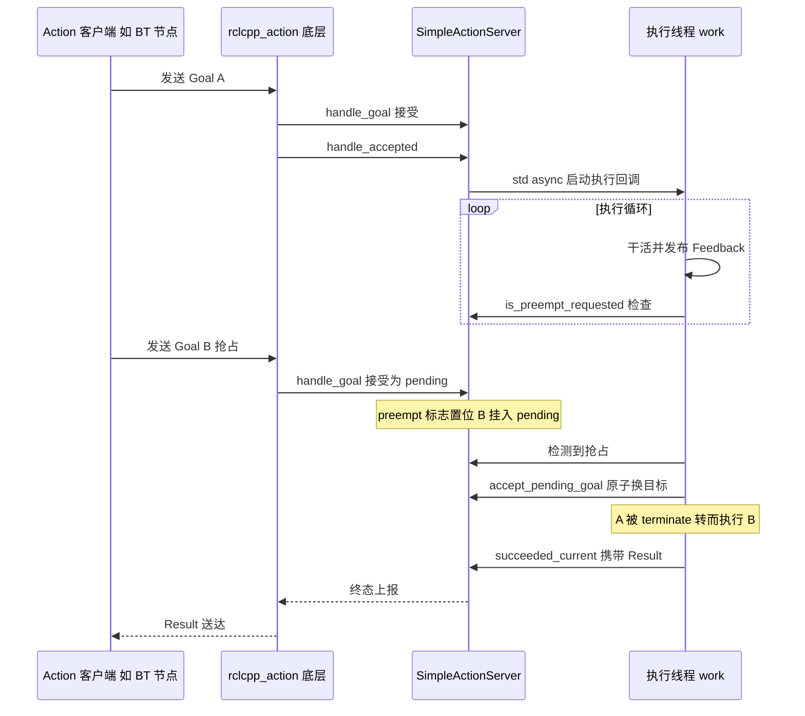
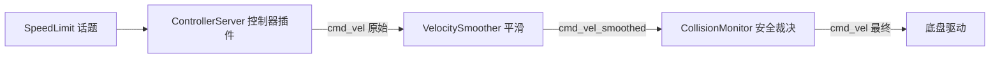

# 第 19 章 Action 与通信机制：把"长任务"做成可反馈、可抢占的一等公民

> **一句话总结**：Nav2 按"长任务用 Action、原子查询用 Service、高频流用 Topic"的规律组织全部通信；nav2_msgs 定义了约 20 个 Action、19 个 Service 与 22 个 Message 构成接口层，nav2_ros_common 里的 SimpleActionServer 在 rclcpp_action 之上封装出"单目标执行 + pending 抢占"的工作模型，配合统一的 QoS 约定（地图 transient_local、传感器 best_effort），让各服务器（Server）以一致的姿势对外提供导航能力。

> **前置知识**：第 01 章 · 第 07 章 ｜ **知识依赖图**：[KnowledgeGraph/Knowledge](KnowledgeGraph/Knowledge.md)

## 19.1 为什么导航任务必须用 Action

一次 NavigateToPose 可能持续几十秒到几分钟，期间机器人要持续汇报进度、随时可能被新目标打断。用三种 ROS 2 通信原语逐一检验这个需求：

- **Topic** 是单向流，没有"任务完成"的语义，调用方无从得知导航成败；
- **Service** 是一问一答，请求发出后调用方只能干等，既拿不到中途反馈，也无法取消一个执行到一半的请求；
- **Action** 天生具备三要素：Goal（下达任务）、Feedback（周期性进度）、Result（终态与错误码），外加 cancel 与"新 Goal 顶替旧 Goal"的抢占能力。

导航恰好是"长时 + 反馈 + 抢占"三个特征齐备的任务，因此 Nav2 中所有任务级接口——从顶层的 NavigateToPose 到底层的 Spin、BackUp——无一例外都是 Action。这也是第 01 章架构图中"服务器之间以 Action 相连"这一形态的根源。

### 选型规律表

| 通信类型 | 判断依据 | Nav2 典型例子 |
|---|---|---|
| Action | 执行时间不可预期、需要进度反馈、需要抢占或取消 | NavigateToPose、FollowPath、Spin、DockRobot |
| Service | 原子操作、同步问答、执行时间短且确定 | ClearEntireCostmap、SetInitialPose、IsPathValid、ManageLifecycleNodes |
| Topic | 高频单向数据流、发布方不关心谁在听 | /cmd_vel、/scan、/particle_cloud、/plan 可视化 |

可以把规律进一步压缩成一句判断口诀：**"要等结果吗？要等多久？中途要管吗？"**——不等结果用 Topic；等且很快用 Service；等且很久、中途还要管，就是 Action。

## 19.2 nav2_msgs：接口即契约

nav2_msgs 是 Nav2 的接口包，不含任何逻辑，只定义三类契约。它被刻意做薄，使得任何外部系统（车队调度、Web 面板、测试脚本）只依赖这一个包就能与整套导航栈对话。

### Action 清单（nav2_msgs/action/，约 20 个）

| 分组 | Action | 用途 |
|---|---|---|
| 任务编排层 | NavigateToPose、NavigateThroughPoses | BT Navigator 对外的顶层导航入口 |
| 规划层 | ComputePathToPose、ComputePathThroughPoses、SmoothPath | 规划与平滑的服务化封装 |
| 控制层 | FollowPath | 沿路径闭环控制，Feedback 携带跟踪误差与进度 |
| 恢复行为层 | Spin、BackUp、DriveOnHeading、Wait、AssistedTeleop | 短时行为，同样保留取消能力 |
| 航点层 | FollowWaypoints、FollowGPSWaypoints | 多点巡航，Feedback 报告当前航点序号 |
| 泊车与跟随 | DockRobot、UndockRobot、FollowObject | 泊车阶段状态经 Feedback 上报 |
| 图路由层 | ComputeRoute、ComputeAndTrackRoute | nav2_route 的图搜索与追踪 |
| 测试 | DummyBehavior | 单元测试占位 |

### Service 清单（nav2_msgs/srv/，19 个）

| 分组 | Service | 用途 |
|---|---|---|
| 代价地图操作 | ClearEntireCostmap、ClearCostmapAroundRobot、ClearCostmapAroundPose、ClearCostmapExceptRegion | 恢复行为的核心手段 |
| 代价地图查询 | GetCostmap、GetCosts、IsPathValid | 供行为树条件节点与外部工具查询 |
| 地图持久化 | LoadMap、SaveMap | map_server 的读写 |
| 定位 | SetInitialPose | 程序化设置 AMCL 初值 |
| 系统管理 | ManageLifecycleNodes、Toggle | 生命周期编排与通用开关 |
| 图路由 | SetRouteGraph、DynamicEdges | 路由图设置与拓扑动态修改 |
| 泊车 | ReloadDockDatabase | 热重载充电桩数据库 |
| 动态障碍 | AddShapes、RemoveShapes、GetShapes | 碰撞监控的形状管理 |

### Message 清单（nav2_msgs/msg/，22 个）

| 分组 | Message | 用途 |
|---|---|---|
| 代价地图 | Costmap、CostmapMetaData、CostmapUpdate、CostmapFilterInfo、VoxelGrid | 栅格数据、增量更新与过滤配置 |
| 行为树 | BehaviorTreeLog、BehaviorTreeStatusChange | BT 节点状态流水，供 Groot 等工具消费 |
| 定位 | Particle、ParticleCloud | AMCL 粒子集可视化 |
| 控制与反馈 | SpeedLimit、TrackingFeedback、CriticsStats | 限速指令、跟踪误差、评分器统计 |
| 图路由 | Route、RouteNode、RouteEdge、EdgeCost | 路由图结构 |
| 碰撞监控 | CollisionMonitorState、CollisionDetectorState、CircleObject、PolygonObject | 监控状态与障碍形状 |
| 航点 | WaypointStatus | 航点执行状态 |

## 19.3 SimpleActionServer：在 rclcpp_action 之上再抽象一层

rclcpp_action::Server 是通用底座，但它把 goal 接受、并发处理、线程调度全部交给使用者，直接用它写每个服务器会产生大量重复且易错的样板。Nav2 在 nav2_ros_common/include/nav2_ros_common/simple_action_server.hpp 中封装了 `SimpleActionServer<ActionT>` 模板，把导航场景共同的约束固化下来：

1. **单目标执行模型**：任意时刻至多一个 goal 在执行（current），至多一个 goal 在排队（pending）。机器人只有一个身体，不可能同时执行两条导航指令，与其让每个服务器各自处理并发，不如在框架层直接取缔并发。
2. **协作式抢占**：新 goal 到达不会粗暴杀死正在运行的执行回调，而是置位抢占标志、把新 goal 挂到 pending 位；执行回调在自己的循环里调用 `is_preempt_requested()` 主动检查，再用 `accept_pending_goal()` 原子换目标。控制器可以在两次控制周期之间无缝切到新路径，不会出现速度指令断流。
3. **独立执行线程**：`handle_accepted()` 通过 `std::async(std::launch::async, ...)` 把执行回调抛到异步任务中运行，可选调用 `setSoftRealTimePriority()` 提升调度优先级；构造时若开启 spin_thread，还会创建 MutuallyExclusive 回调组与专属单线程执行器（详见第 20 章线程盘点）。
4. **状态一致性**：所有涉及 current/pending 句柄的操作都在 `std::recursive_mutex`（update_mutex_）保护下进行，goal 交换对执行线程与 executor 线程都是原子的。

### 一次 goal 的生命周期

执行回调结束前必须显式调用 `succeeded_current()`、`terminate_current()` 或 `terminate_all()` 之一上报终态——这套"结果必须显式给出"的纪律，正是第 07 章看到的异常到错误码映射能够可靠工作的前提。从模式视角看，Action 本身就是**命令模式**的分布式版本：Goal 是被封装为对象的命令，可排队（pending）、可撤销（cancel）、可替换（preempt）；而 SimpleActionServer 的 executor 线程收 goal、工作线程消费 goal 的结构，是标准的**生产者—消费者**协作。

## 19.4 话题 QoS 约定与 cmd_vel 链路

QoS 配错是 ROS 2 最隐蔽的故障源：发布订阅两端 QoS 不兼容时连接静默失败，没有任何报错。Nav2 在 nav2_ros_common/include/nav2_ros_common/qos_profiles.hpp 中固化了四种预设，全栈统一使用：

| 预设类 | 可靠性 | 持久性 | 深度 | 适用场景 |
|---|---|---|---|---|
| StandardTopicQoS | Reliable | Volatile | 1~10 | 常规话题，如 /cmd_vel、/plan |
| LatchedPublisherQoS | Reliable | transient_local | 1 | 地图类低频数据的发布端 |
| LatchedSubscriptionQoS | Reliable | transient_local | 10 | 晚启动订阅方补收最后一帧 |
| SensorDataQoS | Best-effort | Volatile | 10 | 激光、点云等高频传感器流 |

背后的取舍逻辑：**地图**一年半载才更新一次，晚加入的节点必须能拿到最后一帧，所以用 transient_local 锁存（nav2_costmap_2d/src/costmap_2d_publisher.cpp 中的地图发布即是）；**传感器**数据下一帧马上就来，丢一帧无所谓，重传反而增加延迟，所以 best_effort；**速度指令**要求可靠但绝不锁存——重启的底盘驱动若收到一条陈旧的锁存速度会直接冲出去。

cmd_vel 链路是理解 Topic 串联的最佳样本：

控制器算出的原始速度先经速度平滑服务器做加速度限幅，再经碰撞监控做最后一道安全否决，才抵达底盘——三个节点纯靠话题级联，任何一环都可以独立替换或旁路，这正是 Topic 适合"流式管线"的体现。

## 19.5 服务工具封装：ServiceClient

与 Action 同理，Nav2 也不让各模块裸用 rclcpp::Client。nav2_ros_common/include/nav2_ros_common/service_client.hpp 的 `ServiceClient<ServiceT>` 模板提供 `invoke(request)` 同步调用：内部自带独立回调组与执行器，spin 等待响应并处理超时，调用方拿到的就是 response 或异常。行为树节点里"清除代价地图"这类操作因此可以写成一行阻塞调用，而不必在每个调用点重复 async_send_request + 等 future 的八股。这层薄封装的价值与 SimpleActionServer 一致：**把分布式通信的偶发复杂度挡在业务代码之外**。

## 19.A 源码导航与入手路径

入口链（以任意服务器的 Action 为样本）：宿主节点 create_action_server() 构造 SimpleActionServer → handle_goal() 接受 → handle_accepted()（约 209 行处）经 std::async 启动 work() → 执行回调循环中轮询 is_preempt_requested() 并用 accept_pending_goal() 原子换目标。

| 文件（仓库相对路径，约 N 行） | 关键函数 | 作用 |
|---|---|---|
| nav2_ros_common/include/nav2_ros_common/simple_action_server.hpp（约 680 行） | handle_accepted() / work() / is_preempt_requested() / accept_pending_goal() | 单目标 + pending 抢占模型全部实现 |
| nav2_ros_common/include/nav2_ros_common/service_client.hpp（约 250 行） | invoke() | 同步服务调用封装 |
| nav2_ros_common/include/nav2_ros_common/qos_profiles.hpp（约 110 行） | StandardTopicQoS / LatchedPublisherQoS / SensorDataQoS 等四个类 | 全栈 QoS 预设 |
| nav2_msgs/action/、srv/、msg/（现存 19 / 18 / 21 个接口文件） | —（纯接口定义） | 全栈通信契约 |

| 第一遍只看 | 第二遍补充 | 以后再看 |
|---|---|---|
| simple_action_server.hpp 的 work() 与抢占分支 | qos_profiles.hpp 四预设与 service_client.hpp | rclcpp_action 底层与 nav2_msgs 全量接口清单 |

完整业务链路见 [NavigateToPose 全景时序图](Assets/sequence/NavigateToPose.md)。

## 19.B 设计权衡

### Action vs Service vs Topic：为什么不能"一把梳子梳到底"

把所有接口统一成一种原语看似简洁，代价却是语义错配：若全用 Topic，调用方得自己发明"任务完成确认协议"；若全用 Service，一次分钟级导航会把调用方吊死在同步等待上且无法取消。Nav2 的选型口诀（要等结果吗？要等多久？中途要管吗？）把选择成本降到最低，代价是三套客户端/服务端基础设施并存——Nav2 用 nav2_ros_common 的三层封装（SimpleActionServer、ServiceClient、QoS 预设）把这份复杂度集中偿付，业务代码只面对统一姿势。

### 19 个 Action 的粒度：按服务器职责切，而非按业务场景切

nav2_msgs 没有定义"NavigateAndDock"这类复合 Action，而是每个服务器暴露自己的原子能力（规划、跟路、旋转、靠泊），组合逻辑上移到行为树 XML。若按业务场景定义粗粒度 Action，每新增一种业务组合都要改接口包与服务器；细粒度 + BT 编排则让组合变化只落在 XML 层。代价是一次导航跨多层 Action 嵌套（NavigateToPose 内包 ComputePathToPose 与 FollowPath），排障时需要分层看 feedback 与 error_code 才能定位失败环节。

### 自研 SimpleActionServer vs 裸用 rclcpp_action

rclcpp_action 允许多 goal 并发、把线程调度全部交给使用者，而导航机器人只有一个身体，并发 goal 对它是错误而非特性。与其让九个服务器各自处理"拒并发 + 抢占 + 线程"的八股，不如在框架层一次固化为"单目标 + pending"模型。代价是协作式抢占依赖执行回调自觉轮询——忘记检查的插件会让新目标永远排队，这是框架约束换取一致性的典型代价。

## 知识总结

1. Nav2 的通信选型有明确规律：长时可抢占任务用 Action，原子同步查询用 Service，高频单向流用 Topic；所有任务级接口都是 Action。
2. nav2_msgs 是纯接口包，约 20 个 Action、19 个 Service、22 个 Message，外部系统只需依赖它即可驱动整个导航栈。
3. SimpleActionServer 在 rclcpp_action 之上固化了"单目标 + pending 抢占"模型：执行回调主动轮询 `is_preempt_requested()`，用 `accept_pending_goal()` 原子换目标，goal 交换由递归互斥锁保护。
4. 全栈 QoS 由 qos_profiles.hpp 四种预设统一：地图 transient_local 锁存、传感器 best_effort、速度指令 Reliable 且不锁存。
5. cmd_vel 走"控制器 → 速度平滑 → 碰撞监控 → 底盘"的话题级联管线，每一环可独立替换。

## 常见面试题

1. **为什么 NavigateToPose 用 Action 而不是 Service？**
   要点：导航是长时任务，Service 无法提供中途反馈与取消；Action 的 Goal/Feedback/Result 三段结构外加 cancel 与抢占，恰好覆盖"长时 + 反馈 + 可打断"三个需求。
2. **SimpleActionServer 的抢占是抢占式还是协作式？如何实现？**
   要点：协作式。新 goal 只置位标志并挂入 pending，不打断执行线程；执行回调在循环中调用 `is_preempt_requested()` 检查，`accept_pending_goal()` 在互斥锁保护下原子交换目标，保证控制输出不断流。
3. **地图话题为什么用 transient_local？传感器为什么用 best_effort？**
   要点：地图低频且晚启动的订阅方必须补收最后一帧，transient_local 提供锁存语义；传感器高频，丢帧代价低于重传延迟，best_effort 换取实时性。两端 QoS 不兼容会静默不连接，需特别警惕。
4. **一个 goal 在 SimpleActionServer 中的完整生命周期是什么？**
   要点：handle_goal 接受 → handle_accepted 经 std::async 启动执行回调 → 循环中发 Feedback 并检查抢占/取消 → 显式调用 succeeded_current / terminate_current 上报终态；若有新 goal 抢占则先挂 pending 再由执行线程换目标。
5. **Nav2 中 Service 的典型使用场景有哪些？为什么这些场景不用 Action？**
   要点：清除代价地图、设置初始位姿、路径有效性校验等——都是执行时间短且确定的原子操作，没有进度反馈与抢占需求，Service 的同步问答语义最简洁。

## 最佳实践与容易踩坑

- **执行回调里必须周期性检查抢占与取消**：自定义服务器若忘记轮询 `is_preempt_requested()` / `is_cancel_requested()`，新目标将永远排队，取消请求也会石沉大海。
- **终态必须显式上报**：执行回调正常返回但没调 `succeeded_current()` 或 `terminate_current()`，客户端会一直挂在等待 Result 上。
- **不要给 /cmd_vel 配锁存 QoS**：底盘驱动重启后收到陈旧速度指令会导致机器人失控冲出，速度类话题必须 Volatile。
- **QoS 不匹配静默失败**：订阅了地图却收不到数据，第一反应应当检查订阅端是否也用了 transient_local，而不是怀疑发布方没发。
- **优先复用 nav2_ros_common 的封装**：自己裸写 rclcpp_action 服务器或裸用 Client 等 future，几乎必然重新踩一遍线程与超时的坑。

## 延伸阅读

- nav2_ros_common/include/nav2_ros_common/simple_action_server.hpp —— 单目标抢占模型与异步执行的完整实现
- nav2_ros_common/include/nav2_ros_common/service_client.hpp —— 同步服务调用封装
- nav2_ros_common/include/nav2_ros_common/qos_profiles.hpp —— 全栈 QoS 预设
- nav2_msgs/action/、srv/、msg/ —— 三类接口定义原文
- ROS 2 官方设计文档 *Actions Design*（design.ros2.org）

## 19.C 阅读检查点

1. 用"要等结果吗？要等多久？中途要管吗？"口诀判断：清除代价地图、下发导航目标、发布激光扫描各应选哪种原语？（19.1）
2. SimpleActionServer 收到新 goal 时，从置位抢占标志到旧 goal 被替换，经过哪几步？哪一步发生在执行线程里？（19.3）
3. 执行回调正常返回但没有调用 succeeded_current()，客户端会看到什么现象？为什么？（19.3）
4. 地图话题、激光话题、/cmd_vel 各自应配哪种 QoS 预设？配错后分别会出现什么症状？（19.4）
5. cmd_vel 从控制器到底盘经过哪几个节点与话题？为什么这段链路适合用 Topic 而非 Action？（19.4）

> 下一章：20_线程模型
