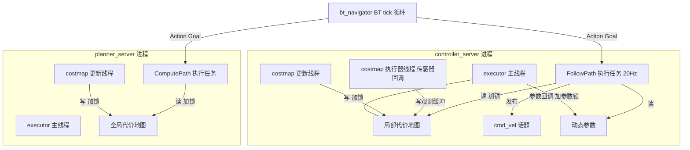
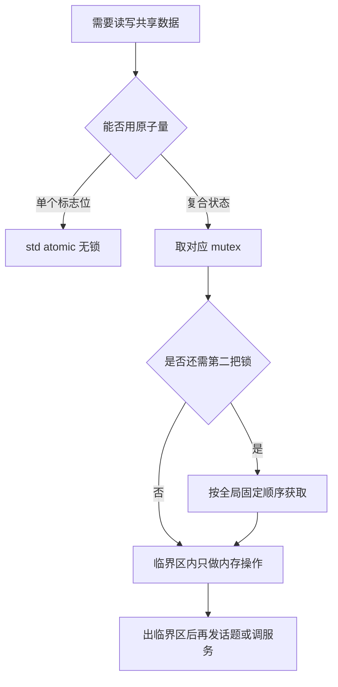

# 第 20 章 线程模型：谁在什么线程上跑，共享了什么数据

> **一句话总结**：Nav2 的并发结构可以概括为"每个服务器一个 executor 主线程，外加各自的专用工作线程"——代价地图（Costmap）的更新循环线程、SimpleActionServer 的异步执行任务、BT tick 循环、MPPI 的批量并行计算各司其职；共享数据靠 costmap 互斥锁、参数回调锁与原子标志保护，回调组（MutuallyExclusive/Reentrant）决定回调能否并发，理解这张线程地图是排查实时性抖动与死锁的前提。

> **前置知识**：第 06 章 · 第 19 章 ｜ **知识依赖图**：[KnowledgeGraph/Knowledge](KnowledgeGraph/Knowledge.md)

## 20.1 为什么必须理解线程模型

导航栈同时背负两类相互冲突的诉求：**实时性**——控制器必须以 20 Hz 稳定输出速度，任何一个周期超时都表现为机器人顿挫；**数据一致性**——控制器读代价地图的同时，更新线程正在往里写传感器数据，读到"半张图"会产生幽灵障碍或漏检。单线程能保证一致性但保不住实时性，多线程反过来。Nav2 的答案是**按数据流切分线程 + 细粒度锁**：慢速任务（地图更新、规划）与快速任务（控制循环）分属不同线程，交界处用明确的互斥锁保护。排查"控制频率抖动""偶发死锁""CPU 占用异常"这类问题时，第一步永远是回答两个问题：**这段代码在哪个线程上跑？它碰了哪些共享数据？**

## 20.2 全系统线程盘点

以典型单机器人配置（bt_navigator、planner_server、controller_server、behavior_server、amcl、map_server、lifecycle_manager 各自独立进程）为基准：

| 进程 | 线程 | 职责 | 来源 |
|---|---|---|---|
| 每个服务器 | executor 主线程 | 驱动订阅、服务、参数、生命周期回调 | main 函数中的 spin |
| planner_server | 全局 costmap 执行器线程 | 驱动 Costmap2DROS 子节点的回调 | nav2::NodeThread |
| planner_server | 全局 costmap 更新线程 | mapUpdateLoop 定频融合各层并发布 | std::thread |
| planner_server | Action 执行任务 | 运行规划回调 computePlan | SimpleActionServer 的 std::async |
| controller_server | 局部 costmap 执行器线程 + 更新线程 | 同上，作用于局部代价地图 | 同上 |
| controller_server | Action 执行任务 | FollowPath 控制循环，20 Hz 定频 | SimpleActionServer 的 std::async |
| bt_navigator | Action 执行任务 | BT tick 循环，每 bt_loop_duration 一拍 | SimpleActionServer 的 std::async |
| behavior_server | Action 执行任务 | Spin/BackUp 等行为的定频循环 | 同上 |
| amcl | 无额外工作线程 | 激光、初始位姿回调全在 executor 内 | 纯回调驱动 |
| controller_server | OpenMP 工作线程池 | MPPI 批量轨迹采样与评分的并行化 | 使用 MPPI 时按需 |

几个值得展开的细节：

**Costmap2DROS 是"节点中的节点"**（nav2_costmap_2d/include/nav2_costmap_2d/costmap_2d_ros.hpp）。它作为宿主服务器的子生命周期节点存在，却拥有自己的执行器线程与地图更新线程：更新线程以 update_frequency 定频调用 updateMap()，依次触发各层插件的 updateBounds/updateCosts；执行器线程独立消化传感器订阅回调。这样，激光雨点般的回调不会挤占宿主服务器的 executor，地图更新的耗时也不会阻塞规划请求的接收。

**SimpleActionServer 没有常驻工作线程**。每个 goal 到达时经 std::async 临时起一个异步任务，goal 结束任务即回收（见第 19 章）。因此"控制循环线程"的生命周期与 FollowPath goal 严格重合——没有导航任务时 controller_server 几乎不耗 CPU。

**BT tick 循环运行在 bt_navigator 的 Action 执行任务里**（nav2_behavior_tree/include/nav2_behavior_tree/bt_action_server_impl.hpp）。它以 bt_loop_duration（典型 10~20 ms）为节拍循环 tick 整棵行为树（BT），每拍还会 flush 一次 ROS 回调队列；树上的 BT 节点内部再作为 Action 客户端与各服务器通信——所以行为树本身是单线程的，并发发生在它调用的远端服务器里（树的执行机制详见第 11 章）。

**MPPI 不显式建线程**，而是用 OpenMP 把数千条采样轨迹的评分并行摊到线程池上，属于"计算内并行"而非"结构性线程"，对锁的影响限于评分期间只读 costmap。

### 线程与共享数据关系图

## 20.3 回调组与 Composition 的影响

回调组是 ROS 2 控制回调并发度的开关：**MutuallyExclusive** 组内回调串行执行，天然免锁；**Reentrant** 组内回调可并发，吞吐高但共享数据必须自己加锁。Nav2 的使用规律很保守：

- SimpleActionServer 在 spin_thread 模式下为自己创建 MutuallyExclusive 组绑定专属单线程执行器，保证 goal 相关回调不并发；
- Costmap2DROS 的订阅与服务同样默认走 MutuallyExclusive 组；
- Reentrant 只在确有吞吐需求且共享数据已有锁保护时使用，例如多路独立传感器流。

这个保守偏好值得学习：**先用回调组消灭并发，再对无法消灭的并发加锁**，比处处 Reentrant 然后到处补锁可维护得多。

Composition（组件化部署）会改变整张线程地图：通过 component container 把多个服务器装进单进程后，进程间通信变为进程内指针传递（省去序列化），但所有节点的回调组改由容器的一个 MultiThreadedExecutor 统一调度。收益是延迟与内存开销显著下降；风险是**故障域合并**——任何一个节点在回调里长时间阻塞，都会占用容器执行器的线程配额，拖慢其他节点的回调；一个节点崩溃则整个容器全军覆没。生产部署选择 composition 前，应确认各节点回调都遵守"快进快出"纪律。

## 20.4 共享数据与锁

Nav2 中值得点名的锁有三类：

**costmap 主锁**。Costmap2D 内部持有可递归互斥锁，更新线程写图、规划与控制线程读图都必须先取锁。规划器插件的标准姿势是在 createPlan 入口用 lock_guard 风格的守卫锁住整张图再搜索——宁可让地图更新等一拍，也不能读到写了一半的栅格。

**参数回调锁**。动态参数回调（见第 21 章）在 executor 线程触发，而参数的消费者在工作线程；两侧用同一把 mutex 保护，典型实现如 nav2_planner/src/parameter_handler.cpp：验证与应用参数时持锁，工作线程读参数快照时持锁。

**bond 心跳**。每个生命周期节点（Lifecycle Node）与 lifecycle_manager 之间维持 bond 连接（生命周期机制详见第 05 章）。它不是锁，但依赖 executor 线程按时处理心跳——executor 被重活阻塞时，心跳超时会让 lifecycle_manager 误判节点死亡并触发系统级降级，这是"阻塞 executor"最戏剧化的后果。

**原子标志**用于最简单的跨线程信号：Costmap2DROS 的 initialized_、stopped_、stop_updates_ 均为 std::atomic，单变量读写不必上锁。

**加锁顺序纪律**：跨多把锁时必须保持全局一致的获取顺序（例如永远先 costmap 锁后参数锁），且**持锁期间绝不调用可能再次进入回调系统的函数**——持有 costmap 锁去发话题、调服务，等于把锁的作用域延伸进不可控的中间件代码，是死锁的经典温床。

## 20.5 常见坑

- **在回调里做重活**：executor 线程被一个耗时回调占住，同组的所有回调排队，bond 心跳、参数服务一并停摆。重活应放进 Action 执行任务或专用线程。
- **持 costmap 锁调用外部接口**：锁内发布话题、等待服务响应，与另一个"持中间件资源等 costmap 锁"的线程互相守望即死锁。
- **控制频率抖动**：FollowPath 循环里若混入偶发慢操作（TF 超时等待、锁竞争、日志洪水），表现为 cmd_vel 周期性缺拍。定位手段是给控制循环打点统计各段耗时，重点怀疑锁等待。
- **Reentrant 组配了、锁没加**：回调并发后共享容器未加保护，产生难以复现的偶发崩溃；改回 MutuallyExclusive 往往是最快的止血方案。
- **composition 后互相拖累**：单进程部署后某节点回调阻塞导致"无关"节点超时，排查时容易南辕北辙——先看容器执行器的线程是否被占满。

## 20.A 源码导航与入手路径

入口链（以代价地图更新线程为样本）：Costmap2DROS::on_activate()（costmap_2d_ros.cpp 约 262 行处）→ 创建 std::thread 跑 mapUpdateLoop() → 每周期调 updateMap() 融合各层并发布；另一条线是 SimpleActionServer::handle_accepted() → std::async 启动每 goal 一个的执行任务。

| 文件（仓库相对路径，约 N 行） | 关键函数 | 作用 |
|---|---|---|
| nav2_costmap_2d/src/costmap_2d_ros.cpp（约 950 行） | mapUpdateLoop() / updateMap() / on_activate() | 更新线程的创建与定频循环 |
| nav2_costmap_2d/include/nav2_costmap_2d/costmap_2d_ros.hpp（约 470 行） | initialized_ / stopped_ / stop_updates_ 等 atomic 成员 | 线程、执行器与原子标志声明 |
| nav2_ros_common/include/nav2_ros_common/simple_action_server.hpp（约 680 行） | handle_accepted() / work() | 每 goal 一个异步执行任务 + 回调组创建 |
| nav2_ros_common/include/nav2_ros_common/node_thread.hpp（约 90 行） | NodeThread 构造/析构 | 执行器线程的 RAII 封装 |
| nav2_behavior_tree/include/nav2_behavior_tree/bt_action_server_impl.hpp（约 550 行） | executeCallback() | BT tick 循环的宿主 |

| 第一遍只看 | 第二遍补充 | 以后再看 |
|---|---|---|
| costmap_2d_ros.cpp 的 mapUpdateLoop() 与锁的获取点 | simple_action_server.hpp 与 node_thread.hpp | bt_action_server_impl.hpp 的 tick 循环与 MPPI 并行细节 |

完整业务链路见 [Costmap 更新循环时序图](Assets/sequence/Costmap更新循环.md)。

## 20.B 设计权衡

### 单进程多执行器 vs 多进程：故障域与延迟的对价

Nav2 默认每个服务器独立进程：崩溃隔离彻底（planner 段错不杀 controller）、可单独重启、CPU 亲和可分别调度；代价是跨进程通信的序列化与拷贝开销，对大尺寸代价地图尤其明显。Composition 把多节点装进单进程换成指针传递，但故障域合并：一个节点阻塞拖慢全容器、一个崩溃全容器陆沉，而 bond 机制的"一个倒下全体放倒 + 整体重启"意味着两种部署的系统级后果最终趋同，选型真正的分歧点在延迟预算与运维粒度。

### 回调组隔离：先消灭并发，再对残余并发加锁

Nav2 几乎处处默认 MutuallyExclusive 回调组，用"组内串行"把大部分共享状态从并发集合里直接剔除，只对无法串行的交界（costmap 读写、参数更新）加锁。反向方案——处处 Reentrant 再靠锁自律——吞吐上限更高，但每一处共享成员都成为潜在竞态点，心智负担随代码规模线性增长。Nav2 的保守选择牺牲了少量并行度，换来"默认安全、显式开启危险"的维护性——与第 22 章"先用结构消灭复杂度再处理残余"的哲学一脉相承。

### 每 goal 临时 std::async vs 常驻工作线程

SimpleActionServer 不养常驻线程，goal 到达才起异步任务、结束即回收：空闲时零线程开销，生命周期与任务严格重合，不存在"残留状态污染下一个 goal"的风险。代价是每个 goal 承担一次线程创建成本，且需要 setSoftRealTimePriority() 这类补丁才能拿回调度优先级；对导航这种"goal 粒度秒级以上"的负载，创建成本可忽略；若 goal 频率达百赫兹级，这个设计就需要重评。

## 知识总结

1. Nav2 的线程结构是"每服务器一个 executor + 专用工作线程"：costmap 有独立的执行器线程与更新循环线程，Action 执行回调跑在 std::async 临时任务里，BT tick 循环单线程运行于 bt_navigator 的执行任务中。
2. 回调组是第一道并发控制：Nav2 默认 MutuallyExclusive 串行化回调，Reentrant 仅在有锁保护且确需吞吐时使用。
3. 共享数据三件套：costmap 互斥锁保护栅格读写，参数锁衔接 executor 线程与工作线程，原子标志承担轻量信号。
4. 死锁规避两条铁律：多锁保持全局一致顺序；持锁期间不调用发布、服务等可能重入中间件的接口。
5. Composition 用共享内存换故障域合并：延迟更低，但任一节点阻塞或崩溃影响整个容器。

## 常见面试题

1. **Costmap2DROS 有哪几个线程？为什么这样设计？**
   要点：宿主 executor 之外还有专属执行器线程（消化传感器订阅）与地图更新线程（定频 updateMap 并发布）；目的是让高频传感器回调与耗时的分层融合都不阻塞宿主服务器的请求处理。
2. **控制器读 costmap 时如何保证不读到半张图？**
   要点：Costmap2D 内置互斥锁，更新线程写图与控制/规划线程读图都先取锁；规划器在搜索全程持锁换取一致性快照。
3. **MutuallyExclusive 与 Reentrant 回调组的区别及 Nav2 的选择？**
   要点：前者组内回调串行免锁，后者可并发但需自行保护共享数据；Nav2 默认前者，SimpleActionServer 与 Costmap2DROS 均为其典型使用者。
4. **为什么"在回调里 sleep 或做重计算"在 Nav2 中危害特别大？**
   要点：除了同组回调排队，还会耽误 bond 心跳，lifecycle_manager 会据此判定节点失联并触发降级/重启，一个慢回调放大成系统事件。
5. **Composition 部署对线程模型有什么影响？**
   要点：多节点共享容器的 MultiThreadedExecutor，进程内零拷贝通信；但回调阻塞会跨节点传染，崩溃波及全容器，需要更严格的回调纪律。

## 最佳实践与容易踩坑

- **给每类工作找对宿主**：订阅处理留在 executor，长任务进 Action 执行回调，定频重活开专用线程——不要在错误的宿主里干活。
- **锁的临界区只做内存操作**：把发布话题、写日志、调服务全部挪到锁外，临界区越短越好。
- **控制循环做耗时预算**：为 TF 查询设短超时，统计每个周期各段耗时，抖动问题九成能靠打点定位。
- **改回调组前先想清数据归属**：换成 Reentrant 之前列出该组回调触碰的全部共享成员并确认锁覆盖。
- **压测时盯住 CPU 亲和与优先级**：软实时优先级（SimpleActionServer 可选开启）在负载机上能显著压低控制抖动，但需要系统权限配合。

## 延伸阅读

- nav2_costmap_2d/include/nav2_costmap_2d/costmap_2d_ros.hpp —— 更新线程、执行器线程与原子标志的定义
- nav2_ros_common/include/nav2_ros_common/simple_action_server.hpp —— 异步执行任务与回调组创建
- nav2_ros_common/include/nav2_ros_common/node_thread.hpp —— 执行器线程的 RAII 封装
- nav2_behavior_tree/include/nav2_behavior_tree/bt_action_server_impl.hpp —— BT tick 循环的宿主
- ROS 2 官方文档 *Executors* 与 *Callback groups* 章节

## 20.C 阅读检查点

1. controller_server 进程里最多可能同时存在哪几类线程？各自由谁创建？（20.2）
2. Costmap2DROS 为什么需要自己的执行器线程和更新线程，而不是借用宿主服务器的 executor？（20.2）
3. "持 costmap 锁发布话题"为什么是死锁温床？正确的临界区纪律是什么？（20.4、20.5）
4. executor 被耗时回调占住时，bond 心跳会发生什么？为什么一个慢回调会放大成系统级事件？（20.4）
5. Composition 部署后线程地图发生了什么变化？选择它之前应确认什么纪律？（20.3、20.B）

> 下一章：21_配置系统
