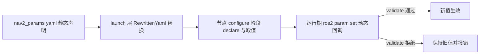
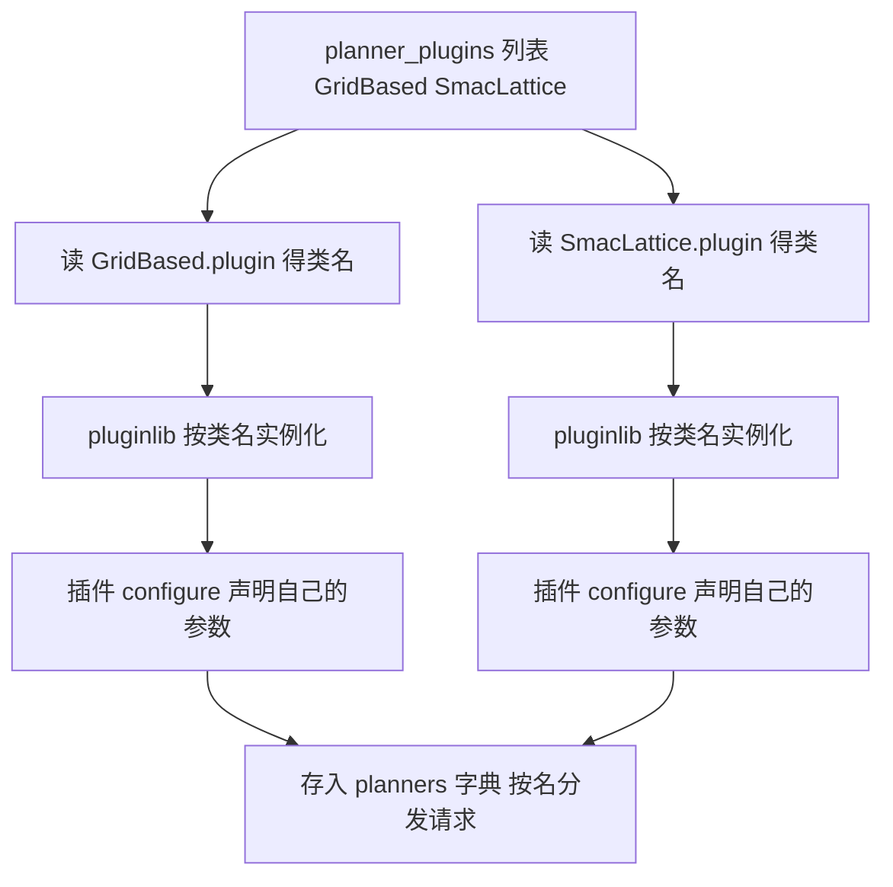

# 第 21 章 配置系统：从一份 yaml 到一台能跑的机器人

> **一句话总结**：Nav2 的配置是四层流水线——nav2_params.yaml 按节点组织参数、launch 层用 RewrittenYaml 做运行时替换、节点在 configure 阶段经 declare_parameter_if_not_declared / declare_or_get_parameter 声明取值、运行期由 add_on_set_parameters_callback 承接热更新；插件列表参数（planner_plugins、controller_plugins 等）是驱动 pluginlib 加载的总开关，行为树 XML 则是"另一种形态的配置"，共同决定一套二进制能长成什么样的导航系统。

> **前置知识**：第 05 章 · 第 07 章 ｜ **知识依赖图**：[KnowledgeGraph/Knowledge](KnowledgeGraph/Knowledge.md)

## 21.1 参数体系的四层分层

Nav2 全栈没有一处硬编码的算法选择：跑 NavFn 还是 Smac、DWB 还是 MPPI、几层代价地图（Costmap）叠什么插件（Plugin），全部由参数决定。这份灵活性来自一条清晰的流水线：

### 第一层：yaml 文件的组织

nav2_bringup/params/nav2_params.yaml 是全栈的单一事实来源，按**节点名分组**，每组以 `ros__parameters` 为根：bt_navigator、amcl、controller_server、planner_server、local_costmap、global_costmap……各占一段。插件的参数以插件配置名为前缀嵌套（如 `FollowPath.max_vel_x`），形成"节点 → 插件 → 参数"的三级命名空间。一份文件描述整个系统，这既是便利也是纪律：读懂一台机器人的行为，从读它的 nav2_params.yaml 开始。

### 第二层：launch 与 RewrittenYaml

同一份 yaml 要服务仿真与实机、单机与多机，靠 launch 层的运行时改写。nav2_common 提供的 RewrittenYaml 替换器在启动瞬间把 yaml 中的占位参数（use_sim_time、地图路径、命名空间等）替换为 LaunchConfiguration 的实际值，再把改写后的临时文件喂给节点。多机器人场景下它还负责给所有节点、话题按 namespace 重写——这是"一份参数模板部署整个车队"的关键机制。

### 第三层：节点内声明与取值

ROS 2 要求参数先声明后使用，Nav2 在 nav2_ros_common/include/nav2_ros_common/node_utils.hpp 中沉淀了两个工具：

- `declare_parameter_if_not_declared`：先查再声明，避免宿主与插件对同名参数重复声明时抛异常——插件的 configure 可能被 cleanup/configure 循环多次调用，幂等声明是刚需；
- `declare_or_get_parameter`：声明与取值合一，还支持"yaml 未覆盖时告警"与严格加载模式，把"参数拼错名导致静默用默认值"这类事故暴露在启动日志里。

插件参数的声明统一发生在其 configure() 阶段，前缀为插件配置名（`name_ + ".xxx"`），与 yaml 的三级命名空间严格对应（插件生命周期与宿主同步的机制见第 05 章）。

### 第四层：动态参数回调

运行期 `ros2 param set` 触发两阶段回调：

1. **验证阶段**（add_on_set_parameters_callback 注册）：检查取值合法性，返回 SetParametersResult；返回失败则整批参数被拒绝，旧值保持；
2. **应用阶段**（add_post_set_parameters_callback 注册）：验证通过后在锁保护下把新值写入成员变量（锁的必要性见第 20 章）。

典型样本是 nav2_velocity_smoother/src/velocity_smoother.cpp 与 nav2_planner/src/parameter_handler.cpp：先 validate 后 update、更新全程持参数锁，几乎所有支持热更新的服务器（Server）都是同一套八股。

## 21.2 哪些参数能热更新，哪些不能

判断一个参数可否热更新，看它改变后**需要重建什么**：

| 类别 | 判断特征 | 例子 | 可否热更新 |
|---|---|---|---|
| 纯数值调节 | 下个周期直接用新值 | 控制器速度上限、评分权重、BT 超时 | 可 |
| 需重算派生数据 | 改后需重新计算缓存 | 足迹（重算膨胀）、膨胀半径 | 多数可，回调里触发重算 |
| 需重建大对象 | 改后必须重新分配内存或重连 | 地图分辨率、地图尺寸、话题名 | 不可，需重启节点 |
| 结构性配置 | 决定加载哪些代码 | 插件列表、坐标系名 | 不可，需完整生命周期重启 |

实践判断方法有二：一看该节点的动态参数回调源码里是否处理了这个参数名——没处理的参数即使 set 成功也不会生效，这是最迷惑人的一类"假热更新"；二看参数描述符是否标记为只读。

### 插件列表参数：配置驱动的插件加载

`planner_plugins`、`controller_plugins`、`smoother_plugins`、costmap 的 `plugins`/`filters`、bt_navigator 的 `plugin_lib_names`——这些字符串数组参数是全栈最有权力的配置。以 planner_server 为例，configure 阶段遍历 `planner_plugins` 列表，对每个名字读取其 `<名字>.plugin` 参数得到类名，交给 pluginlib 的 ClassLoader 实例化，再以配置名为键存入字典（分发机制见第 07 章）：

**配置名与类名解耦**是这套机制的精髓：yaml 里的 `GridBased` 只是键，把 `GridBased.plugin` 从 NavFn 换成 Smac，上层行为树（BT）与 Action 调用方一行不改。

## 21.3 行为树 XML 也是配置

把视野再拉高一层：nav2_params.yaml 决定"每个服务器怎么干活"，而 bt_navigator 加载的行为树 XML 决定"整个任务怎么编排"——失败后先清图还是先重规划、重试几次、何时放弃，全部写在 XML 里而非 C++ 里。XML 路径本身又是参数（`default_nav_to_pose_bt_xml`），XML 中可用的节点集合由 `plugin_lib_names` 参数决定——**行为树是配置的配置**，三者环环相扣（树的语法与执行详见第 11 章）。做系统定制时应遵循"能改 yaml 不改 XML，能改 XML 不改代码"的成本阶梯。

## 21.4 常见坑

- **命名空间与节点名不匹配**：yaml 顶层键必须与实际节点名（含 namespace 重映射后的名字）一致，对不上时整段参数被静默忽略，节点全用默认值——多机器人加 namespace 后最高发。
- **参数名拼错静默用默认值**：`max_vel_x` 写成 `max_val_x`，ROS 2 不报错。防线有三：用 `declare_or_get_parameter` 的告警模式、启动后 `ros2 param dump` 与 yaml 对账、代码评审盯参数名字符串。
- **use_sim_time 不一致**：仿真里部分节点没设 use_sim_time，TF 时间戳混用墙钟与仿真钟，表现为 TF 超时和"数据太旧"——它必须在**每个节点**的参数段出现，RewrittenYaml 全局替换正是为此。
- **假热更新**：`ros2 param set` 返回成功但行为没变，因为该节点的动态回调没处理这个参数；确认手段是读该服务器的参数回调实现。
- **插件参数前缀写错**：把 `FollowPath.max_vel_x` 顶格写成节点级参数，插件 configure 时查不到即用默认值，症状与拼错名完全一致。

## 21.A 源码导航与入手路径

入口链：launch 读入 nav2_params.yaml → RewrittenYaml（rewritten_yaml.py）在启动瞬间改写占位值 → 各节点 on_configure() 中经 declare_or_get_parameter() 声明取值 → 运行期 `ros2 param set` 触发 validateParameterUpdatesCallback() / updateParametersCallback() 两阶段回调。

| 文件（仓库相对路径，约 N 行） | 关键函数 | 作用 |
|---|---|---|
| nav2_ros_common/include/nav2_ros_common/node_utils.hpp（约 460 行） | declare_parameter_if_not_declared() / declare_or_get_parameter() | 幂等声明与严格加载模式 |
| nav2_common/nav2_common/launch/rewritten_yaml.py（约 290 行） | RewrittenYaml 类 | launch 期的 yaml 运行时改写 |
| nav2_bringup/params/nav2_params.yaml（约 600 行） | —（按节点分组配置） | 全栈参数单一事实来源 |
| nav2_planner/src/parameter_handler.cpp（约 130 行） | validateParameterUpdatesCallback() / updateParametersCallback() | 两阶段动态回调最短样板 |
| nav2_velocity_smoother/src/velocity_smoother.cpp（约 640 行） | validateParameterUpdatesCallback() / updateParametersCallback() | 热更新 + 参数锁的完整实例 |

| 第一遍只看 | 第二遍补充 | 以后再看 |
|---|---|---|
| node_utils.hpp 两个声明工具 + parameter_handler.cpp | rewritten_yaml.py 与 nav2_params.yaml 逐段对照 | 各服务器动态回调的参数覆盖面差异 |

完整业务链路见 [NavigateToPose 全景时序图](Assets/sequence/NavigateToPose.md)（配置决定图中每个服务器装载哪些插件）。

## 21.B 设计权衡

### 分布式参数 vs 集中配置中心

ROS 2 的参数属于各节点：每个服务器自己声明、自己验证、自己热更新，没有中心化配置服务。好处是节点自治——插件参数随插件加载而声明，新增插件零中心改动，且单节点重启只重读自己的参数段；代价是全局一致性无人背书：use_sim_time 必须每节点各配一遍、配错只在现象层暴露。Nav2 用"单一 yaml 文件 + RewrittenYaml 统一改写"在文件层找回集中式的可审计性，等于在工具链而非运行时里搭了一个"伪配置中心"，避开了中心服务的单点与额外依赖。

### 两阶段回调（validate + update） vs 单回调直接写

把"能不能改"与"怎么生效"拆成两个回调，意味着验证失败时整批参数原子回退、旧值不受任何污染；单回调里边验边写则可能在第三个参数验证失败时留下前两个已生效的"半更新"状态。代价是每个支持热更新的服务器都要写两段八股且两处都要枚举参数名——漏写即"假热更新"。Nav2 接受这份重复，换取参数一致性在并发环境（executor 线程写、工作线程读，见第 20 章）下的确定性。

### RewrittenYaml 文本改写 vs 原生 launch 参数拼装

用 launch 原生机制逐节点拼参数字典也能实现替换，但多机器人场景下要对几十个节点逐个重写命名空间与话题，样板爆炸。RewrittenYaml 把改写下沉到文件层：一次替换生成临时 yaml，所有节点共享。代价是调试时看到的是临时文件而非源文件，参数溯源多一跳；且文本级替换对 yaml 结构无感知，顶层键写错这类错误它无力拦截——这正是"启动后 ros2 param dump 对账"成为必做动作的原因。

## 知识总结

1. Nav2 配置是四层流水线：yaml 静态声明 → launch 层 RewrittenYaml 运行时替换 → configure 阶段幂等声明取值 → 运行期两阶段动态回调（validate + update）。
2. node_utils.hpp 的 `declare_parameter_if_not_declared` 与 `declare_or_get_parameter` 解决重复声明与"拼错名静默默认值"两大痛点。
3. 热更新能力取决于参数改变后需要重建什么：纯数值可热更，需重建大对象或结构性配置必须重启；且只有节点回调显式处理的参数才真正热生效。
4. 插件列表参数是配置驱动架构的总开关：配置名作键、`<名字>.plugin` 给类名，pluginlib 据此实例化，配置名与类名解耦使算法替换零侵入。
5. 行为树 XML 是更高层的配置：yaml 配服务器、XML 配任务编排，定制遵循"yaml → XML → 代码"的成本阶梯。

## 常见面试题

1. **一份 nav2_params.yaml 从磁盘到生效经历了哪些环节？**
   要点：launch 读入并经 RewrittenYaml 替换占位值生成临时文件 → 作为参数覆盖传给各节点 → 节点 configure 阶段 declare 并读取 → 运行期可经动态回调更新部分参数。
2. **declare_parameter_if_not_declared 存在的意义是什么？**
   要点：ROS 2 重复声明参数会抛异常；插件可能经历多轮 cleanup/configure，宿主与插件也可能声明同名参数，先查再声明保证幂等。
3. **如何判断某个参数支持热更新？**
   要点：看该节点动态参数回调是否处理了该参数名；看参数是否涉及重建大对象（分辨率、话题、插件列表都不行）；实测 set 后观察行为，警惕"set 成功但未生效"的假热更新。
4. **planner_plugins 这类列表参数如何驱动插件加载？**
   要点：configure 时遍历列表，读每项的 `.plugin` 子参数得到类名，pluginlib ClassLoader 实例化后按配置名存入字典；Action Goal 里的 planner_id 按配置名分发，实现请求级算法切换。
5. **多机器人部署时参数层面要注意什么？**
   要点：yaml 顶层键需与 namespace 重映射后的节点名一致（RewrittenYaml 可自动处理）；use_sim_time 必须全体节点统一；话题重映射与 frame 前缀需同步调整。

## 最佳实践与容易踩坑

- **启动后立即对账**：`ros2 param dump <节点>` 与 yaml 逐段比对一次，能拦截九成的命名空间与拼写事故。
- **利用严格加载模式**：开启 `declare_or_get_parameter` 的告警/严格选项，让"yaml 没覆盖到"在启动期暴露而非运行期。
- **调参走热更新，定型写回 yaml**：现场用 `ros2 param set` 快速迭代，确认后回填 yaml——动态设置的值不会持久化，重启即失。
- **改插件列表必须走完整重启**：插件列表与坐标系类参数没有热更新路径，通过 lifecycle_manager 走 deactivate/cleanup/configure/activate 全流程。
- **把行为树 XML 纳入配置管理**：XML 与 yaml 同仓版本化、成对评审，避免"参数升级了、树还是旧的"这类漂移。

## 延伸阅读

- nav2_ros_common/include/nav2_ros_common/node_utils.hpp —— 参数声明工具的实现
- nav2_bringup/params/nav2_params.yaml —— 全栈参数组织的权威样本
- nav2_common/nav2_common/launch/ —— RewrittenYaml 与相关 launch 替换工具
- nav2_velocity_smoother/src/velocity_smoother.cpp、nav2_planner/src/parameter_handler.cpp —— 两阶段动态参数回调的标准实现
- ROS 2 官方文档 *Understanding parameters* 与 *Parameter API design*

## 21.C 阅读检查点

1. 一份 nav2_params.yaml 从磁盘到参数生效经过哪四层？每层各解决什么问题？（21.1）
2. declare_parameter_if_not_declared 为什么必须幂等？哪种生命周期场景会触发重复声明？（21.1）
3. 判断一个参数能否热更新的两个实践方法是什么？"假热更新"的根因在哪？（21.2）
4. planner_plugins 列表从 yaml 到 planners 字典经过哪几步？配置名与类名解耦带来什么好处？（21.2）
5. 多机器人部署时，yaml 顶层键、use_sim_time、命名空间三者各有什么坑？RewrittenYaml 在其中承担什么角色？（21.1、21.4）

> 下一章：22_设计模式专题
