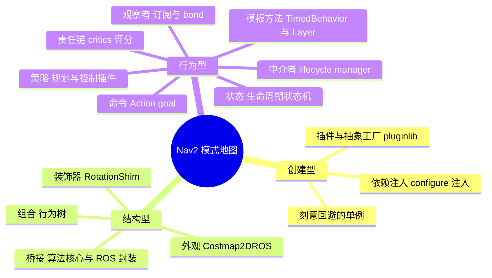
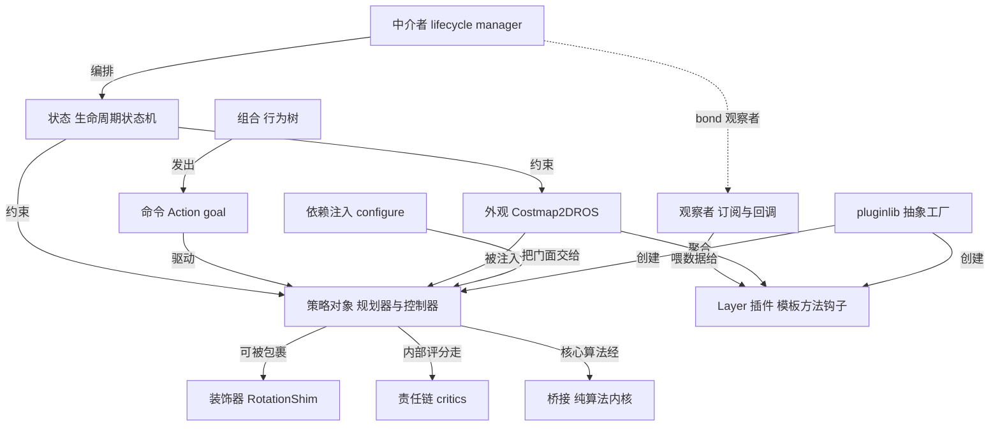

# 第 22 章 设计模式专题：Nav2 是一座活的模式博物馆

> **一句话总结**：Nav2 几乎把 GoF 经典模式与现代依赖注入实践用了个遍——pluginlib 实现插件化抽象工厂、各类算法插件是策略、TimedBehavior 与 Layer 是模板方法、Costmap2DROS 是外观、行为树（BT）是组合与命令、RotationShim 是装饰器、生命周期节点（Lifecycle Node）与 docking 是状态机、lifecycle_manager 是中介者、critics 评分是责任链——而它刻意回避的单例，恰恰是理解其架构哲学最好的反面教材。

## 22.1 为什么在导航框架里谈设计模式

一个自主导航系统天然面对三类张力：算法要可替换（不同底盘、不同场景）、组件要可编排（启动顺序、故障恢复）、行为要可组合（导航逻辑因业务而异）。Nav2 的维护者没有发明新范式，而是把这三类张力分别交给了插件（Plugin）体系、生命周期编排和行为树，背后正是一组彼此咬合的经典模式。读懂这张模式地图，比记住任何一个类名都更有迁移价值。



以下每个模式统一按"定义→源码位置→为什么用→优点→代价→替代方案"展开。模式所处的业务背景不再重复，规划见第 07/08 章、控制见第 09~11 章、代价地图（Costmap）见第 05/06 章、行为树见第 04 章。

## 22.2 插件 + 抽象工厂：pluginlib 与 nav2_core

**定义**：用统一接口族 + 运行时类加载器，按配置字符串生产可互换的实现实例。

| 角色 | 位置 |
|---|---|
| 抽象产品 | nav2_core/include/nav2_core/global_planner.hpp、controller.hpp、behavior.hpp 等 |
| 工厂 | nav2_planner/src/planner_server.cpp 中 `pluginlib::ClassLoader<nav2_core::GlobalPlanner>` |
| 产品注册表 | 各插件包的 XML，如 nav2_navfn_planner/global_planner_plugin.xml |

- **为什么用**：不改一行核心代码即可换算法，`planner_id`/`plugin` 参数决定运行时装配，是整个 Nav2 生态开放性的根基。
- **优点**：开闭原则的教科书实现；服务器（Server）与算法完全解耦；第三方包可独立发布。
- **代价**：动态加载有查表与 dlopen 开销；插件是否存在要到运行期才知道，拼错类名只能在启动时报错。
- **替代方案**：条件编译静态链接（失去部署期灵活性）、注册宏 + 静态工厂表（仍需重编译核心包）。

## 22.3 策略模式：一个接口，多个可切换算法

**定义**：把算法封装为可互换对象，调用方只依赖抽象接口。

| 策略族 | 位置 |
|---|---|
| 规划器策略字典 | nav2_planner/src/planner_server.cpp 的 `planners_` map 与 `current_planner_` |
| 控制器策略字典 | nav2_controller/src/controller_server.cpp 的 `controllers_`、`goal_checkers_`、`progress_checkers_` |

策略与上一节的插件是同一枚硬币的两面：pluginlib 负责"造出"策略对象，Server 内的 map 负责"按名选用"。ControllerServer 甚至允许同一次 FollowPath 抢占时按新 goal 的 `controller_id` 热切换策略。

- **优点**：消灭 if-else 算法分支；多策略可并存并按请求选择。
- **代价**：每个策略都要完整实现生命周期接口，简单算法也有样板代码负担。
- **替代方案**：模板参数静态策略（SmacPlanner 内核即如此，见第 08 章），代价是失去运行时切换能力。

## 22.4 模板方法：骨架在基类，细节在子类

**定义**：基类固定算法流程与调用顺序，把可变步骤留为纯虚/可覆写钩子。

| 骨架 | 钩子 | 位置 |
|---|---|---|
| `TimedBehavior<ActionT>::execute()` 控制循环、超时、结果上报 | `onRun()` / `onCycleUpdate()` / `onActionCompletion()` | nav2_behaviors/include/nav2_behaviors/timed_behavior.hpp |
| `BtActionNode<ActionT>::tick()` 发送 goal、等待、分派结果 | `on_tick()` / `on_success()` / `on_aborted()` / `on_cancelled()` | nav2_behavior_tree/include/nav2_behavior_tree/bt_action_node.hpp |
| `Layer::initialize()` 固定父指针、名字、节点绑定顺序 | `onInitialize()` / `updateCosts()` / `onFootprintChanged()` | nav2_costmap_2d/include/nav2_costmap_2d/layer.hpp |

- **为什么用**：Spin、BackUp、Wait 等行为的差异只在"每周期做什么"，而循环节奏、抢占检查、反馈发布完全相同；模板方法把这些共性一次写对，子类无法遗漏也无法写错顺序。
- **优点**：极大压缩重复代码；框架升级（如抢占语义变更）只改基类。
- **代价**：控制流倒置，新人读子类看不到完整流程，必须回到基类；钩子粒度一旦定错，子类会被迫绕过骨架。
- **替代方案**：组合回调对象（更灵活但装配繁琐）、CRTP 静态多态（省虚调用但牺牲可读性）。

## 22.5 外观模式：把子系统折叠成一个门面

**定义**：为一组复杂协作对象提供单一简化入口。

| 外观 | 折叠了什么 | 位置 |
|---|---|---|
| Costmap2DROS | LayeredCostmap、Layer 插件栈、地图更新线程、发布器、足迹订阅、清图服务 | nav2_costmap_2d/include/nav2_costmap_2d/costmap_2d_ros.hpp |
| BehaviorTreeEngine | XML 解析、节点插件注册、tick 循环、halt 传播 | nav2_behavior_tree/include/nav2_behavior_tree/behavior_tree_engine.hpp |

规划器插件拿到的只是一个 `Costmap2DROS` 共享指针，`getCostmap()`、`getRobotPose()` 两个调用背后是整个分层地图子系统在运转；BT Navigator 也只需 `loadBehaviorTree()` + `run()` 就驱动整棵树。

- **优点**：客户代码极简；门面内部重构对外透明——Nav2 多次改写地图更新线程模型而插件无感。
- **代价**：门面类容易发胖成"上帝类"，Costmap2DROS 头文件的成员数量就是明证。
- **替代方案**：让客户直接组装子系统（测试代码里偶尔如此），换来灵活性但复制了装配知识。

## 22.6 组合模式：行为树的树形本质

**定义**：容器与叶子实现同一接口，客户对整体与个体一视同仁。

| 角色 | 位置 |
|---|---|
| 统一构件接口 | BehaviorTree.CPP 的 `BT::TreeNode`（外部库） |
| 容器 | Sequence / Fallback / Parallel 等控制节点，含 nav2_behavior_tree/plugins/control/ 下的扩展 |
| 叶子 | nav2_behavior_tree/plugins/action/ 与 condition/ 下的动作、条件节点 |
| 组合描述 | nav2_bt_navigator/behavior_trees/navigate_w_replanning_and_recovery.xml 等 |

- **为什么用**：导航逻辑是天然的树——"重试内包含序列，序列内包含并行"；组合模式让 `tick()` 沿树递归，任意子树可独立复用。
- **优点**：声明式 XML 就能重排逻辑，无需重编译；子树即模块。
- **代价**：深树的执行路径难以静态推断，调试依赖 Groot 可视化与 BehaviorTreeLog。
- **替代方案**：硬编码状态机（早期 move_base 路线，扩展性差）、脚本引擎（引入解释器复杂度）。

## 22.7 装饰器模式：不改原类而叠加职责

**定义**：用同接口对象包裹原对象，在转发前后追加行为。

| 装饰器 | 被装饰者 | 位置 |
|---|---|---|
| RotationShimController | 任意 `nav2_core::Controller`，经 `lp_loader_` 加载为 `primary_controller_` | nav2_rotation_shim_controller/include/nav2_rotation_shim_controller/nav2_rotation_shim_controller.hpp |
| BT 装饰节点 | 任意子节点 | nav2_behavior_tree/plugins/decorator/ 下的 rate_controller、distance_controller、single_trigger 等 |

RotationShim 自身就是 Controller 插件：朝向偏差大时先输出原地旋转指令，对齐后把 `computeVelocityCommands()` 原样转发给被装饰的主控制器——对 ControllerServer 而言两者毫无区别，这正是装饰器"同接口包裹"的精髓。

- **优点**：旋转对齐逻辑写一次，DWB/MPPI/RPP 全都受益；可再叠加速度平滑形成多层装饰链。
- **代价**：链条过长时行为归因困难；每层都有转发开销与参数命名空间嵌套。
- **替代方案**：把对齐逻辑复制进每个控制器（维护灾难）、在 Server 层硬编码前置阶段（污染通用流程）。

## 22.8 观察者模式：ROS 订阅、bond 与层间通知

**定义**：被观察者状态变化时，自动通知所有注册的观察者。

| 场景 | 位置 |
|---|---|
| 传感器数据观察 | 各 Layer 的话题订阅，如 nav2_costmap_2d/plugins/obstacle_layer.cpp |
| 足迹变化观察 | nav2_costmap_2d/src/costmap_2d_ros.cpp 的 `footprint_sub_`，触发各层 `onFootprintChanged()` |
| 节点存活观察 | bond 心跳：lifecycle_manager 监听各服务器的 bond 断连事件 |

ROS 2 的 pub/sub 本身就是分布式观察者，Nav2 的贡献在于把它延伸到进程内：LayeredCostmap 持有 Layer 列表，footprint 更新时逐层回调，层无需知道谁在关心自己。

- **优点**：发布方与订阅方零耦合，观察者可动态增删。
- **代价**：通知时序不可控，回调里做重活会拖垮执行器；调试"谁改了状态"需要追消息流。
- **替代方案**：轮询（浪费 CPU 且有延迟）、显式接口调用（引入编译期依赖）。

## 22.9 命令模式：Action goal 即命令对象

**定义**：把请求封装为携带全部参数的对象，支持排队、取消与结果回执。

| 角色 | 位置 |
|---|---|
| 命令定义 | nav2_msgs/action/ 下 NavigateToPose、FollowPath、Spin 等 20 个 Action |
| 命令发起者 | BT 动作节点，如 nav2_behavior_tree/plugins/action/navigate_to_pose_action.hpp |
| 命令接收者 | 各 Server 中的 `SimpleActionServer<ActionT>`（nav2_ros_common/include/nav2_ros_common/simple_action_server.hpp） |

Goal 是命令、Result 是回执、cancel 是撤销请求、抢占是"新命令替换旧命令"——ROS Action 协议本身就是命令模式的分布式实现，行为树再把这些命令声明式地编排成序列。

- **优点**：命令可跨进程传递、可持久化日志、可抢占；发起者与执行者的生命周期彻底解耦。
- **代价**：一来一回的握手延迟；异步状态机（发送、等待接受、等待结果）比直接函数调用复杂得多。
- **替代方案**：服务调用（无反馈无抢占，不适合长任务）、话题指令（无结果回执）。

## 22.10 状态模式：生命周期与靠泊流程

**定义**：对象行为随内部状态改变，状态迁移受显式规则约束。

| 状态机 | 位置 |
|---|---|
| 生命周期节点状态机 Unconfigured→Inactive→Active | rclcpp_lifecycle 框架 + nav2_ros_common/include/nav2_ros_common/lifecycle_node.hpp |
| 靠泊阶段推进 NAV_TO_STAGING→APPROACH→FINAL_APPROACH | nav2_docking/opennav_docking/src/docking_server.cpp |

生命周期状态机由 ROS 2 框架强制：`on_configure` 里分配资源、`on_activate` 里开始工作，非法跳转（Unconfigured 直达 Active）被框架拒绝。DockingServer 则用阶段枚举 + 顺序推进实现轻量状态机，每阶段经 feedback 上报。

- **优点**：非法状态不可表达；每个状态的职责边界清晰，资源管理与 RAII 自然对齐（见第 23 章）。
- **代价**：状态回调样板多；跨状态共享数据需要小心置空与重建。
- **替代方案**：布尔标志组合（状态爆炸后必然出错）、完整 State 类层次（对 docking 这种线性流程属过度设计——Nav2 选择了枚举推进的务实简化）。

## 22.11 中介者模式：lifecycle_manager 与 NavigatorMuxer

**定义**：用中心协调者管理一组对象的交互，使它们互不直接引用。

| 中介者 | 协调对象 | 位置 |
|---|---|---|
| LifecycleManager | 全部 Nav2 服务器的启动/关闭顺序、bond 健康监控、故障降级 | nav2_lifecycle_manager/src/lifecycle_manager.cpp |
| NavigatorMuxer | 多个 Navigator 插件互斥执行，同一时刻只允许一个导航任务 | nav2_bt_navigator/include/nav2_bt_navigator/bt_navigator.hpp |

PlannerServer 不知道 ControllerServer 的存在，两者都只与 lifecycle_manager 发生管理关系；NavigateToPose 与 NavigateThroughPoses 两个 Navigator 也互不相识，靠 Muxer 仲裁"谁在导航"。

- **优点**：N 个组件的交互从 N² 条连线收敛为 N 条；启动顺序、失败重启策略集中一处。
- **代价**：中介者是单点，其可用性决定系统可用性；逻辑集中也意味着复杂度集中。
- **替代方案**：组件间直接依赖（形成启动顺序死结）、完全无协调（节点各自为政，无法整体降级）。

## 22.12 责任链模式：critics 评分管线

**定义**：请求沿处理器链传递，每个处理器完成自己的一环。

| 链条 | 位置 |
|---|---|
| DWB critics | nav2_dwb_controller/dwb_core/src/dwb_local_planner.cpp 遍历 critic 插件累计轨迹得分 |
| MPPI critics | nav2_mppi_controller/src/critic_manager.cpp 依次调用各 critic 的 `score()` |

严格说这是责任链的"全员处理"变体：每条候选轨迹流经所有 critic，各自累加代价而非任一环节短路（个别 critic 置无效分除外）。链条由 `critics` 参数配置，增删一个评分维度不动任何已有代码。

- **优点**：评分维度即插即用；每个 critic 单一职责、可独立测试与调权。
- **代价**：得分是各环节耦合的总和，调参时"哪个 critic 在捣乱"需要逐项排查；链长直接乘在每条轨迹的评估成本上。
- **替代方案**：单一整体代价函数（不可扩展）、加权和硬编码（每加一项都要改核心代码）。

## 22.13 桥接模式：算法核心与 ROS 封装分离

**定义**：抽象层级与实现层级各自独立演化，中间以组合相连。

| ROS 侧抽象 | 纯算法实现 | 位置 |
|---|---|---|
| AmclNode 生命周期节点 | `pf_t` 粒子滤波 C 库 | nav2_amcl/src/amcl_node.cpp 桥接 nav2_amcl/src/pf/ |
| NavfnPlanner 插件 | NavFn 纯 Dijkstra/A* 内核 | nav2_navfn_planner/src/navfn_planner.cpp 桥接 navfn.cpp |

pf 库与 navfn.cpp 不含一行 ROS 代码，可单独单测、可移植到非 ROS 环境；ROS 侧类只负责参数、话题、TF 与生命周期。这是 Nav2 从 ROS 1 时代继承并坚持的分层纪律。

- **优点**：算法可脱离中间件测试与复用；ROS 接口变更不伤算法。
- **代价**：两层之间需要数据结构转换（消息↔内部表示），有复制成本与胶水代码。
- **替代方案**：算法直接依赖 rclcpp（短期省事，长期把算法锁死在特定中间件版本上）。

## 22.14 依赖注入：configure 签名里的架构观

**定义**：对象不自行获取依赖，由外部在装配期注入。

所有 nav2_core 插件接口的 `configure()` 都是同一个句式（以 GlobalPlanner 为例，nav2_core/include/nav2_core/global_planner.hpp）：

```cpp
virtual void configure(
  const nav2::LifecycleNode::WeakPtr & parent,   // 注入宿主节点
  std::string name,                               // 注入参数命名空间
  std::shared_ptr<tf2_ros::Buffer> tf,            // 注入 TF
  std::shared_ptr<nav2_costmap_2d::Costmap2DROS> costmap_ros);  // 注入代价地图门面
```

- **为什么用**：插件不该知道代价地图从哪来——测试时注入 mock，仿真时注入回环实现，全都不改插件代码。
- **优点**：可测试性的根本保障；依赖关系在签名里一目了然。
- **代价**：装配代码集中在 Server，构造顺序必须由外部保证。

## 22.15 被拒绝的模式：Nav2 为什么没有单例

翻遍代码库找不到一个 `getInstance()`。这是刻意的：单例的全局可达性与 ROS 2 多节点、可组合（composition）架构根本冲突——同一进程可能装载两个 Costmap2DROS（全局/局部各一），"唯一实例"的假设即刻破产；单例还使依赖隐形化，摧毁上一节依赖注入带来的可测试性。Nav2 的替代做法是 `std::make_shared` 创建 + 参数传递 + `WeakPtr` 回引宿主，让每一份依赖都显式、可替换、可 mock。

## 22.16 模式协同的整体图景

单看每个模式都不稀奇，Nav2 的功力在于它们的咬合方式：



一次导航的模式之旅：中介者按状态机把各服务器带到 Active；工厂早已按配置造好策略并经依赖注入拿到外观；组合树发出命令，命令落到 Server 后由模板方法骨架驱动策略执行；策略内部或走责任链评分、或跨桥接调用纯算法内核，期间观察者源源不断把传感器数据经 Layer 写进代价地图。模式不是装饰品，而是这台机器的传动结构。

## 知识总结

1. Nav2 扩展性的三根支柱：**pluginlib 工厂造对象、依赖注入递依赖、策略接口定契约**——三者合力实现"改配置不改代码"。
2. **模板方法**统一了 TimedBehavior、BtActionNode、Layer 三大家族的执行骨架，共性流程只写一次；**外观**（Costmap2DROS、BehaviorTreeEngine）把子系统复杂度挡在门内。
3. 行为树同时是**组合**（树形结构）与**命令**（Action goal）两个模式的载体，装饰节点与 RotationShim 则展示了进程内/插件级两种**装饰器**形态。
4. 系统级秩序来自**状态**（生命周期）+ **中介者**（lifecycle_manager）+ **观察者**（bond 心跳）的组合，而非任何组件间的直接依赖。
5. Nav2 刻意回避**单例**：全局唯一实例与多节点、可组合架构冲突，且摧毁可测试性；显式注入 + WeakPtr 是其替代方案。

## 常见面试题

1. **Nav2 的插件机制对应哪些设计模式？pluginlib 解决了传统抽象工厂的什么问题？**
   要点：抽象工厂 + 策略的组合；pluginlib 把"注册产品"从编译期宏/静态表移到 XML 描述与运行时 dlopen，核心包无需知晓任何具体实现，实现真正的第三方开放；代价是错误延迟到运行期暴露。
2. **RotationShimController 是装饰器还是策略？**
   要点：对 ControllerServer 而言它是一个普通 Controller 策略；对被它包裹的主控制器而言它是装饰器——同接口、持有被装饰者（`primary_controller_`）、条件转发。一个类在两个关系中扮演两种模式角色，是模式辨析的经典案例。
3. **为什么说 ROS Action 是命令模式的分布式实现？**
   要点：Goal 封装完整请求参数（命令对象）、可排队可抢占（命令调度）、cancel 即撤销、Result 即回执；BT 动作节点是 invoker，SimpleActionServer 是 receiver，二者跨进程解耦。
4. **Nav2 为什么不用单例管理全局资源（如 TF、代价地图）？**
   要点：组合部署下同进程有多份"同类"资源（全局/局部代价地图），唯一性假设不成立；单例隐藏依赖导致无法注入 mock；Nav2 用 configure 显式注入 + WeakPtr 回引，依赖可见、可测、可替换。
5. **DWB/MPPI 的 critics 是标准责任链吗？**
   要点：是"全员处理"变体——请求不短路，每个 critic 都参与并累加得分（个别置无效分例外）；保留了责任链"处理器可配置增删、彼此独立"的核心收益，放弃了"链上传递直至有人处理"的短路语义。

## 最佳实践与容易踩坑

- **写新插件先抄接口不抄实现**：nav2_core 的纯虚接口就是契约，生命周期五件套（configure/activate/deactivate/cleanup + 业务方法）一个都不能少，漏写 deactivate 里的资源停用是崩溃常客。
- **模板方法子类不要绕过骨架**：在 `onCycleUpdate()` 里自建循环或阻塞等待，会架空基类的抢占与超时检查，表现为行为无法取消。
- **装饰链要克制**：RotationShim 套控制器再叠速度平滑已是三层，每层参数命名空间嵌套，排障时先画出链条再看数据。
- **观察者回调里不做重活**：Layer 的传感器回调只应缓存数据，重计算留给地图更新线程，否则拖垮整个执行器。
- **插件持宿主节点必须用 WeakPtr**：用 SharedPtr 会形成"节点→插件→节点"循环引用，析构永不发生（详见第 23 章智能指针一节）。
- **别把中介者当垃圾桶**：业务逻辑塞进 lifecycle_manager 是常见腐化路径，它只该管状态编排与健康监控。

## 延伸阅读

- nav2_core/include/nav2_core/ —— 全部插件契约接口，一小时读完，终身受益
- nav2_ros_common/include/nav2_ros_common/simple_action_server.hpp —— 命令模式接收端 + 抢占语义实现
- nav2_lifecycle_manager/src/lifecycle_manager.cpp —— 中介者 + bond 观察者的完整实现
- 《设计模式：可复用面向对象软件的基础》GoF —— 对照 Nav2 重读，体会"模式在真实系统中从不单独出现"
- 第 04 章（行为树）、第 05/06 章（代价地图）、第 09~11 章（控制器）—— 各模式的业务现场

## 22.C 阅读检查点

1. pluginlib 实现的插件工厂与传统静态注册工厂相比，把什么从编译期移到了运行期？代价是什么？（22.2）
2. RotationShimController 在哪两个关系中分别扮演什么模式角色？判据是什么？（22.7、22.3）
3. TimedBehavior、BtActionNode、Layer 三个模板方法骨架各自固化了什么流程、留出了哪些钩子？（22.4）
4. 生命周期状态机、lifecycle_manager 中介者、bond 观察者三个模式如何合作支撑系统级启停与降级？（22.10、22.11、22.8）
5. Nav2 为什么找不到一个 getInstance()？单例与哪两个架构前提根本冲突？（22.15、22.14）

**交叉引用**：

- 模式在各业务章的现场权衡：见 [18_Docking靠泊](18_Docking靠泊.md) 18.B（插件化与独立服务器）、[19_Action与通信机制](19_Action与通信机制.md) 19.B（命令粒度）、[20_线程模型](20_线程模型.md) 20.B（回调组隔离）各章的"设计权衡"板块。
- 策略/工厂/责任链模式在规划与控制器上的演进史：[Evolution/Planner](Evolution/Planner.md) · [Evolution/Controller](Evolution/Controller.md)。
- 组合与命令模式的载体——行为树——的演进史：[Evolution/BehaviorTree](Evolution/BehaviorTree.md)。

> 下一章：23_现代C++专题
