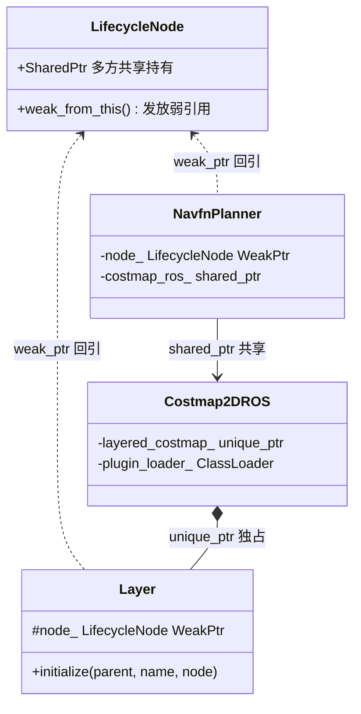
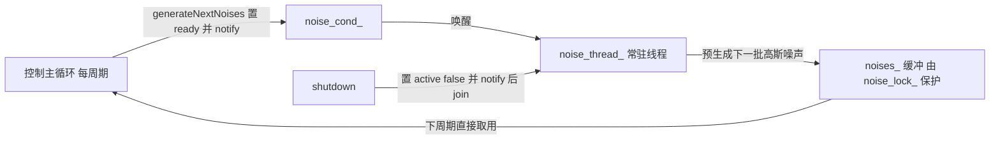

# 第 23 章 现代 C++ 专题：Nav2 的语言工程学

> **一句话总结**：Nav2 以 C++20 标准编译（nav2_package.cmake 强制 cxx_std_20，且 `-Wall -Wextra -Wpedantic -Werror` 零警告红线），但其现代性不在于炫技，而在于一套克制的工程纪律——RAII 管一切资源、三种智能指针各司其职（shared_ptr 共享节点、unique_ptr 独占插件、weak_ptr 打破循环）、模板消灭重复、lambda 承载回调、atomic 与 mutex 分级护航并发——每一项选择都能在源码里找到稳定复现的规律。

## 23.1 基调：标准、编译选项与代码风格红线

Nav2 所有包经 `nav2_package()` 宏统一构建配置（nav2_common/cmake/nav2_package.cmake）：C++20 是硬性要求（找不到 `cxx_std_20` 直接 FATAL_ERROR），GCC/Clang 下全量开启 `-Wall -Wextra -Wpedantic -Werror -Wdeprecated -Wshadow -Wnull-dereference -Wnon-virtual-dtor`。这组选项传达的信息很明确：警告即错误、变量遮蔽不许、基类必须虚析构——语言层面的防御从编译期开始。

值得注意的是，虽然标准是 C++20，代码主体仍以 C++11/14/17 的成熟特性为骨干：Concepts、Ranges、协程基本缺席。这不是保守，而是务实——ROS 2 生态的编译器基线与事件驱动模型决定了激进特性收益有限。本章逐项拆解真正大规模落地的技术。

| 技术 | 代表位置 | 动机 |
|---|---|---|
| RAII / lock_guard | simple_action_server.hpp、costmap_2d_ros.cpp | 异常安全的资源与锁管理 |
| shared_ptr | lifecycle_node.hpp 的 SharedPtr 别名 | 节点被多方共享引用 |
| unique_ptr | costmap_2d_ros.hpp 的 `layered_costmap_` | 插件与子系统的独占所有权 |
| weak_ptr | 各插件的 `parent_` 成员 | 插件回引宿主而不延长其生命 |
| 移动语义 | 路径/轨迹在管线间传递 | 大对象零复制 |
| 模板 | AStarAlgorithm、BtActionNode、SimpleActionServer | 一份骨架适配任意类型参数 |
| lambda + std::function | 执行回调、cancel_checker | 就地定义带捕获的回调 |
| std::optional | mppi critic_data.hpp、graceful_controller.hpp | 表达"可能不存在"的值 |
| atomic | costmap_2d_ros.hpp 的状态标志 | 无锁的跨线程标志位 |
| mutex / condition_variable | noise_generator.hpp | 复合状态保护与线程唤醒 |
| async / future | simple_action_server.hpp 的 `execution_future_` | 每 goal 一个异步执行任务 |

## 23.2 RAII：资源生命周期即作用域

**技术要点**：资源在构造时获取、析构时自动释放，让编译器代替人脑保证清理。

Nav2 中 RAII 有两个尺度。小尺度是锁：

```cpp
// nav2_ros_common/include/nav2_ros_common/simple_action_server.hpp
std::lock_guard<std::recursive_mutex> lock(update_mutex_);
```

goal 切换逻辑中任何一条提前 return 或异常抛出，锁都随作用域结束自动释放，死锁的一大来源被语言机制根除。大尺度是生命周期节点（Lifecycle Node）：`on_configure()` 里 `std::make_shared` / `std::make_unique` 获取的发布器、TF 缓冲、插件实例，全部挂在智能指针成员上，`on_cleanup()` 只需 `reset()` 或干脆什么都不做等析构，资源释放顺序由成员声明顺序反向保证。

**为什么用**：导航系统的失败路径远多于成功路径（规划超时、TF 缺失、插件加载失败），手动配对的 acquire/release 在错误分支上必然遗漏。

**最佳实践**：锁的作用域尽量小，只包住临界区；持锁期间不调用可能回调用户代码的函数；需要中途解锁的场景用 `std::unique_lock` 而非裸 mutex 操作。

## 23.3 智能指针：三种指针，三种关系

**技术要点**：所有权关系决定指针类型——共享用 shared、独占用 unique、回引用 weak，Nav2 对此的执行近乎教条。



三条规律在代码库里稳定复现：

- **shared_ptr 给节点与门面**：`nav2::LifecycleNode::SharedPtr`（nav2_ros_common/include/nav2_ros_common/lifecycle_node.hpp）被 Server、执行器、多个插件同时引用，谁最后放手谁触发析构；Costmap2DROS 以 shared_ptr 注入各规划器插件，同理。
- **unique_ptr 给独占子系统**：Costmap2DROS 的 `std::unique_ptr<LayeredCostmap> layered_costmap_`（nav2_costmap_2d/include/nav2_costmap_2d/costmap_2d_ros.hpp）表达"分层地图只属于我"；pluginlib 的 `createUniqueInstance()` 返回带自定义删除器的 unique_ptr，插件卸载与库卸载顺序由它保证。
- **weak_ptr 打破循环**：插件的 `configure()` 统一接收 `nav2::LifecycleNode::WeakPtr parent`。若插件用 shared_ptr 持节点，就形成"节点→（经门面）插件→节点"的引用环，双方都等对方先死，析构永不发生。weak_ptr 让插件"能用但不续命"，用时 `lock()` 升级并判空：

```cpp
auto node = parent_.lock();
if (!node) {throw std::runtime_error("Unable to lock node!");}
```

**最佳实践**：成员里长期存 weak_ptr，函数体内短暂 lock 成 shared_ptr 用完即弃；绝不在成员里缓存 lock 的结果，否则 weak 形同虚设。裸指针只出现在"借用且不涉及生命期"的参数位置（如 `GoalChecker *`）。

## 23.4 移动语义：大对象在管线间流动

**技术要点**：用 `std::move` 转移容器所有权，避免路径、轨迹、点云这类大对象的深拷贝。

一条全局路径动辄数千个位姿，在"规划器→平滑器→黑板→控制器"的管线上若逐站复制，代价可观。Nav2 的惯用法：函数按值返回 `nav_msgs::msg::Path`（天然触发移动或 RVO 省略）、向容器交付所有权时显式 `std::move`（如 LayeredCostmap 接管 Layer 实例）、`unique_ptr` 成员的转移只能经 move 完成——这一点由类型系统强制，无需靠自觉。

**最佳实践**：move 之后的源对象只可析构或重新赋值；对 `const` 对象 `std::move` 是无声的失效操作（退化为拷贝），编译器不报错但优化落空，`-Wall` 家族也查不出，评审时值得专门盯。

## 23.5 模板与泛型：一份骨架，多种类型

**技术要点**：用类型参数把"流程相同、类型不同"的代码收敛为单一实现，且换来编译期检查与内联优化。

Nav2 有三个教科书级模板类：

| 模板 | 类型参数 | 收敛了什么 | 位置 |
|---|---|---|---|
| `SimpleActionServer<ActionT>` | 20 种 Action 类型 | goal 接收、抢占、取消、结果上报的全套状态机 | nav2_ros_common/include/nav2_ros_common/simple_action_server.hpp |
| `BtActionNode<ActionT>` | 各 Action 客户端 | 发 goal、等结果、超时、分派钩子的 BT 节点骨架 | nav2_behavior_tree/include/nav2_behavior_tree/bt_action_node.hpp |
| `AStarAlgorithm<NodeT>` | Node2D/NodeHybrid/NodeLattice | A* 主循环 | nav2_smac_planner/include/nav2_smac_planner/a_star.hpp |

前两者是"接口泛化"：同一套异步协议逻辑服务所有 Action 类型，`typename ActionT::Goal` 这类依赖类型让编译器为每种 Action 生成专属代码。第三个是"性能泛化"：A* 每秒扩展数十万节点，虚函数的间接调用与内联失效不可接受，模板把节点策略静态绑定，配合 `if constexpr` 做编译期分支裁剪，实现零成本抽象（展开见第 08 章）。

**最佳实践**：热路径（搜索、评分内循环）优先模板静态多态，冷路径（插件加载、生命周期）用虚函数动态多态——Nav2 两者并用且边界清晰，是"何时用模板"的最好参照。

## 23.6 lambda 与 std::function：回调的现代形态

**技术要点**：lambda 就地定义带捕获的闭包，std::function 提供统一的可调用对象容器，二者构成 Nav2 全部回调的载体。

代表性用法有三类：

- **异步任务体**：SimpleActionServer 每接受一个 goal，就以 lambda 启动异步执行——`std::async(std::launch::async, [this]() {work();})`，捕获 this 即可访问全部成员。
- **可传递的取消检查**：PlannerServer 把 `std::function<bool()> cancel_checker` 注入 `createPlan()`，规划器内核在长循环里周期调用它——算法层不需要知道 Action、抢占这些概念，一个布尔谓词完成解耦。
- **订阅与参数回调**：新代码偏好 lambda 而非 `std::bind`，捕获列表比占位符 `_1` 直白得多。

**最佳实践**：跨线程或延迟执行的 lambda 慎用 `[this]` 裸捕获——对象若先亡，回调即野指针；ROS 2 场景下惯用"捕获 weak_ptr，回调内 lock 判空"的防御式写法。std::function 有类型擦除与潜在堆分配开销，热循环内直接用模板参数接受可调用对象更佳。

## 23.7 std::optional：把"可能没有"写进类型

**技术要点**：用类型系统表达值的可缺失性，取代魔数与"指针判空"约定。

报告推断此特性少见，实际核对后它在多处关键路径上真实落地：

- `nav2_mppi_controller/include/nav2_mppi_controller/critic_data.hpp`：`std::optional<std::vector<bool>> path_pts_valid` 与 `std::optional<size_t> furthest_reached_path_point`——多个 critic 共享的惰性计算结果，"尚未计算"与"计算得零"由类型区分，第一个用到的 critic 负责填充。
- `nav2_graceful_controller/include/nav2_graceful_controller/graceful_controller.hpp`：`std::optional<double> safe_approach_angle_`。
- `nav2_docking/opennav_docking/include/opennav_docking/parameter_handler.hpp`：`std::optional<bool> dock_backwards`——三态语义（未配置/真/假）用 optional 表达得恰到好处。

至于 std::variant，Nav2 中确实没有成规模的应用：异构消息由 ROS 类型系统处理，插件多态由虚函数处理，variant 的生态位在导航框架中基本被占满，缺席是合理的工程选择，而非有待补齐的短板。

**最佳实践**：optional 适合"值缺失是正常业务态"的场景；若缺失意味着错误，抛异常或返回 expected 风格的结果更诚实。不要用 `optional<T*>` 或 `optional<shared_ptr>` 叠加两层"可空"。

## 23.8 constexpr：常量的编译期化

**技术要点**：把编译期可知的常量与简单计算固化为 constexpr，换取零运行时开销与常量传播优化。

Nav2 的使用偏基础：代价地图的特殊代价值、各类默认阈值以 constexpr/静态常量定义；SmacPlanner 用 `if constexpr` 依据 NodeT 在编译期裁剪 SE(2) 相关代码路径，是代码库里 constexpr 家族最有技术含量的一处。大规模 constexpr 函数计算（如编译期查找表）未见——运动基元表依赖运行时参数（转弯半径、量化位数），本就不具备编译期化条件。

**最佳实践**：能 constexpr 的常量不要用宏；`if constexpr` 是模板代码里替代 SFINAE/标签分发的首选，可读性高一个量级。

## 23.9 并发原语：atomic、mutex 与 condition_variable 的分工

**技术要点**：按共享状态的复杂度分级选择同步手段——单一标志用 atomic，复合状态用 mutex，线程间等待/唤醒用 condition_variable。

Costmap2DROS 是 atomic 的样板（nav2_costmap_2d/include/nav2_costmap_2d/costmap_2d_ros.hpp）：

```cpp
std::atomic<bool> initialized_{false};
std::atomic<bool> stopped_{true};
std::atomic<bool> stop_updates_{false};
```

地图更新线程与生命周期回调分属不同线程，这些开关标志用 atomic 即可安全读写，无锁无阻塞；而动态参数更新涉及多个成员的原子性修改，就升级为 `std::mutex` + lock_guard。

condition_variable 的完整案例在 MPPI 的噪声生成器（nav2_mppi_controller/include/nav2_mppi_controller/tools/noise_generator.hpp）：



`noise_thread_` 常驻后台，`noise_cond_.wait()` 挂起等待主循环 notify，把耗时的大批量随机数生成移出控制热路径——这是"mutex 保护数据 + condition_variable 传递事件 + 谓词防虚假唤醒"的标准三件套。关停时置标志、notify、join 的顺序同样是教科书写法。

**最佳实践**：atomic 只用于真正独立的标志/计数，两个 atomic 变量间没有原子性，复合不变式必须上锁；cv.wait 必带谓词；持锁时间与 notify 调用尽量分离，避免"惊醒即再阻塞"。

## 23.10 async 与 future：每个 goal 一个执行任务

**技术要点**：用 std::async + future 表达"一次性异步任务及其完成状态"，替代手写线程管理。

SimpleActionServer 的执行模型：`handle_accepted()` 中以 `std::async(std::launch::async, ...)` 启动 work 循环，返回的 `std::future` 存为 `execution_future_`；关停或新 goal 到来时通过 `future.wait_for()` 探询任务是否结束，避免 join 裸线程的样板。客户端侧则是 rclcpp 风格的 future：BtActionNode 发送 goal 得到 `future_goal_handle_`，用 `spin_until_future_complete()` 带超时等待。显式的 `std::promise` 在 Nav2 中罕见——async 与 Action 框架已覆盖其生态位。

**最佳实践**：std::async 必须接住返回的 future，弃值会导致临时 future 析构时同步阻塞等待任务完成（launch::async 策略下），等于把异步写成了同步——这是 C++ 标准库著名陷阱。

## 23.11 从 Nav2 学到的 C++ 工程习惯

跳出单项技术，Nav2 沉淀的工程习惯更值得带走：

- **异常只在边界处理**：插件内部大胆抛（`lock()` 失败即 throw），Server 的 Action 执行回调统一 catch 并转换为 Action 失败结果码——异常不跨插件边界裸奔，也不跨线程传播。
- **接口最小化**：nav2_core 的每个纯虚接口只有生命周期五件套加一两个业务方法，没有任何"以防万一"的接口；宽接口是耦合的温床。
- **头文件纪律**：`-Wshadow -Wnon-virtual-dtor` 编译期兜底，公共头只暴露契约，实现细节藏进 impl 头（如 bt_action_server_impl.hpp）或源文件。
- **所有权即文档**：看到成员是 unique_ptr 就知道"我独占"，weak_ptr 就知道"我借用"，不需要注释解释谁负责释放——类型签名承担了文档职责。
- **热冷路径区别对待**：冷路径要灵活（虚函数、std::function、shared_ptr），热路径要极致（模板、if constexpr、预分配、无锁标志），不在同一维度上"一刀切"。

## 知识总结

1. Nav2 强制 **C++20 + 全量警告 + -Werror**（nav2_package.cmake），但特性使用克制，主体是 C++11/14/17 成熟特性的纪律化运用。
2. 智能指针铁律：**shared_ptr 共享节点与门面、unique_ptr 独占插件与子系统、weak_ptr 让插件回引宿主**——WeakPtr + lock 判空是插件访问节点的唯一正确姿势。
3. 三大模板类 SimpleActionServer、BtActionNode、AStarAlgorithm 展示模板的两种动机：**接口泛化**（消灭 Action 类型样板）与**性能泛化**（热路径零成本抽象）。
4. 并发分级：**atomic 管标志、mutex 管复合状态、condition_variable 管线程唤醒**，NoiseGenerator 线程是三者协作的完整范本；RAII 的 lock_guard 让锁与异常安全绑定。
5. std::optional 已在 MPPI、docking、graceful controller 等处落地表达"值可缺失"；variant 与协程等特性则因生态位被 ROS 类型系统占据而缺席。

## 常见面试题

1. **Nav2 插件为什么用 WeakPtr 持有宿主节点？shared_ptr 会发生什么？**
   要点：节点（经门面）拥有插件，插件若以 shared_ptr 回持节点即成引用环，引用计数永不归零、析构永不发生；weak_ptr 不增加计数，用时 lock 升级并判空，节点亡则插件优雅报错。
2. **AStarAlgorithm 用模板而 GlobalPlanner 用虚函数，如何解释这种双轨制？**
   要点：GlobalPlanner 在冷路径，每次导航调用一次，需要运行时按配置切换实现，虚函数 + pluginlib 合适；A* 内循环每秒数十万次节点扩展，虚调用开销与内联失效不可接受，模板静态绑定 + if constexpr 裁剪实现零成本抽象。
3. **Costmap2DROS 里 atomic 标志和 mutex 并存，各自的适用边界？**
   要点：`stopped_`、`stop_updates_` 等是独立布尔开关，单变量读写用 atomic 无锁即安全；动态参数更新要同时改多个成员、维持复合不变式，必须 mutex 整体保护。两个 atomic 之间没有原子性是关键判据。
4. **NoiseGenerator 为什么要独立线程 + condition_variable，而不是在控制循环里现算？**
   要点：批量高斯采样耗时且与控制周期解耦，后台线程在上一周期就预生成下一批噪声，主循环 notify 触发、直接取缓冲，把延迟移出热路径；cv 带谓词防虚假唤醒，关停按置标志→notify→join 顺序保证无泄漏。
5. **std::async 返回的 future 如果不接住会怎样？**
   要点：launch::async 策略下，临时 future 的析构会阻塞等待任务完成，异步退化为同步；因此 SimpleActionServer 把 future 存成员 `execution_future_`，既保住异步性又可用 wait_for 探询完成状态。

## 最佳实践与容易踩坑

- **lock() 结果不落成员**：weak_ptr 只在函数作用域内短暂升级，缓存 shared_ptr 到成员等于绕过弱引用，循环引用卷土重来。
- **跨线程 lambda 别裸捕 this**：定时器、异步任务里 `[this]` 遇对象先亡即野指针；捕 weak_ptr、回调内 lock 判空是标准防御。
- **持锁不做慢活**：lock_guard 作用域内不发布消息、不调用插件虚函数、不等待 future，否则锁竞争放大成系统卡顿。
- **对 const 对象 std::move 静默退化为拷贝**：编译器不警告，性能预期落空，评审时专项检查。
- **-Werror 是红线不是建议**：给 Nav2 贡献代码前本地必须零警告，`-Wshadow` 常抓出参数与成员同名的隐患。
- **别为省事用 recursive_mutex**：SimpleActionServer 用它有历史与回调重入的具体理由；新代码里递归锁往往是锁设计不清晰的气味。

## 延伸阅读

- nav2_common/cmake/nav2_package.cmake —— 全项目编译基调的唯一权威来源
- nav2_ros_common/include/nav2_ros_common/simple_action_server.hpp —— 模板、lambda、async、recursive_mutex 的浓缩现场
- nav2_mppi_controller/include/nav2_mppi_controller/tools/noise_generator.hpp 与 src/noise_generator.cpp —— 并发三件套完整范本
- nav2_costmap_2d/include/nav2_costmap_2d/costmap_2d_ros.hpp —— atomic/mutex/unique_ptr 的成员级教学
- Scott Meyers, *Effective Modern C++* —— 对照条款 18~22（智能指针）与 35~40（并发）重读 Nav2 源码
- 第 08 章（模板化 A* 内核）、第 22 章（依赖注入与所有权设计的模式视角）

## 23.C 阅读检查点

1. 插件用 shared_ptr 持有宿主节点会发生什么？WeakPtr + lock() 判空的正确姿势是什么？（23.3）
2. AStarAlgorithm 用模板而 GlobalPlanner 用虚函数，这种双轨制的判据是什么？（23.5）
3. Costmap2DROS 里 atomic 标志与 mutex 并存，两者的适用边界在哪？"两个 atomic 之间没有原子性"意味着什么？（23.9）
4. NoiseGenerator 的常驻线程 + condition_variable 方案把什么移出了控制热路径？关停时的三步顺序是什么？（23.9）
5. std::async 返回的 future 不接住会怎样？SimpleActionServer 如何规避这个陷阱？（23.10）

**交叉引用**：

- 并发原语的使用现场与线程地图：见 [20_线程模型](20_线程模型.md) 20.B（回调组隔离、每 goal 一个 async 任务）与 [19_Action与通信机制](19_Action与通信机制.md) 19.B（自研 SimpleActionServer 的取舍）。
- 所有权与依赖注入的模式视角：见 [22_设计模式专题](22_设计模式专题.md) 22.14/22.15。
- 模板化控制器/规划器内核的演进背景：[Evolution/Planner](Evolution/Planner.md) · [Evolution/Controller](Evolution/Controller.md)。

> 下一章：24_扩展开发指南
