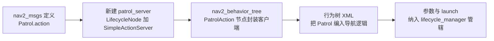

# 第 24 章 扩展开发指南：把自己的算法装进 Nav2

> **一句话总结**：Nav2 的一切扩展都遵循同一条流水线——继承 nav2_core（或对应包）暴露的纯虚接口、编写 pluginlib 描述文件、在 CMake 中导出、最后在参数文件中注册插件名——掌握这套"四步曲"，规划器、控制器、恢复行为、行为树节点乃至充电桩驱动都只是同一个模板的不同实例。

> **前置知识**：第 04 章 · 第 22 章 ｜ **知识依赖图**：[KnowledgeGraph/Knowledge](KnowledgeGraph/Knowledge.md)

前面二十余章我们一直在"读"Nav2，本章开始"写"Nav2。好消息是：得益于第 04 章的插件接口契约与第 22 章的插件工厂模式，扩展 Nav2 几乎不需要触碰任何框架代码。本章按扩展场景逐一给出配方，并以"新增一个完整 Action 模块"收尾，覆盖从单个插件到整条业务链路的全部扩展路径。

## 24.1 统一范式：扩展四步曲

无论扩展哪一类插件，工序完全一致：


四步各自的本质：

| 步骤 | 产物 | 作用机制 |
|---|---|---|
| 继承基类 | 一个 `.hpp/.cpp` 与共享库 | 满足宿主服务器持有的 `pluginlib::ClassLoader<BaseT>` 的类型契约 |
| plugins.xml | 插件描述文件 | 告诉 pluginlib：哪个共享库里有哪个类、它实现了哪个基类 |
| CMake 导出 | ament 索引注册项 | `pluginlib_export_plugin_description_file(基类所在包 描述文件)` 把 XML 注册进 ament 资源索引，加载器据此发现插件 |
| 参数注册 | YAML 条目 | 宿主服务器读取 `xxx_plugins` 列表与每项的 `plugin` 字段，据此调用 `createUniqueInstance` |

尾部还有一个隐含的"第五步"：插件的生命周期方法（configure/activate/deactivate/cleanup）会被宿主服务器在对应的生命周期回调里逐一调用（第 05 章），任何一个方法缺失或抛异常都会让宿主转换失败——这是新手最常忽略的一环。

另一个所有场景共用的约定是**参数命名空间**：插件参数一律以"插件实例名.参数名"的形式声明，例如实例名为 `GridBased` 时，参数是 `GridBased.tolerance` 而不是全局的 `tolerance`。配合 `nav2_ros_common/include/nav2_ros_common/node_utils.hpp` 提供的 `declare_parameter_if_not_declared` 与 `declare_or_get_parameter` 工具，可避免重复声明异常（第 21 章）。

## 24.2 九类扩展场景速查

先给出全景对照表，再逐场景展开：

| 场景 | 继承基类 | 宿主服务器 | 描述文件登记到的包 | 参数注册字段 |
|---|---|---|---|---|
| 全局规划器 | nav2_core::GlobalPlanner | planner_server | nav2_core | planner_plugins |
| 控制器 | nav2_core::Controller | controller_server | nav2_core | controller_plugins |
| 恢复行为 | nav2_behaviors::TimedBehavior | behavior_server | nav2_core | behavior_plugins |
| 路径平滑器 | nav2_core::Smoother | smoother_server | nav2_core | smoother_plugins |
| 行为树节点 | BtActionNode 等 | bt_navigator | 无需 pluginlib | plugin_lib_names |
| 导航器 | nav2_core::BehaviorTreeNavigator | bt_navigator | nav2_core | navigators |
| 代价地图层 | nav2_costmap_2d::Layer | 各 Costmap2DROS | nav2_costmap_2d | plugins / filters |
| 路由边评分器 | nav2_route::EdgeCostFunction | route_server | nav2_route | edge_cost_functions |
| 充电桩 | opennav_docking_core::ChargingDock | docking_server | opennav_docking_core | dock_plugins |

### 24.2.1 自定义全局规划器 GlobalPlanner

**继承基类**：`nav2_core::GlobalPlanner`（`nav2_core/include/nav2_core/global_planner.hpp`）。

**必须实现的方法**：

| 方法 | 调用时机 | 说明 |
|---|---|---|
| configure | 宿主 on_configure | 注入节点弱指针、插件名、TF、Costmap2DROS，在此声明参数 |
| activate / deactivate | 宿主 on_activate / on_deactivate | 启停发布器等资源 |
| cleanup | 宿主 on_cleanup | 释放资源，与 configure 对称 |
| createPlan | 每次规划请求 | 输入起点、终点、途经点与取消检查器，输出 `nav_msgs::msg::Path` |

注意 main 分支的 `createPlan` 签名已带 `viapoints` 与 `cancel_checker` 两个参数——前者支撑途经点规划，后者要求算法在长循环里周期性调用 `cancel_checker()` 以支持任务取消，移植旧教程代码时务必补齐。最小骨架：

```cpp
class MyPlanner : public nav2_core::GlobalPlanner
{
public:
  void configure(const nav2::LifecycleNode::WeakPtr & parent,
    std::string name, nav2::TransformBuffer::SharedPtr tf,
    std::shared_ptr<nav2_costmap_2d::Costmap2DROS> costmap_ros) override
  {
    auto node = parent.lock();
    tolerance_ = node->declare_or_get_parameter(name + ".tolerance", 0.5);
  }
  void activate() override {}
  void deactivate() override {}
  void cleanup() override {}
  nav_msgs::msg::Path createPlan(
    const geometry_msgs::msg::PoseStamped & start,
    const geometry_msgs::msg::PoseStamped & goal,
    const std::vector<geometry_msgs::msg::PoseStamped> & viapoints,
    std::function<bool()> cancel_checker) override;
};
PLUGINLIB_EXPORT_CLASS(my_pkg::MyPlanner, nav2_core::GlobalPlanner)
```

**plugins.xml 要点**：`class` 的 `type` 写完整命名空间类名，`base_class_type` 必须精确为 `nav2_core::GlobalPlanner`：

```xml
<library path="my_planner_lib">
  <class type="my_pkg::MyPlanner" base_class_type="nav2_core::GlobalPlanner">
    <description>My custom planner</description>
  </class>
</library>
```

**CMake**：`pluginlib_export_plugin_description_file(nav2_core my_planner_plugin.xml)`——第一个实参是**基类所在包**而非自己的包名，写错则插件永远"找不到"。

**参数注册**：

```yaml
planner_server:
  ros__parameters:
    planner_plugins: ["GridBased"]
    GridBased:
      plugin: "my_pkg::MyPlanner"
      tolerance: 0.5
```

**参考样例**：`nav2_theta_star_planner/`（结构最精简）、`nav2_navfn_planner/`（含 `global_planner_plugin.xml` 与 CMake 全套）、`nav2_system_tests/src/error_codes/`（最小化测试插件）。

### 24.2.2 自定义控制器 Controller

**继承基类**：`nav2_core::Controller`（`nav2_core/include/nav2_core/controller.hpp`）。

**必须实现的方法**：

| 方法 | 调用时机 | 说明 |
|---|---|---|
| configure / activate / deactivate / cleanup | 生命周期同步 | 同规划器四件套 |
| newPathReceived | 收到新全局路径时 | 只做轻量状态重置，路径裁剪由服务器的 PathHandler 完成 |
| computeVelocityCommands | 每个控制周期 | 输入当前位姿、速度、目标检查器、已变换的局部路径与全局终点，输出 `TwistStamped` |
| setSpeedLimit | 收到限速消息时 | 支持绝对值与百分比两种模式 |
| cancel / reset | 任务取消 / 退出时 | 有默认实现，可按需覆写以支持平滑减速停车 |

main 分支的接口与旧版差异较大：`setPlan` 已更名为 `newPathReceived`，且 `computeVelocityCommands` 直接收到服务器预裁剪的 `transformed_global_plan`，插件内不必再自己做路径变换——这是 1.5.0 时代 PathHandler 插件化（第 09 章）带来的职责重分配。

**plugins.xml / CMake / 参数**：与规划器完全同构，`base_class_type` 换为 `nav2_core::Controller`，导出仍登记到 nav2_core，参数字段为 `controller_plugins`，实例名默认 `FollowPath`。

**参考样例**：`nav2_regulated_pure_pursuit_controller/`（单文件核心逻辑，最适合当模板）、`nav2_graceful_controller/`；想学"装饰器式"控制器则读 `nav2_rotation_shim_controller/`。

### 24.2.3 自定义恢复行为 Behavior

恢复行为的基类分两层：`nav2_core::Behavior` 是 pluginlib 契约（configure/activate/deactivate/cleanup/getResourceInfo），而实际开发几乎总是继承模板中间层 `nav2_behaviors::TimedBehavior<ActionT>`（`nav2_behaviors/include/nav2_behaviors/timed_behavior.hpp`），它已替你实现了 SimpleActionServer 装配、碰撞检查器注入与周期执行循环。

**必须实现的方法**（TimedBehavior 层）：

| 方法 | 调用时机 | 说明 |
|---|---|---|
| onRun | Action 目标到达时 | 解析 Goal、初始化状态，返回 `ResultStatus` |
| onCycleUpdate | 每个执行周期 | 行为主体：返回 RUNNING 继续、SUCCEEDED 完成、FAILED 终止 |
| onConfigure / onCleanup | 生命周期钩子 | 可选覆写，声明自有参数 |
| onActionCompletion | 行为结束时 | 可选覆写，填充 Result 附加字段 |
| getResourceInfo | 配置期 | 声明需要局部/全局哪套碰撞检查资源（CostmapInfoType） |

模板参数 `ActionT` 就是该行为对外暴露的 Action 类型，例如 `Spin` 继承 `TimedBehavior<nav2_msgs::action::Spin>`。这意味着新增一个恢复行为通常要连带在 nav2_msgs（或自己的接口包）里新增 Action 定义，正好衔接 24.3 节的完整流程。

**plugins.xml / CMake / 参数**：`base_class_type` 为 `nav2_core::Behavior`，导出登记到 nav2_core（参照 `nav2_behaviors/behavior_plugin.xml` 与其 CMakeLists.txt），参数字段为 behavior_server 下的 `behavior_plugins` 列表。

**参考样例**：`nav2_behaviors/plugins/wait.cpp`（不到百行，理解执行循环的最佳入口）、`nav2_behaviors/plugins/spin.cpp`（带碰撞前瞻检查的完整范例）。

### 24.2.4 自定义 Smoother

**继承基类**：`nav2_core::Smoother`（`nav2_core/include/nav2_core/smoother.hpp`）。核心只有一个业务方法：

| 方法 | 说明 |
|---|---|
| configure | 注入依赖：注意这里拿到的是 CostmapSubscriber 与 FootprintSubscriber，而非完整的 Costmap2DROS——平滑器只读代价地图，不拥有它 |
| smooth | 就地修改传入的 `path`，并在 `max_time` 预算内返回；返回 false 表示平滑失败 |
| activate / deactivate / cleanup | 生命周期四件套 |

`smooth` 的时间预算语义值得强调：超时应返回当前已完成的部分结果或 false，而不是无限阻塞——smoother_server 会拿这个布尔值决定 Action 结果码。

**plugins.xml / CMake / 参数**：`base_class_type` 为 `nav2_core::Smoother`，导出参照 `nav2_smoother/CMakeLists.txt` 的 `pluginlib_export_plugin_description_file(nav2_core plugins.xml)`，参数字段为 `smoother_plugins`。

**参考样例**：`nav2_smoother/src/simple_smoother.cpp`（加权均值平滑，逻辑直白）；测试目录下的 dummy 平滑器展示了满足接口的最小实现。

### 24.2.5 自定义行为树 BT 节点

BT 节点是唯一**不走 pluginlib** 的扩展类别：它使用 BehaviorTree.CPP 自己的工厂注册机制。

**继承基类**（按节点语义选择，均位于 `nav2_behavior_tree/include/nav2_behavior_tree/`）：

| 基类 | 适用场景 | 关键覆写点 |
|---|---|---|
| BtActionNode 模板 | 封装一个 ROS Action 客户端 | on_tick 填 goal_，on_success / on_aborted / on_cancelled 处理结果 |
| BtServiceNode 模板 | 封装一个 Service 客户端 | on_tick 填请求，on_completion 处理响应 |
| BT::ConditionNode | 纯条件判断 | tick 返回 SUCCESS/FAILURE |
| BT::DecoratorNode / ControlNode | 改写子节点语义 / 自定义编排 | tick 中操纵子节点状态 |

**注册方式**：在 `.cpp` 末尾用 `BT_REGISTER_NODES` 宏向工厂注册（参照 `nav2_behavior_tree/plugins/action/spin_action.cpp` 尾部的 NodeBuilder 写法），每个节点编译为独立共享库。

**CMake**：无 pluginlib 导出，但要把库名加入插件清单；nav2_behavior_tree 通过 `plugins_list.hpp.in` 模板在编译期生成内置清单。自定义包则在 CMake 中正常 `add_library` + `install`，然后走参数注册。

**参数注册**：bt_navigator 的 `plugin_lib_names` 列表填库名（内置节点自动加载，只需列自定义库）：

```yaml
bt_navigator:
  ros__parameters:
    plugin_lib_names: ["my_bt_condition_lib"]
```

最后别忘了在 `nav2_behavior_tree/nav2_tree_nodes.xml` 风格的节点清单中补充声明，Groot 可视化编辑器才能识别新节点的端口。

**参考样例**：`nav2_behavior_tree/plugins/action/wait_action.cpp`（BtActionNode 最小实例）、`nav2_behavior_tree/plugins/condition/` 下任一条件节点。

### 24.2.6 自定义 Navigator

Navigator 决定 bt_navigator 对外暴露哪种 Action 及其目标预处理逻辑（第 11 章）。

**继承基类**：`nav2_core::BehaviorTreeNavigator<ActionT>`（`nav2_core/include/nav2_core/behavior_tree_navigator.hpp`），它是模板中间层，底层契约为 `NavigatorBase`。

**必须实现的方法**：

| 方法 | 说明 |
|---|---|
| getName | 返回导航器名，同时决定 Action 话题名 |
| getDefaultBTFilepath | 返回默认行为树 XML 路径 |
| goalReceived | 目标校验与黑板初始化，返回 false 即拒绝目标 |
| onLoop | 每次 BT tick 后发布反馈 |
| onPreempt | 处理抢占目标 |
| goalCompleted | 填充结果码 |

**plugins.xml / CMake / 参数**：`base_class_type` 为 `nav2_core::NavigatorBase`，导出参照 `nav2_bt_navigator/navigator_plugins.xml`；参数字段为 bt_navigator 下的 `navigators` 列表。

**参考样例**：`nav2_bt_navigator/src/navigators/navigate_to_pose.cpp`——官方两个导航器共约几百行，是理解"一个 Action 一棵树"模式的最短路径。

### 24.2.7 自定义 Costmap Layer

**继承基类**：`nav2_costmap_2d::Layer`（需要自带栅格存储时继承其子类 `CostmapLayer`，可直接复用主栅格操作工具）。

**必须实现的方法**（`nav2_costmap_2d/include/nav2_costmap_2d/layer.hpp`）：

| 方法 | 调用时机 | 说明 |
|---|---|---|
| onInitialize | initialize 模板方法末尾 | 声明参数、创建订阅（模板方法模式，第 22 章） |
| updateBounds | 每个地图更新周期第一阶段 | 上报本层希望重绘的包围盒 |
| updateCosts | 第二阶段 | 把本层代价写入主栅格窗口 |
| reset | 收到清图服务时 | 恢复到未观测状态 |
| isClearable | 配置期 | 声明本层是否可被清图服务清除 |

**plugins.xml / CMake / 参数**：`base_class_type` 为 `nav2_costmap_2d::Layer`，描述文件登记到 **nav2_costmap_2d** 包（这是与前几类最大的不同）；参数注册在各 costmap 的 `plugins`（或滤镜类的 `filters`）列表下。

**参考样例**：`nav2_costmap_2d/plugins/static_layer.cpp`（订阅驱动型）、`nav2_costmap_2d/plugins/inflation_layer.cpp`（纯计算型）；官方教程配套的 gradient_layer 亦是经典入门样例。

### 24.2.8 自定义 Route EdgeScorer

nav2_route 的边评分器决定图搜索中每条边的代价权重（第 17 章）。

**继承基类**：`nav2_route::EdgeCostFunction`（`nav2_route/include/nav2_route/interfaces/edge_cost_function.hpp`）。必实现 `configure`、`score`（对给定边输出 cost，返回 false 表示该边不可通行）与 `getName`，可选覆写 `prepare` 做每次请求前的状态刷新。同目录还有 RouteOperation、GraphFileLoader/Saver 两类姊妹接口，扩展方式同构。

**plugins.xml / CMake / 参数**：`base_class_type` 为 `nav2_route::EdgeCostFunction`，导出登记到 nav2_route 包（参照其 CMakeLists.txt 的 `pluginlib_export_plugin_description_file(nav2_route plugins.xml)`）；参数字段为 route_server 下的 `edge_cost_functions` 列表。

**参考样例**：`nav2_route/src/plugins/edge_cost_functions/distance_scorer.cpp`——几十行即完成一个可用评分器。

### 24.2.9 自定义 ChargingDock

**继承基类**：`opennav_docking_core::ChargingDock`（`nav2_docking/opennav_docking_core/include/opennav_docking_core/charging_dock.hpp`）。这是九类中方法最多的接口，因为它同时抽象了感知与充电状态机（第 18 章）：

| 方法组 | 方法 | 说明 |
|---|---|---|
| 生命周期 | configure / activate / deactivate / cleanup | 常规四件套 |
| 位姿 | getStagingPose / getRefinedPose | 预备位姿计算与基于检测的桩位精修 |
| 状态 | isDocked / isCharging / hasStoppedCharging | 物理接触与充电状态查询 |
| 控制 | disableCharging / startDetectionProcess / stopDetectionProcess | 脱离前断充与检测器启停 |

**plugins.xml / CMake / 参数**：`base_class_type` 为 `opennav_docking_core::ChargingDock`，导出登记到 opennav_docking_core；参数字段为 docking_server 下的 `dock_plugins`，并配合 `docks` 数据库描述每个桩实例的位姿与类型。

**参考样例**：`nav2_docking/opennav_docking/src/simple_charging_dock.cpp`——官方参考实现，覆盖全部接口且带丰富参数。

## 24.3 进阶：新增一个完整模块与新 Action

当需求超出"替换某个算法"，例如要给机器人加一个"原地画圈巡逻"任务，就需要走完整的模块链路：



四个环节的要点：

1. **接口定义**：在 nav2_msgs（或独立接口包）的 `action/` 下新增 `.action` 文件，Goal/Result/Feedback 三段式；Result 建议包含 `error_code` 与 `error_msg` 字段以对齐 Nav2 1.5.0 的错误码规范（各内置 Action 均如此）。
2. **服务器实现**：新建生命周期节点，用 `nav2::SimpleActionServer<Patrol>`（`nav2_ros_common/include/nav2_ros_common/simple_action_server.hpp`）承接目标，获得抢占、取消与工作线程的全套语义（第 19 章）；执行回调里周期检查 `is_preempt_requested` 与 `is_cancel_requested`。
3. **BT 节点封装**：继承 `BtActionNode<nav2_msgs::action::Patrol>`，把 Goal 字段映射为 BT 输入端口，按 24.2.5 注册。
4. **XML 编排与接管**：把新节点写进行为树 XML（例如挂在 RecoveryNode 的恢复分支或独立子树），最后在参数中把 patrol_server 加入 lifecycle_manager 的 `node_names`，让它接受统一的启停编排。

这条链路走通后，你新增的能力与官方的 Spin、Wait 在架构地位上完全平等——这正是 Nav2 "微服务 + 行为树"范式的威力。

## 24.4 外部集成：nav2_simple_commander Python API

若只想在业务层调用 Nav2 而非扩展其内部，`nav2_simple_commander/nav2_simple_commander/robot_navigator.py` 的 `BasicNavigator` 封装了全部常用 Action 客户端：

| 方法 | 对应 Action / 服务 | 用途 |
|---|---|---|
| setInitialPose | /initialpose 话题 | 设置 AMCL 初始位姿 |
| goToPose / goThroughPoses | NavigateToPose / NavigateThroughPoses | 单点与多点导航 |
| followWaypoints / followGpsWaypoints | FollowWaypoints / FollowGPSWaypoints | 路径点与 GPS 路径点巡航 |
| followPath | FollowPath | 直接下发路径给控制器 |
| spin / backup / driveOnHeading | Spin / BackUp / DriveOnHeading | 单独触发恢复行为 |
| assistedTeleop | AssistedTeleop | 辅助遥操作 |
| dockRobotByID / dockRobotByPose | DockRobot | 靠泊充电 |
| getPath / getPathThroughPoses | ComputePathToPose 等 | 只规划不执行 |
| isTaskComplete / getFeedback / getResult | 通用 | 非阻塞轮询任务状态 |
| lifecycleStartup / lifecycleShutdown | ManageLifecycleNodes | 编程式启停整个导航栈 |

典型用法是"发起任务 → while 循环轮询 isTaskComplete 并消费 getFeedback → 检查 getResult"，天然适合写任务调度层与验收测试脚本。

## 24.5 常见坑速查

| 症状 | 根因 | 修复 |
|---|---|---|
| 报错 failed to load plugin / class not found | plugins.xml 里的类名与参数 `plugin:` 字段不一致，或 CMake 导出的第一个实参写成了自己的包 | 三处核对：`PLUGINLIB_EXPORT_CLASS` 宏、XML 的 type、YAML 的 plugin 字段必须逐字符一致 |
| 编译通过但运行时找不到插件 | 忘写 `pluginlib_export_plugin_description_file`，或 package.xml 缺少对基类包的依赖导出 | 补导出宏；确认 `ament_export_dependencies` 包含基类包 |
| 宿主 configure 阶段崩溃 | 插件构造函数里访问了 ROS 资源（此时节点尚未注入） | 构造函数保持空，一切初始化放进 configure/onInitialize |
| deactivate 后再 activate 行为异常 | 生命周期回调不对称：activate 里创建的资源没有在 deactivate 释放 | 逐一核对四件套对称性；发布器记得调用 on_activate |
| 更新 Nav2 版本后插件加载即崩溃 | ABI 不兼容：接口签名变更（如 createPlan 新增参数、setPlan 更名）但旧二进制未重编 | 升级后全量重编插件包；覆写时坚持写 `override` 让编译器兜底 |
| 参数改了不生效 | 参数声明在错误的命名空间，缺少"实例名."前缀 | 统一用 `name_ + ".param"` 声明与读取 |

## 24.A 源码导航与入手路径

入口链（以规划器插件为样本）：planner_server 的 on_configure() 读 planner_plugins 列表 → pluginlib ClassLoader 按类名实例化 → 插件 configure()（注入节点/TF/Costmap2DROS）→ 每次请求调 createPlan()。扩展开发的阅读重心不在服务器实现，而在 nav2_core 接口头文件——它们就是契约本身：

| 文件（仓库相对路径，约 N 行） | 关键函数 | 作用 |
|---|---|---|
| nav2_core/include/nav2_core/global_planner.hpp（约 90 行） | configure() / createPlan() | 全局规划器契约 |
| nav2_core/include/nav2_core/controller.hpp（约 150 行） | newPathReceived() / computeVelocityCommands() | 控制器契约 |
| nav2_core/include/nav2_core/smoother.hpp（约 80 行） | smooth() | 平滑器契约 |
| nav2_core/include/nav2_core/behavior_tree_navigator.hpp（约 440 行） | goalReceived() / onLoop() / onPreempt() / goalCompleted() | 导航器模板中间层 |
| nav2_costmap_2d/include/nav2_costmap_2d/layer.hpp（约 210 行） | onInitialize() / updateBounds() / updateCosts() | 代价地图层契约 |
| nav2_behaviors/include/nav2_behaviors/timed_behavior.hpp（约 310 行） | onRun() / onCycleUpdate() | 恢复行为模板中间层 |

| 第一遍只看 | 第二遍补充 | 以后再看 |
|---|---|---|
| global_planner.hpp 与 controller.hpp 两个最短契约 | layer.hpp、timed_behavior.hpp 与参考插件实现 | behavior_tree_navigator.hpp 与完整 Action 模块链路 |

动手前先过一遍实战骨架：[规划器插件实例](Examples/PlannerPlugin.md)、[控制器插件实例](Examples/ControllerPlugin.md)、[代价地图层实例](Examples/CostmapLayer.md)、[Action 服务器实例](Examples/ActionServer.md)、[生命周期节点实例](Examples/LifecycleNode.md)。插件在整条链路中的位置，完整业务链路见 [NavigateToPose 全景时序图](Assets/sequence/NavigateToPose.md)。

## 24.B 设计权衡

### 模板中间层（TimedBehavior/BehaviorTreeNavigator） vs 裸契约

恢复行为与导航器都提供了模板中间层：SimpleActionServer 装配、周期循环、抢占取消处理已经写好，子类只填 onRun()/onCycleUpdate() 这类业务钩子。好处是样板代码锐减一个量级且抢占语义不会被子类写错；代价是控制流倒置——新手看不到完整流程，且钩子粒度不合适时（比如需要非定频执行）只能退回裸契约自建循环。Nav2 把两层都暴露而非强制中间层，正是给边缘场景留逃生口——但 95% 的扩展应该继承中间层。

### BT 节点走 BehaviorTree.CPP 工厂而非 pluginlib

九类扩展里唯独 BT 节点不走 pluginlib，因为 BehaviorTree.CPP 自带工厂与端口系统，再套一层 pluginlib 只会产生两套注册体系的阻抗。代价是一致性裂缝：BT 节点没有 base_class_type 校验，库名写错只在运行期加载失败时暴露，且 Groot 可视化需要额外维护节点清单 XML。这是"尊重第三方库原生机制"优先于"全栈统一注册路径"的取舍——与第 22 章插件工厂的语境对照阅读更清晰。

### 新增完整 Action 模块 vs 塞进现有服务器

想加"原地画圈巡逻"这类能力时，把它做成 behavior_server 的一个插件比新建服务器省事得多；但插件共享宿主的进程、参数命名空间与碰撞检查资源，业务逻辑复杂或依赖特殊传感器时会把宿主拖胖。独立模块（Action 定义 + 新服务器 + BT 节点）拥有自己的生命周期与故障域，与官方 Spin/Wait 架构地位平等，代价是多一个进程、一份 lifecycle_manager 纳管配置。判据：行为是"定频短时、只需速度接口"选插件，否则选独立模块。

## 24.6 知识总结

1. Nav2 扩展的统一范式是**四步曲**：继承接口、描述文件、CMake 导出、参数注册；九类插件只是同一模板在不同接口上的实例化。
2. `pluginlib_export_plugin_description_file` 的第一个实参永远是**基类所在包**，这是整个机制里最反直觉、也最易错的一处。
3. BT 节点是唯一不走 pluginlib 的扩展点，使用 BehaviorTree.CPP 工厂 + `plugin_lib_names` 参数注册。
4. 恢复行为、导航器都提供了**模板中间层**（TimedBehavior、BehaviorTreeNavigator），实际开发应继承中间层而非裸契约，可省去大量样板代码。
5. 新增完整业务能力的标准链路是：Action 定义 → SimpleActionServer 服务器 → BtActionNode 封装 → XML 编排 → lifecycle_manager 接管。
6. 只做上层集成时优先使用 nav2_simple_commander，不必编写任何 C++。

## 24.7 常见面试题

1. **在 Nav2 中新增一个自定义全局规划器需要哪几步？**
   要点：继承 nav2_core::GlobalPlanner 实现 configure/activate/deactivate/cleanup/createPlan；PLUGINLIB_EXPORT_CLASS 宏；plugins.xml 声明 type 与 base_class_type；CMake 中 pluginlib_export_plugin_description_file(nav2_core ...)；YAML 的 planner_plugins 注册实例名与 plugin 类型。
2. **pluginlib 是如何在运行时找到你的插件的？**
   要点：导出宏把描述文件登记进 ament 资源索引；ClassLoader 以基类包+基类名为键扫描索引获得候选类清单；按参数中的类名 createUniqueInstance 打开共享库并构造实例。
3. **为什么自定义恢复行为要继承 TimedBehavior 而不是直接继承 nav2_core::Behavior？**
   要点：TimedBehavior 已实现 SimpleActionServer 装配、周期循环、取消/抢占处理与碰撞检查器注入，子类只需实现 onRun/onCycleUpdate 的业务逻辑；直接继承裸契约则这些都要自己写。
4. **BT 节点扩展与其他插件扩展的机制差异？**
   要点：BT 节点用 BehaviorTree.CPP 的工厂注册（BT_REGISTER_NODES），编译为共享库后经 bt_navigator 的 plugin_lib_names 加载，不经过 pluginlib，也没有 base_class_type 校验。
5. **插件的生命周期方法与宿主服务器是什么关系？**
   要点：宿主 LifecycleNode 在 on_configure/on_activate/on_deactivate/on_cleanup 中逐一调用所持插件的对应方法；插件不独立拥有生命周期状态机，任何一个插件转换失败都会导致宿主转换失败。
6. **新增一个对外 Action 能力的完整链路？**
   要点：接口包定义 .action（含错误码字段）；生命周期节点 + SimpleActionServer 实现服务器；BtActionNode 子类做客户端封装；行为树 XML 编排；lifecycle_manager 的 node_names 纳管。

## 24.8 最佳实践与容易踩坑

- **从最接近的官方插件复制起步**：与其从零手写，不如整包复制 nav2_theta_star_planner 或 wait 行为改名重构，四步曲的样板细节一个不会漏。
- **所有覆写方法显式标注 override**：Nav2 接口在大版本间会调整签名（本章已见 createPlan、newPathReceived 两例），override 能把"静默变成非覆写"的 ABI 陷阱转化为编译错误。
- **插件内不要自建节点或全局单例**：一切资源经 configure 注入（依赖注入，第 22 章），这既是测试友好性的来源，也避免执行器与回调组冲突。
- **长计算必须响应取消**：createPlan/smooth 一类预算受限的方法要周期检查 cancel_checker 或超时，否则 BT 抢占语义会在你的插件上失效。
- **先用 loopback_sim 验证再上实机**：插件跑通四步曲后，第一站永远是仿真回环，确认生命周期完整走通 startup 与 shutdown 各一次。
- **参数变更考虑热更新回调**：若希望支持 ros2 param set 在线调参，参照第 21 章注册动态参数回调，并只对无需重建内部状态的参数放行。

## 24.9 延伸阅读

- docs.nav2.org 的 Plugin Tutorials 系列：官方逐类插件的手把手教程，与本章配方互为印证
- `nav2_core/include/nav2_core/` 全目录：十余个接口头文件的注释本身就是最权威的开发文档
- pluginlib 官方文档：理解 ClassLoader、资源索引与描述文件的底层机制
- BehaviorTree.CPP 文档的 Ports 与 Registration 章节：自定义 BT 节点端口系统的必读材料
- `nav2_system_tests/src/error_codes/`：官方用于测试错误码的最小插件全家桶，是极佳的骨架参考

## 24.C 阅读检查点

1. 扩展四步曲的每一步各产出什么？隐含的"第五步"是什么？（24.1）
2. pluginlib_export_plugin_description_file 的第一个实参为什么必须是基类所在包？写错后的症状是什么？（24.1、24.5）
3. main 分支的 createPlan 与旧教程相比多了哪两个参数？各自支撑什么能力？（24.2.1）
4. 自定义恢复行为为什么应继承 TimedBehavior 而非裸契约 nav2_core::Behavior？代价是什么？（24.2.3、24.B）
5. 新增一个对外 Action 能力的完整链路包含哪五个环节？什么情况下应退回到"只写一个插件"？（24.3、24.B）

> 下一章：25_学习路线图
