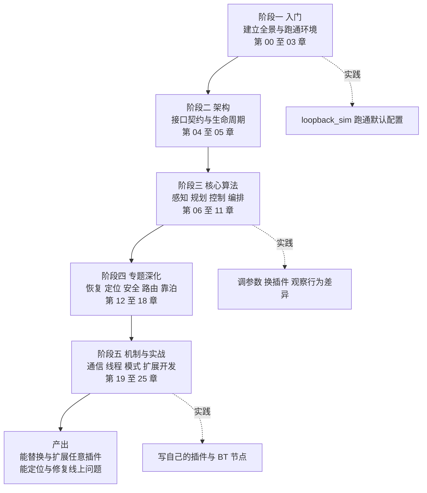

# 第 25 章 学习路线图：从读懂到用好 Nav2

> **一句话总结**：Nav2 的最优学习路径是"先架构后算法、先接口后实现、先跑通后修改"——沿着 nav2_core 接口宪法 → 行为树编排 → 各算法服务器的顺序读源码，配合 loopback_sim 从改参数到写插件的四级实践阶梯，可以在最短时间内把这个 40 余包的大型系统内化为自己的工程能力。

> **前置知识**：第 00 章 · 第 24 章 ｜ **知识依赖图**：[KnowledgeGraph/Knowledge](KnowledgeGraph/Knowledge.md)

作为全书收官，本章不再引入新知识，而是回答三个问题：**按什么顺序学**（章节计划）、**按什么顺序读源码**（阅读路线）、**留下什么**（可长期复用的架构知识卡片）。

## 25.1 学习路线总图

全书 25 章可以收敛为五个阶段：

三条并行主线贯穿始终：**读**（源码与本书）、**跑**（仿真环境验证每个概念）、**记**（沉淀为 25.4 节的知识卡片）。只读不跑，架构理解会悬空；只跑不记，三个月后一切归零。

## 25.2 章节学习计划表

以下计划与第 00 章 0.7 节大纲完全对应。星级含义：★★★★★ 必学、★★★★ 推荐、★★★ 可选按需。建议顺序基本沿章节号推进，个别章节可按角色前置或后置。总投入约 55~70 小时，按每周 6 小时计约需 10~12 周。

| 章节 | 重要度 | 建议顺序 | 预计耗时 | 学习目标一句话 |
|---|---|---|---|---|
| 00_项目概览 | — | 1 | 1.5 h | 建立包地图与四层架构心智模型 |
| 01_整体架构 | ★★★★★ | 2 | 3 h | 画得出服务器拓扑与一次导航的完整数据流 |
| 02_目录设计 | ★★★ | 3 | 1 h | 看到包名即能推断其职责与依赖方向 |
| 03_模块总览 | ★★★★ | 4 | 2 h | 40+ 包职责速查表烂熟于心 |
| 04_nav2_core插件接口 | ★★★★★ | 5 | 3.5 h | 逐一说出十余种插件契约的方法与注入依赖 |
| 05_生命周期管理 | ★★★★★ | 6 | 3 h | 解释 configure 到 activate 的编排与 bond 保活 |
| 06_Costmap2D | ★★★★★ | 7 | 4 h | 讲清分层更新两阶段与膨胀层代价模型 |
| 07_PlannerServer与全局规划 | ★★★★ | 8 | 3 h | 理解规划服务器的插件调度与 NavFn 势场法 |
| 08_SmacPlanner | ★★★★★ | 9 | 4.5 h | 掌握 Hybrid-A* 的运动基元与启发式设计 |
| 09_ControllerServer与局部控制 | ★★★★★ | 10 | 3.5 h | 理清控制循环与进度/目标检查器体系 |
| 10_MPPI与RPP控制器 | ★★★★★ | 11 | 4.5 h | 说清采样优化与调节纯追踪的适用边界 |
| 11_行为树与BTNavigator | ★★★★★ | 12 | 4 h | 能读写默认导航树 XML 并定位任一 BT 节点源码 |
| 12_Behaviors恢复行为 | ★★★★ | 13 | 2 h | 掌握 TimedBehavior 执行循环与恢复策略编排 |
| 13_AMCL定位 | ★★★★ | 14 | 3 h | 理解粒子滤波三步循环与自适应重采样 |
| 14_MapServer | ★★★ | 15 | 1.5 h | 掌握地图格式与加载保存服务 |
| 15_Smoother路径平滑 | ★★★ | 16 | 2 h | 区分简单平滑与约束优化平滑的场景 |
| 16_CollisionMonitor与VelocitySmoother | ★★★★ | 17 | 2.5 h | 解释独立安全层为何绕开代价地图 |
| 17_Route路线规划 | ★★★★ | 18 | 3 h | 掌握图路由与自由空间规划的互补关系 |
| 18_Docking靠泊 | ★★★★ | 19 | 2.5 h | 理清靠泊状态机与 ChargingDock 抽象 |
| 19_Action与通信机制 | ★★★★ | 20 | 2.5 h | 掌握 SimpleActionServer 抢占语义与 QoS 约定 |
| 20_线程模型 | ★★★★ | 21 | 3 h | 画得出各服务器的线程与回调组分布 |
| 21_配置系统 | ★★★ | 22 | 1.5 h | 掌握参数声明工具与动态更新回调 |
| 22_设计模式专题 | ★★★★ | 23 | 2.5 h | 能在源码中指认十余种模式的落点 |
| 23_现代C++专题 | ★★★ | 24 | 2 h | 理解智能指针所有权约定与模板化服务器 |
| 24_扩展开发指南 | ★★★★★ | 25 | 4 h | 独立完成一个插件的四步曲全流程 |
| 25_学习路线图 | ★★★ | 26 | 1 h | 制定个人复习与实践计划 |

按角色裁剪：**应用集成者**可精读 00~05、11、24 并略读其余；**算法工程师**在此基础上精读 06~10 中与自己方向相关的章节；**系统/平台工程师**则应把 19~23 的机制专题提到第三阶段之前。

## 25.3 源码阅读路线

书是地图，源码才是地形。推荐按四步递进，并明确"精读、通读、跳过"的取舍：

**第一步：接口与配置（约 1 周）**。通读 `nav2_core/include/nav2_core/` 全部头文件——不足两千行却定义了整个系统的边界；对照 `nav2_bringup/params/nav2_params.yaml` 把每个服务器的插件清单与接口对上号。读完这两处，Nav2 的"骨架"就立起来了。

**第二步：编排层（约 1 周）**。读 `nav2_bt_navigator/src/` 与 `nav2_bt_navigator/behavior_trees/navigate_to_pose_w_replanning_and_recovery.xml`，弄清一次 NavigateToPose 请求如何被拆解为 ComputePathToPose 与 FollowPath 的循环；再挑三五个 `nav2_behavior_tree/plugins/` 下的节点对照 XML 阅读。

**第三步：算法服务器（约 2 周）**。精读 `nav2_planner/src/planner_server.cpp` 与 `nav2_controller/src/controller_server.cpp`——两者是"宿主服务器 + 插件"范式的标准样板，读懂一个，另一个及 smoother/behavior 服务器都是同构的。

**第四步：按需深入**。此后依方向选择精读对象，不必求全：

| 取舍 | 模块 | 理由 |
|---|---|---|
| 必须精读 | nav2_costmap_2d | 所有规划控制的输入，分层与膨胀机制影响一切调参 |
| 按需精读 | nav2_smac_planner | 做规划方向必读；模板化 A* 框架含金量高 |
| 按需精读 | nav2_mppi_controller | 做控制方向必读；采样优化与 critic 链设计精彩 |
| 通读即可 | nav2_behaviors、nav2_smoother | 结构简单，作为插件写法样板浏览 |
| 可以跳过 | dwb 内部细节 | 概念被 critic 链概括，工程上 MPPI/RPP 已是主流 |
| 可以跳过 | amcl 的 pf 底层 C 库 | 理解粒子滤波原理即可，实现是三方遗产代码 |
| 最后再看 | nav2_route、nav2_docking | 业务需要时再读，接口层面第 17/18 章已覆盖 |

**配套实践阶梯**（与阅读并行，每级都以"能解释现象"为过关标准）：

1. **跑通**：用 `nav2_loopback_sim` 或仿真环境启动 nav2_bringup，完成一次完整导航并观察 RViz 中的路径与代价地图。
2. **改参数**：调整膨胀半径、控制频率、恢复行为清单，预测并验证行为变化。
3. **换插件**：把规划器从 NavFn 换成 SmacHybrid、控制器从 RPP 换成 MPPI，仅改 YAML 不碰代码。
4. **写插件**：按第 24 章四步曲实现一个直线规划器或自定义 BT 条件节点，接入默认行为树。

## 25.4 知识提炼：长期有效的架构知识卡片

以下卡片提炼的是**超越 Nav2 本身**的架构知识，可直接放入个人知识库（Obsidian 等），每条附指向章节便于回溯：

| 卡片 | 核心内容 | 出处 |
|---|---|---|
| 插件架构 | 用纯虚接口 + 动态加载把算法边界外置为配置。宿主只依赖抽象，扩展方只依赖接口包，双方通过描述文件与资源索引在运行时会合。 | 第 04、22、24 章 |
| 生命周期节点 | 把"构造即可用"拆为 unconfigured/inactive/active 显式状态，使大型分布式系统获得确定性的启动顺序与优雅退化能力。 | 第 05 章 |
| 行为树编排 | 用可组合的树结构替代硬编码状态机，逻辑外置为 XML；恢复与重试成为局部子树而非全局跳转，复杂度随规模线性而非指数增长。 | 第 11 章 |
| 组合模式 | BT 的容器节点与叶子节点同构于 Composite 模式：统一 tick 接口让编排逻辑与业务动作可以任意嵌套。 | 第 11、22 章 |
| 状态机的正确位置 | Nav2 没有消灭状态机，而是把它下沉到局部（生命周期转换、靠泊阶段推进），全局编排交给 BT——状态机适合封闭小状态空间，BT 适合开放任务逻辑。 | 第 05、18 章 |
| 微服务化拆分 | 规划/控制/恢复各自独立进程与 Action 接口，实现故障隔离、独立频率与可替换性；代价是通信与生命周期编排的复杂度，由 lifecycle_manager 与 composition 兜底。 | 第 01、20 章 |
| 依赖注入 | 插件所需的节点、TF、代价地图全部经 configure 注入而非自行获取，测试可 mock、耦合可控——与全局单例是一对反义词。 | 第 22、24 章 |
| 模板方法 | Layer 的 initialize 固化调用顺序、TimedBehavior 固化执行循环：基类定骨架、子类填空，是框架"强约束扩展点"的标准手法。 | 第 06、12、22 章 |
| 装饰器叠加 | RotationShimController 包裹任意控制器、BT 装饰节点改写子节点语义：不改原实现而增强行为，层层可叠。 | 第 09、22 章 |
| 责任链评分 | DWB 与 MPPI 的 critic 链把"轨迹好坏"拆为可插拔的独立评分器之和，增删指标零侵入——多目标优化的工程化范本。 | 第 10、22 章 |
| 抢占式任务模型 | SimpleActionServer 的 current+pending 双目标模型：新目标不打断执行线程，而是置标志由执行循环择机原子切换，是长任务服务的通用设计。 | 第 19 章 |
| 独立安全层 | 安全功能与算法栈解耦：collision_monitor 直连原始传感器与速度指令，即使上游全部失效仍能兜底——安全不依赖"聪明"，依赖"简单"。 | 第 16 章 |
| SOLID 在 Nav2 | 单一职责（每服务器一事）、开闭（插件扩展不改宿主）、里氏替换（任意插件互换）、接口隔离（nav2_core 按角色拆接口）、依赖倒置（服务器依赖抽象）在同一系统内齐全落地，可作教学案例。 | 第 04、22 章 |
| 所有权约定 | unique_ptr 表达独占（宿主拥有插件）、shared_ptr 表达共享（节点与订阅）、weak_ptr 打破回环（插件回指宿主）——智能指针选型即架构文档。 | 第 23 章 |

## 25.5 全书总结

回望全书，Nav2 教给我们的不只是导航：它示范了如何用**接口宪法**（nav2_core）约束一个 40 余包的系统、如何用**生命周期**驯服分布式启停、如何用**行为树**让任务逻辑摆脱代码发布周期、如何用**插件机制**让学术算法与工程框架各自演进。这些手法适用于任何大型机器人乃至通用软件系统。愿你合上本书时，带走的不是 25 章的细节，而是这套可迁移的系统构建观。

## 25.6 自测清单

通读全书后，用以下 10 题自查掌握程度（均可在对应章节找到答案）：

1. 一次 NavigateToPose 请求从 Action 到 /cmd_vel 经过哪些节点与话题？（第 01、11 章）
2. nav2_core 定义了哪些插件接口？各自被哪个服务器加载？（第 04 章）
3. lifecycle_manager 如何保证各服务器按序启动？bond 断开会发生什么？（第 05 章）
4. 代价地图两阶段更新（updateBounds/updateCosts）为什么要分开？膨胀层的代价如何随距离衰减？（第 06 章）
5. Hybrid-A* 与普通 A* 的状态空间差异是什么？为什么它天然满足运动学约束？（第 08 章）
6. MPPI 一个控制周期内做了哪几件事？critic 链如何影响最终轨迹？（第 10 章）
7. 默认行为树中 RecoveryNode 与 RoundRobin 如何协作完成"重规划 + 恢复"？（第 11、12 章）
8. SimpleActionServer 收到新目标时如何实现无缝抢占？（第 19 章）
9. 为什么 collision_monitor 不使用代价地图而直连传感器？（第 16 章）
10. 写一个自定义规划器插件的四步曲分别是什么？最容易错在哪一步？（第 24 章）

若有超过三题答不上来，回到对应章节按 25.2 的计划表补课即可。

## 25.7 最佳实践与容易踩坑

- **不要按章节号死磕到底**：卡在算法章节（08、10、13）时先跳过推导、记住输入输出契约继续前进，第二遍再补数学细节。
- **每章配一次动手验证**：哪怕只是改一个参数看现象，也远胜连读三章——Nav2 的知识密度决定了纯阅读的遗忘率极高。
- **源码版本要对齐**：本书基于 main 分支 1.5.0，用 Humble 二进制包对照阅读会遇到接口差异（如 createPlan 签名），建议直接以本仓库源码为准。
- **知识卡片当天沉淀**：25.4 的卡片是模板而非成品，用自己的话改写一遍并链接到笔记库中的相关概念，记忆留存率完全不同。
- **别急于造轮子**：动手写插件前先确认官方与社区（navigation.ros.org 的插件列表）是否已有实现，Nav2 生态的复用率远比想象中高。

## 25.8 延伸阅读

- docs.nav2.org：First-Time Robot Setup 与 Tuning Guide 是本书之外最重要的实操材料
- 《Behavior Trees in Robotics and AI》（Colledanchise & Ögren）：行为树理论的系统读本
- ROS 2 官方文档的 Executors 与 Lifecycle 章节：补全第 05、20 章的底层机制
- Nav2 GitHub 仓库的 Issues 与 PR 讨论区：架构决策的第一手演进记录
- ROSCon 历年 Nav2 相关演讲：维护者亲述的设计取舍与路线图

## 25.C 阅读检查点

1. 全书五个学习阶段各覆盖哪些章节？三条并行主线"读、跑、记"分别对应什么产出？（见 25.1）
2. 按你的角色（应用集成者/算法工程师/系统平台工程师），应精读哪些章节、可略读哪些？总投入预算大约多少小时？（见 25.2）
3. 源码阅读四步递进的顺序是什么？为什么第一步是 nav2_core 头文件加 bringup 参数文件而不是某个算法包？（见 25.3）
4. 四级实践阶梯（跑通→改参数→换插件→写插件）中，"换插件"一级为什么只改 YAML 不碰代码就能完成？（见 25.3）
5. 25.4 的架构知识卡片里，哪几张是"超越 Nav2 本身"、可直接迁移到其他大型系统的？请挑三张用自己的话复述。（见 25.4、25.5）

---

**全书完。** 感谢与本书一路同行——若需回顾全景与章节大纲，请返回 [00_项目概览](00_项目概览.md)。
