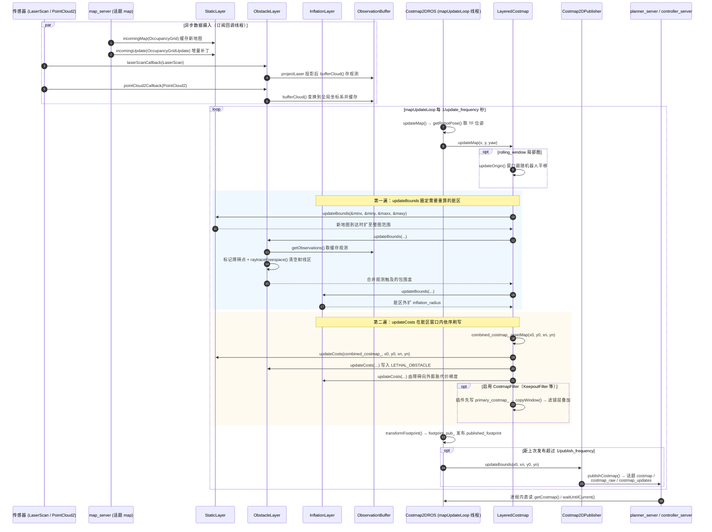

# 端到端时序图：Costmap2DROS 的 mapUpdateLoop 更新循环

## 场景描述

代价地图没有显式的"用户操作"入口——它是被动而持续的：map_server 发布一次静态地图、激光雷达每帧发布 LaserScan、深度相机发布 PointCloud2，这些数据经各 Layer 的订阅回调缓存后，由 Costmap2DROS 独立线程中的 `mapUpdateLoop()` 以 `update_frequency` 节律统一消费——每拍执行"各层 updateBounds 圈定脏区 → 各层 updateCosts 依序刷写主栅格 → 节流发布"三部曲。planner_server 与 controller_server 各自内嵌一份 Costmap2DROS（全局图/局部图），规划与控制读到的每一个代价值都产自这条循环。本篇基于 Nav2 1.5.0（main 分支）源码核实该链路。

## 全链路时序图

## 分阶段解说

### 阶段一：传感器数据的异步摄入

数据摄入与地图刷写是**解耦的两条线**。StaticLayer 在 onInitialize 订阅 `map` 话题：`StaticLayer::incomingMap()`（nav2_costmap_2d/plugins/static_layer.cpp，约 302 行）缓存整幅新地图，`incomingUpdate()`（约 319 行）处理增量补丁。ObstacleLayer 按 `observation_sources` 参数逐源创建订阅（nav2_costmap_2d/plugins/obstacle_layer.cpp，约 261 行与约 323 行）：`laserScanCallback()`（约 388 行）先用 laser_geometry 投影成点云，`pointCloud2Callback()`（约 465 行）直接转交；两者最终都调用 `ObservationBuffer::bufferCloud()`（nav2_costmap_2d/src/observation_buffer.cpp，约 79 行）把点云变换到全局坐标系、按 `observation_persistence` 滚动保留。回调只写缓存，不动栅格。

### 阶段二：更新循环的驱动

`Costmap2DROS::on_activate()` 启动独立线程运行 `mapUpdateLoop()`（nav2_costmap_2d/src/costmap_2d_ros.cpp，线程创建约 315 行，函数体约 533 行）：以 `update_frequency` 节律循环，未被 `stop()` 暂停时持锁调用 `updateMap()`（约 602 行）——先 `getRobotPose()` 从 TF 取 `global_frame → robot_base_frame` 位姿，再把 (x, y, yaw) 交给 `LayeredCostmap::updateMap()`（nav2_costmap_2d/src/layered_costmap.cpp，约 136 行）。局部图的 `rolling_window_` 为 true 时先 `updateOrigin()` 让窗口跟随机器人。

### 阶段三：第一遍——updateBounds 圈定脏区

`LayeredCostmap::updateMap()` 对每个插件层与滤镜层依次调用 `updateBounds()`（遍历约 166-201 行），各层**只扩不缩**地合并出本拍需要重算的世界坐标包围盒：StaticLayer（static_layer.cpp，约 365 行）平时返回空、新地图到达时扩到整图；ObstacleLayer（obstacle_layer.cpp，约 476 行）从 ObservationBuffer 取出缓存观测，把障碍点圈入包围盒并执行 `raytraceFreespace()`（约 705 行）沿射线清空自由区；InflationLayer（nav2_costmap_2d/plugins/inflation_layer.cpp，约 149 行）把别人的脏区再外扩一个 `inflation_radius`，保证膨胀梯度完整。若某层的 bounds 反而变小会打印 "Illegal bounds change" 告警。

### 阶段四：第二遍——updateCosts 依序刷写

包围盒经 `worldToMapEnforceBounds()` 换算成栅格窗口 (x0, y0, xn, yn) 后（约 203-210 行），无滤镜时先 `combined_costmap_.resetMap()` 清窗口，再按插件配置顺序逐层 `updateCosts()`（约 216-224 行）：StaticLayer 写入地图先验（static_layer.cpp，约 441 行），ObstacleLayer 把观测点写成 LETHAL_OBSTACLE（obstacle_layer.cpp，约 604 行），InflationLayer 最后基于障碍格向外生成指数衰减的代价梯度（inflation_layer.cpp，约 283 行）——**层序即语义**：膨胀必须排在所有障碍源之后。启用 CostmapFilter（如 KeepoutFilter）时走双图路径（layered_costmap.cpp，约 228-251 行）：插件先写 `primary_costmap_`，`copyWindow()` 拷贝到 `combined_costmap_` 后滤镜层再叠加，保证滤镜效果不会在下一拍被插件层当成"真实障碍"。

### 阶段五：发布与消费

刷写完成后 `updateMap()` 还会 `transformFootprint()` 并发布 `published_footprint`（costmap_2d_ros.cpp，约 615-620 行）。发布按 `publish_frequency` 节流（mapUpdateLoop 内约 560-582 行）：先把脏区窗口告知发布器 `updateBounds()`，到期再 `Costmap2DPublisher::publishCostmap()`（nav2_costmap_2d/src/costmap_2d_publisher.cpp，约 237 行）向 `costmap`（OccupancyGrid）、`costmap_raw`（nav2_msgs::Costmap）、`costmap_updates`/`costmap_raw_updates`（增量）等话题发布（发布器创建约 71-80 行）。但注意：planner/controller 是**进程内直读** `getCostmap()` 指针，话题主要服务于 RViz 与跨进程消费者（如 collision_monitor 的 PolygonSource）；服务器在清图恢复后则用 `waitUntilCurrent()`（costmap_2d_ros.cpp，约 627 行）阻塞等待代价地图重新"喂饱"传感器数据。

## 相关章节

- [第 06 章 Costmap2D](../../06_Costmap2D.md)
- [第 07 章 PlannerServer 与全局规划](../../07_PlannerServer与全局规划.md)
- [第 09 章 ControllerServer 与局部控制](../../09_ControllerServer与局部控制.md)
- [第 14 章 MapServer](../../14_MapServer.md)
- [第 20 章 线程模型](../../20_线程模型.md)
