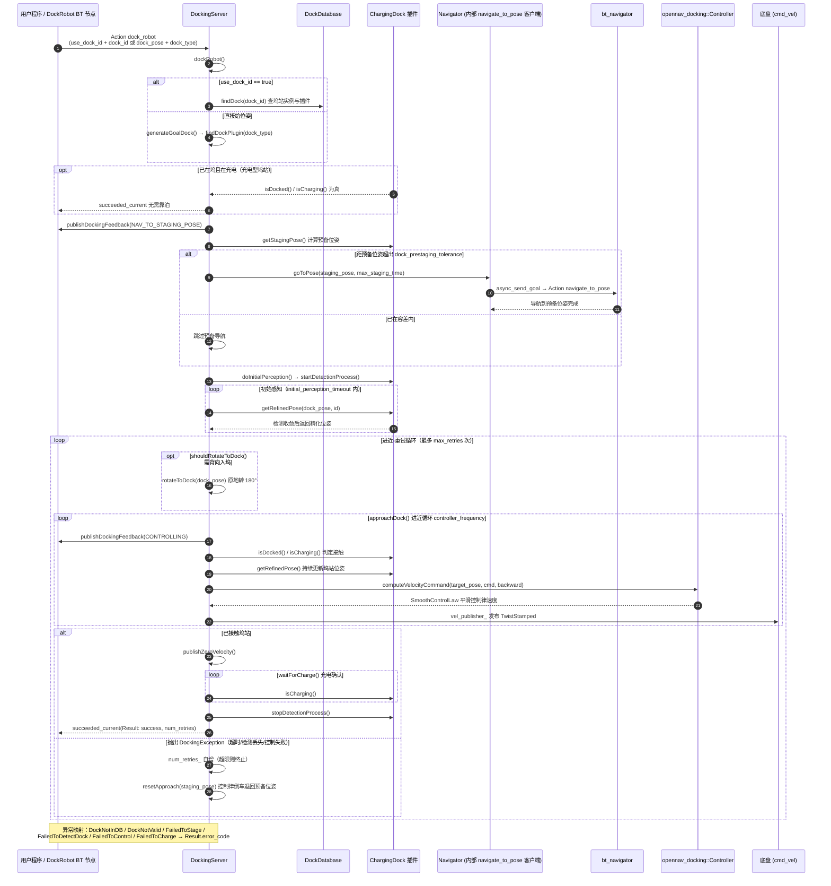

# 端到端时序图：nav2_docking（opennav_docking）DockRobot 靠泊链路

## 场景描述

机器人电量不足，或任务要求返回工位——用户程序（或行为树中的 `DockRobot` BT 节点，见 nav2_docking/opennav_docking_bt/behavior_trees/application_example.xml）向 docking_server 发送 `dock_robot` Action：既可以只给一个 `dock_id` 让服务器查坞站数据库，也可以直接给 `dock_pose` + `dock_type` 临时指定坞站。随后服务器完成"导航到预备位姿（staging pose）→ 启动检测并精化坞站位姿 → 闭环进近直到接触 → 等待充电确认"的完整流程，失败自动退回预备位姿重试。本篇基于 Nav2 1.5.0（main 分支）源码核实该链路。

## 全链路时序图

## 分阶段解说

### 阶段一：Goal 接收与坞站解析

`DockingServer::on_configure()`（nav2_docking/opennav_docking/src/docking_server.cpp，约 51 行）创建 `dock_robot` 与 `undock_robot` 两个 Action 服务器，回调分别是 `dockRobot()`（约 175 行）与 `undockRobot()`（约 621 行）。`dockRobot()` 先按 Goal 分流：`use_dock_id` 为 true 时经 `dock_db_->findDock(dock_id)` 从坞站数据库取实例（数据库由 yaml 参数或外部服务装载），否则 `generateGoalDock()`（约 379 行）用 `dock_pose`/`dock_type` 临时构造并按类型查 ChargingDock 插件。若插件报告 `isDocked()`/`isCharging()` 已为真则直接成功返回（约 215 行）。

### 阶段二：导航到预备位姿（staging pose）

服务器发布 `NAV_TO_STAGING_POSE` 反馈后，调用插件的 `getStagingPose()` 得到"入坞起跑线"位姿（接口定义见 nav2_docking/opennav_docking_core/include/opennav_docking_core/charging_dock.hpp，约 81 行）。若机器人距其超出 `dock_prestaging_tolerance` 且 Goal 允许（`navigate_to_staging_pose`），则 `navigator_->goToPose()`（nav2_docking/opennav_docking/src/navigator.cpp，约 47 行）经内部 `navigate_to_pose` Action 客户端（约 38 行创建）驱动 bt_navigator 完成一次常规导航——这一步复用了完整的 NavigateToPose 链路及其恢复能力。

### 阶段三：初始感知

`doInitialPerception()`（docking_server.cpp，约 389 行）先调用插件 `startDetectionProcess()` 启动检测（如 AprilTag、红外），再以 `controller_frequency` 轮询 `getRefinedPose(dock_pose, id)` 直到检测收敛或超过 `initial_perception_timeout`（超时抛 `FailedToDetectDock`）。此后 `dock_pose` 从数据库中的粗略标注升级为传感器实测的精确位姿。

### 阶段四：进近控制循环

若插件 `shouldRotateToDock()` 要求背向入坞，先由 `rotateToDock()`（约 416 行）原地掉头。核心是 `approachDock()`（约 453 行）：每拍先查 `isDocked()`/`isCharging()` 判定是否已接触；再 `getRefinedPose()` 刷新目标（把目标沿坞站朝向**向后投影 0.25m**，保证机器人在触点前不会走完螺旋收敛曲线）；然后调用 `Controller::computeVelocityCommand()`（nav2_docking/opennav_docking/src/controller.cpp，约 98 行）——内部是 `nav2_graceful_controller::SmoothControlLaw` 平滑控制律（约 67 行构造），可选碰撞检查 `isCollisionFree()`（约 186 行）——经 `vel_publisher_` 直接发布速度。超过 `dock_approach_timeout` 抛 `FailedToControl`。

### 阶段五：充电确认、重试与收尾

接触后 `publishZeroVelocity()`（约 781 行）刹停，`waitForCharge()`（约 519 行）轮询插件 `isCharging()` 直到确认充电（非充电型坞站直接通过）。成功则 `stashDockData()` 记录坞站类型、`stopDetectionProcess()` 停止检测、`succeeded_current()` 返回。进近或充电确认阶段抛出的 `DockingException` 进入重试逻辑：`num_retries_` 未超 `max_retries` 时经 `resetApproach()`（约 551 行）用控制律倒车退回预备位姿再来一轮；超限或遭遇 `DockNotInDB` 等不可恢复异常时，按异常类型映射 `Result.error_code`（约 321-357 行）终止。脱坞（`undockRobot()`）是逆过程：以入坞时记录的 `curr_dock_type_` 找插件，控制律退到 staging pose 并确认 `hasStoppedCharging()`。

## 相关章节

- [第 18 章 Docking 靠泊](../../18_Docking靠泊.md)
- [第 11 章 行为树与 BTNavigator](../../11_行为树与BTNavigator.md)
- [第 10 章 MPPI 与 RPP 控制器](../../10_MPPI与RPP控制器.md)
- [第 04 章 nav2_core 插件接口](../../04_nav2_core插件接口.md)
- [第 19 章 Action 与通信机制](../../19_Action与通信机制.md)
