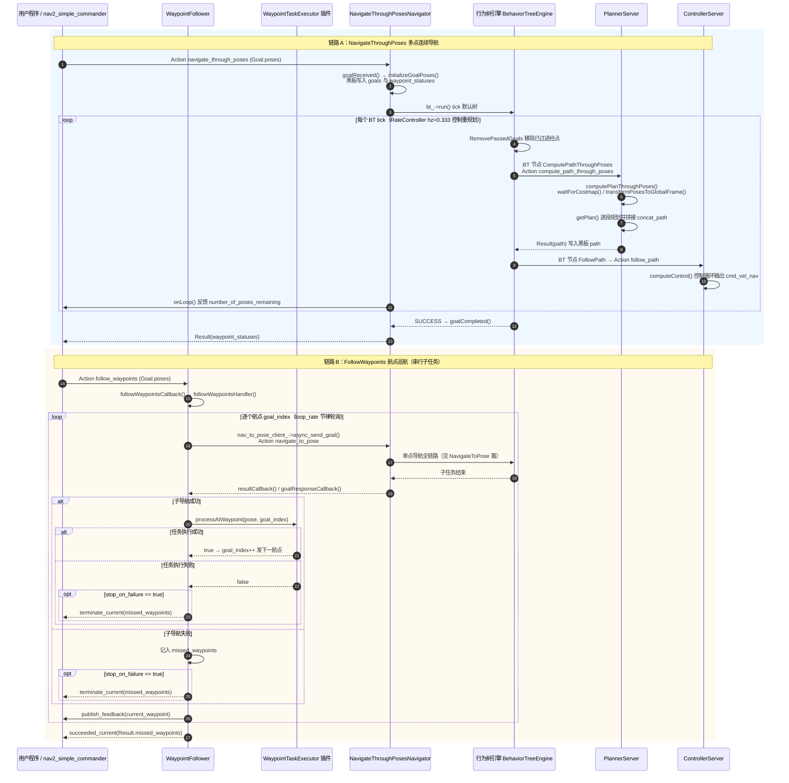

# 端到端时序图：NavigateThroughPoses 多点导航与 FollowWaypoints 航点巡航

## 场景描述

当用户希望机器人**依次途经一串位姿**时，Nav2 提供两条语义不同的链路：其一是 bt_navigator 的 `navigate_through_poses` Action——把所有途经点交给行为树，由 planner_server 一次性规划穿越多点的连续路径（途经点是"路径形状约束"，机器人不会在中间点停留）；其二是 waypoint_follower 的 `follow_waypoints` Action——把每个航点当成一次独立的 `navigate_to_pose` 子任务串行执行，并在每个航点到达后回调 WaypointTaskExecutor 插件执行拍照、等待、充电等业务动作（航点是"任务节点"）。本篇基于 Nav2 1.5.0（main 分支）源码分别核实两条链路。

## 全链路时序图

## 分阶段解说

### 链路 A · 阶段一：Goal 接收与黑板初始化

`NavigateThroughPosesNavigator` 的 Action 名为 `navigate_through_poses`（nav2_bt_navigator/include/nav2_bt_navigator/navigators/navigate_through_poses.hpp，约 63 行）。`goalReceived()`（nav2_bt_navigator/src/navigators/navigate_through_poses.cpp，约 85 行）调用 `initializeGoalPoses()`（约 255 行起）把 Goal 中的每个位姿经 `transformPoseInTargetFrame()` 统一到全局坐标系，写入黑板 `goals` 条目（nav_msgs::msg::Goals），并初始化 `waypoint_statuses` 数组用于 Result 汇报每个途经点的达成状态。`onLoop()`（约 135 行起）每个 tick 估算剩余距离与 `number_of_poses_remaining` 发布反馈。

### 链路 A · 阶段二：多点规划与执行

默认树 nav2_bt_navigator/behavior_trees/navigate_through_poses_w_replanning_and_recovery.xml 与单点版结构同源，差异有二：`RateController hz="0.333"`（多点规划更贵，3 秒一次），以及规划子树换成 `RemovePassedGoals`（半径 0.7m 内视为已过，同步更新 waypoint_statuses）串接 `ComputePathThroughPoses`。服务端回调 `PlannerServer::computePlanThroughPoses()`（nav2_planner/src/planner_server.cpp，约 338 行）对相邻位姿两两调用 `getPlan()`（约 616 行）逐段规划再拼接；途经点为空时抛 `NoViapointsGiven` 映射为 NO_VIAPOINTS_GIVEN 错误码。路径执行仍由 `FollowPath` BT 节点交给 `ControllerServer::computeControl()`（nav2_controller/src/controller_server.cpp，约 448 行），cmd_vel 链路与单点导航完全一致（cmd_vel_nav → velocity_smoother → cmd_vel_smoothed → collision_monitor → cmd_vel）。

### 链路 B · 阶段一：航点任务接收

`WaypointFollower` 在 on_configure（nav2_waypoint_follower/src/waypoint_follower.cpp，约 63 行）创建 `follow_waypoints` Action 服务器（回调 `followWaypointsCallback()`，约 357 行）与 `follow_gps_waypoints` 服务器（回调 `followGPSWaypointsCallback()`，约 369 行，先经 robot_localization 的 FromLL 服务把经纬度转成地图坐标），同时用 pluginlib 加载 `nav2_core::WaypointTaskExecutor` 插件（约 81 行，默认 `wait_at_waypoint`，见 nav2_waypoint_follower/src/parameter_handler.cpp 约 37 行）。两个回调最终汇入模板函数 `followWaypointsHandler()`（约 169 行）。

### 链路 B · 阶段二：串行子导航循环

`followWaypointsHandler()` 以 `loop_rate` 节律轮询：对当前 `goal_index` 的航点，经内部 Action 客户端 `nav_to_pose_client_`（on_configure 约 60 行创建，指向 `navigate_to_pose`）调用 `async_send_goal()`（约 255 行）发起一次完整的单点导航——也就是说**每个航点都会独立跑一遍 NavigateToPose 全链路**（含 BT 恢复）。子任务结果由 `resultCallback()`（约 382 行）与 `goalResponseCallback()`（约 415 行）异步写入 `current_goal_status_`；取消请求则经 `async_cancel_all_goals()` 级联撤销子导航（约 212 行）。

### 链路 B · 阶段三：WaypointTaskExecutor 插件回调

子导航成功后，服务器调用 `waypoint_task_executor_->processAtWaypoint(pose, goal_index)`（约 295 行）执行业务动作。以内置的 `WaitAtWaypoint::processAtWaypoint()`（nav2_waypoint_follower/plugins/wait_at_waypoint.cpp，约 63 行）为例，它按参数睡眠指定毫秒数；其他内置实现还有 `PhotoAtWaypoint` 与 `InputAtWaypoint`。子导航失败或任务执行失败的航点记入 `missed_waypoints`（含 error_code / error_msg）；`stop_on_failure` 为 true 时立即 `terminate_current()` 终止巡航，否则跳过继续下一个航点，全部处理完后 `succeeded_current()` 返回。

### 两条链路的选型口径

途经点只是**几何约束**、机器人不需要在点上停留时选 NavigateThroughPoses——一次规划整条路径，运动连贯；每个点是**必须逐一完成的任务地点**（停留、执行动作、失败可跳过）时选 FollowWaypoints——代价是每段之间机器人会明显减速停车再出发。两者可以叠加：FollowWaypoints 的每段子导航内部依然享受 BT 的重规划与恢复能力。

## 相关章节

- [第 07 章 PlannerServer 与全局规划](../../07_PlannerServer与全局规划.md)
- [第 09 章 ControllerServer 与局部控制](../../09_ControllerServer与局部控制.md)
- [第 11 章 行为树与 BTNavigator](../../11_行为树与BTNavigator.md)
- [第 04 章 nav2_core 插件接口](../../04_nav2_core插件接口.md)
- [第 19 章 Action 与通信机制](../../19_Action与通信机制.md)
