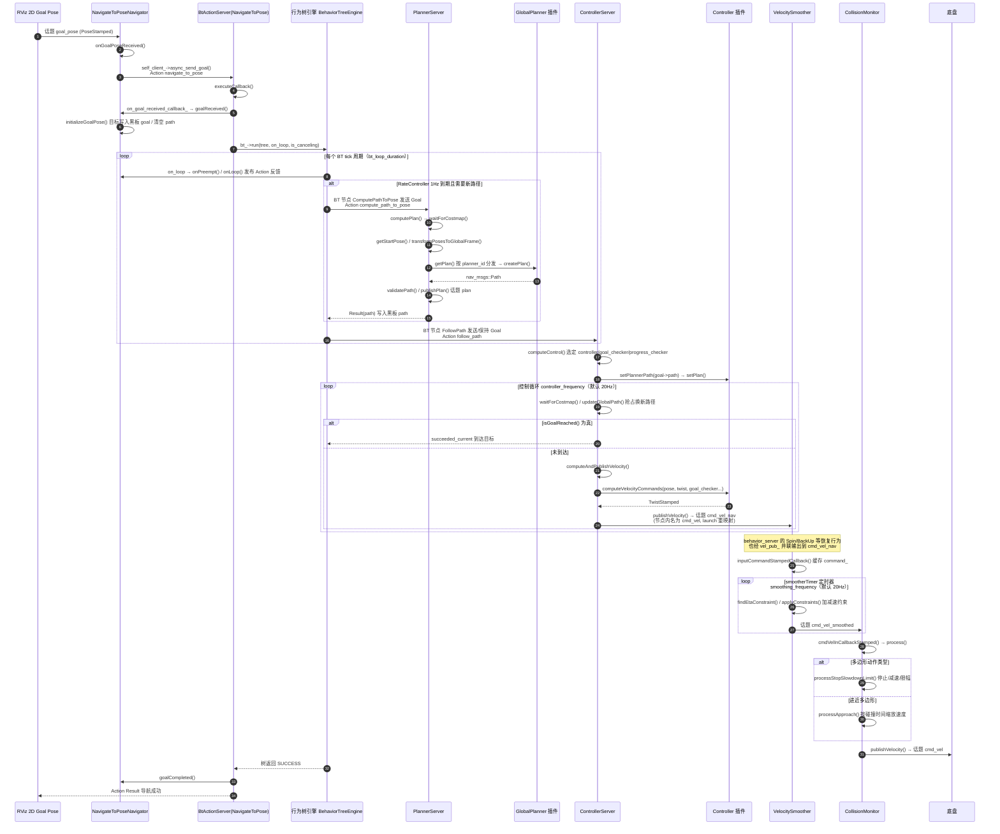

# 端到端时序图：NavigateToPose 单点导航全链路

## 场景描述

用户在 RViz 中点击「2D Goal Pose」工具、在地图上拖出一个目标位姿——这是 Nav2 最经典的用户操作。这个点击动作会发布一条 `goal_pose` 话题消息（geometry_msgs/PoseStamped），随后触发一条贯穿 bt_navigator、planner_server、controller_server、velocity_smoother、collision_monitor 五个生命周期节点的完整链路，最终以底盘可执行的 `cmd_vel` 速度指令收尾。本篇按 Nav2 1.5.0（main 分支）源码逐环节核实这条链路的真实回调、Action 名与 Topic 名。

需要先记住 cmd_vel 链路的口径：controller_server 与 behavior_server 都把各自的 `cmd_vel` 输出重映射为 **cmd_vel_nav**（并联汇入，见 nav2_bringup/launch/navigation_launch.py 约 171 行与约 214 行的 remappings），velocity_smoother 订阅 cmd_vel_nav、发布 **cmd_vel_smoothed**，collision_monitor 订阅 cmd_vel_smoothed、发布最终的 **cmd_vel**。

## 全链路时序图

## 分阶段解说

### 阶段一：从 RViz 点击到 Action Goal

RViz 的「2D Goal Pose」工具只发布一条 `goal_pose` 话题消息，真正把话题"升格"为 Action 请求的是 bt_navigator 内的导航器插件自己：`NavigateToPoseNavigator::onGoalPoseReceived()`（nav2_bt_navigator/src/navigators/navigate_to_pose.cpp，约 279 行）把 PoseStamped 包装成 Goal，通过 `self_client_->async_send_goal(goal)`（约 284 行）发给**自己的** `navigate_to_pose` Action 服务器——Action 名由 `getName()` 返回（navigate_to_pose.hpp，约 75 行）。这样话题入口与 Action 入口共用同一条处理路径，程序化调用（如 nav2_simple_commander）则直接走 Action。

### 阶段二：BtActionServer 接管与黑板初始化

`BtActionServer<ActionT>::executeCallback()`（nav2_behavior_tree/include/nav2_behavior_tree/bt_action_server_impl.hpp，约 400 行）是所有导航器共用的 Goal 处理骨架：先回调 `goalReceived()`（navigate_to_pose.cpp，约 95 行），后者调用 `initializeGoalPose()`（约 231 行）把目标位姿变换到全局坐标系并写入黑板的 `goal` 条目、把 `path` 清空；然后调用 `bt_->run()`（nav2_behavior_tree/src/behavior_tree_engine.cpp，约 46 行）进入 tick 循环。每个 tick 周期内的 `on_loop` 闭包会先检查抢占并回调 `onPreempt()`（约 211 行），再回调 `onLoop()`（约 128 行起）计算剩余距离、预计到达时间等并发布 Action 反馈。

### 阶段三：BT 内规划——ComputePathToPose

默认树 nav2_bt_navigator/behavior_trees/navigate_to_pose_w_replanning_and_recovery.xml 用 `RateController hz="1.0"` 包住规划子树：仅当目标更新、路径失效（`ValidatePath` 失败）或目标不再邻近时，`ComputePathToPose` BT 节点（nav2_behavior_tree/plugins/action/compute_path_to_pose_action.cpp）才向 planner_server 的 `compute_path_to_pose` Action 发送 Goal。服务端回调 `PlannerServer::computePlan()`（nav2_planner/src/planner_server.cpp，约 511 行）依次执行 `waitForCostmap()`（约 248 行）、`getStartPose()`（约 289 行）、`transformPosesToGlobalFrame()`（约 302 行），再经 `getPlan()`（约 616 行）按 `planner_id` 分发到 GlobalPlanner 插件的 `createPlan()`，最后 `validatePath()`（约 316 行）校验、`publishPlan()`（约 651 行）发布 `plan` 可视化话题，Result 中的 Path 写回黑板 `path` 端口。

### 阶段四：BT 内控制——FollowPath 与控制循环

`FollowPath` BT 节点向 controller_server 的 `follow_path` Action 发送 Goal（黑板 `path` 更新时以抢占方式换路径），服务端回调 `ControllerServer::computeControl()`（nav2_controller/src/controller_server.cpp，约 448 行）：先按 Goal 里的 id 选定 controller / goal_checker / progress_checker / path_handler 四类插件，`setPlannerPath()`（约 642 行）把路径交给控制器插件，然后进入 `controller_frequency` 节律的 while 循环——每拍 `waitForCostmap()`、`updateGlobalPath()`（约 794 行，处理抢占的新路径）、`isGoalReached()`，未到达则 `computeAndPublishVelocity()`（约 665 行）：取机器人位姿、progress_checker 检查进展、path_handler 裁剪变换局部路径，调用控制器插件的 `computeVelocityCommands()` 得到 TwistStamped，经 `publishVelocity()`（约 860 行）发布。节点内话题名是 `cmd_vel`，launch 重映射为 **cmd_vel_nav**。behavior_server 中 `TimedBehavior` 的 `vel_pub_` 同样发布 `cmd_vel` 并被重映射到 cmd_vel_nav（nav2_behaviors/include/nav2_behaviors/timed_behavior.hpp，约 146 行）——恢复行为与控制器**并联**汇入同一话题。

### 阶段五：速度平滑——velocity_smoother

velocity_smoother 的输入订阅在节点内也叫 `cmd_vel`（launch 重映射为 cmd_vel_nav，navigation_launch.py 约 247 行）。`VelocitySmoother::inputCommandStampedCallback()`（nav2_velocity_smoother/src/velocity_smoother.cpp，约 232 行）只做合法性校验并缓存 `command_`；真正的输出由独立定时器 `smootherTimer()`（约 312 行，定时器创建于 on_activate 约 170 行）以 `smoothing_frequency` 驱动：超时未收到新指令则发零速减速停车，否则用 `findEtaConstraint()`（约 258 行）与 `applyConstraints()`（约 289 行）按加减速上限逐轴收敛，发布到 `cmd_vel_smoothed`（发布器创建于约 143 行）。

### 阶段六：碰撞监护与最终 cmd_vel

collision_monitor 的输入/输出话题默认值就是 `cmd_vel_smoothed` / `cmd_vel`（nav2_collision_monitor/src/collision_monitor_node.cpp，约 267 行与约 269 行）。`cmdVelInCallbackStamped()`（约 211 行）触发 `process()`（约 429 行）：把各数据源（`Scan::dataCallback()`，nav2_collision_monitor/src/scan.cpp 约 111 行等）的最新点云点变换到基座标系，逐个安全多边形执行 `processStopSlowdownLimit()`（约 544 行，stop/slowdown/limit 三种动作）或 `processApproach()`（约 608 行，按碰撞时间缩放），最后 `publishVelocity()`（约 231 行）把裁决后的速度发布到 `cmd_vel`——这才是底盘真正执行的指令。

### 阶段七：收尾与失败恢复

树返回 SUCCESS 后 `executeCallback()` 回调 `goalCompleted()` 并 `succeeded_current()` 返回 Action Result。任一环节失败时，错误码沿 BT 黑板上行：默认树的 `RecoveryNode`/`RoundRobin` 会依据 `WouldAPlannerRecoveryHelp`/`WouldAControllerRecoveryHelp` 判断是否值得清除代价地图、Spin、Wait、BackUp 后重试（最多 6 轮）。另注意 bond 机制的口径：lifecycle_manager 监测到任一被管节点 bond 断开即"一个倒下全体放倒"，随后整体重启，不做单节点热替换。

## 相关章节

- [第 07 章 PlannerServer 与全局规划](../../07_PlannerServer与全局规划.md)
- [第 09 章 ControllerServer 与局部控制](../../09_ControllerServer与局部控制.md)
- [第 11 章 行为树与 BTNavigator](../../11_行为树与BTNavigator.md)
- [第 12 章 Behaviors 恢复行为](../../12_Behaviors恢复行为.md)
- [第 16 章 CollisionMonitor 与 VelocitySmoother](../../16_CollisionMonitor与VelocitySmoother.md)
- [第 19 章 Action 与通信机制](../../19_Action与通信机制.md)
- [第 05 章 生命周期管理](../../05_生命周期管理.md)
