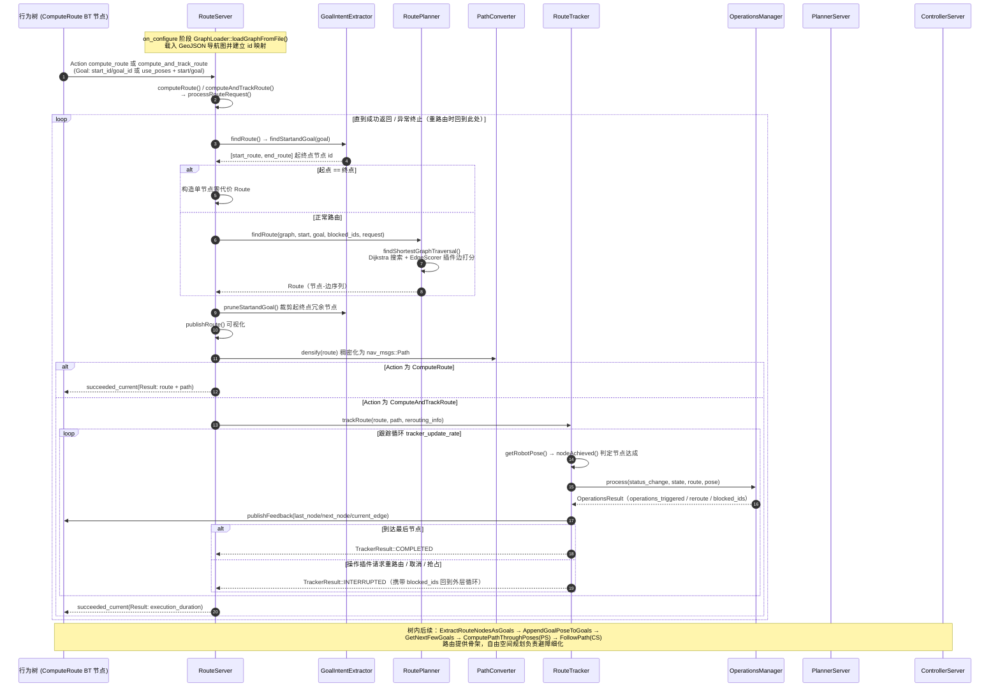

# 端到端时序图：nav2_route 图路由链路（ComputeRoute / ComputeAndTrackRoute）

## 场景描述

在仓库、园区这类大尺度或强约束场景里，用户往往预先在地图上标注了一张**导航图**（节点 + 有向边的 GeoJSON 文件），希望机器人沿"预定义路网"行走，而不是在整张代价地图上自由搜索。用户（或行为树）向 route_server 发送 `compute_route` Action 即可得到一条图上最优路线；发送 `compute_and_track_route` 则在返回路线的同时**持续跟踪执行进度**——逐节点汇报、触发边/节点上挂接的操作插件（开门、调速等），并在边被封锁时自动重路由。典型触发方式是 bt_navigator 装载 navigate_w_routing_global_planning_and_control_w_recovery.xml 树后，用户发出一次普通的 `navigate_to_pose` 请求。本篇基于 Nav2 1.5.0（main 分支）源码核实该链路。

## 全链路时序图

## 分阶段解说

### 阶段一：图加载与服务器就绪

`RouteServer::on_configure()`（nav2_route/src/route_server.cpp，约 40 行起）创建两个 Action 服务器：`compute_route`（回调 `computeRoute()`，约 346 行）与 `compute_and_track_route`（回调 `computeAndTrackRoute()`，约 352 行），并由 `GraphLoader::loadGraphFromFile()`（nav2_route/src/graph_loader.cpp，约 62 行）解析 `graph_filepath` 指定的 GeoJSON 图文件、建立节点 id 到图索引的映射；运行期还可通过 `SetRouteGraph` 服务热替换整张图（`setRouteGraph()`，约 359 行）。两个 Action 回调最终汇入共享模板 `processRouteRequest<ActionT>()`（约 246 行）。

### 阶段二：起终点解析与图搜索

`findRoute()`（route_server.cpp，约 209 行）先由 `GoalIntentExtractor::findStartandGoal()`（nav2_route/src/goal_intent_extractor.cpp，约 94 行）把请求解析成图节点对——`use_poses` 为 false 时直接用 Goal 里的 `start_id`/`goal_id` 查表，为 true 时在图上就近搜索匹配节点；若处于重路由状态则用 `rerouting_start_id` 覆盖起点。随后 `RoutePlanner::findRoute()`（nav2_route/src/route_planner.cpp，约 42 行）经 `findShortestGraphTraversal()`（约 85 行）执行 Dijkstra 图搜索，每条边的代价由一组 EdgeScorer 插件（距离、时间、惩罚、语义等）累计打分，`blocked_ids` 中被封锁的节点/边直接跳过。搜索结果再经 `pruneStartandGoal()`（goal_intent_extractor.cpp，约 216 行）裁掉起终点处"回头路"节点。

### 阶段三：路线输出——ComputeRoute 分支

对 `compute_route` 请求，服务器把 Route 经 `publishRoute()` 发布可视化，再由 `PathConverter::densify()`（nav2_route/src/path_converter.cpp，约 42 行）按固定间距插值成稠密的 nav_msgs::Path，随 Result 一并返回（`populateActionResult()`，route_server.cpp 约 188 行）。行为树拿到的 `route` 与 `path` 端口即来源于此。

### 阶段四：路线跟踪——ComputeAndTrackRoute 分支

对 `compute_and_track_route` 请求，`RouteTracker::trackRoute()`（nav2_route/src/route_tracker.cpp，约 145 行）以 `tracker_update_rate` 循环：每拍取机器人位姿，`nodeAchieved()`（约 58 行）用"进入半径 + 越过节点分界面"的判据推进 `RouteTrackingState`；`OperationsManager::process()`（nav2_route/src/operations_manager.cpp，约 125 行）触发挂在节点/边上的 RouteOperation 插件（如 TriggerEvent 开门、AdjustSpeedLimit 调速、CollisionMonitor 检测边阻塞）；`publishFeedback()`（约 127 行）逐节点上报进度。返回值三分：COMPLETED（到达末节点，Action 成功）、INTERRUPTED（操作插件请求重路由或被取消/抢占——重路由时把 `blocked_ids` 与 `rerouting_start_id` 写入 `rerouting_info`，回到外层 while 重新 `findRoute()`）、EXITED（rclcpp 关闭）。

### 阶段五：与全局规划、控制的衔接

路由本身不驱动底盘。在 navigate_w_routing_global_planning_and_control_w_recovery.xml（nav2_bt_navigator/behavior_trees/）中，`ComputeRoute` BT 节点（nav2_behavior_tree/plugins/action/compute_route_action.cpp）产出 `route` 后，由 `ExtractRouteNodesAsGoals` 把路线节点转为 goals、`AppendGoalPoseToGoals` 追加最终目标，再经 `RemovePassedGoals` + `GetNextFewGoals` 取前 2 个节点交给 `ComputePathThroughPoses`（planner_server）做考虑实时环境的自由空间细化规划，最后 `FollowPath`（controller_server）执行——"路由给骨架、规划给细节、控制给速度"，cmd_vel 链路与单点导航一致。

### 异常口径

路由异常与 Action 错误码一一映射（route_server.cpp 约 295-341 行）：`NoValidRouteCouldBeFound` → NO_VALID_ROUTE、`TimedOut` → TIMEOUT、`RouteTFError` → TF_ERROR、`NoValidGraph` → NO_VALID_GRAPH、`IndeterminantNodesOnGraph` → INDETERMINANT_NODES_ON_GRAPH、`InvalidEdgeScorerUse` → INVALID_EDGE_SCORER_USE、`OperationFailed` → OPERATION_FAILED（仅跟踪分支）。行为树的 `WouldARouteRecoveryHelp` 据此决定是否清图重试。

## 相关章节

- [第 17 章 Route 路线规划](../../17_Route路线规划.md)
- [第 07 章 PlannerServer 与全局规划](../../07_PlannerServer与全局规划.md)
- [第 11 章 行为树与 BTNavigator](../../11_行为树与BTNavigator.md)
- [第 09 章 ControllerServer 与局部控制](../../09_ControllerServer与局部控制.md)
- [第 19 章 Action 与通信机制](../../19_Action与通信机制.md)
