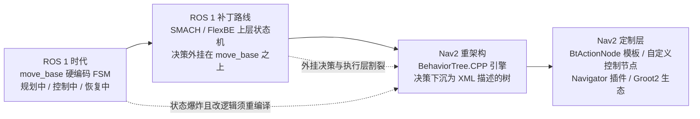

# 导航决策设计演进史：FSM/SMACH → BehaviorTree.CPP

> **本文定位**：只回答"导航决策为什么从状态机走向行为树，以及 Nav2 在 BehaviorTree.CPP 之上定制了什么、为什么定制"。行为树的执行模型、默认树逐层剖析与节点库全表，请回到对应章节（见文末分工声明）。口径：Nav2 1.5.0（main 分支）。

## 演进时间线

## 第一代：move_base 的硬编码状态机——够用，直到不够用

ROS 1 的 move_base 把导航主逻辑写成一台三状态 FSM：规划中、控制中、恢复中，迁移边与恢复序列（清地图→旋转→再清→再转）全部硬编码在 C++ 里。这个设计在"点到点、失败就按固定套路恢复"的场景里工作了十年，但三个结构性缺陷随复杂度上升而放大：**状态爆炸**——每加一种行为，状态与迁移边组合式增长；**恢复全局化**——"恢复中"是一个全局状态，表达不了"规划失败清全局代价地图、控制失败清局部代价地图"这种上下文相关策略；**改逻辑即改代码**——调整恢复顺序都要重新编译。社区的补救是把 SMACH（Python 状态机库）、FlexBE 这类上层任务编排外挂在 move_base 之上，但这只是把状态机搬到了更高一层：决策逻辑与导航执行割裂在两个进程、两种生命周期里，失败语义传不透，组合爆炸依旧。演进的真正出口不是"更好的状态机"，而是换一种对失败与组合更友好的形式化——行为树把"控制流"编码在树结构里，用 tick 语义代替迁移边，恢复逻辑可以就地长在失败点旁边。

## 第二代：Nav2 选择 BehaviorTree.CPP——决策变成一份可加载的 XML

Nav2 重架构时把导航主逻辑整体迁移到行为树，选型是 C++ 生态成熟的 BehaviorTree.CPP（依赖声明见 nav2_behavior_tree/package.xml 的 `<depend>behaviortree_cpp</depend>`，1.5.0 使用其 v4 系列，XML 根标签为 `BTCPP_format="4"`）。nav2_bt_navigator/README.md 把动机浓缩为一句："a Behavior Tree-based implementation of navigation that is intended to allow for flexibility in the navigation task and provide a way to easily specify complex robot behaviors"——灵活性与复杂行为的可表达性，正对 FSM 的两个死穴。同一份 README 还点出第三个动机：BT XML "can also be specified on a per-task basis"，每个导航任务可以指定不同的树，这是状态机时代不可想象的"按单配菜"。

落地的架构痕迹清晰可查：BtNavigator 读入 XML，交给通用的 BehaviorTreeEngine（nav2_behavior_tree/src/behavior_tree_engine.cpp，约 220 行）动态构建并周期 tick；nav2_bt_navigator/behavior_trees/ 下随包提供 15 棵内置树，默认的 navigate_to_pose_w_replanning_and_recovery.xml 只有约 60 行——**60 行 XML 就完整表达了 move_base 时代需要硬编码数百行 C++ 的"边走边重规划 + 分层恢复"逻辑**，这份对比本身就是演进收益的最好证据。代价也随之而来：树的行为由各控制节点的 tick 语义递归决定，学习曲线比"看状态转移图"陡峭得多。

## 第三代：Nav2 的 BT 定制层——为导航领域补齐三类缺口

BehaviorTree.CPP 只是通用引擎，Nav2 在其上做了三类领域定制，每一类都对应一个真实缺口。

**缺口一：BT 的同步 tick 与 ROS 2 异步 Action 的阻抗失配。** BT 节点被以固定周期同步 tick，而规划、控制都是秒级的异步 Action。Nav2 的答案是 `BtActionNode<ActionT>` 模板（nav2_behavior_tree/include/nav2_behavior_tree/bt_action_node.hpp）：自动管理 Action 客户端、非阻塞轮询结果，派生类只需实现少数钩子。nav2_behavior_tree/README.md 把它列为该包提供的第一项能力："A C++ template class for easily integrating ROS2 actions and services into Behavior Trees"。这个模板是 Nav2 约 80 个 BT 节点（端口清单见 nav2_behavior_tree/nav2_tree_nodes.xml，约 580 行）得以薄如适配器的原因。

**缺口二：标准控制节点表达不了导航特有的编排语义。** BehaviorTree.CPP 自带的 Sequence/Fallback 写不出"控制器跟路径的同时按 1 Hz 重规划"与"失败→恢复→重试"的导航惯用法，Nav2 于是自造了一组控制/装饰节点：PipelineSequence（后续子节点 RUNNING 时持续 tick 前置子节点，实现零线程的边走边重规划）、RecoveryNode（失败转恢复再重试）、RoundRobin（多轮恢复轮换动作）、RateController（限频装饰器）等，源码在 nav2_behavior_tree/plugins/ 的 control 与 decorator 子目录。这些节点是 Nav2 对行为树范式最有辨识度的贡献——它们把 move_base 硬编码的恢复策略变成了可重排的积木。

**缺口三：树逻辑复杂化之后，没有可视化就没有可维护性。** Nav2 深度接入了 BehaviorTree.CPP 官方的 Groot 生态：BehaviorTreeEngine 提供 `addGrootMonitoring()`，内部用 `BT::Groot2Publisher` 实时发布树状态供 Groot2 连接观察（behavior_tree_engine.cpp 中的注释："This logger publish status changes using Groot2"）；nav2_behavior_tree/include/nav2_behavior_tree/json_utils.hpp 专门为可视化注册消息类型的 JSON 转换（注释："required when using Groot 2 to visualize the BT"）；nav2_tree_nodes.xml 同时充当 Groot 的节点调色板（文件头注释指引读者参考包内 groot_instructions.md）。**付出的代价**：黑板是无作用域的全局键值空间，端口拼写错误要到运行期才暴露；"BT 节点必须非阻塞"成为所有扩展者必须遵守却容易违反的纪律；而 XML + 插件的双层间接也让"这棵树到底会做什么"的答案分散在配置与代码两处。

## 代价总账

| 演进步 | 得到 | 付出 |
|---|---|---|
| FSM → BT | 组合性、失败点局部恢复、零编译改逻辑 | tick 语义学习成本、行为分散在 XML 与插件两处 |
| 通用 BT.CPP → Nav2 定制层 | 异步 Action 适配、导航惯用法节点、可视化调试 | 黑板无作用域、非阻塞纪律、约 80 节点的认知负担 |

## 与本书章节的分工声明

本文只讲演进动机与定制点的"为什么"，不展开机制细节：

- BtActionServer 执行模型、黑板条目、默认树逐层剖析与节点库四类全表 → [第 11 章](../11_行为树与BTNavigator.md)
- 树上挂载的 Spin/BackUp/Wait 等恢复行为服务器本体 → [第 12 章](../12_Behaviors恢复行为.md)
- 组合模式、模板方法、命令模式在 BT 体系中的系统性盘点 → [第 22 章](../22_设计模式专题.md)

## 源码证据清单

- nav2_bt_navigator/README.md：选择 BT 的动机自述（flexibility、complex behaviors、per-task XML）
- nav2_behavior_tree/README.md：包的三大能力定位（BtActionNode 模板、导航 BT 节点、BehaviorTreeEngine）
- nav2_behavior_tree/package.xml：`<depend>behaviortree_cpp</depend>` 依赖声明
- nav2_behavior_tree/src/behavior_tree_engine.cpp（约 220 行）：`addGrootMonitoring()` 与 `BT::Groot2Publisher`
- nav2_behavior_tree/include/nav2_behavior_tree/json_utils.hpp：Groot2 可视化的 JSON 类型注册注释
- nav2_behavior_tree/nav2_tree_nodes.xml（约 580 行）：全部节点端口清单，文件头注释指向 groot_instructions.md
- nav2_behavior_tree/groot_instructions.md：Groot 使用指引
- nav2_bt_navigator/behavior_trees/navigate_to_pose_w_replanning_and_recovery.xml（约 60 行）：默认树，"60 行 XML 替代硬编码 FSM"的直接物证（同目录共 15 棵内置树）
- nav2_behavior_tree/include/nav2_behavior_tree/bt_action_node.hpp：同步 tick 与异步 Action 的适配模板
