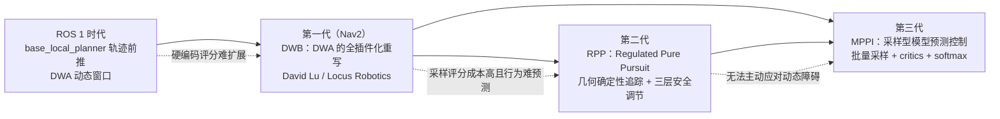

# 局部控制器设计演进史：DWA/DWB → RPP → MPPI

> **本文定位**：只回答"控制器为什么从采样评分走向几何追踪、又走向最优控制"。各控制器的算法细节、参数表与调参实践，请回到对应章节（见文末分工声明）。口径：Nav2 1.5.0（main 分支）。

## 演进时间线

三代之间不是简单替代，而是一条清晰的动机链：**DWB 把"采样评分"做成开放框架 → RPP 发现多数场景根本不需要采样 → MPPI 发现需要采样的场景其实需要的是最优控制**。

## 第一代：DWB——把 DWA 的评分函数拆成插件

ROS 1 的 base_local_planner（trajectory rollout）与 DWA 已经确立了局部控制的基本范式：在速度空间采样一批 (v, w)，前推出候选轨迹，逐条打分取最优。问题不在范式而在实现——评分函数硬编码在算法里，想加一条"别在货架间蛇形"的偏好就得改核心代码，行为调优成了源码考古。

DWB 的出身写在 nav2_dwb_controller/README.md 第一段："the successor to the base local planner and DWA controllers in ROS 1. It was created in ROS 1 by David Lu!! at Locus Robotics as part of the `robot_navigation` project"，随后移植进 Nav2 充当"critic-based controller"。它的演进答案是彻底插件化：轨迹生成器是插件（StandardTrajectoryGenerator 复刻 trajectory rollout，LimitedAccelGenerator 复刻 DWA——README 明说两者分别"similar to"这两位前辈，等于把两代 ROS 1 算法统一成同一框架下的两个配置项）；评分器也是插件，dwb_critics/src 下十余个 critic 源文件（BaseObstacle、PathAlign、GoalDist、PreferForward、Oscillation、Twirling 等）各管一个偏好维度，核心调度层 dwb_core/src/dwb_local_planner.cpp 只有约 400 行。

**付出的代价**：开放性带来参数面爆炸——每个 critic 都有权重与专属参数，组合调优成为玄学；逐条轨迹的串行评分限制了采样密度与预测时域，面对动态障碍只能靠"评分时它已经在代价地图里"的被动方式响应。

## 第二代：RPP——多数机器人不需要采样，只需要好好跟路

DWB 之后的反思是：仓储、服务机器人绝大多数时间在跟一条已经规划好的路径，为一件确定性的事付出采样评分的算力与不确定性，得不偿失。RPP（nav2_regulated_pure_pursuit_controller，主实现约 440 行）回到了六十年代的 Pure Pursuit 几何学——取前视点、算曲率、画圆弧——但用三层"regulation"补上了它的历史欠账。README 交代了命名由来："This variant we call the Regulated Pure Pursuit Algorithm, due to its additional regulation terms on collision and linear speed"，由 Shrijit Singh 与 Steve Macenski 在 Samsung Research 期间开发，并沉淀为论文（Macenski et al., *Regulated Pure Pursuit for Robot Path Tracking*, Autonomous Robots, 2023）。

"为什么要 regulate"在 README 里写得很坦率：原始 Pure Pursuit"has an issue with overshoot and poor handling in particularly high curvature environments"，会冲出路径撞上环境；于是加曲率减速（急弯慢行）、障碍接近减速（贴墙慢行）、按时间前推的碰撞投影。回报是极致的确定性与算力友好——README 实测"well over 1 kHz on a modern intel processor"，行为可以手推验证。

**付出的代价**：README 同样直言不讳——"a pure pursuit controller is that, it 'purely' pursues the path without interest or concern about dynamic obstacles"。它不修改路径、不绕行，遇到动态障碍只能减速停车等重规划；且必须搭配能产出可跟踪路径的规划器（README 点名 Smac 这类运动学可行规划器）。main 分支新增的 DWPP 分支（`use_dynamic_window`，Ohnishi 等人的工作）把速度/加速度约束纳入求解，是这条几何路线的最新延伸。

## 第三代：MPPI——采样评分以最优控制的姿态回归

RPP 解决不了的场景（人流密集、需要轨迹层主动绕行、全向底盘、复杂行为约束）把演进推向第三步。有趣的是，MPPI 表面上"退回"了 DWB 的采样评分范式，实质却完成了两级跳：**评分对象从"离散速度对"变成"未来 N 步的控制序列"，选择方式从"取最高分"变成"按 softmax 权重融合"**——这正是最优控制（采样型 MPC）与启发式评分的分水岭。nav2_mppi_controller/README.md 概括其机理：在上一周期最优解上叠加高斯扰动、按运动模型批量前推、critics 打分后"The output scores are used to set the best control with a soft max function"，迭代收敛的解又作为下一周期的温启动。该实现由 Aleksei Budyakov 创建、Steve Macenski 为 Nav2 适配开发。

DWB 的遗产清晰可见：critics 插件体系原样继承（README："plugin-based critic functions to impact the behavior of the algorithm"），行为定制依然是"加一个 critic"；但评分从逐条轨迹的虚函数调用变成批量张量运算——CMakeLists.txt 中 `find_package(Eigen3 REQUIRED)`，代价与轨迹全部是 Eigen 数组的向量化计算；噪声采样则由 nav2_mppi_controller/src/noise_generator.cpp 中的后台 `std::thread` 流水线预生成。README 实测"50+ Hz on a modest Intel processor (4th gen i5)"。

**付出的代价**：单周期毫秒级算力，嵌入式平台吃紧；调参维度从"权重"扩展到"温度、噪声标准差、批量规模"的概率语义（README 对 `temperature` 的说明——趋近 0 则只认最低代价，过大则"just taking mean of all trajectories without cost consideration"）；核心 Optimizer（nav2_mppi_controller/src/optimizer.cpp，约 730 行）的理解门槛也远高于 RPP 的几何学。

## 代价总账

| 演进步 | 得到 | 付出 |
|---|---|---|
| DWA → DWB | 评分与轨迹生成全插件化，行为可扩展 | 参数面爆炸，采样密度受算力制约 |
| DWB → RPP | 微秒级算力、行为完全可预期 | 放弃动态避障，依赖可行路径 |
| RPP → MPPI | 轨迹层主动绕障、任意非凸行为约束 | 毫秒级算力、概率化调参、实现复杂度 |

## 与本书章节的分工声明

本文只讲演进动机与设计取舍，不展开算法细节：

- ControllerServer 的插件调度、五控制器横向对比与 failure_tolerance 机制 → [第 09 章](../09_ControllerServer与局部控制.md)
- RPP 的三层调节/碰撞投影细节、MPPI 的 Optimizer 主循环/critics 全表/调参 → [第 10 章](../10_MPPI与RPP控制器.md)
- critics 责任链、NoiseGenerator 生产者消费者等模式的系统性盘点 → [第 22 章](../22_设计模式专题.md)

## 源码证据清单

- nav2_dwb_controller/README.md：DWB 身世（"successor to the base local planner and DWA"、David Lu / Locus Robotics）、两个轨迹生成器与 ROS 1 算法的对应关系、critic 插件清单
- nav2_dwb_controller/dwb_core/src/dwb_local_planner.cpp（约 400 行）：插件调度核心
- nav2_dwb_controller/dwb_critics/src/：十余个 critic 源文件
- nav2_regulated_pure_pursuit_controller/README.md："regulated" 命名由来、原始 PP 过冲问题、"purely pursues the path" 的局限自述、1 kHz 实测、RPP 与 DWPP 论文引用
- nav2_regulated_pure_pursuit_controller/src/regulated_pure_pursuit_controller.cpp（约 440 行）：主实现
- nav2_mppi_controller/README.md：MPPI 机理与 softmax 描述、Budyakov/Macenski 作者信息、50+ Hz 实测、temperature 参数语义
- nav2_mppi_controller/src/optimizer.cpp（约 730 行）：采样型 MPC 核心
- nav2_mppi_controller/src/noise_generator.cpp：后台噪声线程
- nav2_mppi_controller/CMakeLists.txt：`find_package(Eigen3 REQUIRED)` 向量化依赖
