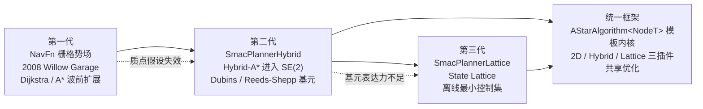

# 全局规划器设计演进史：A*/NavFn → Hybrid-A* → State Lattice → Smac 统一框架

> **本文定位**：只回答"为什么会演进成今天这个样子"。每一代规划器的算法细节、参数表与调参实践，请回到对应章节（见文末分工声明）。口径：Nav2 1.5.0（main 分支）。

## 演进时间线

## 第一代：NavFn——把"最短路"做成十年不坏的基础设施

NavFn 诞生于 2008 年的 Willow Garage（版权头见 nav2_navfn_planner/src/navfn.cpp，约 1035 行），要解决的问题非常朴素：在任意占据栅格地图上，毫秒级算出一条从起点到终点的最短代价路径。它的答案是"导航函数"（navigation function）：从目标出发做 Dijkstra 波前扩展，在整张地图上铺一层势场（`potarr` 势场数组、`POT_HIGH` 未赋值标记，见 nav2_navfn_planner/include/nav2_navfn_planner/navfn.hpp，约 290 行），再从起点沿势场负梯度（`gradx`/`grady` 数组）回溯出路径。源文件头部注释直白地记录了它的身世："Navigation function computation, Uses Dijkstra's method, Modified for Euclidean-distance computation"。所谓 `use_astar` 参数只是把波前扩展换成带启发式的版本（navfn_planner.cpp 中的 `calcNavFnAstar()` 分支），并不是另一个规划器。

**为什么 Nav2 几乎原样移植它**：nav2_navfn_planner/README.md 给出了官方理由——ROS 1 的 `global_planner` 包虽然是 NavFn 的可读性重构，但"lacks in run-time performance and introduces suboptimal behaviors"；而 NavFn"has been extremely stable for about 10 years at the time of porting"。稳定压倒优雅，这是基础设施的选择逻辑。

**付出的代价**：机器人被抽象为质点，(x, y) 状态空间里表达不了朝向、转弯半径与倒车；梯度回溯还有已知伪影——nav2_smac_planner/README.md 毫不客气地写道，其 2D A* 实现没有"the weird artifacts introduced by the gradient wavefront-based 2D A* implementation in the NavFn Planner"。这两个代价，正是后两代演进的全部动机。

## 第二代：Hybrid-A*——当质点假设在类车底盘上破产

第一个撑不住的场景是阿克曼/类车底盘：底盘有最小转弯半径，NavFn 给出的直角折线在物理上不可执行，控制器被迫"边跟边修路"，结果是贴障、抖动甚至死锁。问题的本质是搜索空间错了——必须从 (x, y) 升到 SE(2) 的 (x, y, θ)，节点转移从"移动到邻接栅格"变成"执行一段满足曲率约束的运动基元"。

SmacPlannerHybrid 就是这条路线的 Nav2 实现。nav2_smac_planner/README.md 明确交代了学术源头：实现的是 Dolgov 等人的 *Practical Search Techniques in Path Planning for Autonomous Driving*（DARPA 城市挑战赛的 Hybrid-A*），并在启发式与遍历函数上做了改进，"to increase path quality without needing expensive optimization-based smoothing"。运动基元按 Dubins（只前进）或 Reeds-Shepp（可倒车）模型即时生成——倒车库、三点掉头从此可以被搜索出来，而不是靠恢复行为凑合。

**付出的代价**：状态空间多了一个角度维（默认量化为几十个 bin），节点数与内存成倍增长；为把搜索压回实时预算，不得不配套一整套性能工程——障碍启发式与距离启发式双下界预计算、解析扩展、代价地图下采样器（这些机制在第 08 章展开）。README 的 Metrics 一节记录了这套工程的成果：14 万格地图 72 角度 bin 下 2~20 ms，快于原论文实现。演进的痕迹还留在平滑器上：README 的 Note 坦承早期曾按原论文实现 CG 平滑器，但"failed to consistently provide useful results, took too much compute time, and was deprecated"，最终换成更简单更可靠的梯度平滑——工程上"95% 的时候能用"不等于能用。

## 第三代：State Lattice——当"即时生成的基元"表达不了你的底盘

Hybrid-A* 的基元由 `minimum_turning_radius` 参数即时生成，天然只会"画曲率受限的弧线"。但差速底盘会原地转向，全向底盘会斜移——这些能力在 Hybrid 的基元语言里根本写不出来，于是可行的动作被白白浪费。State Lattice 的回答是：不要现场编基元，把底盘的"最小控制集"（minimum control set）离线算好，搜索时只从这本"动作字典"里取。

SmacPlannerLattice 的学术脉络同样写在 nav2_smac_planner/README.md 里：参考 Pivtoraiko 与 Kelly 的 State Lattice 系列工作（含 *Generating Near Minimal Spanning Control Sets for Constrained Motion Planning in Discrete State Spaces*），仓库还随包提供了 Ackermann、差速、全向、足式的控制集与生成工具（nav2_smac_planner/lattice_primitives/ 目录）。核心实现在 nav2_smac_planner/src/node_lattice.cpp（约 520 行）。

**付出的代价**：表达力换来了离线依赖——lattice 文件必须与代价地图分辨率、底盘能力严格匹配，分辨率一变就要重新生成；参数面也更宽（如 `rotation_penalty` 专门压制"贪小便宜的原地转"）；README 的调参一节直言，由于可用任意自定义控制集，"this planner may require more tuning to get good behavior"。灵活性的账单永远由使用者支付。

## 统一框架：Smac 家族——三个规划器，一份内核

到这里出现了一个工程问题：2D A*、Hybrid-A*、State Lattice 如果各写一份，主循环、碰撞检查、启发式、平滑器就要维护三遍，任何优化都要抄三处。Smac（由 Steve Macenski 在 Samsung Research 期间构建，见 README 的 Introduction）给出的答案是模板化：`AStarAlgorithm<NodeT>` 固定 A* 骨架（nav2_smac_planner/include/nav2_smac_planner/a_star.hpp，约 330 行，配 a_star_impl.hpp 的模板实现），"什么是邻居、启发式怎么算、状态如何编码"全部委托给 Node2D / NodeHybrid / NodeLattice 三种节点策略。README 的 Design 一节把意图讲得很清楚："a standard A* implementation that can be used to traverse any type of graph as long as a node template can be created for it"。

统一的直接红利是**优化共享**：README 提到 Lattice 复用了 Hybrid-A* 的解析扩展与改进启发式，"largely matching those of Hybrid-A* to allow them to share these optimized implementations to drive search towards the goal, faster"；下采样器、碰撞检查器、平滑器同样三家通用。间接红利是**演进开放**：新增一种搜索（README 举例 3D 栅格、路由搜索）只需写一个节点模板。

**付出的代价**：模板泛型 + 编译期分支（`if constexpr`）的抽象门槛显著高于三份朴素实现，阅读 a_star_impl.hpp 需要同时理解 A* 与 C++ 模板机制；这也是本书把它单列一章精讲的原因。

## 代价总账

| 演进步 | 得到 | 付出 |
|---|---|---|
| NavFn → Hybrid-A* | 运动学可行路径、可搜索的倒车 | 状态空间 ×角度维、启发式与性能工程复杂度 |
| Hybrid-A* → Lattice | 精确表达底盘全部能力 | 离线基元生成、与分辨率耦合、更宽参数面 |
| 三份实现 → 模板统一 | 优化共享、扩展开放 | 泛型抽象的理解与维护门槛 |

## 与本书章节的分工声明

本文只讲演进动机与设计取舍，不展开算法细节：

- PlannerServer 的插件加载、Action 接口与 NavFn/Theta* 的使用细节 → [第 07 章](../07_PlannerServer与全局规划.md)
- Smac 三插件的内核结构、双启发式、解析扩展、性能工程与调参 → [第 08 章](../08_SmacPlanner.md)
- `AStarAlgorithm<NodeT>` 背后的模板方法/策略模式系统性盘点 → [第 22 章](../22_设计模式专题.md)
- 被 Smac 淘汰的 CG 平滑器去了哪里（Smoother Server 体系） → [第 15 章](../15_Smoother路径平滑.md)

## 源码证据清单

- nav2_navfn_planner/src/navfn.cpp（约 1035 行）：2008 Willow Garage 版权头；"Uses Dijkstra's method" 注释
- nav2_navfn_planner/include/nav2_navfn_planner/navfn.hpp（约 290 行）：`potarr` 势场、`gradx`/`grady` 梯度回溯
- nav2_navfn_planner/README.md：移植决策（global_planner "lacks in run-time performance"；NavFn "extremely stable for about 10 years"）
- nav2_smac_planner/README.md：Dolgov/Pivtoraiko 论文脉络、NavFn 伪影批评、CG 平滑器废弃记录、Metrics 数据、Design 一节的模板化意图
- nav2_smac_planner/include/nav2_smac_planner/a_star.hpp（约 330 行）与 a_star_impl.hpp：模板内核
- nav2_smac_planner/src/node_hybrid.cpp（约 540 行）、node_lattice.cpp（约 520 行）：两代节点策略
- nav2_smac_planner/lattice_primitives/：离线控制集与生成工具
