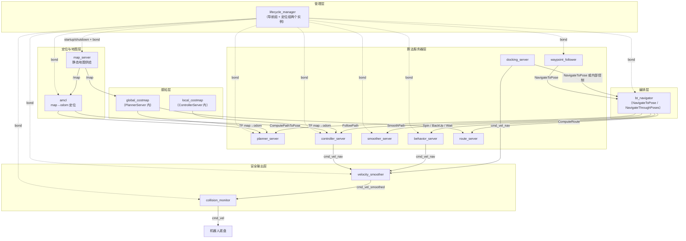

# 架构依赖图（Architecture Graph）

> 口径：Nav2 1.5.0（main 分支）、C++20。本图回答一个问题：**Nav2 运行时由哪些组件构成、谁管理谁、谁给谁提供数据**——从 lifecycle_manager 的统一编排，到各服务器的分层依赖，再到 BT 对算法服务器的任务编排。
>
> 配套图谱：[Knowledge.md](Knowledge.md)（知识依赖图）、[Business.md](Business.md)（业务链路图）、[Plugin.md](Plugin.md)（插件族谱）。返回导航枢纽：[Index.md](../Index.md)。

## 架构分层全景

箭头语义：实线 `-->` 为"管理/调用/数据依赖"，虚线 `-.->` 为 lifecycle_manager 的生命周期编排与 bond 监活。

## 节点 → 章节链接表

| 层 | 组件 | 职责一句话 | 对应章节 |
|---|---|---|---|
| 管理层 | lifecycle_manager | 按序拉起/关停全部受管节点，bond 监活，"一个倒下全体放倒 + 整体重启" | [05_生命周期管理.md](../05_生命周期管理.md) |
| 定位与地图层 | map_server | 加载 map.yaml + 图片为 OccupancyGrid，常驻供图 | [14_MapServer.md](../14_MapServer.md) |
| 定位与地图层 | amcl | 粒子滤波定位，发布 map→odom 变换 | [13_AMCL定位.md](../13_AMCL定位.md) |
| 感知层 | global_costmap / local_costmap | 分层代价地图，规划与控制的公共输入（分别内嵌于规划/控制服务器进程） | [06_Costmap2D.md](../06_Costmap2D.md) |
| 算法服务器层 | planner_server | 全局规划宿主，加载 GlobalPlanner 插件 | [07_PlannerServer与全局规划.md](../07_PlannerServer与全局规划.md)、[08_SmacPlanner.md](../08_SmacPlanner.md) |
| 算法服务器层 | controller_server | 高频控制循环宿主，加载 Controller/GoalChecker/ProgressChecker 插件 | [09_ControllerServer与局部控制.md](../09_ControllerServer与局部控制.md)、[10_MPPI与RPP控制器.md](../10_MPPI与RPP控制器.md) |
| 算法服务器层 | smoother_server | 路径平滑宿主，加载 Smoother 插件 | [15_Smoother路径平滑.md](../15_Smoother路径平滑.md) |
| 算法服务器层 | behavior_server | 恢复行为宿主（Spin/BackUp/Wait 等），与控制器并联输出 cmd_vel_nav | [12_Behaviors恢复行为.md](../12_Behaviors恢复行为.md) |
| 算法服务器层 | route_server | 预定义路网上的图搜索与实时跟踪 | [17_Route路线规划.md](../17_Route路线规划.md) |
| 算法服务器层 | docking_server | 最后一米高精度对接状态机 | [18_Docking靠泊.md](../18_Docking靠泊.md) |
| 算法服务器层 | waypoint_follower | 航点巡航，逐点调用 NavigateToPose | [19_Action与通信机制.md](../19_Action与通信机制.md) |
| 编排层 | bt_navigator | 加载 Navigator 插件，用行为树 XML 编排各算法服务器 | [11_行为树与BTNavigator.md](../11_行为树与BTNavigator.md) |
| 安全输出层 | velocity_smoother | 平滑加减速，输出 cmd_vel_smoothed | [16_CollisionMonitor与VelocitySmoother.md](../16_CollisionMonitor与VelocitySmoother.md) |
| 安全输出层 | collision_monitor | 直连原始传感器的最终安全闸，输出 cmd_vel | [16_CollisionMonitor与VelocitySmoother.md](../16_CollisionMonitor与VelocitySmoother.md) |
| — | 机器人底盘 | cmd_vel 的最终消费者（底盘驱动/仿真器） | [01_整体架构.md](../01_整体架构.md) |

## 三个架构要点

1. **管理面与数据面分离**：lifecycle_manager 只做启停编排与 bond 监活（虚线），不出现在任何一条导航数据链路（实线）上——它挂了不影响正在执行的导航，见 [05_生命周期管理.md](../05_生命周期管理.md) 5.B 设计权衡。
2. **服务器之间不横向调用**：planner/controller/smoother/behavior 彼此不知道对方存在，全部组合逻辑上移到 bt_navigator 的 XML；这是"细粒度 Action + BT 编排"的架构落点，见 [11_行为树与BTNavigator.md](../11_行为树与BTNavigator.md) 与 [19_Action与通信机制.md](../19_Action与通信机制.md) 19.B。
3. **输出通道唯一且被串联把守**：所有速度来源（控制器、恢复行为、靠泊）汇聚到 cmd_vel_nav，经 velocity_smoother → collision_monitor 两道闸后才成为 cmd_vel，业务细节见 [Business.md](Business.md)。

> 完整启动清单与 TF 数据流见 [01_整体架构.md](../01_整体架构.md)（1.3、1.6 节）；进程/线程视角的同一张图见 [20_线程模型.md](../20_线程模型.md)。
