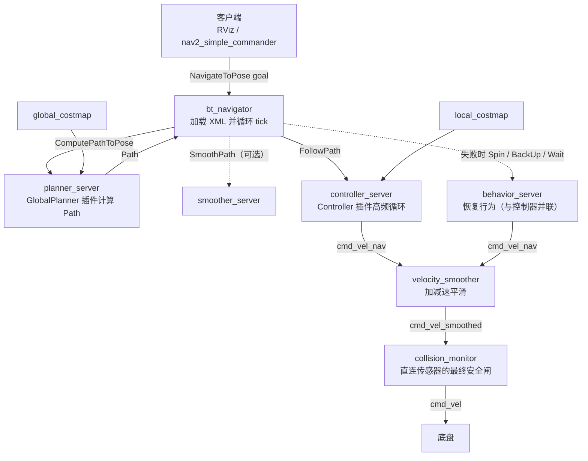
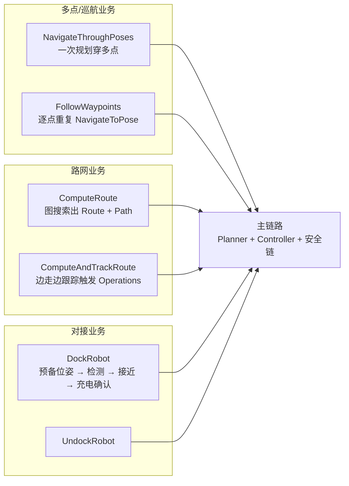

# 业务链路图（Business Flow Graph）

> 口径：Nav2 1.5.0（main 分支）、C++20。本图回答一个问题：**一次导航业务从请求到轮子转动，数据依次流经哪些环节**——以 NavigateToPose 主链路为骨干，覆盖速度指令三级安全链与四条业务变体。
>
> 配套图谱：[Knowledge.md](Knowledge.md)（知识依赖图）、[Architecture.md](Architecture.md)（架构依赖图）、[Plugin.md](Plugin.md)（插件族谱）。返回导航枢纽：[Index.md](../Index.md)。

## 主链路：NavigateToPose → Planner → Controller → cmd_vel

两条关键口径：

- **速度指令三级安全链**：`cmd_vel_nav`（控制器/恢复行为原始输出）→ velocity_smoother 平滑 → `cmd_vel_smoothed` → collision_monitor 安全裁决 → `cmd_vel`（底盘唯一入口）。任何新的速度来源都应汇入 `cmd_vel_nav` 而不是直写 `cmd_vel`，详见 [16_CollisionMonitor与VelocitySmoother.md](../16_CollisionMonitor与VelocitySmoother.md)。
- **重规划与恢复是链路的一部分**：默认行为树中 ComputePathToPose 周期性重规划、失败时进入恢复子树（清 Costmap → Spin → Wait → BackUp 轮转），见 [11_行为树与BTNavigator.md](../11_行为树与BTNavigator.md) 11.4 节与 [12_Behaviors恢复行为.md](../12_Behaviors恢复行为.md)。

## 业务变体链路

所有变体最终都收敛到主链路的"规划 + 控制 + 三级安全链"，差别只在**任务分解方式**（一次多点 vs 逐点、自由空间 vs 路网、粗导航 vs 精对接）。

## 链路 → 时序图与章节链接表

| 业务链路 | 端到端时序图（逐消息级） | 主讲章节 |
|---|---|---|
| NavigateToPose 单点导航 | [Assets/sequence/NavigateToPose.md](../Assets/sequence/NavigateToPose.md) | [11_行为树与BTNavigator.md](../11_行为树与BTNavigator.md)、[01_整体架构.md](../01_整体架构.md)（1.5 节） |
| NavigateThroughPoses / FollowWaypoints | [Assets/sequence/NavigateThroughPoses与FollowWaypoints.md](../Assets/sequence/NavigateThroughPoses与FollowWaypoints.md) | [11_行为树与BTNavigator.md](../11_行为树与BTNavigator.md)、[19_Action与通信机制.md](../19_Action与通信机制.md) |
| ComputeRoute / ComputeAndTrackRoute 图路由 | [Assets/sequence/Route图路由.md](../Assets/sequence/Route图路由.md) | [17_Route路线规划.md](../17_Route路线规划.md) |
| DockRobot / UndockRobot 靠泊 | [Assets/sequence/Docking靠泊.md](../Assets/sequence/Docking靠泊.md) | [18_Docking靠泊.md](../18_Docking靠泊.md) |
| Costmap 更新循环（支撑所有链路的感知心跳） | [Assets/sequence/Costmap更新循环.md](../Assets/sequence/Costmap更新循环.md) | [06_Costmap2D.md](../06_Costmap2D.md) |
| 全局规划环节 | —（见 NavigateToPose 时序图规划段） | [07_PlannerServer与全局规划.md](../07_PlannerServer与全局规划.md)、[08_SmacPlanner.md](../08_SmacPlanner.md) |
| 局部控制环节 | —（见 NavigateToPose 时序图控制段） | [09_ControllerServer与局部控制.md](../09_ControllerServer与局部控制.md)、[10_MPPI与RPP控制器.md](../10_MPPI与RPP控制器.md) |
| 路径平滑环节 | —（可选环节） | [15_Smoother路径平滑.md](../15_Smoother路径平滑.md) |
| 恢复行为环节 | —（失败分支） | [12_Behaviors恢复行为.md](../12_Behaviors恢复行为.md) |
| 速度三级安全链 | —（所有链路的公共出口） | [16_CollisionMonitor与VelocitySmoother.md](../16_CollisionMonitor与VelocitySmoother.md) |

## 排障时怎么用这张图

沿链路**从后往前**定位：底盘不动 → 看 `cmd_vel` 是否有值 → 无则看 collision_monitor 是否处于 stop 区（[16 章](../16_CollisionMonitor与VelocitySmoother.md)）→ 再看 `cmd_vel_smoothed` / `cmd_vel_nav` 是否有值 → 无则看 FollowPath 是否在跑（[09 章](../09_ControllerServer与局部控制.md)）→ 再看 ComputePathToPose 是否成功（[07 章](../07_PlannerServer与全局规划.md)）→ 最后看 BT 的 error_code 与当前 tick 到哪个节点（[11 章](../11_行为树与BTNavigator.md)）。每层 Action 的 feedback 与 error_code 是分层定位的一手证据，见 [19_Action与通信机制.md](../19_Action与通信机制.md) 19.B。
