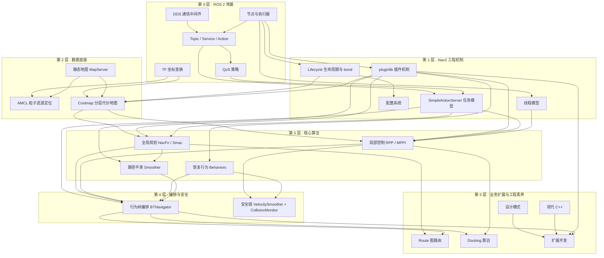

# 知识依赖图（Knowledge Graph）

> 口径：Nav2 1.5.0（main 分支）、C++20。本图回答一个问题：**学 Nav2 应该按什么顺序补哪些知识**——箭头方向为"前置 → 后继"，学习任一节点前，先确认其入边节点已掌握。
>
> 配套图谱：[Architecture.md](Architecture.md)（架构依赖图）、[Business.md](Business.md)（业务链路图）、[Plugin.md](Plugin.md)（插件族谱）。返回导航枢纽：[Index.md](../Index.md)。

## 全景依赖图

## 节点 → 章节链接表

| 层 | 节点 | 对应章节 | 前置节点 |
|---|---|---|---|
| L0 | DDS 通信中间件 | [19_Action与通信机制.md](../19_Action与通信机制.md)、[Interview/ROS2基础.md](../Interview/ROS2基础.md) | 无（起点） |
| L0 | 节点与执行器 | [20_线程模型.md](../20_线程模型.md)、[Interview/ROS2基础.md](../Interview/ROS2基础.md) | 无（起点） |
| L0 | Topic / Service / Action | [19_Action与通信机制.md](../19_Action与通信机制.md) | DDS、节点与执行器 |
| L0 | QoS 策略 | [19_Action与通信机制.md](../19_Action与通信机制.md) | Topic / Service / Action |
| L0 | TF 坐标变换 | [01_整体架构.md](../01_整体架构.md)（1.6 节）、[13_AMCL定位.md](../13_AMCL定位.md) | 无（起点） |
| L1 | Lifecycle 生命周期与 bond | [05_生命周期管理.md](../05_生命周期管理.md)、[CheatSheet/Lifecycle.md](../CheatSheet/Lifecycle.md) | 节点与执行器 |
| L1 | SimpleActionServer 任务模型 | [19_Action与通信机制.md](../19_Action与通信机制.md)、[CheatSheet/Action.md](../CheatSheet/Action.md) | Topic / Service / Action、QoS |
| L1 | pluginlib 插件机制 | [04_nav2_core插件接口.md](../04_nav2_core插件接口.md)、[CheatSheet/Plugin.md](../CheatSheet/Plugin.md) | 节点与执行器 |
| L1 | 线程模型 | [20_线程模型.md](../20_线程模型.md) | 节点与执行器 |
| L1 | 配置系统 | [21_配置系统.md](../21_配置系统.md) | Lifecycle 生命周期 |
| L2 | 静态地图 MapServer | [14_MapServer.md](../14_MapServer.md) | Lifecycle 生命周期 |
| L2 | AMCL 粒子滤波定位 | [13_AMCL定位.md](../13_AMCL定位.md) | TF、静态地图 |
| L2 | Costmap 分层代价地图 | [06_Costmap2D.md](../06_Costmap2D.md)、[CheatSheet/Costmap.md](../CheatSheet/Costmap.md) | Lifecycle、TF、静态地图、插件机制 |
| L3 | 全局规划 NavFn / Smac | [07_PlannerServer与全局规划.md](../07_PlannerServer与全局规划.md)、[08_SmacPlanner.md](../08_SmacPlanner.md) | Costmap、插件机制、Action 任务模型 |
| L3 | 局部控制 RPP / MPPI | [09_ControllerServer与局部控制.md](../09_ControllerServer与局部控制.md)、[10_MPPI与RPP控制器.md](../10_MPPI与RPP控制器.md) | Costmap、插件机制、Action 任务模型、线程模型 |
| L3 | 路径平滑 Smoother | [15_Smoother路径平滑.md](../15_Smoother路径平滑.md) | 全局规划、插件机制 |
| L3 | 恢复行为 Behaviors | [12_Behaviors恢复行为.md](../12_Behaviors恢复行为.md) | 插件机制 |
| L4 | 行为树编排 BTNavigator | [11_行为树与BTNavigator.md](../11_行为树与BTNavigator.md) | Action 任务模型、全局规划、局部控制、恢复行为、路径平滑 |
| L4 | 安全链 VelocitySmoother + CollisionMonitor | [16_CollisionMonitor与VelocitySmoother.md](../16_CollisionMonitor与VelocitySmoother.md) | 局部控制、恢复行为 |
| L5 | Route 图路由 | [17_Route路线规划.md](../17_Route路线规划.md) | 全局规划、行为树编排 |
| L5 | Docking 靠泊 | [18_Docking靠泊.md](../18_Docking靠泊.md) | 行为树编排、局部控制 |
| L5 | 设计模式 | [22_设计模式专题.md](../22_设计模式专题.md) | 可随时穿插阅读 |
| L5 | 现代 C++ | [23_现代C++专题.md](../23_现代C++专题.md) | 可随时穿插阅读 |
| L5 | 扩展开发 | [24_扩展开发指南.md](../24_扩展开发指南.md) | 插件机制、行为树编排、设计模式、现代 C++ |

## 三条最短学习路径

按依赖图收缩出三条常用"关键路径"（节点按依赖顺序排列）：

1. **只想看懂一次导航**：节点与执行器 → Topic/Service/Action → SimpleActionServer → 行为树编排 → 全局规划 → 局部控制（对应章节 [19](../19_Action与通信机制.md) → [11](../11_行为树与BTNavigator.md) → [07](../07_PlannerServer与全局规划.md) → [09](../09_ControllerServer与局部控制.md)）。
2. **只想调好参数**：Lifecycle → 配置系统 → Costmap → 局部控制 → 安全链（对应章节 [05](../05_生命周期管理.md) → [21](../21_配置系统.md) → [06](../06_Costmap2D.md) → [09](../09_ControllerServer与局部控制.md)/[10](../10_MPPI与RPP控制器.md) → [16](../16_CollisionMonitor与VelocitySmoother.md)）。
3. **只想写一个插件**：pluginlib 插件机制 → nav2_core 接口 → 目标域章节 → 扩展开发（对应章节 [04](../04_nav2_core插件接口.md) → 所在域章节 → [24](../24_扩展开发指南.md)，配合 [Examples](../Examples/PlannerPlugin.md) 动手）。

> 概览类章节（[00](../00_项目概览.md)、[02](../02_目录设计.md)、[03](../03_模块总览.md)）与收官章（[25_学习路线图.md](../25_学习路线图.md)）不依赖任何节点，可在任意阶段阅读；[01_整体架构.md](../01_整体架构.md) 建议在 L0 完成后尽早读，为后续所有节点提供全景锚点。
