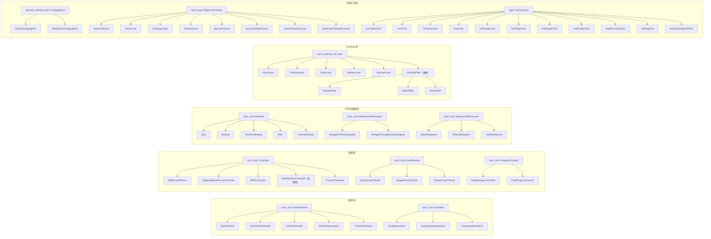

# 插件族谱（Plugin Family Tree）

> 口径：Nav2 1.5.0（main 分支）、C++20。本图回答一个问题：**每个插件接口下有哪些官方实现、各自在哪一章讲**。接口以 nav2_core 为主，附带 Costmap Layer、ChargingDock、Route、MPPI Critic 等相邻插件族。实现类清单以 [ClassIndex.md](../ClassIndex.md) 与源码为准。
>
> 配套图谱：[Knowledge.md](Knowledge.md)（知识依赖图）、[Architecture.md](Architecture.md)（架构依赖图）、[Business.md](Business.md)（业务链路图）。返回导航枢纽：[Index.md](../Index.md)。

## 族谱总图

## 接口 → 实现 → 章节链接表

### nav2_core 接口（接口定义统一见 [04_nav2_core插件接口.md](../04_nav2_core插件接口.md)）

| 接口 | 宿主服务器 | 官方实现 | 实现所在包 | 主讲章节 |
|---|---|---|---|---|
| `GlobalPlanner` | planner_server | NavfnPlanner / ThetaStarPlanner | nav2_navfn_planner / nav2_theta_star_planner | [07_PlannerServer与全局规划.md](../07_PlannerServer与全局规划.md) |
| `GlobalPlanner` | planner_server | SmacPlannerHybrid / SmacPlanner2D / SmacPlannerLattice | nav2_smac_planner | [08_SmacPlanner.md](../08_SmacPlanner.md) |
| `Controller` | controller_server | DWBLocalPlanner / GracefulController | nav2_dwb_controller / nav2_graceful_controller | [09_ControllerServer与局部控制.md](../09_ControllerServer与局部控制.md) |
| `Controller` | controller_server | RegulatedPurePursuitController / MPPIController / RotationShimController | nav2_regulated_pure_pursuit_controller / nav2_mppi_controller / nav2_rotation_shim_controller | [10_MPPI与RPP控制器.md](../10_MPPI与RPP控制器.md) |
| `GoalChecker` | controller_server | SimpleGoalChecker / StoppedGoalChecker / PositionGoalChecker | nav2_controller | [09_ControllerServer与局部控制.md](../09_ControllerServer与局部控制.md) |
| `ProgressChecker` | controller_server | SimpleProgressChecker / PoseProgressChecker | nav2_controller | [09_ControllerServer与局部控制.md](../09_ControllerServer与局部控制.md) |
| `Smoother` | smoother_server | SimpleSmoother / SavitzkyGolaySmoother | nav2_smoother | [15_Smoother路径平滑.md](../15_Smoother路径平滑.md) |
| `Smoother` | smoother_server | ConstrainedSmoother | nav2_constrained_smoother | [15_Smoother路径平滑.md](../15_Smoother路径平滑.md) |
| `Behavior` | behavior_server | Spin / BackUp / DriveOnHeading / Wait / AssistedTeleop | nav2_behaviors | [12_Behaviors恢复行为.md](../12_Behaviors恢复行为.md) |
| `BehaviorTreeNavigator<ActionT>` | bt_navigator | NavigateToPoseNavigator / NavigateThroughPosesNavigator | nav2_bt_navigator | [11_行为树与BTNavigator.md](../11_行为树与BTNavigator.md) |
| `WaypointTaskExecutor` | waypoint_follower | WaitAtWaypoint / PhotoAtWaypoint / InputAtWaypoint | nav2_waypoint_follower | [19_Action与通信机制.md](../19_Action与通信机制.md) |

### 相邻插件族（接口不在 nav2_core，但同为 pluginlib 体系）

| 接口 | 宿主 | 官方实现 | 主讲章节 |
|---|---|---|---|
| `nav2_costmap_2d::Layer` | Costmap2DROS（LayeredCostmap） | StaticLayer / ObstacleLayer / VoxelLayer / InflationLayer / DenoiseLayer | [06_Costmap2D.md](../06_Costmap2D.md)、[Examples/CostmapLayer.md](../Examples/CostmapLayer.md) |
| `CostmapFilter`（Layer 子族） | Costmap2DROS | KeepoutFilter / SpeedFilter / BinaryFilter | [06_Costmap2D.md](../06_Costmap2D.md)、[14_MapServer.md](../14_MapServer.md)（过滤信息服务） |
| `opennav_docking_core::ChargingDock` | docking_server | SimpleChargingDock / SimpleNonChargingDock | [18_Docking靠泊.md](../18_Docking靠泊.md) |
| `nav2_route::EdgeCostFunction` | route_server（RoutePlanner） | DistanceScorer / TimeScorer / CostmapScorer / PenaltyScorer / SemanticScorer / DynamicEdgesScorer / GoalOrientationScorer / StartPoseOrientationScorer | [17_Route路线规划.md](../17_Route路线规划.md) |
| `nav2_route::RouteOperation` | route_server（RouteTracker） | AdjustSpeedLimit / CollisionMonitor（路由版）/ ReroutingService / TimeMarker / TriggerEvent | [17_Route路线规划.md](../17_Route路线规划.md) |
| `nav2_route::GraphFileLoader` / `GraphFileSaver` | route_server | GeoJsonGraphFileLoader / GeoJsonGraphFileSaver | [17_Route路线规划.md](../17_Route路线规划.md) |
| `mppi::CriticFunction` | MPPIController（CriticManager） | Constraint / Cost / Obstacles / Goal / GoalAngle / PathAlign / PathAngle / PathFollow / PreferForward / Twirling / VelocityDeadband 共 11 个 Critic | [10_MPPI与RPP控制器.md](../10_MPPI与RPP控制器.md) |
| 行为树节点（BT 插件） | bt_navigator（BehaviorTree.CPP 工厂） | 数十个动作/条件/控制/装饰节点（清单见 nav2_behavior_tree/nav2_tree_nodes.xml） | [11_行为树与BTNavigator.md](../11_行为树与BTNavigator.md) |

## 想自己加入这棵族谱？

四步曲（继承接口 → 导出宏 → 插件描述 XML → YAML 挂载）见 [24_扩展开发指南.md](../24_扩展开发指南.md)；各接口速查卡见 [CheatSheet/Plugin.md](../CheatSheet/Plugin.md)；可直接照抄的完整样例：[Examples/PlannerPlugin.md](../Examples/PlannerPlugin.md)、[Examples/ControllerPlugin.md](../Examples/ControllerPlugin.md)、[Examples/CostmapLayer.md](../Examples/CostmapLayer.md)。各插件族的历史演进脉络见 [Evolution/Planner.md](../Evolution/Planner.md)、[Evolution/Controller.md](../Evolution/Controller.md)、[Evolution/BehaviorTree.md](../Evolution/BehaviorTree.md)。
